# 你为 QTP/UFT 必须学习 VBScript 第一部分

## 即将上线！

Jones 先生计划提供免费逐步演示视频，引导人们从 A 到 Z 学习 QTP/UFT 和/或 Selenium 的概念。这些材料将教授/培训个人语言基础、QTP/UFT 和/或 Selenium 基础，以及这些语言/这些工具的高级概念。所有的视频和网络研讨会将都面向初学者以及中级自动化工程师。

## 订阅接收

1. **30 天内成为 QTP/UFT 高手的 3 个可操作策略**

[`tinyurl.com/3-Tips-For-QTP-UFT`](http://tinyurl.com/3-Tips-For-QTP-UFT)

2. **30 天内成为 Selenium 高手的 3 个可操作策略**

[`tinyurl.com/3-Tips-For-Selenium`](http://tinyurl.com/3-Tips-For-Selenium)

3. **免费视频与网络研讨会通知**

[`tinyurl.com/Free-QTP-UFT-Selenium`](http://tinyurl.com/Free-QTP-UFT-Selenium)

## Rex Jones 的联系信息

邮箱地址：Rex.Jones@Test4Success.org

LinkedIn：[`www.linkedin.com/in/rexjones34`](https://www.linkedin.com/in/rexjones34)

Twitter: @RexJonesII

Skype: rex.jones34

# 第 7 章 创建和销毁对象

## 创建对象

## 属性与方法

### 多重引用

### 使用构造函数

## 销毁对象

# 结论

# 参考文献

# 订阅

# 前言

我必须承认，为这本关于 QTP/UFT 的书编写这本书是一项挑战。这种挑战源于互联网上信息的无限获取。书中的所有信息都可以散落在各个搜索引擎、博客等地方。然而，如果你正在寻找一个资源汇总的资源，那么这本书正适合你。

## 目标读者

目标读者是初级和中级自动化工程师。初学者是刚接触 QTP/UFT 的人，需要学习比 VBScript 基础更深入的知识。中级自动化工程师是了解 `VBScript` 但希望刷新编程技能的人。他们不需要预先了解 `VBScript` 或编程概念。然而，关于 QTP/UFT 的一个常见误区是开发技能并非必要。事实是，开发技能是非常必要的。

## 为什么要学习 VBScript？

你能想象去到一个外国国家，在不学习当地语言的情况下尝试与当地人交流吗？这就像在不学习 `VBScript` 的情况下与 QTP/UFT 交流一样。本书的目的是帮助自动化工程师理解，如果没有强大的 `VBScript` 基础，QTP/UFT 就无法完全优化。大多数 QTP/UFT 书籍和培训课程犯的错误是没有提供关于 `VBScript` 编程语言的可靠信息。这些书籍和课程仅关注 QTP/UFT，导致自动化工程师在自动化项目上挣扎。自动化是应用程序测试的未来。利用这个机会学习 `VBScript`吧。

# 关于作者

Rex Allen Jones II 是一位对分享测试知识充满热情的 QA/软件测试员。自 2005 年 2 月以来，他一直在观看网络研讨会、参加座会议并测试应用程序。Jones 先生于 1999 年 6 月毕业于 DeVry 大学，获得计算机信息系统（CIS）学士学位。

目前，Rex 是 Dallas / Fort Worth Mercury 用户组 (DFWMUG) 的顾问和董事会成员，同时是 Dallas / Fort Worth Quality 保证协会 (DFWQAA) 的活跃成员。除了用户组身份外，他还是认证软件测试工程师 (CSTE) 并拥有测试管理方法 (TMap) 认证。

Jones 先生对功能自动化测试感兴趣的人的建议是学习编程语言。这一建议使他编写了两本书《（第一部分和第二部分）为了 QTP/UFT 你必须学习 VBScript》，这两书针对 `VBScript`，而它是 Unified Functional Testing (UFT，原名为 Quick Test Professional，QTP) 的编程语言。此外，还有两本即将出版的书籍针对 Java（Selenium 的编程语言之一）。

# 关于编辑

当 Samantha Mann 没有在通过建设性的编辑标记和注释改进文档内容时，她正在德克萨斯州达拉斯作为一名专业人士享受生活。Samantha 是研究和设计领域的用户体验专家，担任信息技术顾问。在工作之外，她的爱好包括典型的极客式乐趣：自由编辑、阅读、写作以及和她的比特犬一起狂看 Netflix。

与 Samantha 联系：

Samantha.danae.mann@gmail.com

https://www.linkedin.com/pub/samantha-mann/84/9b7/100

我要感谢我的妻子 Tiffany、孩子们 Olivia Rexe’ 和 Rex III、家人、朋友以及许多提供鼓励的人。写这本书花费了大量时间，你们的支持帮助了这本书得以向前推进。

感谢，

Rex Allen Jones II

# 第 1 章 VBScript 简介

## 概述

VBScript 的全称是 Microsoft Visual Basic Scripting Edition 语言。它是 Visual Basic (VB) 和 Visual Basic for Applications (VBA) 系列编程语言的简化版本。VBScript 的语法基于 Visual Basic 的语法。语法是一组规则，决定了语言如何被浏览器或服务器编写和解释。VBScript 的大部分功能都取自 Visual Basic。控制流、操作符和过程等功能在 Visual Basic 系列中是可以接受的。

Visual Basic 是一种完整的编程语言，而 VBScript 是支持脚本的精简版本。处理是完整编程语言与脚本语言之间的主要区别。脚本语言在每次运行时都必须重新处理，而完整的编程语言运行速度更快，因为它只被处理一次。

VBScript 是为一个可以解释和自动化任务的运行时环境编写的。它使用组件对象模型 (COM) 来访问其运行环境中的元素。软件应用程序、浏览器中的网页、操作系统 (OS) 的外壳以及嵌入式系统都是可以自动化的环境示例。VBScript 可用于以下实例：

* Windows 管理任务
* HTML 页面（作为客户端脚本语言）
* 服务端脚本语言，在带有 Internet Information Services (IIS) 服务器的原生应用程序提供程序 (ASP) 页面中
* 嵌入式应用程序
* Quick Test Professional (QTP)/Unified Functional Testing (UFT) 用于自动化测试的脚本语言

QTP/UFT 使用 VBScript 作为开发测试脚本的脚本语言。理解 VBScript 将有助于在 QTP/UFT 中创建和维护测试脚本。

本章提供了 QTP/UFT 中 VBScript 构建模块的通用原则，而非详细细节，并将解释以下内容：

* 变量
* 流程控制
* 编码标准

## 变量

变量是内存中的存储位置（参见第 2 章中的变量和数据类型）。脚本使用变量存储数据以备后后使用。

## 流程控制

运行脚本时，代码按照特定的层级顺序执行。代码的执行顺序称为流（参见第 5 章流程控制）。简单的脚本从上到下执行，也称为自上而下的程序。脚本引擎从第一条语句开始执行，然后移动到下一条语句，继续向下执行直到到达最后一条语句。在不包含分支或循环的情况下，执行按这种方式进行。

## 分支

分支是一种根据某些条件执行特定语句的技术（参见第 5 章流程控制中的分支结构）。VBScript 有两种分支结构：“If”分支和“Select Case”分支。

### If 分支

* `If` 语句：当条件为真时执行一组代码

图 1.1


```vb
Option Explicit
Dim strTest4Success
strTest4Success = "Test 4 Success has Free Live Training and Free Valuable Videos"
If strTest4Success <> Empty Then
    MsgBox strTest4Success
End If
```

输出显示“Test 4 Success has Free Live Training and Free Valuable Videos.”

图 1.2

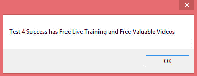

* `If-Then-Else` 语句：选择两组代码中的一组执行

图 1.3

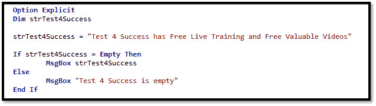

```vb
Option Explicit
Dim strTest4Success
strTest4Success = "Test 4 Success has Free Live Training and Free Valuable Videos"
If strTest4Success = Empty Then
        MsgBox strTest4Success
Else
        MsgBox "Test 4 Success is empty" 
End If
```

输出显示“Test 4 Success is empty.”

图 1.4

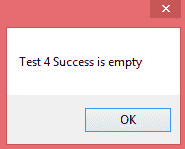

* `If-Then-ElseIf` 语句：选择多组代码中的一组执行

图 1.5

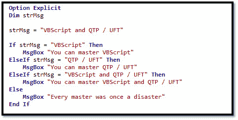

```vb
Option Explicit
Dim strMsg
strMsg = "VBScript and QTP / UFT"
If strMsg = "VBScript" Then
    MsgBox "You can master VBScript"
ElseIf strMsg = "QTP / UFT" Then
    MsgBox "You can master QTP / UFT"
ElseIf strMsg = "VBScript and QTP / UFT" Then
    MsgBox "You can master VBScript and QTP / UFT"
Else
    MsgBox "Every master was once a disaster"
End If
```

输出显示“You can master VBScript and QTP / UFT.”

图 1.6

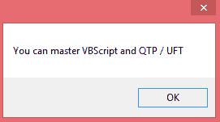

### Select Case 分支

* `Select Case` 语句：根据实际值而非真或假来做决策。`Select Case` 语句为同一个表达式选择多组代码中的一组执行

图 1.7

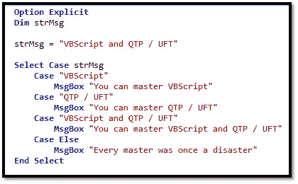

```vb
Option Explicit
Dim strMsg
strMsg = "VBScript and QTP / UFT"
Select Case strMsg
    Case "VBScript"
        MsgBox "You can master VBScript"
    Case "QTP / UFT"
        MsgBox "You can master QTP / UFT"
    Case "VBScript and QTP / UFT"
        MsgBox "You can master VBScript and QTP / UFT"
    Case Else
        MsgBox "Every master was once a disaster"
End Select
```

输出显示“You can master VBScript and QTP / UFT.”

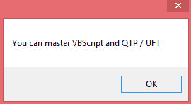

## 循环

循环反复执行代码行（参见第 5 章中的循环）。当需要重复执行代码块直到条件为真，或者重复执行代码块固定次数时，循环非常有用。大多数程序员使用以下结构：`For Next`和`Do Loop`。

* `For Next` 语句：按指定的次数运行代码

图 1.9

```vb
Option Explicit
Dim i
For i = 1 to 3
    MsgBox "Number " & i
Next
```

输出显示“Number 1”，第二次输出显示“Number 2”，第三次输出显示“Number 3”。

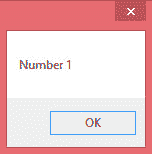!(images/00141.jpg)!(images/00145.jpg)

* `For Each-Next` 语句：对集合（存储一组数据）或数组（数据的矩阵）中的每个项目运行代码

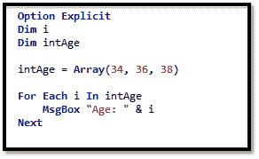

```vb
Option Explicit
Dim i
Dim intAge
intAge = Array(34, 36, 38)
For Each i In intAge
    MsgBox "Age: " & i
Next
```

输出显示“Age: 34”，第二次输出显示“Age: 36”，第三次输出显示“Age: 38”。

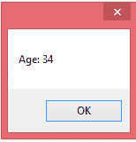!(images/00155.jpg)!(images/00176.jpg)

* `Do Loop` 语句：在条件为真时或直到条件为真时循环执行代码

图 1.13

```vb
Option Explicit
Dim i
i = 1
Do While i < 3
    MsgBox "Number " & i & " is less than 3"
    i = i + 1
Loop
```

输出显示“Number 1 is less than 3”，第二次输出显示“Number 2 is less than 3.”

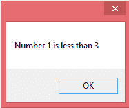!(images/00010.jpg)

图 1.15

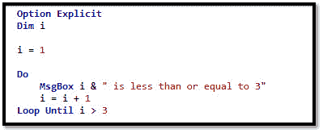

```vb
Option Explicit
Dim i = 1
Do
    MsgBox i & " is less than or equal to 3"
    i = i + 1
Loop Until i > 3
```

第一次输出显示“1 is less than or equal to 3”，第二次输出显示“2 is less than or equal to 3”，第三次输出显示“3 is less than or equal to 3”。

!(images/0173.jpg)!(images/0053.jpg)

## 编码规范

养成良好的习惯是非常重要的，因为良好的习惯确保了代码更容易阅读、理解，并包含更少的错误。从长远来看这是有利的。良好的布局提高了了你和其他程序员的可读性。代码缩进显示了行之间的从属关系。因此，相关的代码应该保持在一起。

## 匈牙利命名法

匈牙利命名法涉及为变量名添加前缀（参见第 2 章变量与数据类型中的匈牙利命名法）。结果在前缀中指示变量范围和类型。这使得程序更容易编写和阅读。例如，`strName` 就是匈牙利命名法。前缀 `str` 定义该变量为字符串。

'(错误的注释) 字符串 "strName" 结合了名和姓

`strName = strFirstName & " " & strLastName`

'(良好的注释) "strName" 的目的是将名称放在客户表而非员工表中

`strName = strFirstName & " " & strLastName`

## 代码模块化

随着脚本中添加的代码越来越多，一次性读完一整块代码会变得越来越困难。在某些情况下，决策将通过分支或循环来重定向代码。因此，代码变得更加复杂，容易引入错误。糟糕的糟糕布局（也称为意大利面条代码）使得查找和修复问题变得更加困难。

模块化是程序员用来管理代码复杂性的一种技术。它是将代码组织成模块的过程，这些模块可以被视为构建块。使用过程来实现模块化。过程有两种类型的程序：`Sub Procedure`（子过程）和 `Function Procedure`（函数过程）。

## Sub Procedure

`Sub Procedure`是一系列由 `Sub` 和 `End Sub` 语句包围的语句（参见第 6 章过程-函数中的 Sub Procedure）。它可以执行某些操作并接收参数（也称为形式参数），但不返回值。操作执行任务，例如数字相加。参数是过程使用的特殊变量，用于提供数据作为输入。以下是 `Sub Procedure` 的语法：

### 语法

```
Sub NameOfSubProcedure()
    code  
End Sub

Sub NameOfSubProcedure ([Argument1], [ArgumentN])
    code
End Sub
```

## Function Procedure

`Function Procedure`是一系列由 `Function` 和 `End Function` 语句包围的语句（参见第 6 章过程-函数中的 Function Procedure）。它可以执行某些操作、接收参数并返回一个值。该值通过向其名称赋值值来返回。以下是 `Function Procedure` 的语法：

### 语法

```
Function NameOfFunctionProcedure()
    code     
    NameOfFunctionProcedure = some value
End Function

Function NameOfFunctionProcedure ([Argument1], [ArgumentN])
    code         
    NameOfFunctionProcedure = some value
End Function
```

第 1 章概述了变量、流程控制和编码标准的基础原理。第 2 章将探索变量和匈牙命名法，以及变量数据类型。

# 第 2 章变量和数据类型


变量在 VBScript 中极其重要。变量为脚本存储数据。脚本中的每个输入、输出和处理都使用变量。变量中的数据可以留待以后使用，而某些变量在使用后就会被丢弃。将值放入变量中被称为初始化。值默认或从应用程序放入变量中。数据库也用于存储变量中的值。数据库可以是文本文件、Excel 文件等。

本章将解释以下内容：

- 变量规则
- 变量类型
- 变量生命周期/作用域
- 声明变量
- `Option Explicit`
- 数据类型
- 匈牙命名法

## 变量规则

变量可以存储值（`x=3`）或表达式（`x = y + z`）。在给变量赋值时，确保变量名在左侧，值在右侧。变量可以有一个短名称（如“z”），也可以有一个描述性名称（如`strTestPage`）。以下是变量的一些规则：

1. 不能超过 255 个字符
2. 下划线 “_” 是唯一有效的非字母数字字符
3. 必须以字母（大写或小写）开头

## 变量类型

有类型的变量。以下是每种变量类型的列表：

1. 标量
2. 数组
3. 常量

### 标量

标量变量只包含一个在执行前或执行期间可以更改的值。以下示例包含一个名为“x”的变量，值为“34”。

```vb
Dim x
x = 34
```

### 数组

数组变量包含多个值（参见第 6 章中的数组）。

```vb
Dim y(3)
y(0) = 4
y(1) = 5
y(2) = 6
y(3) = 7
```

### 常量

常量变量包含在执行前或执行期间不能更改的值。通常，常量名称使用大写字母。

```vb
Const NUMBER = 3
```

### 字面量

字面量是静态（固定的）数据，包含文本、数字或布尔值。`True` 或 `False` 等值就是字面量。以下是字面量的示例：

```vb
Option Explicit
Dim datBirthday
datBirthday = #05/09/12#
MsgBox "Test For success " & datBirthday
```

## 变量生命周期/作用域

变量的生命周期取决于它的存在性。它可以是局部的或全局的。局部变量在过程内部声明，而全局变量在外部声明。如果变量是局部的，它在过程结束后会被删除。以下是两个拥有同名局部变量的过程示例：

```vb
Option Explicit
Call DisplayOldColor
Call ReturnNewColor

Sub DisplayOldColor()
    Dim strCarColor
    strCarColor = "blue"
    MsgBox "My old car was " & strCarColor
End Sub

Function ReturnNewColor()
    Dim strCarColor
    strCarColor = "black"
    ReturnNewColor = strCarColor
End Function
```

第一个输出使用局部变量`strCarColor`显示“My old car was blue”，而第二个输出使用同名的局部变量显示“My new car is black”。

全局变量是在过程外声明的变量。所有过程都可以访问全局变量。因此，它们不能重名。这些变量的生命周期从声明开始，到程序关闭结束。变量的生命周期和作用域是相互关联的。以下是变量作用域的三类型/级别：

- 脚本作用域
- 过程作用域
- 类作用域

### 脚本作用域

脚本作用域（与全局变量相关）是指变量对脚本文件中的所有脚本都可用。这些变量没有在过程或类中声明。以下是具有脚本作用域变量的示例：

```vb
Option Explicit
Dim strFirstName
strFirstName = "Rex"
Call DisplayFirstName(strFirstName)
Call Greet(strFirstName)
```

```vb
Sub DisplayFirstName(strFirst)
    MsgBox "My first name is " & strFirst
End Sub

Sub Greet(strFirst)
    MsgBox "Hello " & strFirst
End Sub
```

第一个输出使用全局变量`strFirstName`显示“My first name is Rex”，而第二个输出使用全局变量`strFirstName`显示“Hello Rex”。两个过程（`DisplayFirstName` 和 `Greet`）都可以访问该全局变量，因为该变量具有脚本级作用域（Script Level Scope，整个文件可用）。

### 过程级作用域

过程级作用域（Procedure Level Scope 与局部变量相关）是在过程中声明的变量。过程外部的代码无法访问该变量。以下是一个过程级作用域变量的示例：

```vb
Option Explicit

Call WroteQTP

Sub WroteQTP
    Dim strCompany
    strCompany = "Mercury Interactive"
    MsgBox "Originally," & strCompany & "wrote QuickTest Professional"
End Sub
```

输出通过具有过程级作用域的变量`strCompany`显示“Originally, Mercury Interactive wrote QuickTest Professional”。

### 类级作用域

类（Class）是一个特殊的结构，包含逻辑分组或属性和方法。在类中使用`private`语句声明且位于类内过程之外的变量具有类级作用域。类内部的代码可以访问该变量，但类外部的代码无法访问它。具有类级作用域的变量与具有过程级作用域的变量相似。以下是一个具有类级作用域的变量`mstrAnimal`的示例：

```vb
Option Explicit

Class Animals
    Private mstrAnimal
    Public Property Let Zebra(strAnimal)
        mstrAnimal = strAnimal
    End Property
    Public Sub Zebra(strColor)
        MsgBox mstrAnimal & " good with a " & DisplayCarColor(strColor) & "color."
    End Sub
    Private Function DisplayCarColor(strColor)
        Select Case strColor
            Case "Black and White"
                DisplayCarColor = "Black and White"
            Case "Brown and White"
                DisplayCarColor = "Brown and White"
            Case "Brown and Black"
                DisplayCarColor = "Brown and Black"
        End Select
    End Function
End Class
```

## 声明变量

我们可以使用`Dim`、`Public`或`Private`语句来声明变量。无论语句类型类型，所有变量都是可用的。三个语句如下：

1. `Dim`语句
2. `Public`语句
3. `Private`语句

### Dim 语句

`Dim`语句允许在分配内存的同时声明一个或多个新变量。该语句用于在脚本级或过程级声明变量。在过程内部不允许使用`Public`和`Private`语句。如果在类级中使用，`Dim`语句与`Public`语句类似：

```vb
Dim strTestPage
```

### Public 语句

`Public`语句允许在分配内存的同时声明一个或多个新变量和/数组。该语句用于脚本级或类级，但不用于过程。建议在类中使用`Public`语句。以下是`Public`语句的语法：

```vb
Public strTestPage
```

### Private 语句

`Private`语句允许在分配内存的同时声明一个或多个新变量和/数组。该语句用于脚本级或类级，但不用于过程。如果在过程之外声明了`Private`语句，则其结果与`Dim`语句或`Public`语句相同。过程外部的变量整个脚本文件可用（称为全局变量）。这迫使`Private`语句运行方式类似于`Dim`或`Public`语句。以下是`Private`语句的语法：

```vb
Private strTestPage
```

同一行中允许声明多个变量。然而，脚本和过程中的变量数量存在限制。

```vb
Dim strTestPage
```

```vb
Dim strTestPage, strFirstName
```

```vb
Dim strTestPage, strUserName
```

```vb
Option Explicit
Dim strMessage
strMessage = "Option Explicit is very important"
MsgBox strMessage
```

输出显示“Option Explicit is very important”

图 2.9

## 数据类型

所有变量都有变体数据类型（variant）。`Variant`是一种特殊的数据类型，根据其使用方式包含不同的信息。信息将以数值或字符串形式存在。数值信息的大小从布尔型到浮点数不等。几类字符串和数值信息被称为子数据类型（Sub-Data Types）。以下是子数据类型：

| 子数据类型 | 说明 |
| :--- | :--- |
| `Empty` | 值为“0”或空值。变量在创建时未初始化，当变量设为空时未对其分配任何值 |
| `Null` | 带有无效数据的变量 |
| `Boolean` | 包含 `True` 或 `False` |
| `Byte` | 包含从 0 到 255 的数值 |
| `Integer` | 包含从 -32,768 到 32,767 的数值 |
| `Currency` | 包含从 -922,337,203,685,477.5808 到 922,337,203,685,477.5807 的货币值 |
| `Long` | 包含从 -2,147,483,648 到 2,147,483,647 的数值 |
| `Single` | 包含单精度浮点数 |
| `Double` | 包含双精度浮点数 |
| `Date (Time)` | 包含日期和时间 |
| `String` | 包含存储在双引号中的字母数字字符 |
| `Object` | 包含一个对象 |
| `Error` | 包含错误代码 |

## 匈牙命名法

匈牙命名法（Hungarian Naming Convention）涉及为变量名添加一个前缀。因此，该前缀指示变量的数据类型和作用域。匈牙命名法使程序更容易编写和阅读。如果程序员不确定变量中可能存储什么类型的数据，或者打算在不同时间使用不同类型的数据，最好是使用`var`前缀。

| 数据类型 | 前缀 | 示例 |
| :--- | :--- | :--- |
| 布尔值 | `bln` 或 `bool` | `blnBusy` |
| 字节 | `byt` | `bytColor` |
| 货币 | `cur` | `curDollar` |
| 日期或时间 | `dtm` | `dtmToday` |
| 双精度浮点 | `dbl` | `dblAmount` |
| 错误 | `err` | `errInvalid` |
| 整数 | `int` | `intTotal` |
| 长整型 | `lng` | `lngWeight` |
| 对象 | `obj` | `objSchedule` |
| 单精度浮点 | `sng` | `sngMeasure` |
| 字符串 | `str` | `strTest` |
| 变体 | `var` | `varTeam` |

第 2 章提到了变量规则、变量类型和变量生命。此外，还解释了数据类型、`Option Explicit`、变量声明以及变量的命名规范。[第 3 章] 关注运算符及其优先级。

# 第 3 章运算符

运算符是表示特定操作的符号。它们允许程序员通过对一个或多个输入执行某个功能，来操作数字和文本。以下是不同类型的运算符：

- 赋值运算符：用于为属性或变量分配值。
- 算术运算符：用于计算数值，并与赋值运算符和/或比较运算符配合使用。
- 连接运算符：用于将无限数量的表达式结合。连接运算符被视为一种独立的运算符类型，但有时会被包含在算术运算符中。
- 比较运算符：用于比较变量和表达式。
- 逻辑运算符：用于对表达式执行逻辑操作。逻辑操作用于控制程序流程的操作。所有逻辑运算符都可以作为位运算符使用。
- 位运算符：用于逐位计算二进制值（所有位运算符都可以作为逻辑运算符使用）。

操作通常从左到右执行，除非表达式中存在多个运算符。如果一个表达式中存在多个运算符，它们将按顺序执行：首先执行`算术运算符`，接着是`连接运算符`，然后是`比较运算符`，最后是`逻辑运算符`。

可以使用括号覆盖该顺序。放在括号中的操作始终在括号外的操作之前评估。括号内适用标准的优先级规则。以下是示例：

```vb
y = 3 + 2 * 4 + 5
y = (3 + 2) * (4 + 5)
```

## Option Explicit

```vba
Dim y
y = 3 + 2 * 4 + 5
MsgBox y
```

答案是 16。

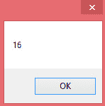

```vba
Dim y
y = (3 + 2) * (4 + 5)
MsgBox y
```

答案是 45。

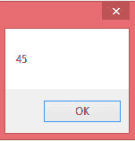

上述两个示例看起来相似，但实际上是不同的。根据运算符优先级的指南，乘法的优先级高于加法。因此，第一行的值为 16（`2 * 4 = 8 + 3 + 5 = 16`）。通过添加括号，加法运算符在乘法运算符之前评估，因此第二行的值为 45（`5 * 9 = 45`）。

本章将涵盖四种运算符类型。连接运算符包含在算术运算符中。将讨论的运算符如下：

- 算术运算符
- 比较运算符
- 逻辑运算符

## 算术运算符

算术运算符是一个接收操作数并使用它们执行计算的函数。例如，以下表达式`7 + 4`使用`+`添加两个操作数。以下是优先级顺序：

- `幂`
- `乘法`
- `浮点除法`
- `整数除法`
- `取模`
- `加法`
- `减法`
- `连接运算符`
- `比较运算符`
- `赋值运算符`

### 幂

幂运算符`^`用于将数字提升为幂。以下是幂运算符的示例：

```vba
Dim x, y
y = 7 ^ 2
MsgBox y
```

答案是 49。

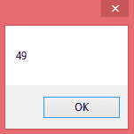

### 一元取反

一元取反运算符`-`表示表达式的负值。以下是一元取反运算符的示例：

```vba
Dim x
x = -4
MsgBox x
```

图 3.4

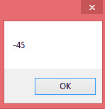

### 乘法

乘法运算符`*`用于数字相乘。以下是乘法运算符的示例：

```vba
Dim x
x = 3 * 4
MsgBox x
```

答案是 12。

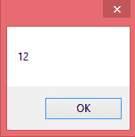

### 浮点除法

浮点除法运算符`/`用于除两个数字并返回浮点数。以下是浮点除法运算符的示例：

```vba
Dim x
x = 4 / 3
MsgBox x
```

答案是 1.33333333333333

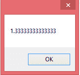

### 整数除法

整数除法运算符`\`用于除两个数字，丢弃余数并仅返回整数。以下是整数除法运算符的示例：

```vba
Dim x
x = 4 \ 3
MsgBox x
```

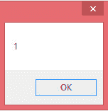

取模运算符（`Mod`）用于将两个数字相除，并仅返回余数。以下是取模运算符的示例：

### 语法

```vb
Result = Number1 Mod Number2
```

## Option Explicit

```vba
Dim x
x = 12 Mod 10
MsgBox x
```

答案是 2。

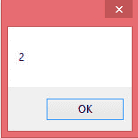

**注意：** 如果是浮点数，数字将被四舍五入整数。空表达式被视为零 (0)。如果一个或两个表达式为 `Null`，则结果为 `Null`。

## 加法

加法运算符（`+`）用于将数字相加并连接字符串。以下是加法运算符的示例：

### 语法

```vba
Result = Number1 + Number2
```

## Option Explicit

```vba
Dim x
x = 3 + 4
MsgBox x
```

答案是 7。

图 3.9

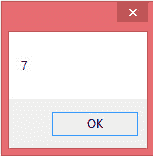

**注意：** 如果两个表达式都为空，则结果为整数。然而，如果一个表达式为空，则另一个表达式保持不变。如果一个或两个表达式为 `Null`，则结果为 `Null`。表达式决定了加法运算符（`+`）的行为。如果涉及字符串，加法运算符将像连接运算符（`&`）一样合并字符串。以下是加法运算符合并字符串的示例：

## Option Explicit

```vba
Dim strFirstName, strLastName
strFirstName = "John"
strLastName = "Doe"
MsgBox "A common fake name is " + strFirstName + " " + strLastName
```

输出显示“A common fake name is John Doe.”

图 3.10

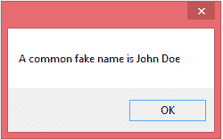


以下是一个显示不同类型表达式的成功表：

图 3.11

| 如果 | 则 |
| :--- | :--- |
| 两个表达式都是数值 | 相法 |
| 两个表达式都是字符串 | 连接 |
| 其中一个表达式是数值，另一个是字符串 | 错误：类型不匹配 |

## 减法

减法运算符（`-`）用于计算两个数字之间的差。以下是减法运算符的示例：

### 语法

```vba
Result = Number1 – Number2
```

### 强制声明

```vba
Dim x
x = 37 - 3
MsgBox x
```

答案是 34。

图 3.12

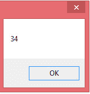

**注意：** 空表达式被视为零（0）。如果一个或两个表达式为 `Null`，则结果为 `Null`。

## 连接

连接运算符（`&`）用于强制连接各个表达式。以下是连接运算符的示例：

### 语法

```vba
Result = Expression1 & Expression2
```

### 强制声明

```vba
Dim strFirstName, strLastName
strFirstName = "Rex"
strLastName = "Jones II"
MsgBox "The author of this eBook is " & strFirstName & " " & strLastName & "."
```

答案是“The author of this eBook is Rex Jones II.”

图 3.13

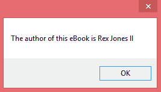

**注意：** 非字符串表达式将转换为字符串。如果两个表达式均为 `Null`，则结果也是 `Null`。然而，如果只有一个表达式为 `Null`，则该表达式在与其他表达式连接时被视为一个零长度字符串（`""`）。零长度字符串被赋予一个空白值——无值。任何空表达式也会被视为零长度字符串。

## 比较运算符

比较运算符允许程序员比较两个表达式。比较运算符测试两个表达式是否为真或为假。因此，比较运算符的数据类型是布尔型（`Boolean`）。以下是一个成功表，作为比较表达式的指南：

图 3.14

| 如果 | 则 |
| :--- | :--- |
| 两个表达式都是数值 | 执行数值比较 |
| 两个表达式都是字符串 | 执行字符串比较 |
| 其中一个表达式是数值，另一个是字符串 | 数值表达式小于字符串表达式 |
| 其中一个表达式为空，另一个是数值 | 执行数值比较，使用零（0）作为空表达式 |
| 其中一个表达式为空，另一个是字符串 | 执行字符串比较，使用零长度字符串（`""`）作为空表达式 |
| 两个表达式都为空 | 表达式相等 |

以下按优先级排序的每个比较运算符列表：

* 相等
* 不等于
* 小于
* 大于
* 小于等于
* 大于等于
* 对象等效性（`Is`）

### 等于

相等运算符（`=`）如果 `Expression1` 等于 `Expression2` 则返回 `True`，否则返回 `False`。以下是相等运算符的示例：

### 语法

```vba
Expression1 = Expression2
```

### 强制声明

```vba
Dim x, y
x = 34
y = 34
If x = y Then
    MsgBox x & "equals " & y
End If
```

该表达式是一个真语句，显示 34 等于 34。

图 3.15

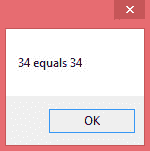

### 不等于

不等于运算符（`<>`）如果 `Expression1` 不等于 `Expression2` 则返回 `True`，否则返回 `False`。以下是不等于运算符的示例：

### 语法

```vba
Expression1 <> Expression2
```

### 强制声明

```vba
Dim x, y
x = 34
y = 38
If x <> y Then
    MsgBox x & "does not equal"
End If
```

该表达式是一个真语句，显示 34 不等于 38。

图 3.16

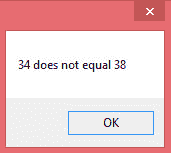

### 小于

小于运算符（`<`）如果 `Expression1` 小于 `Expression2` 则返回 `True`，否则返回 `False`。以下是小于运算符的示例：

### 语法

```vba
Expression1 < Expression2
```

### 强制声明

```vba
Dim x, y
x = 34
y = 38
If x < y Then
    MsgBox x & "is less than"
End If
```

该表达式是一个真语句，显示 34 小于 38。

图 3.17

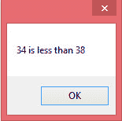

### 大于

大于运算符（`>`）如果 `Expression1` 大于 `Expression2` 则返回 `True`，否则返回 `False`。以下是大于运算符的示例：

### 语法

```vba
Expression1 > Expression2
```

### 强制声明

```vba
Dim x, y
x = 38
y = 34
If x > y Then
    MsgBox x & "is greater than"
End If
```

该表达式是一个真语句，显示 38 大于 34。

图 3.18

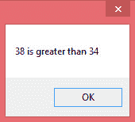

### 小于等于

小于等于运算符（`<=`）如果 `Expression1` 小于或等于 `Expression2` 则返回 `True`，否则返回 `False`。以下是小于等于运算符的示例：

### 语法

```vba
Expression1 <= Expression2
```

### 强制声明

```vba
Dim x, y
x = 34
y = 34
If x <= y Then
    MsgBox x & "is less than or equal to"
End If
```

该表达式是一个真语句，显示 34 小于或等于 34。

图 3.19

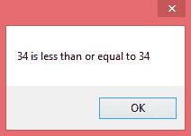

### 强制声明

```vba
Dim x, y
x = 34
y = 38
If x <= y Then
    MsgBox x & "is less than or equal to"
End If
```

该表达式是一个真语句，显示 34 小于或等于 38。

图 3.20


### 大于等于

大于等于运算符（`>=`）如果 `Expression1` 大于或等于 `Expression2` 则返回 `True`，否则返回 `False`。以下是大于等于运算符的示例：

### 语法

```vba
Expression1 >= Expression2
```

### 强制声明

```vba
Dim x, y
x = 34
y = 34
If x >= y Then
    MsgBox x & "is greater than or equal to"
End If
```

该表达式是一个真语句，显示 34 大于或等于 34。

图 3.21

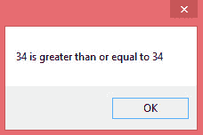

### 强制声明

```vba
Dim x, y
x = 38
y = 34
If x >= y Then
    MsgBox x & "is greater than or equal to"
End If
```

输出显示“38 is greater than or equal to 34”

图 3.22

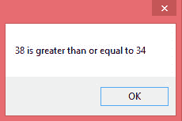

### 对象等效性（`Is`）

对象等效运算符（`Is`）当 `Object1` 和 `Object2` 引用相同的内存位置时，返回 `True`。以下是对象等效运算符（`Is`）的示例：

### 语法

```vba
Result = Object1 Is Object2
```

### 强制声明

```vb
Dim x, y, z
Dim intSameNumber
x = 11
y = 21
z = "1 on another level"
Set x = CreateObject("Scripting.Dictionary")
Set y = CreateObject("Scripting.Dictionary")
Set z = CreateObject("Scripting.Dictionary")
Set x = z
Set y = z
intSameNumber = x Is y
MsgBox intSameNumber
```

答案是“True.”。

图 3.23

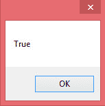

**注意：** 对象等效运算符（`Is`）不比较值，也不比较一个对象与另一个对象。相反，它检查同一个表达式中的两个对象（`x` 和 `y`）是否引用了同一个对象（`z`），即同一个内存位置。

## 逻辑运算符

逻辑运算符用于对表达式执行逻辑操作。通常在控制语句中找到逻辑运算符，以控制程序的流程。每个操作数被视为一个决策，允许程序做出判断。以下是各种逻辑运算符的类型，按优先级排序如下：

* 逻辑非（`Not`）
* 逻辑与（`And`）
* 逻辑或（`Or`）
* 逻辑异或（`Xor`）
* 逻辑等价（`Eqv`）
* 逻辑蕴含（`Imp`）

### 逻辑非（`Not`）

逻辑非运算符（`Not`）返回表达式的逻辑取反。如果表达式为 `False`，结果为 `True`；如果表达式为 `True`，结果为 `False`。如果表达式为 `Null`，则返回 `Null`。以下是逻辑非运算符的示例：

### 语法

```vba
Result = Not Expression
```

### 强制声明

```vb
Dim x, y
x = 10
y = Not (x < 20)
MsgBox y
```

答案是“False.”。

图 3.24

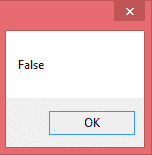

以下是逻辑非运算符（`Not`）的真值表：

图 3.25

| 表达式 | 结果 |
| :--- | :--- |
| `True` | `False` |
| `False` | `True` |
| `Null` | `Null` |

### 逻辑与（`And`）

逻辑与运算符（`And`）当两个表达式都为 `True` 时返回 `True`，否则返回 `False`。以下是逻辑与运算符的示例：

### 语法

```vba
Result = Expression1 And Expression2
```

### 强制声明

```vb
Dim x, y, z
x = 10
y = 15
z = x > 4 And y <= 20
MsgBox z
```

答案是“True.”。

图 3.26

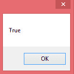

以下是逻辑与运算符（`And`）的真值表：

图 3.27

| 如果 `Expression1` | 如果 `Expression2` | `Expression1 And Expression2` |
| :--- | :--- | :--- |
| `True` | `True` | `True` |
| `True` | `False` | `False` |
| `False` | `True` | `False` |
| `False` | `False` | `False` |

### 逻辑或（`Or`）

逻辑或运算符（`Or`）当一个或两个表达式为 `True` 时返回 `True`，否则返回 `False`。以下是逻辑或运算符的示例：

### 语法

```vba
Result = Expression1 Or Expression2
```

### 强制声明

```vb
Dim x, y, z
x = 10
y = 15
z = x > 4 Or y >= 20
MsgBox z
```

答案是“True.”。

图 3.28

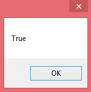

以下是逻辑或运算符（`Or`）的真值表：

图 3.29

| 如果 `Expression1` | 如果 `Expression2` | `Expression1 Or Expression2` |
| :--- | :--- | :--- |
| `True` | `True` | `True` |
| `True` | `False` | `True` |
| `False` | `True` | `True` |
| `False` | `False` | `False` |

### 逻辑异或（`Xor`）

逻辑异或运算符（`Xor`）当仅有一个表达式为 `True` 时返回 `True`，否则返回 `False`。以下是逻辑异或运算符的示例：

### 语法

```vba
Result = Expression1 Xor Expression2
```

### 强制声明

```vb
Dim x, y, z
x = 100
y = 10
z = x = 200 Xor y > 400
MsgBox z
```

答案是“False.”。

图 3.30

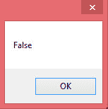

以下是逻辑异或运算符（`Xor`）的真值表：

图 3.31

| 如果 `Expression1` | 如果 `Expression2` | `Expression1 Xor Expression2` |
| :--- | :--- | :--- |
| `True` | `True` | `False` |
| `True` | `False` | `True` |
| `False` | `True` | `True` |
| `False` | `False` | `False` |

### 逻辑等价（`Eqv`）

逻辑等价运算符（`Eqv`）当两个表达式求值为相同的值（`True` 或 `False`）时，返回 `True`。以下是逻辑等价运算符的示例：

### 语法

```vba
Result = Expression1 Eqv Expression2
```

### 强制声明

```vb
Dim x, y, z
x = 100
y = 10
z = x > 200 Eqv y > 400
MsgBox z
```

答案是“True.”。

图 3.32

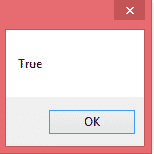

以下是逻辑等价运算符（`Eqv`）的真值表：

图 3.33

| 如果 `Expression1` | 如果 `Expression2` | `Expression1 Eqv Expression2` |
| :--- | :--- | :--- |
| `True` | `True` | `True` |
| `True` | `False` | `False` |
| `False` | `True` | `False` |
| `False` | `False` | `False` |

### 逻辑蕴含（`Imp`）

逻辑蕴含运算符（`Imp`）当 `Expression1` 为 `True` 且 `Expression2` 为 `False` 时返回 `False`。以下是逻辑蕴含运算符的示例：

### 语法

```vba
Result = Expression1 Imp Expression2
```

### 强制声明

```vb
Dim x, y
x = 45
y = 50
z = x < 200 Imp y > 40
MsgBox z
```

答案是“True.”。

图 3.34

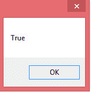

以下是逻辑蕴含运算符（`Imp`）的真值表：

图 3.35

| 如果 `Expression1` | 如果 `Expression2` | `Expression1 Imp Expression2` |
| :--- | :--- | :--- |
| `True` | `True` | `True` |
| `True` | `False` | `False` |
| `False` | `True` | `True` |
| `False` | `False` | `True` |

第三章讨论了六种运算符中的四种：算术、连接、比较以及逻辑。第四章将介绍数组，数组存储值与变量相似。

## 第四章 数组

数组是存储多个值的矩阵。允许在多个隔间中存储多个信息。隔间将数据划分为特定操作的区域。数组与变量的概念相似，变量只能包含一个值。

* 声明数组和边界
* 访问数组
* 遍历数组

## 静态数组类型

静态数组具有固定的索引。无法增加或减少数组的大小。数组在整个生命周期内保持固定大小。因此，程序员必须知道数组中将有多少项。

### 一维数组

一维数组有一行一列。括号中的数字指定了索引的最大值。索引是表示项目在列表中相对位置的整数下标。以下是一维数组的示例：

```vb
Dim arrName(2)
```

### 填充一维数组

如果不使用数组函数，新数组将是空的。必须将项目分配给索引才能填充数组。

```vb
arrName(0) = "James"
arrName(1) = "Janice"
arrName(2) = "Jane"
```

图 4.2

| `NameOfArray(index)` | Value | 元素 # |
| :--- | :--- | :--- |
| `arrName(0)` | James | 1 |
| `arrName(1)` | Janice | 2 |
| `arrName(2)` | Jane | 3 |

括号中的值填充了特定的索引。此示例将零（0）填充为“James”，将一（1）填充为“Janice”，将二（2）填充为“Jane”。因此，该数组包含从索引 0 开始到索引 2 结束三个元素。0 是下界，2 是上限。数组是基于零的，并且始终具有零的下界。另一方面，`VBScript` 允许确定上限。上限决定了特定维度可以容纳多少个隔间。数组中的每个隔间被称为元素。一个元素只能容纳一个值。

### `LBound`

`LBound` 是一个函数，用于返回数组维度的最小下标。以下是 `LBound` 函数的示例：

#### 语法


```
LBound (NameOfArray[, Dimension])
```

----------------------------------

图 4.3

| 参数 |  |
| :--- | :--- |
| `NameOfArray` | 必需。数组变量名 |
| `Dimension` | 可选。基础维度定义 1 为列，2 为行。维度可以超过 2 继续下去。默认维度为 1 |

图 4.4

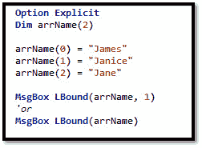

```vb
Option Explicit

Dim arrName(2)

arrName(0) = "James"
arrName(1) = "Janice"
arrName(2) = "Jane"

MsgBox LBound(arrName, 1) 
'或者 
MsgBox LBound(arrName)
```

两个输出都返回“0”，这是最小下标。

图 4.5

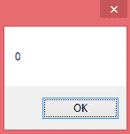

### UBound

`UBound` 是一个函数，用于返回数组维度的最大下标。以下是 `UBound` 函数的示例：

#### 语法

```
UBound(NameOfArray[, Dimension])
```

----------------------------------

图 4.6

| 参数 | 说明 |
| :--- | :--- |
| `NameOfArray` | 必需。数组变量名 |
| `Dimension` | 可选。基础维度定义 1 为列，2 为行。维度可以超过 2 继续下去。默认维度为 1 |

图 4.7

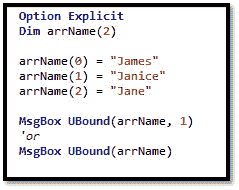

```vb
Option Explicit

Dim arrName(2)

arrName(0) = "James"
arrName(1) = "Janice"
arrName(2) = "Jane"

MsgBox UBound(arrName, 1) 
'或者 
MsgBox UBound(arrName)
```

答案是“2”，这是最大下标。

图 4.8

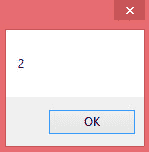

## 二维数组

程序员必须添加一个逗号和另一个上限来声明一个二维数组。列是第一维度，行是第二维度。二维数组显示多列和多行。因此，程序员不受限于两列。以下是一个二维静态数组的示例：

```vb
Dim arrName(1, 2)
```

### 填充二维数组

图 4.9

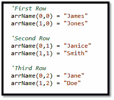

```vb
'第一行
arrName(0,0) = "James"
arrName(1,0) = "Jones"

'第二行
arrName(0,1) = "Janice"
arrName(1,1) = "Smith"

'第三行
arrName(0,2) = "Jane"
arrName(1,2) = "Doe"
```

图 4.10

| | 0 | 1 |
| :--- | :--- | :--- |
| 0 | James | Jones |
| 1 | Janice | Smith |
| 2 | Jane | Doe |

### LBound

`LBound` 是一个函数，用于返回数组维度的最小下标。以下是使用二维数组的 `LBound` 函数的示例：

#### 语法

```
LBound(NameOfArray[, Dimension])
```

----------------------------------

图 4.11

| 参数 | 说明 |
| :--- | :--- |
| `NameOfArray` | 必需。数组变量名 |
| `Dimension` | 可选。基础维度定义 1 为列，2 为行。维度可以超过 2 继续下去。默认维度为 1 |

图 4.12

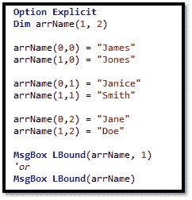

```vb
Option Explicit

Dim arrName(1, 2)

arrName(0,0) = "James"
arrName(1,0) = "Jones"
arrName(0,1) = "Janice"
arrName(1,1) = "Smith"
arrName(0,2) = "Jane"
arrName(1,2) = "Doe"

MsgBox LBound(arrName, 1) 
'或者 
MsgBox LBound(arrName)
```

输出返回“0”，这是最小下标。

图 4.13


### UBound

`UBound` 是一个函数，用于返回数组维度的最大下标。以下是 `UBound` 函数的示例：

#### 语法

```
UBound(NameOfArray[, Dimension])
```

----------------------------------

图 4.14

| 参数 | 说明 |
| :--- | :--- |
| `NameOfArray` | 必需。数组变量名 |
| `Dimension` | 可选。基础维度定义 1 为列，2 为行。维度可以超过 2 继续下去。默认维度为 1 |

图 4.15

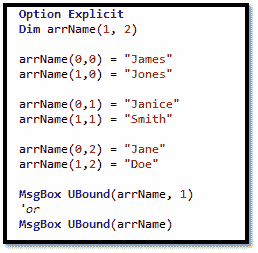

```vb
Option Explicit

Dim arrName(1, 2)

arrName(0,0) = "James"
arrName(1,0) = "Jones"
arrName(0,1) = "Janice"
arrName(1,1) = "Smith"
arrName(0,2) = "Jane"
arrName(1,2) = "Doe"

MsgBox UBound(arrName, 1) 
'或者 
MsgBox UBound(arrName)
```

答案是“2”，这是上限。

图 4.16

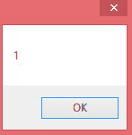

## Array 函数

`Array` 函数返回一个包含数组的变体。以下是 `Array` 函数的示例：

#### 语法

```
Array (Arglist)
```

----------------------------------

图 4.17

| 参数 | 说明 |
| :--- | :--- |
| `Arglist` | 必需。用逗号分隔的值列表 |

图 4.18


```vb
Option Explicit

Dim arrAge
arrAge = Array(7, 14, 21, 28, 34)

MsgBox arrAge(4)
```

输出返回“34”。

### Filter 数组

`Filter` 函数返回一个基于零的数组，它是字符串数组的子集。以下是 `Filter` 函数的示例：

#### 语法

```
Filter (Inputstrings, Value[,Include, [,Compare]])
```

----------------------------------

图 4.19

| 参数 | 说明 |
| :--- | :--- |
| `Inputstrings` | 必需。字符串数组 |
| `Value` | 可选。搜索字符串 |
| `Include` | 可选。布尔值，指示返回包含或排除该值的子集。`True` 返回包含该值的数组子集。`False` 返回不包含该值的数组子集。默认值为 `True` |
| `Compare` | 可选。指定用于比较的值之一 0 = `vbBinaryCompare`：执行二进制比较 1 = `vbTextCompare`：执行文本比较 |

图 4.20


```vb
Option Explicit

Dim arrAge, strAge
Dim i

arrAge = Array("Cat", "Dog", "Frog")

strAge = Filter(arrAge, "o")

For i = 0 To UBound(strAge)
    MsgBox strAge(i)
Next
```

输出返回“Dog”和“Frog”，因为它们都有“o”。

图 4.21


## 动态数组类型

当程序员不知道元素数量时，可以使用动态数组。动态数组没有预定义的上限或特定的维度数量。数组可以在设计时声明一次，而上限和维度可以在运行时更改。以下是动态数组的示例：

```vb
Dim arrName()
```

### 调整数组大小

动态数组允许程序员在运行时调整数组大小。`ReDim` 语句最初设置或更改动态数组的大小。必须填充新索引来增加动态数组索引的大小。此外，程序员可以根据需要多次调整数组大小。但是，在使用 `ReDim` 语句时有一个注意事项：在调整数组大小后，之前存储在数组中的所有数据都会丢失。以下是调整数组大小的示例：

图 4.22

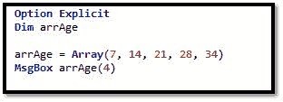

### 显式声明

```vbba
Option Explicit
Dim arrAge
arrAge = Array(7, 14, 21, 28, 34)
MsgBox arrAge(4)
```

输出返回“34。”

图 4.25

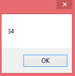

图 4.26

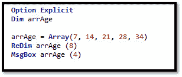

```vbba
Option Explicit
Dim arrAge
arrAge = Array(7, 14, 21, 28, 34)
ReDim arrAge (8)
MsgBox arrAge (4)
```

输出返回一个空值。

图 4.27

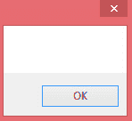

消息框将显示一个空值。有时丢失数据是好事，但有时并不好。在不宜丢失数据时，请使用 `Preserve` 关键字。`Preserve` 确保之前存储在数组中的数据在调整大小时保留。以下是使用 `Preserve` 关键字的示例：

图 4.28


```vbba
Option Explicit
Dim arrAge
arrAge = Array(7, 14, 21, 28, 34)
MsgBox arrAge(4)
```

输出返回“34。”

图 4.29


图 4.30


```vbba
Option Explicit
Dim arrAge
arrAge = Array(7, 14, 21, 28, 34)
ReDim Preserve arrAge(8)
MsgBox arrAge(4)
```

输出仍然返回“34。”

图 4.31


### 清除数组

使用 `Erase` 语句可以清空数组。它对静态数组和动态数组有不同的影响。对于静态数组，`Erase` 语句仅删除项目的内容，而数组的下界和上界不变。对于动态数组，`Erase` 语句会完全删除数组分配的内存。元素被销毁，数据被删除。变量仍然存在，但边界不再存在。程序员必须再次对变量使用 `ReDim` 语句，边界才会返回。以下是 `Erase` 语句的示例：

```vbba
Erase arrAge
```

### 拆分数组

`Split` 函数允许拆分静态或动态数组中的索引值。它使用一个分隔符将字符串拆分为子字符串，然后将子字符串分配给数组索引。程序员指定字符串和分隔符作为 `Split` 函数的参数。`Split` 函数返回一个从零开始的一维数组，包含指定数量的子字符串。以下是 `Split` 函数的示例：

#### 语法

```vbba
Split (Expression[, Delimiter[, Count[, Compare]]])
```

图 4.32

| 参数 | 说明 |
| :--- | :--- |
| `Expression` | 表达式是一个包含子字符串和分隔符的字符串，在 `Split` 函数中必须的 |
| `Delimiter` | 分隔符是用于识别子字符串边界的字符，在 `Split` 函数中可选。默认值为空格 |
| `Count` | 计数是 `Split` 函数中返回的子字符串数量，可选的。-1 表示返回所有子字符串 |
| `Compare` | `Compare` 是可选的，指定用于比较的以下值之一：0 = `vbBinaryCompare`：执行二进制比较 1 = `vbTextCompare`：执行文本比较 |

图 4.33


```vbba
Option Explicit
Dim arrColors
arrColors = Split("Black, White, Red", ",")
MsgBox arrColors(0)
```

由于索引为 0，输出返回“Black,”。索引 1 是“White”，索引 2 是“Red。”

图 4.34


### 合并数组

`Join` 函数将每个数组索引包含的子字符串合并为一个字符串，并将该字符串分配给变量。该变量将不是数组而是字符串类型（String Subtype）。此函数执行 `Split` 函数相反的任务。以下是 `Join` 函数的示例：

#### 语法

```vbba
Join (List[, Delimiter])
```

图 4.35

| 参数 | 说明 |
| :--- | :--- |
| `List` | 列表是一个包含要合并子字符串的一维数组，是必须的 |
| `Delimiter` | 分隔符是用于在 `Join` 函数返回的字符串中分隔子字符串的字符，是的。默认为空格 |

图 4.36


```vbba
Option Explicit
Dim strColors
Dim arrColors(2)
arrColors(0) = "Black"
arrColors(1) = "White"
arrColors(2) = "Red"
strColors = Join(arrColors)
MsgBox strColors
```

在合并 `arrColors` 索引中的子字符串后，输出返回“Black White Red”，并将结果分配给 `strColors`。

图 4.37


### 访问数组

必须使用下标从数组元素中读取或写入数据。一维数组被描述为每个值一个元素。下标类似于电子表格中的列和行号，或 x 和 y 轴。x 轴是水平线，y 轴是垂直线。让我们查看从元素读取和写入元素的示例：

### 从数组读取

图 4.38


```vbba
Option Explicit
Dim arrName(1,2)
arrName(0,0) = "James"
arrName(1,0) = "Jones"
arrName(0,1) = "Janice"
arrName(1,1) = "Smith"
arrName(0,2) = "Jane"
arrName(1,2) = "Doe"
MsgBox arrName(0,0)
```

输出返回“James。”

图 4.39


### 写入元素

图 4.40


```vbba
Option Explicit
Dim arrName()
ReDim Preserve arrName(1,0)
arrName(0,0) = "James"
arrName(1,0) = "Jones"
ReDim Preserve arrName(1,1)
arrName(0,1) = "Janice"
arrName(1,1) = "Smith"
ReDim Preserve arrName(1,2)
arrName(0,2) = "Jane"
arrName(1,2) = "Doe"
ReDim Preserve arrName(1,3)
arrName(0,3) = "Rex"
arrName(1,3) = "Allen"
MsgBox arrName(0,3)
```

输出返回“Rex。”数组类型变为动态，添加了 `Preserve`。

图 4.42


### 遍历数组

在处理静态数组时，上界是已知的，可以遍历静态数组。想象你想查看图 4.43 中的所有项。编写以下代码：

图 4.43

| James |
| Janice |
| Jane |

图 4.44


```vbba
Option Explicit
Dim arrName(2)
arrName(0) = "James"
arrName(1) = "Janice"
arrName(2) = "Jane"
MsgBox arrName(0)
MsgBox arrName(1)
MsgBox arrName(2)
```

第一个输出返回“James”，第二个输出返回“Janice”，第三个输出返回“Jane”。

图 4.45

### 4.46 遍历数组

所有项都显示了，但有更好的方法显示所有项。我们可以使用 `For` 循环，它将在第 5 章解释。`For` 循环按指定的次数运行一行或一组代码。以下是查看所有项的 `For` 循环示例：

图 4.46


```vbba
Option Explicit
Dim i
Dim arrName(2)
arrName(0) = "James"
arrName(1) = "Janice"
arrName(2) = "Jane"
For i = 0 to 2
    MsgBox arrName(i)
Next
```

第一个输出返回“James”，第二个输出返回“Janice”，第三个输出返回“Jane”。

图 4.47

### 4.48

字母 `i` 是用于跟踪循环内部行数的变量。它在每次迭代中都体现在 `MsgBox` 中。作为结果，`i` 在第一次迭代中代表 0，第二次迭代中代表 1，第三次迭代中代表 2。

此外，`LBound` 和 `UBound` 函数通过消除硬编码值，在遍历数组时更有效。之前的示例工作如下：

图 4.48


```vbba
Option Explicit
Dim i
Dim arrName(2)
arrName(0) = "James"
arrName(1) = "Janice"
arrName(2) = "Jane"
For i = LBound(arrName) to UBound(arrName)
    MsgBox arrName(i)
Next
```

[](images/00115.jpg)[](images/00118.jpg)

遍历数组的另一种方法是“For Each…Next 语句”。`For Each…Next` 语句是一种循环，它会为数组中的每个项目重复执行一组语句，而无需使用 `LBound` 和 `UBound` 函数。`For Each…Next` 语句将在第 5 章中进行解释。以下是 `For Each…Next` 循环的示例：

图 4.50


```vbscript
Option Explicit

Dim strName
Dim arrName(2) 

arrName(0) = "James"
arrName(1) = "Janice"
arrName(2) = "Jane"

For Each strName In arrName
    MsgBox strName
Next
```

第一次输出显示“James”，第二次输出显示“Janice”，第三次输出显示“Jane”

图 4.51

[](images/00115.jpg)[](images/00118.jpg)

第 4 章详细介绍了数组。数组在读取或写入元素时可以是静态的也可以是动态的。第 5 章将解释流程控制的分支结构和循环语句。

# 第 5 章 流程控制

VBScript 按照从上到下的概念执行。它从脚本的顶部开始，然后逐行处理，直到到达脚本结束。逻辑会由于分支而导致某些行被跳过，而其他行则因为循环而执行多次一次。

本章涵盖了：

*   分支结构

*   循环语句

## 分支结构

分支是做出决策并根据该决策执行一个代码块的过程。分支的两种结构是“If…End If”（If 语句）和“Select…End Select”（Select 语句）。这两种结构都用于定义由起始和结束语句保护的代码块。If 块需要 `If` 作为起始语句，`End If` 作为结束语句。Select 块遵循类似的模式，需要 `Select` 作为起始语句，`End Select` 作为结束语句。如果未输入所需的语句，则会在运行时发生语法错误。

### “If”块分支

`If` 语句在条件为 True（真）时执行一组代码。If 语句是程序员在编写代码时使用的最常用结构之一。以下是 If 块的语法：

#### 语法

```vbscript
If <condition> Then
    <statement>
End If
```

----------------------------------

任何导致 True 或 False 的结果都可以代替 `<condition>`。True 或 False 的回答被称为布尔表达式。以下是几个 If 构造示例：

图 5.1


```vbscript
Option Explicit

If 10 + 5 = 15 Then
    MsgBox "The answer is correct"
End If
```

输出显示“The answer is correct”

图 5.2


图 5.3


```vbscript
Option Explicit

Dim strFirstName
strFirstName = "Rex"

If strFirstName = "Rex"
    MsgBox "First Name " & strFirstName & " is correct"
End If
```

输出显示“First Name Rex is correct”

图 5.4


图 5.5


```vbscript
Option Explicit

Dim strFirstName, strLastName
strFirstName = "Joe"
strLastName = "Doe"

If strFirstName = "Joe" and (strLastName = "Doe" or strLastName = "Blow") Then
    MsgBox "First Name is " & strFirstName & "and Last Name is " & strLastName 
End If
```

输出显示“First Name is Joe and Last Name is Doe”

图 5.6


### Else 块分支

“Else”块可以作为 If 构造的另一个维度添加。如果 If 条件的结果为 False（假），则将执行它。以下是 Else 块的示例：

#### 语法

```vbscript
If <condition> Then
    <statement>
Else
    <statement>
End If
```

----------------------------------

图 5.7


```vbscript
Option Explicit

Dim strFirstName, strLastName
strFirstName = "James"
strLastName = "Doe"

If strFirstName = "Joe" Then
    MsgBox "First Name is " & strFirstName 
Else
    MsgBox "First Name is not Joe but " & strFirstName 
End If 
```

输出显示“First Name is not Joe but James”

图 5.8


### Else-If 块分支

有时决策需要是二选一的评估。在这种情况下，程序员可以添加多个 Else-If 块。以下是 Else-If 块的示例：

#### 语法

```vbscript
If <condition> Then 
    <statement>
ElseIf <condition> Then         
    < statement>
ElseIf <condition> Then
    <statement>
Else
    <statement>
End If
```

----------------------------------

图 5.9


```vbscript
Option Explicit

Dim strColor
strColor = "Purple"

If strColor = "Black" Then
    MsgBox "Black is a dark color"
ElseIf strColor = "Green" Then
    MsgBox "Green is a nice color"
ElseIf strColor = "Purple" Then
    MsgBox "Purple is a pretty color"
Else
    MsgBox "The color is not Black, or Purple"
End If
```

输出显示“Purple is a pretty color”

图 5.10

images/0079.jpg)

如果第一个条件返回 False，执行将移动到第一个 Else-If。如果第一个 Else-If 评估返回 False，执行移动到第二个 Else-If。最后，如果第二个 Else-If 评估返回 False，执行移动到 Else 块。每个 Else-If 行必须以 `Then` 结尾。Else-If 构造是灵活的，因为每行 Else-If 都可以评估不同的表达式。以下是在没有 Else 块的情况下评估唯一条件的 Else-If 示例：

```vbscript
If <condition> Then
    <statement>
ElseIf <condition> Then
    <statement>
ElseIf <condition> Then
    <statement>
End If
```

----------------------------------

图 5.11

images/044.jpg)

```vbscript
Option Explicit

Dim intNumber
intNumber = 0

If IsNull(intNumber) Then
    MsgBox "The variable IsNull"
ElseIf IsEmpty(intNumber) Then
    MsgBox "The variable IsEmpty"
ElseIf IsNumeric(intNumber) Then
    MsgBox "The variable IsNumeric"
End If
```

输出显示“The variable IsNumeric”

图 5.12

images/0104.jpg)

### 嵌套 If 分支

程序员可以将 If…End 块相互嵌套。以下是嵌套 If 语句的示例：

#### 语法

```vbscript
If <condition> Then
    If <condition> Then
        <statement>
    ElseIf <condition> Then
        <statement>
    ElseIf <condition> Then
        <statement>
    Else
        <statement>
    End If
Else
    <statement>
End If
```

----------------------------------

图 5.13

images/0078.jpg)

```vbscript
Option Explicit

Dim intNumber
intNumber = 1000

If IsNumeric(intNumber) Then
    If intNumber > 0 and intNumber < 100 Then
        MsgBox "The number is greater than zero and less than 100"
    ElseIf intNumber > 100 and intNumber < 1000 Then
        MsgBox "The number is a greater than 100 and less than 1000"
    ElseIf intNumber >= 1000 Then
        MsgBox "The number is greater than or equal to 1000"
    Else
        MsgBox "The number is a negative number"
    End If
Else
    MsgBox "The variable is NOT Numeric"
End If
```

输出显示“The number is greater than or equal to 1000”

### Select Case 块分支

`Select…End Select` 结构在评估相同条件的不同可能结果时非常有用。因此，`Select` 语句是带有多个 `Else-If` 的 `If…End If` 块的替代方案。在某些情况下，实现 `Select` 语句比 `Else-If` 语句效率，因为每个 `Else-If` 表达式都会被评估，而 `Select …End Select` 只评估一次。`Select` 块只能用于评估相同表达式的不同变体。以下是 `Select Case` 语句的语法：

#### 语法

```vb
Select Case <condition>
    Case <1st possibility>
        <statement>
    Case <2nd possibility>
        <statement>
    Case <3rd possibility>
        <statement>
    Case <n possibility>
        <statement>
    Case Else
        <statement>
End Select
```

图 5.15


```vb
Option Explicit

Dim strColor
strColor = "Purple"

Select Case strColor
    Case "Black"
        MsgBox "Black is a dark color"
    Case "Green"
        MsgBox "Green is a nice color"
    Case "Purple"
        MsgBox "Purple is a pretty color"
    Case Else
        MsgBox "The color is not Black, Green, or Purple"
End Select
```

输出显示“Purple is a pretty color”

图 5.16


第一行评估条件 `strColor`。接着，`Case` 语句检查各种可能性。最后，始终考虑 `Case Else` 块，尽管它是可选的。如果没有任何可能性返回 `True`，则将执行它。添加可选的 `Case Else` 块有两个原因：

1. 为代码添加文档，解释为什么不应该执行它，或者

2. 捕获程序员代码或输入数据的意外变化

## 嵌套 Select Case 块分支

`Select…End Select` 块可以相互嵌套。此外，程序员还可以在 `Select …End Select` 块内部嵌套 `If…End If` 块。以下是一个嵌套的 `Select Case` 块：

### 语法

```vb
Select Case <condition>
    Case <1st possibility>
        Select Case <condition>
            Case <1st possibility>
                If <condition> Then
                    <statement>
                Else
                    <statement>
                End If
            Case <2nd possibility>
                <statement>
            Case <3rd possibility>
                <statement>
            Case Else
                <statement>
        End Select
    Case <2nd possibility>
        <statement>
    Case <3rd possibility>
        <statement>
    Case Else
        <statement>
End Select
```

图 5.17


```vb
Option Explicit

Dim strColor, strBlack
strColor = "Black"
strBlack = "Light Black"

Select Case strColor
    Case "Black"
        Select Case strBlack
            Case "Light Black"
                If strBlack = "Light Black" Then
                    MsgBox "The color is Light Black and looks gray / grey"
                Else
                    MsgBox "The color is not Light Black"
                End If
        Case "Medium Black"
            MsgBox "The color is between Light and Dark Black"
        Case "Dark Black"
            MsgBox "The color is Dark Black"
        Case Else
            MsgBox "The color is not Black"
    Case "Green"
        MsgBox "Green is a nice color"
    Case "Purple"
        MsgBox "Purple is a pretty color"
    Case Else
        MsgBox "The color is not Black, Green, or Purple"
End Select
```

输出显示“The color is Light Black and looks gray / grey”

图 5.18


## 循环语句


循环是重复同一块代码的过程。VBScript 有四个用于不同情况的循环语句。这四个循环语句是：

1. `For…Next` 语句
2. `For Each…Next` 语句
3. `Do…Loop` 语句
4. `While…Wend` 语句

虽然有四个循环语句，但 `While…Wend` 语句的流行已经下降。`While…Wend` 语句工作没有问题，但已被 `Do…Loop` 语句取代。`Do…Loop` 语句执行与 `While…Wend` 语句相同的功能。然而，`Do…Loop` 语句更多功能，因为它具有关键字 `While` 和 `Until`，并且可以使用 `Exit Do` 语句跳出循环。本节将重点关注四个循环语句中的三个。

## `For…Next` 语句

`For…Next` 循环以有限的次数重复一组语句。以下是 `For…Next` 语法的示例：

### 语法

```vb
For Iterator = StartValue To EndValue (StepExpression)
    <statement>
    (Exit For)
Next
```

图 5.19

| 参数 | 描述 |
| :--- | :--- |
| `Iterator` | 被用作循环迭代器的变量 |
| `StartValue` | 迭代器的起始值 |
| `EndValue` | 迭代器的结束值 |
| `StepExpression` | 迭代器在每次循环后根据步进表达式的值变化。默认值为一。 |
| `Statement` | 执行的一条或多个语句 |
| `Exit For` | 强制跳出循环 |

图 5.20


```vb
Option Explicit

Dim intNumber
For intNumber = 1 To 6 Step 2
    MsgBox "Iterator Value: " & intNumber
Next
```

输出显示“Iterator Value: 1”，第二个输出显示“Iterator Value: 3”，第三个输出显示“Iterator Value: 5”。

图 5.21

(images/0166.jpg)(images/0026.jpg)

`For` 块指定了迭代器变量 `intNumber`、起始值一、结束值六以及数值步进表达式。因此，`Next` 块增加步进表达式（示例中为 2）。步进表达式允许 VBScript 跳过二、四、六，而选择一、三、五。步进表达式还允许 VBScript 通过负数减少迭代器值，导致循环反向运行。使用负数时，确保结束值小于起始值。以下是负步进表达式的示例：

图 5.22


```vb
Option Explicit

Dim intNumber
For intNumber = 6 To 1 Step -2
    MsgBox "Iterator Value: " & intNumber
Next
```

输出显示“Iterator Value: 6”，第二个输出显示“Iterator Value: 4”，第三个输出显示“Iterator Value: 2”。

图 5.23

(images/0177.jpg)(images/0180.jpg)

步进表达式是可选的，如果省略，则默认值为一。以下是不带步进表达式的 `For` 示例：

图 5.24


```vb
Option Explicit

Dim intNumber
For intNumber = 0 To 2
    MsgBox "Iterator Value: " & intNumber
Next
```

第一次输出显示“Iterator Value: 0”，第二次输出显示“Iterator Value: 1”，第三次输出显示“Iterator Value: 2”。

图 5.25


循环条件 `intNumber = 0 To 2` 循环将从 0 开始执行三次，移动到 1，最后以 2 结束。循环在循环第三次后停止。注意之前的示例所示，循环变量可以从任何数字开始（0, 1, 和 6）。循环也可以包含一个负值。以下是一个循环变量从负数开始的示例：

图 5.26


### 选项

```vb
Option Explicit

Dim intNumber

For intNumber = -34 To -100 Step -25 

    MsgBox "Iterator Value: " & intNumber        
Next
```

输出显示“Iterator Value: -34, Iterator Value: -59, and Iterator Value: -84。”

图 5.27


## `Exit For` 语句

`Exit For` 将控制权移出 `For` 循环并跳转到 `Next` 语句之后的下一行。以下是 `Exit For` 语句的示例：

图 5.28


```vb
Option Explicit

Dim intNumber

For intNumber = -34 To -100 Step -25 

    MsgBox "Iterator Value: " & intNumber    

    Exit For        

Next

MsgBox "The Exit For statement jumped out of the For Loop and did not display -59 and -84."
```

第一次输出显示“Iterator Value: -34”，第二次输出显示“The Exit For statement jumped out of the For Loop and did not display -59 and -84.”

图 5.29


## `For Each…Next` 语句

`For Each…Next` 语句是一种用于遍历集合（collections）的特殊循环。集合是数据的累积。集合可以是任何类型的数据，但通常由相同类型的对象组成。循环执行组中的每个元素。`For Each…Next` 语句不使用迭代器。因此，程序员无法控制循环运行的次数。循环取决于集合中对象的数量。`For Each…Next` 语句主要用于数组或 `FileSystemObject` (`FSO`)。

数组在第 4 章中已经介绍过（请参见第 3 章“第二部分 - You Must Learn VBScript for QTP – UFT”中的 `FSO`）。以下是 `For Each…Next` 语句的语法：

### 语法

```
For Each object In Group
    <statement>         
    (Exit For)
    <statement>
Next
```

----------------------------------

图 5.30

| 参数 | 说明 |
| :--- | :--- |
| `Object` | 遍历集合或数组中所有对象的变量。 |
| `Group` | 集合或数组的名称 |
| `Statement` | 在指定组中执行每个对象的语句或多个语句 |
| `Exit For` | 强制跳出循环 |

图 5.31


```vb
Option Explicit

Dim arrNames, strName
arrNames = Array("James", "John", "Joe")

For Each strName In arrNames
    MsgBox "Name is " & strName
Next
```

第一次输出显示“Name is James”，第二次输出显示“Name is John”，第三次输出显示“Name is Joe。”

图 5.32


`arrNames` 组是 `strName` 对象的集合。因此，代码表示查看 `arrNames` 组中的每个 `strName` 对象。变量 `strName` 持有 `arrNames` 组中每个名称的引用。如果 `arrNames` 组为空，则循环将不会执行。`Exit For` 是可选的，但对于终止循环过程非常有用。以下是使用 `Exit For` 的 `For Each…Next` 语句示例：

图 5.33


```vb
Option Explicit

Dim arrNames, strName
arrNames = Array("James", "John", "Joe")

For Each strName In arrNames
    MsgBox "Name is " & strName
    If strName = "John" Then
        MsgBox "Loop exits when " & strName
        Exit For
    End If
Next
MsgBox "Found the name we were looking for"
```

第一次输出显示“Name is James”，第二次输出显示“Name is John”，第三次输出显示“Loop exits when John”，第四次输出显示“Found the name we were looking for。” `Exit For` 语句在找到特定名称“John”时终止 `For` 循环并跳转到 `Next` 之后的行。名称“Joe”没有显示。

图 5.34

[](images/029.jpg)

## `Do…Loop` 语句

`Do…Loop` 语句由于 `While` 或 `Until` 关键字，具有多种用法。`Do…Loop` 根据 `While` 或 `Until` 条件执行语句。在 `Do` 语句的开头或结尾放置条件可以控制循环次数。在 `Do` 语句开头放置条件可以决定是否执行语句。类似于 `Exit For` 语句，`Exit Do` 语句可以将控制权移出循环并跳转到 `Loop` 之后的行。`Exit Do` 是可选的。

### `Do While`

`While` 关键字在条件为真时重复语句块。以下是 `Do While` 和 `Do While…Loop` 的语法：

```
Do While condition
    <statement>         
    (Exit Do)
    <statement>
Loop
```

------------------

图 5.35

| 参数 | 说明 |
| :--- | :--- |
| `Do` | 开始 `Do Loop` 的必要参数 |
| `While` | 条件为真时继续循环的必要参数 |
| `Condition` | 真值表达式。空条件被视为假 |
| `Statement` | 在条件为真时重复的语句 |
| `Exit Do` | 强制跳出循环 |
| `Loop` | 结束 `Do Loop` 的必要参数 |

```vb
Option Explicit

Dim i
i = 3
Do While i < 3 
    MsgBox "Iterator Value: " & i    
    i = i + 1
Loop
MsgBox "Iterator is 3"
```

输出显示“Iterator is 3”

图 5.36


循环带有 `Do` 语句的条件，因此如果判定返回真值，则执行语句。在这种情况下，通过语句将 `i` 设置为 3 后返回假值。`Do While i < 3` 不执行，因为 `i` 等于 3，并不小于 3。以下是 `Do While…Loop` 循环的流程图：

图 5.37


```
Do
    <statement>         
    (Exit Do)
    <statement>
Loop While condition
```

------------------

图 5.38


```vb
Option Explicit

Dim i
i = 3
Do 
    MsgBox "Iterator Value: " & i    
    i = i + 1
Loop While i < 3 

MsgBox "Iterator is 3 or more"
```

输出显示“Iterator Value: 3”和“Iterator is 3 or more”

图 5.39


循环带有 `Loop` 语句的条件，因此如果判定返回真值，则语句至少执行一次。`Do…Loop` 由于 `Exit Do` 语句可以将控制权移出循环并跳转到 `Loop` 之后的行。

### `Do Until`

`Until` 关键字在条件为 `False` 时重复执行语句块。换句话说，语句将一直重复直到条件变为 `True` 为止。以下是 `Do Until…Loop` 和 `Do…Loop Until` 的语法：

#### 语法

```
Do Until condition
    <statement>
    (Exit Do)
    <statement>
Loop
```

----------------------------------

图 5.42

| 参数 | 说明 |
| :--- | :--- |
| `Do` | 必需的参数，用于启动 `Do Loop` |
| `Until` | 必需的参数，表示循环一直持续到条件变为 `True` 为止 |
| `Condition` | 一个为 `True` 或 `False` 的表达式。空条件被视为 `False` |
| `Statement` | 语句将重复执行直到条件变为 `True` 为止 |
| `Exit Do` | 强制跳出循环 |
| `Loop` | 必需的参数，结束 `Do Loop` 的定义 |

图 5.43


```vb
Option Explicit
Dim i
i = 1
Do Until i < 3 
    MsgBox "Iterator = " & i
    i = i + 1
Loop 
MsgBox "Iterator is less than 3"
```

输出显示“Iterator is less than 3”

图 5.44


循环包含一个带有 `Do` 语句的条件。因此，必须对语句执行做出决定。在这种情况下，通过语句 `i = 1` 将 `i` 设置为一。条件 `Do Until i < 3` 将不会执行，因为 `i` 的值为 1，已经小于 3。语句（`MsgBox "Iterator = " & i`）由于条件为 `True`，因此不需要执行。以下是 `Do Until…Loop` 的流程图示例：

图 5.45


#### 语法

```
Do
    <statement>
    (Exit Do)
    <statement>
Loop Until condition
```

----------------------------------

图 5.46


```vb
Option Explicit
Dim i
i = 1
Do
    MsgBox "Iterator = " & i
    i = i + 1
Loop Until i < 3 
MsgBox "Iterator is less than 3"
```

第一个输出显示“Iterator = 1”，第二个输出显示“Iterator is less than 3”

图 5.47


该语句至少执行一次，因为 `Do` 语句上没有条件。通过设置 `i = 1`，迭代器等于一，通过语句 `MsgBox "Iterator = " & i` 产生第一个输出（Iterator = 1）。通过语句 `i = i + 1`，迭代器增加到二。条件 `Loop Until i < 3` 导致循环停止，因为二小于三，这显示了第二个输出“Iterator is less than 3”。另一方面，如果条件 `Loop Until i < 3` 为假，则语句 `MsgBox (Iterator = " & i)` 将被重复执行。以下是 `Do…Loop Until` 的流程图示例：

图 5.48


`Do Loop` 的优点在于可以使用关键字 `While` 或 `Until`，并且可以将关键字放置在循环的开头或结尾。通常，人们在编码时会选择其中一个关键字。一个重要的问题是代码是否应该至少执行一次。如果是，则条件将放在循环的末尾。如果不是，则条件将放在循环的开头。第 5 章解释了涵盖分支结构和循环语句的流程控制。第 6 章介绍了程序和函数。

# 第 6 章 程序—函数


程序和函数互换使用的情况。在本章中，子程序和函数的术语是相同的，函数将用于引用内置函数。程序允许程序员将他们的代码模块化为执行特定任务的命名块……（此处省略原文中大量重复的 "Modularization describes complex code into named blocks of code that perform a specific task" 句子，以遵循指令不重复输出原文的要求）。

```
MsgBox intTotal
intThird = 5
intFourth = 15
intTotal = intThird + intFourth
MsgBox intTotal
```

第一个输出显示“37”，第二个输出显示“20。”

图 6.8


上述代码由于额外的变量和更多的代码行而需要较高的维护成本。以下是一个 `Sub Procedure`（子过程）示例，它将产生与相同的结果，但方式更加高效：

图 6.9


```vbba
Option Explicit

Call AddNumbers (20, 17)

Call AddNumbers (5, 15)

Sub AddNumbers (intFirstNumber, intSecondNumber) 
    MsgBox intFirstNumber + intSecondNumber
End Sub
```

第一个输出显示“37”，第二个输出显示“20。”

图 6.10


如果尝试向 `Sub Procedure` 返回值，就会发生错误。以下是一个显示 `Run Error`（运行错误）的示例：

图 6.11


```vbba
Option Explicit

Dim intFirst, intSecond
intFirst = 20
intSecond = 17
MsgBox "This SubProcedure displays an error when attempting to return a value " & AddNumbers (intFirst, intSecond)

Sub AddNumbers (intFirstNumber, intSecondNumber) 
    MsgBox "Sub Procedure does not return values. The first MsgBox displays a Run Error"
End Sub
```

第 8 行显示 `Run Error`：“Type mismatch: AddNumbers”。

图 6.12


# Function 过程

一个 `Function Procedure`（函数过程）是一个由 `Function` 和 `End Function` 包围的命名代码块，它执行一个操作并返回一个值。关于关键字 `Public` 和 `Private` 以及声明参数的原则与 `Sub Procedure` 相同。以下是 `Function Procedure` 的语法：

### 语法

```vbba
[Public | Private] Function NameOfFunctionProcedure ([Argument1], [ArgumentN])
    code         
    NameOfFunctionProcedure = some value
End Function
```

图 6.13


```vbba
Option Explicit

Dim intFirst, intSecond
intFirst = 25
intSecond = 4
MsgBox "The total is " & MultiplyNumbers (intFirst, intSecond)

Function MultiplyNumbers (intFirstNumber, intSecondNumber)
    MultiplyNumbers = intFirstNumber * intSecondNumber
End Function
```

输出显示“The total is 100.”

图 6.14


`Function Procedure` 有两个参数 `intFirstNumber` 和 `intSecondNumber`，它们的名称与变量 `intFirst` 和 `intSecond` 不同。参数和变量可以有相同的名称，但这可能会引起混淆。因此，使用独特且足够相似以识别变量与参数之间关系的名称是有利的。每个参数都为过程内的代码提供了一种从调用代码访问值的方法。以下是调用代码和过程内部代码的拆解：

*   调用代码 = `MsgBox "The total is " & MultiplyNumbers (intFirst, intSecond)`

*   过程内部代码 = `(MultiplyNumbers = intFirstNumber * intSecondNumber)`

调用代码变量将值“25”和“4”传递给过程参数。变量 `intFirst` 将 25 传递给参数 `intFirstNumber`，而 `intSecond` 将 4 传递给参数 `intSecondNumber`。最后消息框 (`MsgBox`) 显示从过程返回的值“100”。注意过程内部的代码。函数名 `MultiplyNumbers` 以及参数 `intFirstNumber` 和 `intSecondNumber` 没有通过 `Dim` 语句显式声明。根据语句 `Function MultiplyNumbers (intFirstNumber, intSecondNumber)`，不需要显式声明，因为它隐式地声明了函数名和参数。然而，如果过程使用了未定义的变量（例如 `intTotal`），程序将遇到错误。`Function Procedures` 只有当值存储在函数名内部时才能返回值。因此，`intFirstNumber = 25` 乘以 `intSecondNumber = 4` 将 100 分配给函数名 `MultiplyNumbers`，该函数将 100 返回给调用代码。

## 过程技术/规则

使用具有意义的过程名称以使目的清晰是有益的。一种可以采用的好技巧是动词-名词的组合，例如“GetOrder”。程序员可以使用所需的任意数量的参数，尽管过程任务过多的迹象是参数也过多。适用于过程命名的相同规则也适用于变量命名：

1.  不能超过 255 个字符

2.  下划线 `_` 是唯一的非字母数字字符

3.  必须以字母（大写或小写）开头

## 调用过程的语法

有几种方法可以调用 `Sub Procedure` 或 `Function Procedure`。本节说明了调用 `Sub` 和 `Function Procedures` 的有效和无效方法。

### 调用子过程

`Call` 关键字在调用 `Sub Procedure` 时需要括号。相反，括号可以使用 `Call` 关键字，也可以不带 `Call` 关键字使用。

#### 有效

### 语法

```vbba
NameOfSubProcedure “some value”
```

图 6.15


```vbba
Option Explicit

GreetNeighbor "Joe"

Sub GreetNeighbor(strNeighbor)
    MsgBox "Hi " & strNeighbor
End Sub
```

输出显示“Hi Joe.”

图 6.16


### 语法

```vbba
Call NameOfSubProcedure ("some value")
```

图 6.17


```vbba
Option Explicit

Call GreetNeighbor ("Joe")

Sub GreetNeighbor(strNeighbor)
    MsgBox "Hi " & strNeighbor
End Sub
```

输出显示“Hi Joe.”

图 6.18


### 语法

```vbba
NameOfSubProcedure ("some value")
```

图 6.19


```vbba
Option Explicit

GreetNeighbor ("Joe")

Sub GreetNeighbor(strNeighbor)
    MsgBox "Hi " & strNeighbor
End Sub
```

输出显示“Hi Joe.”

图 6.20


### 无效

### 语法

```vbba
Call NameOfSubProcedure "some value"
```

图 6.21


```vbba
Option Explicit

Call GreetNeighbor "Joe"

Sub GreetNeighbor(strNeighbor)
    MsgBox "Hi " & strNeighbor
End Sub
```

显示 `Run Error`：“The test run cannot continue due to a syntax error.”

图 6.22


## 调用

`Function Procedure` 的规则不同。括号必须包含参数列表，并且必须省略 `Call` 关键字以从函数接收值。

#### 有效

### 语法

```vbba
MsgBox NameOfFunctionProcedure (some value)
```

图 6.23


```vbba
Option Explicit

MsgBox AddNumbers (1, 2, 3)

Function AddNumbers (intFirstNumber, intSecondNumber, intThirdNumber)
    AddNumbers = intFirstNumber + intSecondNumber + intThirdNumber
End Function
```

输出显示“6.”

图 6.24


### 语法

```vbba
variable = NameOfFunctionProcedure (some value)
```

图 6.25


```vbba
Option Explicit

Dim intTotal
intTotal = AddNumbers (1, 2, 3)

MsgBox intTotal

Function AddNumbers (intFirstNumber, intSecondNumber, intThirdNumber)
    AddNumbers = intFirstNumber + intSecondNumber + intThirdNumber
End Function
```

输出显示“6.”

图 6.26


### 无效

### 语法

```vbba
variable = NameOfFunctionProcedure some value
```

图 6.27


```vbba
Option Explicit

Dim intTotal
intTotal = AddNumbers 1, 2, 3

MsgBox intTotal

Function AddNumbers (intFirstNumber, intSecondNumber, intThirdNumber)
    AddNumbers = intFirstNumber + intSecondNumber + intThirdNumber
End Function
```

显示 `Run Error`：“The test run cannot continue due to a syntax error.”

```vb
Function AddNumbers (intFirstNumber, intSecondNumber, intThirdNumber)
    AddNumbers = intFirstNumber + intSecondNumber + intThirdNumber
End Function
```

运行错误显示“由于语法错误，测试运行无法继续。”

图 6.30


## 参数声明（ByRef 或 ByVal）

根据在过程中的声明方式，参数可以按引用传递（`ByRef`）或按值传递（`ByVal`）表示。如果没有声明，则默认为 `ByRef`。使用 `ByRef` 时，在过程中对值的更改是永久的，并会反映在调用它的代码中。相反，将参数指定为 `ByVal` 意味着过程中的代码可以更改变量的值，但这些更改不是永久的。一旦过程结束，更改就会消失。以下是一个不使用 `ByRef` 和 `ByVal` 声明参数的示例：

图 6.31


```vb
Option Explicit

Dim intFirst, intSecond

intFirst = 100

intSecond = 100

Call No_ByRef_ByVal (intFirst, intSecond)

MsgBox "intFirst = " & intFirst & vbNewLine & "intSecond = " & intSecond 

Sub No_ByRef_ByVal (intFirstNumber, intSecondNumber)
    intFirstNumber = intFirstNumber + 10
    intSecondNumber = intSecondNumber + 10
    MsgBox "intFirstNumber = " & intFirstNumber & vbNewLine & _
        "intSecondNumber = " & intSecondNumber
End Sub
```

第一个输出显示“intFirstNumber = 110”和“intSecondNumber = 110”，而第二个输出显示“intFirst = 110”和“intSecond = 110”。

图 6.32


以下是一个使用 `ByRef` 和 `ByVal` 声明参数的示例：

图 6.33


```vb
Option Explicit

Dim intFirst, intSecond

intFirst = 100

intSecond = 100

Call ByRef_ByVal (intFirst, intSecond)

MsgBox "intFirst = " & intFirst & vbNewLine & "intSecond = " & intSecond 

Sub ByRef_ByVal (ByRef intFirstNumber, ByVal intSecondNumber)
    intFirstNumber = intFirstNumber + 10
    intSecondNumber = intSecondNumber + 10
    MsgBox "intFirstNumber = " & intFirstNumber & vbNewLine & _
        "intSecondNumber = " & intSecondNumber
End Sub
```

第一个输出显示“intFirstNumber = 110”和“intSecondNumber = 110”，而第二个输出显示“intFirst = 110”和“intSecond = 100”。

图 6.34


变量 `intFirst` 和 `intSecond` 在脚本级别声明并初始化为 100。参数 `intFirstNumber` 声明为 `ByRef`，参数 `intSecondNumber` 声明为 `ByVal`。两个参数在过程 `ByRef_ByVal` 中都增加了十，输出为“110”。观察 `intFirst` 的值为 110。只有 `intFirst` 在过程之外发生了变化，因为它按引用传递。变量 `intSecond` 按值传递，显示为 100。`ByRef` 值的更改不会反映在过程之外。

## 内置函数

VBScript 自动提供了一个名为内置函数（Built-In Functions）的函数库。内置函数允许程序员更高效，而不浪费时间创建已经存在的函数。`MsgBox` 是一个内置函数，具有多个在书中一直用过的参数。第一个参数在对话框中显示消息，而其他参数（如按钮参数（第二个参数）和标题参数（第三个参数））是可选的。以下是一个使用按钮和标题参数的 `MsgBox` 示例：

```vb
MsgBox "Do you want to join Rex Jones for Free Live Training? ", VYesNo, "FREE LIVE TRAINING"
```

输出显示“Do you want to join Rex Jones for Free Live Training?”

图 6.35


通常，对话框显示一条消息和一个 OK 按钮。此示例显示了一个标题“FREE LIVE TRAINING”、一条消息“Do you want to join Rex Jones for Free Live Training”以及两个按钮 Yes 和 No。在大多数情况下，程序员仅出于调试目的使用 `MsgBox` 函数。因此，可选参数并不是必须的。以下是一些实用的内置函数列表，分为以下几个部分：

- [数组函数]
- [转换函数]
- [日期/时间函数]
- [格式化函数]
- [数学函数]
- [杂函数]
- [字符串函数]

## 数组函数

图 6.36

| 函数 | 描述 |
| :--- | :--- |
| `Array` | 返回一个包含数组的变体 |
| `Filter` | 返回一个零基数组，根据过滤标准包含字符串数组的子集 |
| `IsArray` | 返回一个布尔值，指示指定的变量是否为数组 |
| `Join` | 返回一个由数组元素组成的字符串 |
| `LBound` | 返回维的最小下标 |
| `Split` | 返回一个包含指定数量字符串的数组 |
| `UBound` | 返回维的最大下标 |

## 转换函数

图 6.37

| 函数 | 描述 |
| :--- | :--- |
| `Asc` | 将字符串转换为 ANSI 代码 |
| `CBool` | 将表达式转换为布尔变体 |
| `CByte` | 将表达式转换为字节变体 |
| `CCur` | 将表达式转换为货币变体 |
| `CDate` | 将有效的日期时间转换为日期变体 |
| `CDbl` | 将表达式转换为双精度浮点变体 |
| `Chr` | 将指定的 ANSI 代码转换为字符 |
| `CInt` | 将表达式转换为整数变体 |
| `CLng` | 将表达式转换为长变体 |
| `CSng` | 将表达式转换为单精度浮点变体 |
| `CStr` | 将表达式转换为字符串变体 |

## 日期/时间函数

图 6.38

| 函数 | 描述 |
| :--- | :--- |
| `Date` | 返回当前系统日期 |
| `DateAdd` | 返回增加时间间隔后的日期 |
| `DateDiff` | 返回两个日期之间的间隔数 |
| `DatePart` | 返回日期的指定部分 |
| `DateSerial` | 返回指定年、月、日的日期 |
| `DateValue` | 返回日期 |
| `Day` | 返回月份中的数字（1 到 31 之间） |
| `FormatDateTime` | 返回格式化为日期或时间的表达式 |
| `Hour` | 返回小时的数字（0 到 23 之间） |
| `IsDate` | 返回一个布尔值，指示评估的表达式是否可以转换为日期 |
| `Minute` | 返回分钟的数字（0 到 59 之间） |
| `Month` | 返回月份的数字（1 到 12 之间） |
| `MonthName` | 返回指定月份的名称 |
| `Now` | 返回当前系统日期和时间 |
| `Second` | 返回秒的数字（0 到 59 之间） |
| `Time` | 返回当前系统时间 |
| `Timer` | 返回自午夜 12:00 以来的秒数 |
| `TimeSerial` | 返回指定时、分、秒的时间 |
| `TimeValue` | 返回时间 |
| `Weekday` | 返回星期几（1 到 7 之间） |
| `WeekdayName` | 返回指定星期几的名称 |
| `Year` | 返回年份的数字 |

## 格式化函数

图 6.39

| 函数 | 描述 |
| :--- | :--- |
| `FormatCurrency` | 返回格式化为货币值的表达式 |
| `FormatNumber` | 返回格式化为数字的表达式 |
| `FormatPercent` | 返回格式化为百分比的表达式 |

### 数学函数

图 6.40

| 函数 | 描述 |
| :--- | :--- |
| `Abs` | 返回指定数字的绝对值 |
| `Atn` | 返回指定数字的正切值。`Atn` 函数接收直角三角形两条边的比例值，并返回对应的弧度。该比例值是角度所对边的长度除以角度邻接边的长度。 |
| `Cos` | 返回指定数字（角度）的余弦。`Cos` 函数接收一个角度并返回直角三角形两条边的比例值。该比例值是角度邻接边的长度除以斜边的长度。 |
| `Exp` | 返回“e”的幂 |
| `Hex` | 返回指定数字的十六进制值 |
| `Int` | 返回指定数字的整数部分。如果数字为负数，`Int` 函数返回第一个小于或等于该数字的负整数 |
| `Fix` | 返回指定数字的整数部分。如果数字为负数，则 `Fix` 函数返回第一个大于或等于该数字的负整数 |
| `Log` | 返回指定数字的自然对数。自然对数是以 `e` 为底的对数。常量 `e` 约为 2.718282 |
| `Oct` | 返回指定数字的八进制值。八进制是以 8 为底的数字系统，使用数字 0 到 7 |
| `Rnd` | 返回一个小于 1 且大于等于 0 的随机数 |
| `Sgn` | 返回指示指定数字符号的整数 |
| `Sin` | 返回指定数字（角度）的正弦值。`Sin` 函数接收一个角度并返回直角三角形两条边的比例值。该比例值是角度所对边的长度除以斜边的长度。 |
| `Sqr` | 返回指定数字的平方根 |
| `Tan` | 返回指定数字（角度）的正切值。`Tan` 函数接收一个角度并返回直角三角形两条边的比例值。该比例值是角度邻接边的长度除以边的长度 |

### 杂项函数

图 6.41

| 函数 | 描述 |
| :--- | :--- |
| `CreateObject` | 创建指定类型的对象 |
| `Eval` | 评估表达式并返回结果 |
| `InputBox` | 在对话框中显示提示，等待用户输入文本或点击按钮，并返回文本框的内容 |
| `IsEmpty` | 返回布尔值，指示指定变量是否已初始化 |
| `IsNothing` | 用于测试值是否为已初始化的对象 |
| `IsNull` | 返回布尔值，指示指定表达式是否包含有效数据（`Null`） |
| `IsNumeric` | 返回布尔值，指示指定表达式是否可以作为数字进行评估 |
| `IsObject` | 返回布尔值，指示指定表达式是否为自动化对象 |
| `LoadPicture` | 返回图片对象 |
| `MsgBox` | 返回消息 |
| `RGB` | 返回一个代表 RGB 颜色值的数字 |
| `Round` | 对数字进行四舍五入 |
| `ScriptEngine` | 返回正在使用的脚本语言 |
| `ScriptEngineBuildVersion` | 返回正在使用的脚本引擎的版本号 |
| `ScriptEngineMajorVersion` | 返回正在使用的脚本引擎的主版本号 |
| `ScriptEngineMinorVersion` | 返回正在使用的脚本引擎的次版本号 |
| `TypeName` | 返回指定变量的子类型 |
| `VarType` | 返回指示指定变量子类型的值 |

### 字符串函数

图 6.42

| 函数 | 描述 |
| :--- | :--- |
| `InStr` | 返回一个字符串在另一个字符串中首次出现的位置。搜索从字符串的第一个字符开始 |
| `InStrRev` | 返回一个字符串在另一个字符串中首次出现的位置（搜索从字符串的最后一个字符开始）。 |
| `LCase` | 将指定字符串转换为小写 |
| `Left` | 从字符串的左侧返回指定数量的字符 |
| `Len` | 返回字符串中的字符数 |
| `LTrim` | 字符串左侧的空格 |
| `RTrim` | 字符串右侧的空格 |
| `Trim` | 字符串左右两侧的空格 |
| `Mid` | 从字符串返回指定数量的字符 |
| `Replace` | 按指定次数将字符串的指定部分替换为字符串 |
| `Right` | 从字符串的右侧返回指定数量的字符 |
| `Space` | 返回一个由指定数量空格组成的字符串 |
| `StrComp` | 比较两个字符串并返回代表比较结果的值 |
| `String` | 返回一个包含指定长度重复字符的字符串 |
| `StrReverse` | 反转字符串 |
| `UCase` | 将指定字符串转换为大写 |

第 6 章讨论了过程和函数。两种过程是 `Sub 过程` 和 `Function 过程`。`Function 过程` 返回值，而 `Sub 过程` 不返回值。有许多称为`内置函数`的函数允许程序员编写高效的代码。第 7 章描述了创建和销毁对象的概念。

# 第 7 章 创建和销毁对象

对象与其他 Sub 数据类型不同，因为它们需要使用单独命令显式创建。与变量一样，对象在内存中有位置，但对象的变量持有对象的引用。

第 7 章将涵盖以下对象原理：

- `创建对象`
- `属性和方法`
- `多个引用`
- `With 结构`
- `销毁对象`

注意：本章中的所有示例都使用了字典对象（字典对象参见第 2 章“部分 2 - 你必须学习用于 QTP – UFT 的 VBScript”。）

可以使用属性和方法来访问对象。属性是与特定对象关联的值的占位符。属性可以包含任何类型的数据，包括对另一个对象的引用。方法可以比附加到对象上的过程。方法以过程相同的方式为对象执行特定操作。

### 多重引用

对象变量的值是一个引用，而不是对象本身。当程序员处理对同一个对象的多个重引用时，这个概念非常重要。有时，理解对象的变量引用对象的过程可能会让人感到困惑。简而言之，对象的变量和对象类似于一个拥有房子的人。这个人拥有一栋房子，地址标识了该人的居住地。对象的变量存储着显示该对象在计算机内存中位置的信息。关于本节，对同一个对象的多个重引用类似于一个人拥有多间房子。以下是多个对象变量引用同一个对象的示例：

图 7.4


```vbscript
Option Explicit
Dim objGreet, objName
Dim strGreet, strName
Set objGreet = CreateObject("Scripting.Dictionary")
Set objName = objGreet
'Add and Display the item for objGreet 
objGreet.Add "1", "James"
strGreet = objGreet.Item("1")
MsgBox "(objGreet) = " & strGreet
'Update and Display the item for objName
objName.Item("1") = "Joe"
strName = objName.Item("1")
MsgBox "(objName) = " & strName
'Display the item for objGreet after updating objName
strGreet = objGreet.Item("1")
MsgBox "(objGreet) = " & strGreet
```

第一个输出显示“((objGreet) = James”，第二个输出显示“((objName) = Joe”，第三个输出显示“((objGreet) = Joe”。

图 7.5

[](images/00172.jpg)

有两个对象变量：`objGreet` 和 `objName`，它们通过单独语句创建。对象变量 `objGreet` 是通过 `Set` 命令和 `CreateObject` 函数创建的，而对象变量 `objName` 仅通过 `Set` 命令创建。行 `Set objName = objGreet` 意味着两个变量都引用同一个对象。尽管在 `objGreet` 上只有一个 `Add` 方法：`objGreet.Add "1", "James"`，但任何对象变量都可以更新该对象。在这种情况下，`objName` 通过行 `objName.Item("1") = "Joe"` 更新对象，这会反映在两个变量中。注意 `MsgBox "(objName) = " & strName` 和 `MsgBox "(objGreet) = " & strGreet` 都显示 Joe。

### With Construct

`With` 结构是一种快捷方式，在多次引用同一个对象时可以节省输入。当存在多行代码时，`With` 结构可以让程序员的代码看起来更整洁。`With` 结构要求语句包含在 `With…End With` 块中。以下是 `With` 结构的示例：

图 7.6


```vbscript
Option Explicit
Dim objGreet
Dim strGreet
Set objGreet = CreateObject("Scripting.Dictionary")
With objGreet
    .Add 1, "James"        
    MsgBox "The count is " & .Count
    strGreet = .Item(1)
    MsgBox "Hello " & strGreet        
End With
```

第一个输出显示“The count is 1”，第二个输出显示“Hello James”。

图 7.7


在 `With…End With` 代码块中，对象变量 `objGreet` 包含了 `Add` 方法：`.Add 1, "James"`、`Count` 属性：`.Count` 以及 `Item` 属性：`.Item(1)`，而无需每次输入对象变量。

## 销毁对象

对象消耗大量资源。在使用之前创建对象以及在不再需要时销毁对象是非常重要的。理解对象的关键是识别它们的寿命。只要变量引用该对象，对象就会保留在内存中。对象可以通过两种方式丢失其引用：首先，对象变量可能会超出范围；其次，可以使用关键字 `Nothing` 清除对象。`Nothing` 是一个特殊值，仅用于对象以清空引用。以下是使用 `Nothing` 关键字的示例：

图 7.8


```vbscript
Option Explicit
Dim objGreet
Set objGreet = CreateObject("Scripting.Dictionary")
objGreet.Add "Greet", "Hello"
MsgBox "How many objects are in objGreet: " & objGreet.Count
Set objGreet = Nothing 
```

在这个示例中，对象 `objGreet` 通过使用关键字 `Nothing` 从内存中清除。

# 结论

VBScript 是支持 QTP/UFT 脚本的脚本语言。理解 VBScript 有助于在 QTP/UFT 中创建和维护测试脚本。本书：“第一部分——你必须为 QTP/UFT 学习 VBScript”侧重于为自动化工程师提供该脚本语言良好的基础。一些重点主题包括：

- **编码标准**：自动化工程师必须养成良好的编程习惯，例如注释和变量的匈牙利命名法。
- **流程控制**：分支结构和循环语句是流程控制的两种形式。

# For Next

# Do Loop

# 编码标准

## 匈牙利命名法

# 显式优于隐式

# 注释

## 代码模块化

## 子过程 (Sub Procedure)

## 函数过程 (Function Procedure)

# 第 2 章 变量与数据类型

## 变量规则

## 变量类型

### 标量

### 数组

### 常量

### 字面量

## 变量生命周期/作用域

### 脚本级

### 过程级

### 类级

## 声明变量

### Dim 语句

### Public 语句

### Private 语句

## Option Explicit

## 数据类型

## 匈牙利命名法

# 第 3 章 运算符

## 算术运算符

### 幂运算

### 一元否定

### 乘法

### 浮点数除法

### 整数除法

### 取模运算

## 加法

## 减法

### 字符串拼接

## 比较运算符

### 等于

### 不等于

### 小于

### 大于

### 小于等于

### 大于等于

### 对象等价 (Is)

## 逻辑运算符

### 逻辑非 (Not)

### 逻辑与 (And)

### 逻辑或 (Or)

### 逻辑异或 (Xor)

### 逻辑等价 (Eqv)

### 逻辑蕴含 (Imp)

# 第 4 章 数组

## 声明数组与界限

## 静态数组类型

### 一维数组

## 二维数组

## 数组函数

### 过滤数组

## 动态数组类型

### 调整数组大小

### 删除数组

### 分割数组

### 合并数组

### 访问数组

### 遍历数组

# 第 5 章流程控制

## 分支结构

### “If”分支

### Else 分支

### Else-If 分支

### 嵌套 If 分支

### Select Case 分支

## 循环语句

### For…Next 语句

### For Each…Next 语句

## Do…Loop 语句

### Do While

### Do Until

# 第 6 章 过程—函数

## 子过程

## 函数过程

## 过程技术/规则

### 过程调用语法

### 调用子过程

### 调用函数过程

### 参数声明 (ByRef 或 ByVal)

## 内置函数

## 数组函数

## 转换函数

## 日期/时间函数

## 格式化函数

### 数学函数

### 杂项函数

### 字符串函数

# 第 7 章 创建与销毁对象


# 创建对象

# 属性与方法

## 多重引用

### With

# 销毁对象

# 结论

# 参考文献

## 订阅接收
