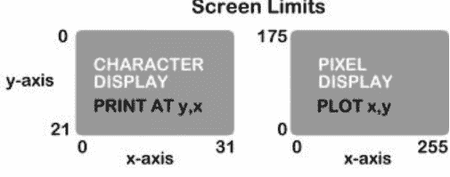
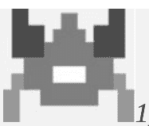
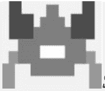

# ZX SPECTRUM 游戏代码俱乐部：20 个用于编程学习的趣味游戏

Sinclair BASIC 有趣且易于学习。

输入一个游戏，运行它，然后我们将进行解释。

Gary Plowman

## Gazzapper 游戏

## 特别感谢

感谢 Gabby 和 Pippin 忍受我的熬夜

## 致谢

我对所有支持这本书的读者，以及那些在早期阶段支持这一想法的 ZX Spectrum & BASIC 编程粉丝感谢。

感谢我的伴侣 Gabrielle 帮助我测试书中的一些代码。

感谢我的父母在 80 年代圣诞节期间为我买了一台 ZX Spectrum。

感谢 Richard Langford 允许我使用他的 48k Spectrum 图像。

感谢广大复古社区对信息传播的帮助。

感谢 Sir Clive Sinclair 制造了 Sinclair ZX Spectrums。

## 引言

在开始之前，让我们先明确一下本书的目的。这本书并不是为了成为一本关于 Sinclair BASIC 语言方方面无所不知的百科全书。这本书的目的是通过输入各种游戏的代码列表来辅助学习 Sinclair BASIC，其额外的好处是，你可以通过一些“老派”游戏的形式享受你的努力成果。随着你对这本书的不断深入，我们会减少解释，以免让你感到无聊。书中有很多不同类型的游戏，因此我希望每个人都能找到感兴趣的内容。

也许你们中的一些人想用一台你从小长大的机器，向年轻一代介绍早期微型计算机的光辉时代。或者你可能希望为当地的代码俱乐部提供易学习的活动，来制作有趣的游戏，而不需要成为资深的艺术家、天才或神童。也许你是一个 ZX 粉丝，并且买了一台那些新的蓝牙版 ZX Spectrum，无论何种情况，我们都希望你喜欢这本书。

作为一名青少年，我受益于 BASIC 编程，它为我开启了许多大门。

## 为什么选择 Sinclair BASIC？

Sinclair BASIC 是一种有趣且易于学习的语言。输入一个游戏，运行它，然后我们将进行解释。

Sinclair BASIC 是通往编程的门槛，许多成功的程序员都是从这里开始的。

Sinclair BASIC 以这种方式让你在编程中获得乐趣。

Sinclair BASIC 教会你逻辑。

Sinclair ROM（只读存储器）是用来让代码运行的。

### 你需要准备什么？

在开始之前，你需要准备以下配置：

- a) 真实的 Spectrum (Real)
- b) ZX Spectrum
- c) 蓝牙版 ZX Spectrum 让你进入 16k 模式。

### 快速上手

如果你想立即开始编写代码，并且已经准备好了上面的选项，那么你可以跳过这一节直接开始游戏。

### 基础命令

我们将使用的一些常用命令：`PRINT`、`IF`、`GOTO`、`GO SUB` 和 `LET`。我只会对这些命令进行简单的概述，以便通过实践来学习，而不是使用过多的术语让你感到无聊。

这是一个经典的“Hello World”示例：

```
10 PRINT AT 10,5;"Hello World"
```

在行末按回车键将其保存到内存中，然后输入 `RUN` 并查看效果。

上述代码的分解如下：

```
10      = 行号（程序的执行顺序）
PRINT   = 在屏幕上打印（简单！）
```

```
AT y,x   = 告诉程序在坐标处打印
其中 y 是纵轴，x 是横轴
```

```
;      = 允许新的子函数或用于文本打印
```

```
"Hello World" = 你的文本内容
```

`PAPER` 8 是透明的

`TAB` # 从左到右水平移动 # 空格

例如：`PRINT INK 2; AT 10,10;"Test"; TAB 16;PAPER 1;INK 7;1;"Print"`

如你所见，你可以在 `PRINT` 语句中使用几乎任何命令的组合。

#### 行号

在为代码行编号时，留出足够的间隙是一个良好的习惯，这样你就可以在以后输入额外的命令。我建议你自己的程序至少按 10 的步长递增。例如第 10 行，然后是第 20 行，以此类推。Sinclair BASIC 最多可以有 9999 行，但行之间可以使用冒号 `:` 分隔，从而包含多个语句，因此命令数量可以达到数万个。

#### 128k 模式与行号

128k Spectrum 模式还有另一个对新代码手非常有用的功能。如果你的程序缺少某部分，且你没有为命令留出空间空间你可以运行 `RENUMBER`，它将重新组织程序的行号。这有一定的局限性，但在我们早期阶段不需要担心这些。

#### UDGs (用户定义图形)

你将学会如何轻松地创建自己的图形！这样你可以回到书中的某些程序，并添加你自己的图形来增强或扩展它们。

#### 机器码

对于本书来说，机器码可能有点难以理解。因此我们不会涵盖这部分。不过，请在 Gazzapper.com 订阅我们的提醒，因为我们可能会发布包含少量机器码例程的游戏更新版本。

#### 什么是“打入列表”？

在微型计算机的早期，杂志会发布“列表”或“打入列表”，让年轻的爱好者（即代码编写者/程序员）坐在自家里舒适的卧室里，坐下来并在键盘上输入代码。有些列表可能会打印错误或包含漏洞，导致用户对作者感到沮丧和愤怒。如果你无法修复这些漏洞，你就只能面对无法运行的代码，而你已经花费了几个小时来输入它们。

不过，我很高兴地告诉你，我已经编写并测试了所有的列表，确保它们能够正常运行，任何问题都可以通过我建立的名为 ZX Spectrum Code Club 的新 Facebook 小组来解决。如果你已经是 ZX Spectrum 组的成员，可以在那里发布你的问题（如果规则允许）。

这些列表的编码方式最大限度地利用了 Sinclair BASIC 的速度限制（在合理范围内），以便游戏具有可玩性，并希望也很有趣。其结构易于理解，虽然并不完美，但它允许用户理解每个游戏内部的运作。游戏的结构保持相似，这样你就能熟悉它们，并为你的创作提供一个简单的使用的模板。

Sinclair BASIC 的一个伟大特性是 ROM 在接受语句之前会验证大部分代码。万一你之前错过了这一点，ROM 代表只读存储器，它包含了 BASIC 所需操作系统和各种例程。

虽然运行程序不需要 `REM` 语句，但提供这些注释是一个良好的习惯，因为你向程序中添加的代码越多，需要的注释就越多。特别是对于用户，在未来的某一天编辑或扩展代码时可以随时参考。它们还可以作为程序不同部分之间的视觉分割符，使之更易阅读。

Sinclair BASIC 不是最快的编程语言，但它是最容易学习的语言之一，而且非常有趣。在不涉及过多技术细节的情况下，用户可以通过将选项中的模拟器速度从标准的 3.54MHz 提高到 x2 倍或更高，来加速任何 Spectrum 模拟器。

#### 模拟器键盘映射

当使用模拟器而非真实的 Spectrum 机器时，关于键盘映射，有一些细微之处需要说明。下面是真实的 48k Spectrum 键盘布局。

在你的 PC / MAC 键盘上选择引号和 `*` 等符号可能与模拟器上的不同。这在某些键盘和模拟器上是可能发生的。你可以从上面看到，某些符号在你的键盘上是不同的。

#### Sinclair 模拟器的标准键盘等效键

以下是一些映射可能有所不同的列表。请记住，某些模拟器在这些映射上可能会使用 Alt 代替 Ctrl。

- *（星号） = Ctrl 和 B
- ( = Ctrl 和 8
- ) = Ctrl 和 9
- “（引号） = Ctrl 和 P
- .（句号） = Alt Gr 和 M
- ,（逗号） = Alt Gr 和 n
- ;（分号） = Alt Gr 和 O
- :（冒号） = Alt Gr 和 O
- Delete = Shift 和 0（零）

注意：Alt Gr 是右 Alt 键

如果你遇到困难或任何问题，请向许多 ZX Spectrum Facebook 小组之一提交你的查询。

#### 保存你的打入内容

对于模拟器用户来说这相对简单——只需保存快照文件 (.sna)，但对于“真实”机器用户，你需要一台旧式的录音机和一张空白的 C15、C30、C60 或 C90 带。要保存你的打入内容，按下磁带机上的“播放与录制”（连接耳机和麦克风），并使用 `SAVE "<Typein Name>" LINE 10`。

我书中的大多数游戏都使用了这种结构。我希望这种格式能帮助你理解游戏循环的作用以及如何使用它。

#### 如何使用本书

你可以按照自己喜欢的顺序编写或打入这些列表。虽然某些命令或新概念可能没有解释，因为它们可能在之前的列表中处理过，但没关系。

Sinclair BASIC 不是最快的编程语言，但它是最容易学习的语言之一，而且很有趣。在不涉及过多技术细节的情况下，用户可以通过将选项中的模拟器速度从标准的 3.54MHz 提高到 x2 倍或更高，来加速任何 Spectrum 模拟器。

### 井字格游戏代码解析

现在你已经完成了游戏的输入，可以开始玩它了。若要在 BASIC 中运行程序，在提示符处输入 `RUN` 然后按回车键。

#### 游戏之后

我们不会逐行讲解代码，只讲解重要的部分或我认为可能较难理解的部分。

那么这一切意味着什么呢？其实第 10 到 20 行只是为了演示，`REM` 命令用于添加代码的任何注释或备注。

```
10 REM ************************************
15 REM *井字格或井圈交叉游戏
20 REM ************ Gary Plowman ************
```

第 30 行设置了游戏的显示。`INK` 命令是笔颜色，`PAPER` 是主屏幕区域，`BORDER` 是主屏幕之外的区域。边框区域很少使用，且 `PLOT` 或 `PRINT` 命令无法到达那里，但可以使其闪烁以指示命中或得分。

```
30 INK 7: PAPER 6: BORDER 7: CLS : LET ply=1: LET win=0: DIM a(9,2): LET sq=0
```

该行接下去的是 `CLS`。这意味着“清除屏幕”，如果没有 `PAPER` 命令，就无法为整个屏幕区域着色。之后，使用 `LET` 命令来设置变量。变量存储值，以便在代码稍后使用或更改。

#### 数组与多维数组

接下来的部分并不难，但如果你暂时还不理解数组，也不要担心。数组在刚开始时很棘手，最好将它们看作值的列表。

第 30 行的最后部分是 `DIM a(9,2)` 命令（多维数组）。这是一个变量数组，工作原理类似于数值顺序的列表或电子表格。但如果你不理解这一点，也许这里能解释得更清楚。

第一维度可以被看作第 1 列，包含 9 行数据。第二部分指的是第 2 列，包含另一组 9 行数据。

##### DIM a(9,2) – 9 行向下，2 列

| 列 1 | 列 2 |
| --- | --- |
| `LET a(1,1)=1` | `LET a(1,2)=1` - 行 |
| ... | ... |
| `LET a(9,1)=9` | `LET a(9,2)=9` - 行 |

上述命令将值存储在数组的不同部分。如果你尝试超出 `DIM` 语句设置的数组限制，就会发生错误。BASIC 中的数组始终从 1 开始，而不是 0。

#### GO SUB 详解

`GO SUB` 命令意味着子程序。`GO SUB` 允许程序根据行号跳转到代码的另一部分，然后在遇到 `RETURN` 语句时返回之前的位置。这对于将 BASIC 程序划分为逻辑部分非常有用。对于任何可能想要添加的代码，记住 `GO SUB` 是很有帮助的。每个重要问题都可以分离为 `GO SUB` 例程，这可以帮助你跟踪程序。

#### 剩余程序总结

第 90 到 210 行绘制游戏屏幕的内容。

- 90 `PRINT AT 2,10; INK 5;"井字"`
- 110 `PLOT 5:100,40; DRAW INK 5;0`
- 120 `PLOT 5:150,40; DRAW INK 5;0`
- 130 `PLOT 5:65,70; DRAW INK 5;0`
- 140 `PLOT 5:65,110; DRAW INK 5;0`
- 160 `REM 状态 1=玩家, 2=玩家`
- 175 `INK 5: PLOT 50,170; DRAW -40`
- 180 `CIRCLE 4:220,150`
- 190 `PRINT ; INK 3;AT 14,0;"7 8 9`

第 110 到 140 行在屏幕上绘制起始点（画点）。然后 `DRAW` 命令创建线段或弧。第 175 到 190 行在网格两侧绘制 X 和 O 符号，并打印玩家控制。第 300 到 400 行运行主循环，这对游戏来说很简单。

```
300 REM 测试
310 PRINT AT 18,1; INK 7; PAPER 6;ply;"1-9"
320 LET i$=INKEY($
330 IF i$="1" AND i$="9" THEN square=VAL i$: GO SUB 100
340 IF i$="" GOTO 320
350 GO SUB 200: REM 测试胜利条件
360 IF win<> THEN PRINT AT 18,1;"玩家胜利了!"; BEEP .4,3; BEEP 2,10: GO TO 10
370 IF win=0 THEN PRINT AT 18,1;"平局 - 重新开始"; BEEP .4,3; BEEP 2,10: GO TO 10
400 GO TO 300
```

320 行是重要的，因为它捕捉了玩家的按键。330 行确保按键有效（即在 1 到 9 之间）。第 1000 到 1090 行检查该格子是否已被占用。

#### 完整代码清单

```
1050 PRINT AT 18,1;"
1090 RETURN

2000 REM ***** 胜利条件检查

2010 FOR n=1 TO 2
2020 IF a(1,n)=1 AND a(2,n)=1 AND a(3,n)=1 THEN win=n
2030 IF a(1,n)=1 AND a(4,n)=1 AND a(7,n)=1 THEN win=n
2040 IF a(2,n)=1 AND a(5,n)=1 AND a(8,n)=1 THEN win=n
2050 IF a(3,n)=1 AND a(6,n)=1 AND a(9,n)=1 THEN win=n
2060 IF a(3,n)=1 AND a(5,n)=1 AND a(7,n)=1 THEN win=n
2070 IF a(1,n)=1 AND a(5,n)=1 AND a(9,n)=1 THEN win=n
2080 IF a(4,n)=1 AND a(5,n)=1 AND a(6,n)=1 THEN win=n
2090 IF a(7,n)=1 AND a(8,n)=1 AND a(9,n)=1 THEN win=n
2100 NEXT

2110 RETURN

3000 REM ***** 绘制移动

3010 LET posx=80: LET posy=130: REM ***** 在哪里绘制
3020 IF square=1 THEN LET posx=80:LET posy=130
3030 IF square=2 THEN LET posx=130: LET posy=130
3040 IF square=3 THEN LET posx=180:LET posy=130
3050 IF square=4 THEN LET posx=80: LET posy=100
3060 IF square=5 THEN LET posx=130: LET posy=100
3070 IF square=6 THEN LET posx=180: LET posy=100
3080 IF square=7 THEN LET posx=80: LET posy=70
3090 IF square=8 THEN LET posx=130: LET posy=70
3100 IF square=9 THEN LET posx=180: LET posy=70
3300 IF ply=1 THEN CIRCLE INK 4;posx-10,posy-10,10
3310 IF ply=2 THEN INK 5: PLOT posx,posy: DRAW -20,-20: PLOT posx-20,posy: DRAW 20,-20

3350 RETURN
```


# ZX Spectrum BASIC 游戏代码解析

## 井字棋游戏核心逻辑

### 检查格子占用情况 (1000-1090 行)

```basic
1000 REM 检查格子
1010 IF a(square,1)=1 OR a(square,2)=1 THEN PRINT AT 18,1; INK 3;"格子已被占用"; BEEP .3,1: GO TO 1050
1020 LET a(square,ply)=1: LET ply=ply+1: LET sq=sq+1
1025 PRINT AT 18; INK 4;"好的一步！": BEEP .4,12
1030 IF ply=3 THEN ply=1
1040 GO SUB 3000: REM ******** 绘制移动
1050 PRINT AT 18,1;"
1090 RETURN
```

### 胜利条件检查 (2000-2110 行)

第 2000 到 2110 行检查是否满足胜利条件。如果找到了胜利者，程序将宣布并重启游戏。

```basic
2000 REM ******** 胜利条件检查
2010 FOR n=1 TO 2
2020 IF a(1,n)=1 AND a(2,n)=1 AND a(3,n)=1 THEN win=n
2030 IF a(1,n)=1 AND a(4,n)=1 AND a(7,n)=1 THEN win=n
2040 IF a(2,n)=1 AND a(5,n)=1 AND a(8,n)=1 THEN win=n
2050 IF a(3,n)=1 AND a(6,n)=1 AND a(9,n)=1 THEN win=n
2060 IF a(3,n)=1 AND a(5,n)=1 AND a(7,n)=1 THEN win=n
2070 IF a(1,n)=1 AND a(5,n)=1 AND a(9,n)=1 THEN win=n
2080 IF a(4,n)=1 AND a(5,n)=1 AND a(6,n)=1 THEN win=n
2090 IF a(7,n)=1 AND a(8,n)=1 AND a(9,n)=1 THEN win=n
2100 NEXT n
2110 RETURN
```

### 绘制玩家移动 (3000-3350 行)

第 3000 到 3350 行根据轮到哪个玩家在棋板上绘制新标记。

```basic
3000 REM ******** 绘制移动
3010 LET posx=80: LET posx=130: REM ******** 在哪里绘制
3020 IF square=2 THEN LET posx=80: LET posy=130
3030 IF square=2 THEN LET posx=130: LET posy=130
3040 IF square=3 THEN LET posx=180:LET posy=130
3050 IF square=4 THEN LET posx=80: LET posy=100
3060 IF square=5 THEN LET posx=130: LET posy=100
3070 IF square=6 THEN LET posx=180: LET posy=100
3080 IF square=7 THEN LET posx=80: LET posy=70
3090 IF square=8 THEN LET posx=130: LET posy=70
3100 IF square=9 THEN LET posx=180: LET posy=70
3300 IF ply=1 THEN CIRCLE INK 4;posx-10,posy-10,10
3310 IF ply=2 THEN INK 5: PLOT posx,posy: DRAW -20,-20: PLOT posx-20,posy: DRAW 20,-20
3350 RETURN
```

现在你已经完成了游戏的输入，可以开始玩了。若要在 BASIC 中运行程序，在提示符处输入 `RUN` 然后按回车键。

## 游戏之后

我们不会逐行讲解代码，只讲解重要的部分或我认为可能较难理解的部分。

### 代码注释与初始化

那么这一切意味着什么呢？其实第 10 到 20 行只是为了演示，`REM` 命令用于添加代码的任何注释或备注。

```basic
10 REM ************************************
15 REM *井字格或井圈交叉游戏
20 REM ************ Gary Plowman ************
```

第 30 行设置了游戏的显示。`INK` 命令是笔颜色，`PAPER` 是主屏幕区域，`BORDER` 是主屏幕之外的区域。边框区域很少使用，且 `PLOT` 或 `PRINT` 命令无法到达那里，但可以使其闪烁以指示命中或得分。

```basic
30 INK 7: PAPER 6: BORDER 7: CLS : LET ply=1: LET win=0: DIM a(9,2): LET sq=0
```

该行接下去的是 `CLS`。这意味着“清除屏幕”，如果没有 `PAPER` 命令，就无法为整个屏幕区域着色。之后，使用 `LET` 命令来设置变量。变量存储值，以便在代码稍后使用或更改。

## 数组与多维数组

接下来的部分并不难，但如果你暂时还不理解数组，也不要担心。数组在刚开始时很棘手，最好将它们看作值的列表。

第 30 行的最后部分是 `DIM a(9,2)` 命令（多维数组）。这是一个变量数组，工作原理类似于数值顺序的列表或电子表格。但如果你不理解这一点，也许这里能解释得更清楚。

第一维度可以被看作第 1 列，包含 9 行数据。第二部分指的是第 2 列，包含另一组 9 行数据。

### DIM a(9,2) – 9 行向下，2 列

| 列 1 | 列 2 |
| --- | --- |
| `LET a(1,1)=1` | `LET a(1,2)=1` - 行 |
| ... | ... |
| `LET a(9,1)=9` | `LET a(9,2)=9` - 行 |

上述命令将值存储在数组的不同部分。如果你尝试超出 `DIM` 语句设置的数组限制，就会发生错误。BASIC 中的数组始终从 1 开始，而不是 0。

### GO SUB 详解

`GO SUB` 命令意味着子程序。`GO SUB` 允许程序根据行号跳转到代码的另一部分，然后在遇到 `RETURN` 语句时返回之前的位置。这对于将 BASIC 程序划分为逻辑部分非常有用。对于任何可能想要添加的代码，记住 `GO SUB` 是很有帮助的。每个重要问题都可以分离为 `GO SUB` 例程，这可以帮助你跟踪程序。

### 剩余程序总结

第 90 到 210 行绘制游戏屏幕的内容。

- `90 PRINT AT 2,10; INK 5;"井字"`
- `110 PLOT 5:100,40; DRAW INK 5;0`
- `120 PLOT 5:150,40; DRAW INK 5;0`
- `130 PLOT 5:65,70; DRAW INK 5;0`
- `140 PLOT 5:65,110; DRAW INK 5;0`
- `160 REM 状态 1=玩家, 2=玩家`
- `175 INK 5: PLOT 50,170; DRAW -40`
- `180 CIRCLE 4:220,150`
- `190 PRINT ; INK 3;AT 14,0;"7 8 9`

第 110 到 140 行在屏幕上绘制起始点（画点）。然后 `DRAW` 命令创建线段或弧。第 175 到 190 行在网格两侧绘制 X 和 O 符号，并打印玩家控制。第 300 到 400 行运行主循环，这对游戏来说很简单。

```basic
300 REM 测试
310 PRINT AT 18,1; INK 7; PAPER 6;ply;"1-9"
320 LET i$=INKEY($)
330 IF i$="1" AND i$="9" THEN square=VAL i$: GO SUB 100
340 IF i$="" GOTO 320
350 GO SUB 200: REM 测试胜利条件
360 IF win<> THEN PRINT AT 18,1;"玩家胜利了!"; BEEP .4,3; BEEP 2,10: GO TO 10
370 IF win=0 THEN PRINT AT 18,1;"平局 - 重新开始"; BEEP .4,3; BEEP 2,10: GO TO 10
400 GO TO 300
```

320 行是重要的，因为它捕捉了玩家的按键。330 行确保按键有效（即在 1 到 9 之间）。第 1000 到 1090 行检查该格子是否已被占用。

```basic
1000 REM 检查格子
1010 IF a(square,1)=1 OR a(square,2)=1 THEN PRINT AT 18,1; INK 3;"格子已被占用"; BEEP .3,1: GO TO 1050
1020 LET a(square,ply)=1: LET ply=ply+1: LET sq=sq+1
1025 PRINT AT 18; INK 4;"好的一步！": BEEP .4,12
1030 IF ply=3 THEN ply=1
1040 GO SUB 3000: REM ******** 绘制移动
1050 PRINT AT 18,1;"
1090 RETURN
```

第 2000 到 2110 行检查是否满足胜利条件。如果找到了胜利者，程序将宣布并重启游戏。

```basic
2000 REM ******** 胜利条件检查
2010 FOR n=1 TO 2
2020 IF a(1,n)=1 AND a(2,n)=1 AND a(3,n)=1 THEN win=n
2030 IF a(1,n)=1 AND a(4,n)=1 AND a(7,n)=1 THEN win=n
2040 IF a(2,n)=1 AND a(5,n)=1 AND a(8,n)=1 THEN win=n
2050 IF a(3,n)=1 AND a(6,n)=1 AND a(9,n)=1 THEN win=n
2060 IF a(3,n)=1 AND a(5,n)=1 AND a(7,n)=1 THEN win=n
2070 IF a(1,n)=1 AND a(5,n)=1 AND a(9,n)=1 THEN win=n
2080 IF a(4,n)=1 AND a(5,n)=1 AND a(6,n)=1 THEN win=n
2090 IF a(7,n)=1 AND a(8,n)=1 AND a(9,n)=1 THEN win=n
2100 NEXT n
2110 RETURN
```

第 3000 到 3350 行根据轮到哪个玩家在棋板上绘制新标记。

```basic
3000 REM ******** 绘制移动
3010 LET posx=80: LET posx=130: REM ******** 在哪里绘制
3020 IF square=2 THEN LET posx=80: LET posy=130
3030 IF square=2 THEN LET posx=130: LET posy=130
3040 IF square=3 THEN LET posx=180:LET posy=130
3050 IF square=4 THEN LET posx=80: LET posy=100
3060 IF square=5 THEN LET posx=130: LET posy=100
3070 IF square=6 THEN LET posx=180: LET posy=100
3080 IF square=7 THEN LET posx=80: LET posy=70
3090 IF square=8 THEN LET posx=130: LET posy=70
3100 IF square=9 THEN LET posx=180: LET posy=70
3300 IF ply=1 THEN CIRCLE INK 4;posx-10,posy-10,10
3310 IF ply=2 THEN INK 5: PLOT posx,posy: DRAW -20,-20: PLOT posx-20,posy: DRAW 20,-20
3350 RETURN
```

# ZX 破砖 (ZX BREAKOUT)

基于 Atari 的原始街机游戏《Breakout》。我第一次玩《Breakout》是在我家附近的一个台球厅。我想那是我玩过的第一款彩色街机游戏。尽管后来我发现自己被骗了！这个游戏其实只有黑白颜色——额外的颜色是通过覆盖一层彩色透明塑料实现的。屏幕上的效果与 ZX Spectrum 的色彩冲突（color clash）非常相似。但尽管如此，它依然发挥了魔力，我迷上了其中。顺便问一下，我提到过苹果的两位主要创始人创建了《Breakout》吗！

## 玩家

## 规则

- 发射球并防止它掉落你的挡板。
- 消除价值 70 分的区块以进入下一个屏幕。

## 控制

- `z` = 左，`x` = 右，`[space]` = 发射球。

```basic
10 REM ***********ZX CODE CLUB***********
15 REM * ZX BREAKOUT by G Plowman 2015
20 REM ************************************
25 GO SUB 7000
30 INK 1: PAPER 7: BORDER 4: CLS
35 LET lives=3
45 REM Initialising variables
50 PRINT AT 2,10; INK 7; BRIGHT 1; PAPER 2;"ZX BREAKOUT"; BRIGHT 0; PAPER 7; INK 1;AT 6;0;"Taken from..";AT 8;0;"Spectrum Games Code Book": PAUSE 0
```

```basic
100 GO SUB 300: REM initialise
```

```basic
120 GO SUB 500: REM menu
```

```basic
130 GO SUB 1000: REM main loop for game
```

```basic
200 GO TO 30
```

```basic
300 LET ply=2: LET win=0: DIM a(9,2): DIM d(30): LET lvl=1: LET pos=30: LET x=10: LET time=0: LET score=0: LET timer=0: LET mov=11: LET pos=11: vx=0: LET vy=0: LET speed=1: LET ball=0: LET bx=0: LET by=0: LET score=2
```

```basic
310 LET b$="+CHR(147)$CHR(145)+" ": LET w=$CHR(146)$CHR$(146)
```

```basic
400 RETURN
```

```basic
510 LET w=$CHR(146)
```

```basic
520 FOR n=0 TO 31
```

```basic
530 PRINT INK 2;AT 1,n;w$;AT 21,n;w
```

```basic
540 NEXT
```

```basic
545 FOR n=0 TO 20:
```

```basic
546 PRINT INK 2;AT n,0;w$;AT n,31;w
```

```basic
549 NEXT
```

```basic
550 RETURN
```

```basic
1000 REM Main Loop
```

```basic
1005 PRINT AT 20,x-2;"b$;"\ "
```

```basic
1010 LET i=$INKEY($): LET kemp=IN 51
```

```basic
1020 LET timer=timer+
```

```basic
1030 IF(i="z" OR k=2 AND x>2) LET x=x-1:
```

```basic
1040 IF(i="x" OR k=1 AND x<29 THEN LET x=x+1
```

```basic
1045 IF i="z" OR is="w" OR k=0 THEN PRINT AT 20,x-2;"b$;"\ "
```

```basic
1050 IF(i=$CHR(32) OR k=16) AND ball=0 THEN LET vx=(RND*1.5)(RND*1.5): LET vy=-1: LET ball=1: LET bx=x: LET by=19
```

```basic
1060 timer=5 THEN SUB 300
```

```basic
1070 ball=1 THEN GO SUB 400
```

```basic
1080 PRINT AT 0,2;"SCORE:";score";(Lvl);Lives:";lives:
```

```basic
2000 GO TO 1010
```

```basic
3000 REM draw blocks
3010 FOR n = 1 TO 20
3020 FOR p = 1 TO 10
3025 ir=RND*4+1
3030 PRINT AT p+2,n+4; INK 0; PAPER ir;"__;
3050 NEXT p
3060 NEXT n
3070 LET timer = 6
```

```basic
3100 RETURN
```


```basic
4000 REM BALL MOVE
4005 PRINT AT by,bx;"
4010 LET bx=bx+vx; LET by=by+vy
4014 LET y$=INT(by),INT(bx))
4015 IF y$=" THEN score + 1; BEEP0,vx+bx; LET score2=score2+1; LET vy=-vy*speed
4016 IF by=19 AND (bx-x)<2 THEN LET vx=((RND*2)+1)-(RND*2)+1)vy=-vy*speed; PRINT AT 20,x-2;"b;"
4020 PRINT AT by,bx; INK 2;CHR(144)
4040 IF bx>29 THEN vx=-(vx*speed)
4050 IF bx<2 THEN LET vx=(vx*speed)
4060 IF by>20 THEN lives=0; LET lives-1: BORDER 2: BEEP1,0
4070 IF by<1 THEN LET vy=-(vy*speed)
4080 IF lives=0 THEN GO SUB 5000:
4090 IF score2>=70 THEN GO SUB 6000; REM Next level
4200 RETURN
```

```basic
5000 REM restart
5010 PRINT AT 10,5; FLASH 1;"G A"
5030 FOR n = 1 TO 20
5100 PRINT AT 12,5;"PRESS TO START"
5110 IF INKEY$=" THEN GO TO 5120
5120 GO TO 30
```

```basic
6000 REM LEVEL
6005 LET lvl=lvl+1: CLS ; PRINT AT 10
```

### 什么是 New？

`RND` function is used to generate a Random value between 0 and 1 which is multiplied by a value which determines the range of the values. E.g. `INT(RND*10)` rounds down a number to places. Other parts in this listing are UDGs (User Definable Graphics) and we will go over briefly. Also new is the use of directional vector stored in `vx` and `vy` which constantly increase or decrease the x and y values for ball movement every loop.

### What are UDGs?

UDGs stand for User Definable Graphics and they help add sprites. Each UDG character has 8 bits. By default they start out like the letters A to Z. After some thought out these letters can be changed to graphics. Each UDG contains 8 bytes of data. Binary of 1s and 0s into a decimal number.

An easy way to create these graphics is to use `BIN` function. The `BIN` function will convert a string of 1s and 0s into a decimal number. Binary on spectrum ranges from 0 to 255 which each 0 or 1 representing a number which doubles the value of the previous digit. All 8 digits would total to make 255. Below is an example of binary data to make tree shape and the decimal equivalents of each byte of the UDG. Here is an example of what Binary => Decimal looks like:

| Digit1 | Digit2 | Digit3 | Digit4 | Digit5 | Digit6 | Digit7 | Digit8 |
| --- | --- | --- | --- | --- | --- | --- | --- |
| 1 = 1 | 1 = 2 | 1 = 4 | 1 = 8 | 1 = 16 | 1 = 32 | 1 = 64 | 1 = 128 |
| 0 | 0 | 1 | 1 | 1 | 0 | 0 | 0 | 28 |
| 0 | 1 | 0 | 1 | 0 | 1 | 0 | 0 | 42 |
| 1 | 0 | 0 | 1 | 0 | 0 | 1 | 0 | 73 |
| 0 | 0 | 1 | 1 | 1 | 0 | 0 | 0 | 28 |
| 0 | 1 | 0 | 1 | 0 | 1 | 0 | 0 | 42 |
| 1 | 0 | 0 | 1 | 0 | 0 | 1 | 0 | 73 |
| 0 | 0 | 1 | 1 | 1 | 0 | 0 | 0 | 28 |
| 0 | 1 | 1 | 1 | 1 | 1 | 0 | 0 | 62 |

Tip: Using code to create UDGs is relatively easy, “a” is the first UDG character.

- Add level formations
- Add power-ups

# 贪蛇 (SNAKE BITE)

You must help the snake survive and grow by eating the apples that are falling from the trees. Try to eat as many as possible without running into the side of the screen or your own tail! Myself and classroom buddies spent a lot of time playing this game on IBMs during classes. It also appeared later on Nokia phones and was one of the first mobile games!

玩家：

规则：

- Try to eat many apples as possible and beat their high score.
- Running into borders or your own tail will end the game.

控制：

- q = up, a = down, o = left, p = right.

```basic
10 REM ******ZX Code Club
15 REM * SNAKE BITE by Garyman
20 REM *********************************
25 LET sc=0: GO SUB 6000
30 INK 1: PAPER 7; BORDER 4: CLS
45 REM Initialising variables
50 PRINT AT 2,10; INK 7; BRIGHT 1; PAPER 2;"SNAKE BITE"
55 LET lives=3
60 PRINT AT 7,5;"Avoid your tail!"
65 PRINT AT 8,5;"Eat the apples"
70 PRINT AT 11,5:"Controls"
75 PRINT AT 12,2;"Q/A=Up/Down, O/P=Left/Right"
80 PRINT AT 18,5;"PRESS A TO START"
85 PAUSE 0
```

```basic
100 GO SUB 300: REM initialise
130 GO SUB 1000: REM main loop for game
200 GO TO 30:
300 REM SETUP
310 LET x=10: LET y=0: LET vx=0: LET score=0: LET lvl=1: ax=1: LET ay=1: LET ax2=0: LET ay2=0: LET loot=0: LET snk=5: LET dx=x: dy=y: LET longer=0: LET snkpos=1: LET ny=0: LET nx=0: LET ly=0: x=0
330 RETURN
```

```basic
1000 CLS
1010 FOR n=0 TO 19
1030 PRINT n,0;CHR$(136);AT n,31;CHR$(136)
1040 NEXT n
1045 FOR n=1 TO 30
1050 PRINT 0,n;CHR$(136);AT 19,n;CHR$(136)
1060 NEXT n
1087 PRINT AT INT (RND*15)+3,INT (RND*25)+3; PAPER 6;"o"
1095 PRINT AT 20,1;Score:":score
1096 FOR n=1 TO 5
1097 PRINT AT y,x-n;"*"
1098 NEXT n
1099 PRINT AT y,x;"*"
1100 LET i=$INKEY($): LET i=IN 31
1110 IF(i="q" OR i=2) AND y>2 THEN LET vy=-1: LET vx=0
1120 IF(i="a" OR i=4) AND y<19 THEN LET vy=1: LET vx=0
1130 IF(i="o" OR i=1) AND x>2 THEN LET vx=-1: LET vy=0
1140 IF(i="p" OR i=2) AND y>30 THEN LET vx=1: LET vy=0
1190 LET x=x+vx: LET y=y+vy
1150 IF x=0 THEN GO SUB 200
1160 IF x=31 THEN GO SUB 2000
1170 IF y=19 THEN GO SUB 2000
1180 IF y=0 THEN GO SUB 2000
1185 LET a$=SCREEN$(y,x)
```

```basic
6000 REM LEVEL
6005 LET lvl=lvl+1: CLS ; PRINT AT 10
```

### 更新了什么？

这里主要的新变化是增加了第二种控制方法。`IN 31` 用于读取机器（或模拟器）的操摇杆端口。现在，你将能够在你的游戏中使用摇杆控制了。是的，在 Sinclair BASIC 游戏中添加操摇杆控制真的有那么简单。从 1100 行到 1140 行包含了检测游戏键盘和操摇杆控制的代码。这只需要 5 行代码！

```basic
1100 LET i=$INKEY(): LET i=IN 31
1110 IF (i="q" OR i=8) AND y>2 THEN LET vy=-1: LET vx=0
1120 IF (i="a" OR i=4) AND y<19 THEN LET vy=1: LET vx=0
1130 IF (i="o" OR i=1) AND x>2 THEN LET vx=-1: LET vy=0
1140 IF (i="p" OR i=2) AND y<30 THEN LET vx=1: LET vy=0
```

你使用一个或多个 Sinclair 操纵杆端口选项，只需要设置键 1,2,3,4 和5 或者 6,7,8,9 和0，这些键等同于左、右、下、上和发射。

### 速度

为了保持游戏代码在整个过程中以相同的速度运行，而不诉助于任何机器码，我们为蛇编写了一个自定义的吃尾部程序。为了让蛇能够生长，我们在蛇每次吃到东西时都延迟了吃尾部程序的执行。

### 碰撞检测

诸如 `SCREEN$(dy+ny,dx)="*"` 这样的命令对于测试碰撞或让程序知道对象可以移动到哪里，或者屏幕部分是否为空非常有用。在你创建任何自己的游戏时，请记住这一点。

### 高分

我这个版本的个人最高分是 72。如果你可以的话，尝试超越这个记录吧！

### IF x THEN y

所有的游戏都需要执行决策。BASIC 中的这些决策是使用 `IF THEN` 语句实现的。`IF x=1 THEN` 执行某些操作：现在执行其他操作：以此此类推。Sinclair 的 `IF` 语句非常简单，只执行单行命令。它们没有 `ELSE` 或 `ELSEIF` 备选条件。但你可以使用 `GOTO` 或 `GO SUB` 进行分支并执行多个命令。在本书中，我们还将看到使用 `AND / OR` 布尔表达式来满足多个条件的 `IF` 语句。

### 简单的布尔表达式示例

在 `IF` 和 `THEN` 之间，你可以有许多不同的表达式，并测试它们为真（TRUE）或假（FALSE），并使用括号以及布尔运算符 `AND` 和 `OR` 来组合并排序这些表达式。

`AND` 表达式在两边都为真时返回 TRUE：

| 1 AND 1 = TRUE | 1 AND 0 = FALSE |

`OR` 表达式在至少一侧为真时返回 TRUE：

| 1 OR 0 = TRUE | 0 OR 0 = FALSE |

加上这些后，你的语句会变成这样：

`IF (a=x OR b=x) AND c=x THEN y`

在上面，括号中的表达式首先被测试，然后使用 `AND` 运算符对结果进行测试。

你可以使用的另一个布尔运算符是 `NOT`。它会反转所用表达式的结果，所以 `NOT 1=1` 等于 FALSE 而 `NOT 1=0` 等于 TRUE。

### Basic BEEP 声音

`BEEP` 命令非常简单实用。你有两个设置：`BEEP` 持续时间和音高。

这里有一些 `BEEP` 值的简单钢琴音阶。

| C | C# | D | D# | E | F | F# |
|---|---|---|---|---|---|---|
| G | G# | A | A# | B | C | |
| | 1 | 2 | 3 | 4 | 5 | 6 | |
| 7 | 8 | 9 | 10 | 11 | 12 | |

持续时间以秒或秒的分数为单位，例如 .5 秒。所以音乐爱好者加入一些简单的音乐。

128k 模式通过 `PLAY` 命令提供了另一种选项，它使用更有音乐感的 AY 芯片，但为了方便使用和兼容性，我们将仅使用 `BEEP`。

### 扩展建议（可选）


- 1] 添加 UDP 并使用颜色属性进行碰撞检测
- 2] 添加更多需要避开的障碍
- 3] 添加计时器，增加玩家快速行动的压力

# FLAPPY BIRD

世界在 2014 年陷入了 Flappy 热。Flappy Bird 随处可见，随着开发者在如此短的时间内创建出游戏的消息，成千上万的新程序员涌现。它重新激发了许多国家对卧室编程的兴趣。

- 规则：玩家试图穿过迎而来的管道。
- 玩家尝试打破自己的高分。
- 控制：按任意键保持在空中。

这仍然是 Flappy Bird，如果你增加速度的话。享受吧！

```basic
1 REM Flappy by Gary (2)
2 PRINT "START"
3 PRINT AT 10,10;"LOADING GRAPHICS"
4 GO SUB 3000
5 BEEP 1
6 PAPER 7
7 CLS
8 LET hscore=0
10 LET score=0
```

### 更新内容？

现在你已经输入了一个 Spectrum 版本的 Flappy Bird（飞行的小鸟），你就可以看到如何用简单的代码来实现这样的游戏。好了，这里的部分代码对你来说可能有点困惑，但这可能是因为数学的应用。一旦解释清楚，它非常简单：管道的屏幕碰撞检测乘以 8，以便将管道绘制在 256（x轴）x192（y轴）像素的像素屏幕网格上。但实际的碰撞检测是基于 32（x轴）x22（y轴）字符打印网格的。为了方便理解，在比较字符打印位置和像素位置时，我们需要乘以或除以因子 8。每 8 个像素对应 1 个字符位置。请下方的屏幕像素和字符工作原理图。



### 欢迎色彩冲突（Colour Clash）

Sinclair Spectrum 的一个已知限制是屏幕上每个字符位置（8 x 8 像素）只能存在两种颜色。当这些颜色相互碰撞时，为游戏增添了一点复古魅力。当你的 Flappy Bird 与管道碰撞时，你会在这个游戏中注意到这个特性。瞧，这就是色彩冲突！

### 基础动画

使用 UDGs（也称为精灵图）进行动画在这里执行非常简单。

```
1033 IF INKEY$<>" THEN anim=1
```

上述行将 `anim` 值设置为 1，这样我们知道要绘制扇翅的 UDG 精灵图，让我们的鸟扇动翅膀。

```
1012 IF anim=1 THEN INK 1: PRINT AT fly-1,10;"CHR$(145)
```

这是一个非常简单的方法，但要实现超过一帧的动画通常涉及使用计时器值跟踪移动。那种细节将留到以后再说。`PRINT` 命令的第一部分会在于新位置打印之前清除小鸟旧的位置。


### 管道生成代码

```basic
302 FOR o=1 TO 10
303 LET h(o)=INT(RND*8)+1
305 NEXT o
306 FOR l=1 TO 10
308 LET x(l)=25+(l*5)
309 NEXT l
```

上面的代码创建了我们的管道位置和高度，但在它们向左滚动足够多显示在屏幕上之前是不会显示的。


> **扩展建议（可选）**

- 1] 添加敌人
- 2] 移除顶部管道并制作一个 Scramble 克隆版！

### 数字游戏

我非常喜欢节目《8 Out of 10 Cats Does Countdown》，我也喜欢尝试解决其中的数学部分！这个游戏灵感源于此。它并不高深，但尝试一下，看看你能否解决你自己的问题！也许你可能会在日后受到启发创建一个“文字”版本？

**玩家**：1 名玩家尝试使用提供的数字和数学命令计算结果。

**控制**：输入相应的值和命令：`add`、`mult` 和 `sub`。

```basic
10 REM ************ZX CODE CLUB\***********
15 REM * The Numbers Game (Countdown)
20 REM ************G,Plowman***********
30 INK 0: PAPER 5: BORDER 4: CLS
45 REM ***** Initialising variables
50 PRINT AT 2,7; INK 7; BRIGHT 1; PAPER 7; INK 3;"The Numbers Game": PRINT AT 4,5;"
60 PRINT AT 4,5;"Athletes Get Ready!"
80 PRINT AT 18,5; FLASH 1;"PRESS A KEY TO START": PAUSE 0: CLS
100 REM GO SUB 5000: REM Graphics
110 GO SUB 300: REM initialise
130 GO SUB 1000: REM draw screen
140 GO SUB 2000: main loop
300 REM **** init
```

```basic
310 LET p1=0: LET p2=0: LET p3=0: LET p4=0: LET p5=0: LET p$="": LET q$="": LET r$=""
320 LET s$="": LET t$=""
330 RETURN

1000 REM ****** Screen
1005 PRINT AT 3,10; PAPER 7; BRIGHT 1; INK 3;"THE NUMBERS GAME
1010 FOR n=5 TO 138
1020 PRINT AT n,10; PAPER 7;" "
1030 NEXT n
1040 PRINT AT 5,3; INK 6;CHR$(137);CHR$(143);CHR$(143);CHR$(143)
1060 PRINT AT 6,2; INK 6;CHR$(133); PAPER 7;CHR$(138);CHR$(137);CHR$(137); INK 3;CHR$(133)
1070 PRINT AT 7,2; INK 6;CHR$(132); PAPER 6;CHR$(138); INK 3;CHR$(133);CHR$(132)
1080 PRINT AT 8,2; INK 6;CHR$(133); PAPER 7;CHR$(138)
1090 PRINT AT 9,2; INK 6;CHR$(133); PAPER 7;CHR$(138); INK 2;CHR$(132);CHR$(140)
1100 PRINT AT 10,3; INK 6;CHR$(133); PAPER 7;CHR$(138); INK 6;CHR$(133)
1110 PRINT AT 11,4; PAPER 7;" "
1200 FOR n = 12 TO 18
1205 RANDOMIZE
1210 LET c=INT(RND*4)+3
1220 PRINT AT n+1,3; INK (RND*4);CHR$(143);CHR$(143); AT n,4;CHR$(143); AT n+1,5;CHR$(143)
1230 NEXT n
1250 FOR n=13 STEP 2
1260 PRINT AT n,14; PAPER 7;" "; PAPER 5;" "; PAPER 7;" "; PAPER 5;" "
1270 NEXT n
2000 PRINT AT 1,10;"PRESS S TO START
2010 LET i$=INKEY$
2020 IF i$="s" THEN GO TO 2100
2030 GO TO 2010
2100 RANDOMIZE
2105 LET ans=0: LET ans1=0
2110 LET n1=INT(RND*9)+10
2120 LET n2=INT(RND*10)+2
2130 LET n3=INT(RND*10)+2
2140 LET n4=INT(RND*10)+2
2150 LET n5=INT(RND*10)+2
2170 LET o1=INT(RND*4)+1
2180 LET o2=INT(RND*4)+1
2190 LET o3=INT(RND*4)+1
2195 LET o4=INT(RND*4)+1
2200 PRINT PAPER 1; INK 7;8
2300 PRINT AT 6,12;ans
2310 INPUT "Enter a number from the above",p1
2315 IF p1<>n1 AND p1<>n2 AND p1<>n3 AND p1<>n4 AND p1<>n5 THEN BEEP ,5,0: PRINT AT 11,10;"WRONG NUMBER": GO TO 2310
2320 INPUT "Enter command,add/sub or mult:",p$
2330 INPUT "Enter next number from the above",p2
2335 IF p2<>n1 AND p2<>n2 AND p2<>n3 AND p2<>n4 AND p2<>n5 THEN BEEP ,5,0: PRINT AT 11,10;"WRONG NUMBER": GO TO 2330
2340 INPUT "Enter command add, sub, mult or calc:"; q$
2345 IF q$="calc" THEN GO SUB 3000
2350 INPUT "Enter next number from the above",p3
2355 IF p3<>n1 AND p3<>n2 AND p3<>n3 AND p3<>n4 AND p3<>n5 THEN BEEP ,5,0: PRINT AT 11,10;"WRONG NUMBER": GO TO 2350
2360 INPUT "Enter command add, sub, mult or calc:"; r$
2370 IF r$="calc" THEN GO SUB 3000
2380 INPUT "Enter next number from the above",p4
2385 IF p4<>n1 AND p4<>n2 AND p4<>n3 AND p4<>n4 AND p4<>n5 THEN BEEP ,5,0: PRINT AT 11,10;"WRONG NUMBER": GO TO 2380
2390 INPUT "Enter command add, sub, mult or calc:", s$
2400 IF s$="calc" THEN GO SUB 3000
2410 INPUT "Enter next number from the above",p5
2420 IF p5<>n1 AND p5<>n2 AND p5<>n3 AND p5<>n4 AND p5<>n5 THEN BEEP ,5,0: PRINT AT 11,10;"WRONG NUMBER": GO TO 2410
2440 IF s$="calc" THEN GO SUB 3000
3000 REM ***** CHECK ANSWER
3010 LET ans=0
3020 IF p$="add" THEN LET answer = p1+p2
3030 IF p$="sub" THEN LET answer = p1-p2
3040 IF p$="mult" THEN LET answer = p1*p2
3050 IF q$="add" THEN LET answer = answer+p3
3060 IF q$="sub" THEN LET answer = answer-p3
3070 IF q$="mult" THEN LET answer = answer*p3
3080 IF r$="add" THEN LET answer = answer+p4
3090 IF r$="sub" THEN LET answer = answer-p4
3100 IF r$="mult" THEN LET answer = answer*p4
3110 IF s$="add" THEN LET answer = answer+p5
3120 IF s$="sub" THEN LET answer = answer-p5
3130 IF s$="mult" THEN LET answer = answer*p5
3200 IF answer = ans THEN BEEP 1,6: PRINT AT 11,10;"Yay! ";answer;" is correct!"
3210 IF answer<>ans THEN BEEP 1,-7: PRINT AT 11,10;"You Got ";answer;" is wrong"
3250 PRINT AT 12,10;"Press to Play Again": PAUSE 0
3260 GO TO 1000
```

> **扩展建议（可选）**

- 1] 增加更复杂的数学解决方案
- 2] 增加《倒计时》（Countdown）游戏中的字母/单词部分

### 战舰大战 (BATTLESHIP WAR)

另一款经典的纸上游戏。《战舰大战》是该游戏的电脑版本，并进行了一些小幅修改。选择你的网格来放置舰只。确保你的对手没有看你把船放在哪里。当你完成后，轮到他们在网格上放置舰只。获胜者是摧毁所有对手舰只的玩家。所以快开始打字并游戏吧！

**玩家**：2

**规则**：通过按下坐标键在网格上放置舰只。胜利者是摧毁所有对手舰只的玩家。

**控制**：使用 `A` 到 `J` 键进行水平放置，`1` 到 `9` 键垂直放置或射击。在按 `ENTER` 保存之前，使用 `R` 旋转船只位置。

**提示**：一块大大的纸板适合在“人人对战”模式下遮挡屏幕。


# 战舰大战 (BATTLESHIP WAR)

另一款经典的纸上游戏。《战舰大战》是该游戏的电脑版本，并进行了一些小幅修改。选择你的网格来放置舰只。确保你的对手没有看你把船放在哪里。当你完成后，轮到他们在网格上放置舰只。获胜者是摧毁所有对手舰只的玩家。

**玩家**：2

**规则**：通过按下坐标键在网格上放置舰只。胜利者是摧毁所有对手舰只的玩家。

**控制**：使用 `A` 到 `J` 键进行水平放置，`1` 到 `9` 键垂直放置或射击。在按 `ENTER` 保存之前，使用 `R` 旋转船只位置。

**提示**：一块大大的纸板适合在“人人对战”模式下遮挡屏幕。

## 代码清单

```basic
10 REM ****** ZX Code Club ************
15 REM * BATTLESHIP WAR by Gary Plowman
20 REM **********************************
30 INK 7: PAPER 0: BORDER 4: CLS
40 PRINT AT 5,10; INK 2;"BATTLESHIP WAR"
50 PRINT AT 10,5;"2 Game (hotseat)"
60 PRINT AT 12,5; BRIGHT 1; INVERSE 1;"1. Start Game"
70 PRINT AT 15,2;"Use a card to hide some"
80 PRINT AT 16,2;"of the screen or look away"
90 PRINT AT 17,2;"when player is placing";AT 18,2;"their units"
100 IF INKEY$="1" THEN LET gm=1: GO TO 130
120 GO TO 100
130 BEEP .2,7: BEEP .6,2: BEEP .3,-3: BEEP .7,9
135 INPUT "ENTER # SHIPS EACH (2 to 5);";nhips
140 BORDER 5: CLS
150 PRINT AT 1,10; INK 2;"BATTLESHIP WAR"
160 GO SUB 190
170 GO TO 270
180 REM ********************************* Redo Board *
190 FOR n=6 TO 14
200 PRINT AT n,5; PAPER 5; INK 1;""
210 PRINT AT n,17; PAPER 5; INK 1;""
220 PRINT AT n,3; PAPER 3;n-5;AT n,28;n-5
230 NEXT n
240 LET a$="ABCDEFGHIJ"
250 PRINT AT 5,5;a$;AT 5,17;a$
260 RETURN
270 IF gm=2 THEN PRINT AT 18,3;"PLAYER 1 GET READY";AT 19,3;"PLAYER 2 LOOK AWAY"
280 PRINT AT 21,5; FLASH 1;"PRESS KEY TO CONTINUE"
290 IF INKEY$="" THEN GO TO 290
300 GO SUB 320
310 GO SUB 380
320 REM ********************* Clearing part of
325 PRINT AT 17,0;"
330 PRINT AT 18,0;"
340 PRINT AT 19,0;"
350 PRINT AT 20,0;"
360 PRINT AT 21,0;"
370 RETURN
380 REM ********************* PLACING PLAYER 1 UNITS
390 DIM a(nhips,2,2): DIM h(2): DIM f(2): DIM x(nhips,2): DIM y(5): LET shp1=1: LET r=0: LET m$="": LET ply=1
400 PRINT AT 17,3;"Press Coords for ship";shp1;AT 18,3;"e.g. A5"
410 LET i$=INKEY$
420 IF i$>="a" AND i$<="k" THEN LET a(shp1,1,ply)=CODE(i$)-96: LET m$=i$+STR$(a(shp1,1,ply)): BEEP .05,6
430 IF i$>="1" AND i$<="9" THEN LET a(shp1,2,ply)=VAL(i$): LET m$=i$+STR$(a(shp1,2,ply)): BEEP .05,7
435 IF a(shp1,1,ply)=0 OR a(shp1,2,ply)=0 THEN GO TO 400
440 IF ply=1 THEN PRINT AT 4,2;CHR$(a(shp1,1,ply)+96);" Ship"
450 IF r=1 AND a(shp1,2,ply)>7 THEN LET r=NOT r
460 IF i$="r" THEN LET r=NOT r
470 IF r=0 AND a(shp1,1,ply)>7 THEN LET r=NOT r
480 IF i$=CHR$(13) AND a(shp1,2,ply)>0 AND a(shp1,1,ply)>0 THEN BEEP .32: LET shp1=shp1+1: GO SUB 320
490 IF shp1>nhips AND ply=1 THEN BEEP 1,7: BEEP .2: LET shp1=1: LET ply=2: GO TO 590
500 IF shp1>nhips AND ply=2 THEN LET ply=1: BEEP 1,7: BEEP .2: GO TO 1000
505 IF a(shp1,2,ply)>0 OR a(shp1,1,ply)=0 THEN PRINT AT 20,0;"[R] Rotate Ship";AT 21,0; FLASH 1;"[Enter] Next"
510 IF i$="" THEN GO TO 590: REM ***************** redo again
530 IF r=0 THEN LET x(shp1,1,ply)=0
540 IF r=1 THEN LET x(shp1,1,ply)=1
550 FOR n=1 TO shp1
560 IF x(n,ply)=0 AND ply=1 THEN PRINT AT a(n,2,ply)+5,a(n,1,ply)+4;
570 IF x(n,ply)=1 AND ply=1 THEN PRINT AT a(n,2,ply)+5,a(n,1,ply)+4;
580 IF x(n,ply)=0 AND ply=2 THEN PRINT AT a(n,2,ply)+5,a(n,1,ply)+16;
590 IF x(n,ply)=1 AND ply=2 THEN PRINT AT a(n,2,ply)+5,a(n,1,ply)+16;AT a(n,2,ply)+6,a(n,1,ply)+16;
600 NEXT n
700 GO TO 400
1000 REM **** TAKE TURNS
1005 LET hits=1: LET ply=1: LET hits1=1: LET hits2=1
1010 PRINT AT 4,2;"
1020 GO SUB 190
1030 GO SUB 320
1040 PRINT AT 17,0;"PLAYER ";ply;"... SHOT..e.g. A5"
1050 GO SUB 2000: REM Get shot
2000 REM ****** Get shot coords
2005 LET ply=ply+1
2006 IF ply>2 THEN LET ply=1
2008 PRINT AT 18,0;"Current Hits on Target: ";f(ply)
2010 LET i$=INKEY$
2020 IF i$>="a" AND i$<="k" THEN LET h(1)=CODE(i$)-96: LET m$=i$+STR$(h(1)): BEEP .05,6
2030 IF i$>="1" AND i$<="9" THEN LET h(2)=VAL(i$): LET m$=i$+STR$(h(2)): BEEP .05,7
2040 IF h(1)>0 AND h(2)>0 THEN PRINT AT 20,0; INK 6;"FIRING...";h(1);";";h(2): GO SUB 2300: GO TO 1030: REM Check hits
2050 IF f(ply)=nhips*3 THEN GO SUB 2200
2100 GO TO 1010
2200 REM ****** WINNER!
2110 PRINT AT 10,10;"PLAYER ";ply;" WINS!"
2220 FOR n = 1 TO 10
2230 BEEP .1,n+RND*2
2240 NEXT n
2250 BEEP 1,2: PAUSE 0
2260 GO TO 30
2300 REM **** Hit checks *****
2305 LET miss=1
2316 IF ply=1 AND ATTR(h(2)+5,h(1)+4)<41 THEN BEEP .1,-2: GO TO 280
```

## 扩展建议（可选）

1. 增加更复杂的数学解决方案
2. 增加《倒计时》（Countdown）游戏中的字母/单词部分


## What's New?

A lot of Arrays used to keep status and locations. Don't worry if the arrays are confusing to you. With enough practice you will start to use them in your own code. Also the commands `CODE` and `STR$` are used for getting press values as coordinates. We use `m$` to display selected coordinate.

The array pointer is used to plot the ship position and rotation which is saved into the `x(#)` array.


### CODEBREAK

It's WWII and the enemy is sending secret orders to their troops. You must crack the code to decrypt the messages! Okay, remember a little electronic game where you had to solve the color code? Also there was a 2 player game called MasterMind that worked using a second player to set the code and tell you if you worked out of the sequence correctly.

**Players:** 1 or more (co-operative)

**Rules:** Limited turns to guess the colour sequence. Choosing from Red, Blue, Green, Cyan, Magenta (purple) and Yellow. The CPU will tell you indicate Y with number of colours correct in sequence and C for number of colours correct.

**Controls:** Enter a colour sequence per turn using previous turns to work out the code.

```basic
10 REM ****** ZX Spectrum ****
15 REM * CODEBREAK by G Plowman 2015
20 REM *********************************
30 INK 1: PAPER 7: BORDER 4: CLS
35 REM POKE 23617, REM **** PUT CURSOR IN CAPS MODE
45 REM ***** Initialising variables
50 PRINT AT 2,10; INK 7; BRIGHT 1; PAPER 2;"CODEBREAK": PRINT AT 4,5;"Find the Colour Code";n
60 PRINT AT 7,5;"Get code in sequence"
70 PRINT AT 8,5;"Enter Colours 1 at a time"
80 PRINT AT 18,5; FLASH 1;"Press any key to start": PAUSE 0
100 GO SUB 300: REM Initialise
130 GO SUB 1000: REM Main Game Loop
200 GO TO 30:
300 REM ***** Setup
310 LET turn=1: DIM c(4); DIM t(4); DIM a$(1,1); LET col=0: colseq=0; LET doceseq=1
330 RETURN
1000 PAPER 4: CLS
1010 RANDOMIZE
1020 FOR n = 1 TO 4
1030 LET c(n)=INT (RND*5)+1
1040 NEXT n:
1050 GO SUB 2000: REM **** Create Panel;
1100 REM **** Start Game Loop
1005 PRINT AT 0,4;"Codebreak "
1110 PRINT AT 2,2;"Turn";turn;AT 20,0;"Sequence";codeseq
1120 PRINT AT 18,0;"Enter each letter for code"
1130 INPUT r,g,b,c,m,y,a$(1,1):
1140 IF a$(1,1)="c" THEN t(codeseq)=2
1150 IF a$(1,1)="b" THEN t(codeseq)=1
1160 IF a$(1,1)="g" THEN t(codeseq)=4
1170 IF a$(1,1)="y" THEN t(codeseq)=6
1180 IF a$(1,1)="m" THEN t(codeseq)=3
1190 IF a$(1,1)="c" THEN t(codeseq)=5
1390 LET codeseq=codeseq+1
1400 IF 5 THEN codeseq=1: GO SUB 4000: REM *** Check Code
1900 GO TO 1100:
2000 FOR n = 1 TO 15
2010 PRINT AT 2+n,10; PAPER 7; BRIGHT 1;"; PAPER 5;"; PAPER 6;";
2020 NEXT n
2030 REM FOR n = 1 TO 4: PRINT AT 2,10+n; INK c(n);CHR$(143)
2040 REM NEXT n: rem **** Uncomment if you want to see code
2050 RETURN
4000 REM Check Values
4010 LET col=0: LET colseq=0
4020 FOR n = 1 TO 4
4030 IF t(n)=c(n) THEN colseq=colseq+1: GO 4050
4040 IF t(n)<c(n) AND (t(n)=1 OR t(n)=2) OR t(n)=c(3) OR t(n)=c(4)) THEN col=col+1
4050 NEXT n
4060 TURN=turn+1
4070 PRINT AT 18-turn,18; PRINT 7;"Y";colseq; C="";col
4080 FOR n = 1 TO 4: PRINT 18-turn,10+n; PAPER t((n));": NEXT n
4090 IF turn=15 PRINT AT 10,10;"Lost ": GO SUB 4300:
4100 If col=4 THEN PRINT AT 10,5;"Congratulations Codebreaker!";AT 12,5;"Play Again"; PAUSE 0: GO TO 30
4110 RETURN
4300 REM Lost
4310 PRINT 7;AT 12,10;";AT 13,10;";AT 14,10;"
4320 FOR n = 1 TO 4
4340 PRINT AT 13,12+n; PAPER c(n);"
4350 NEXT n
4360 PAUSE 0
4370 GO TO 30
```

This is a simple but fun colour game. Players can discuss and agree on colours in the sequence. Lines 2030 and 4040 allow for testing cheat mode. Requires removing REM at start of each line to use.

### What's New?

`RANDOMIZE` is used to generate a new random seed. Placing it after user response makes the program more random when using the `RND` function. Another use is Arrays. However this time the usage is simpler and more direct.

```basic
1180 IF a$(1,1)="m" THEN t(codeseq)=3
```

Array `t()` is used to store the code sequence as numerical values for colours. We then count colour matches using `colseq` and count correct colours using the `col` value.

```basic
4000 REM Check Values
4010 LET col=0: LET colseq=0
4020 FOR n =1 TO 4
4030 IF t(n)=c(n) THEN colseq=colseq+1: GO 4050
4040 IF t(n)>c(n) AND t(n)=(1) OR t(n)=(2) OR t(n)=(3) OR t(n)=(4) THEN col=col+1
4050 NEXT n
```

### Note on Debugging

When debugging programs, it is good practice to use `PRINT` and other commands to display information. Another very useful command is `STOP`. You can combine it with `IF` statements to search for conditions you want to avoid or fix. `STOP` will end the program directly at that line and return to the BASIC prompt.

### Extension Ideas (Optional)

| # | Description |
|---|---|
| 1 | Add more colours and graphics to the game |
| 2 | Add a 2 player option where one player can choose the code |

# Astral Invaders (ASTRAL INV)

Prepare to defend your base! Aliens are attacking! How long can you hold off the onslaught of aliens? The theme of alien invasion never gets old, everyone has enjoyed this classic 80s game. This game is colourful and addictive, come blast some aliens.

**Rules:** Similar to the Astro Wars tabletop electronic game. Letting them through loses a life. Great fun!

**Controls:** `z` = Left, `x` = Right, `Space` = Fire.

```basic
10 REM ZX Spectrum Code
15 REM * Written by Gary Plowman
20 REM ************
30 INK 7: PAPER 0: BORDER 0: CLS
45 REM Initial Variables
50 PRINT AT 2,8; INK 7; BRIGHT 1; PAPER 0;"ASTRAL INV": PRINT AT 4,6;"Don't Let Them Land"; AT 6,1; INK 6;"Controls"; AT 8,1;"Z=Left, X=Right, Space=Fire"
80 PRINT AT 18,5; FLASH 1;"Press Any Key to Start"; PAUSE 0; LET his=0
100 GO SUB 5000: REM Graphics
110 GO SUB 300: REM Initialise
130 GO SUB 1000: REM Main Loop
200 GO TO 30
300 REM ***** Setup
310 LET lives=5; LET score=0; LET lvl=1; LET ax=INT(RND*16)+6; LET ay=1; LET alien=145+INT(RND*3); LET acol=INT(RND*6)+1; LET x=10; LET I$=ONE
315 speed=1
320 RESTORE 340
305 RANDOMIZE
390 RETURN
1000 CLS : PRINT 0,7;l$: REM Main Game
1010 FOR n = 2 TO 19
1020 PRINT AT n,30; PAPER 6; INK RND*5; CHR$(137);CHR$(134);AT n;CHR(137);CHR$(134)
1030 NEXT n
1031 FOR n = 16 TO 170
1032 PLOT RND*6;INT(RND*200)+20,n
1036 NEXT n
1038 PRINT AT 0,7;"Astral Inv "; BRIGHT 1;AT 0,0; INK 2;"Up";AT 1,0; INK 7;AT 0,25;"Hi Score"; INK 7;AT 0,25;hisc
1039 FOR n=1 TO lives: PRINT AT 20,n; INK 6;CHR$(144); NEXT n: BEEP 1,4;
1040 IF i$="z" THEN x=x-1
1070 IF i$="x" THEN x=x+1
1080 PRINT AT 18,x;"";CHR$(144);"
1090 IF i$="" GO SUB 3500: REM Fire
1100 GO SUB 3000: REM Move
1110 IF ay = 19 THEN BEEP 1,2; LET ax=INT(RND*6)+6; RANDOMIZE : LET lives-1
1120 IF ay=19 THEN FOR n=1 TO lives: PRINT AT 20,n; INK 6;CHR$(144);"\NEXT n: LET ay=2
1130 IF i==" GO SUB 2000
1300 GO TO 1040
2000 REM ***** Death
2010 PRINT AT 18,5; INK 2;"**BASE DESTROYED **
2020 PRINT AT 10,10;";AT 12,10;";AT 13,10;";AT 14,10;"
4320 FOR n = 1 TO 4
4340 PRINT AT 13,12+n; PAPER c
4350 NEXT n
4360 PAUSE 0
4370 GO TO 30
3000 REM *** Move
3020 PRINT AT 10,1 of the of
1180 IF a$(1,1)="m" THEN t(codeseq)=3
1190 IF a$(1,1)="c" THEN t(codeseq)=5
```

### Colour Stacks

This is a fun and addictive game, more fun than the name sounds. I came up with this simple but addictive puzzle game while trying to prototype different ideas. You must avoid the wrong colours and watch your move counter, but you have a limited number of colour changes. I plan to release a mobile version of this game soon.

- **Players:** 1
- **Rules:** Puzzle game where the player must connect blocks to the same colour without touching any other colour. When the player makes a correct match, their move counter increases.
- **Controls:** `q` = Up, `a` = Down, `o` = Left, `p` = Right, `[Space]` = Toggle Colour.

```basic
10 REM ******ZX Spectrum Code Club ***
15 REM * COLOUR STACKS by Gary Plowman
20 REM *****************2015***********
30 INK 7: PAPER 0: BORDER 4: CLS
45 REM ******* Initialising variables
50 PRINT AT 2,10; INK 7; BRIGHT 1; PAPER 0;"COLOUR STACKS"; PRINT AT 4,5;"MATCH COLOUR TOGETHER!\AT 6,5;"TOUCH A WRONG COLOUR WILL";AT 8,5;"FORCE A RESTART!\AT 10,5;"[SPACE] to change colour"
80 PRINT AT 18,5; FLASH 1;"PRESS A KEY TO START"; PAUSE 0
100 GO SUB 300: REM initialise
130 GO SUB 1000: REM main loop for game
200 GO TO 30:
```


# ZX Spectrum 游戏代码示例

## 基础游戏框架

```basic
300 REM ***** SETUP
310 LET lives=3: LET score=0: LET misses=0: LET y=19: LET x=24 : LET timer=50: LET setting=INT(RND*5)+1: LET r=0: LET xx=0: LET yy=0: LET chg=3:
320 RANDOMIZE
390 RETURN

1000 CLS REM ******** MAIN GAME:
1010 PLOT 10,10: INK 6: DRAW 0,150: DRAW 200,0: DRAW 0,-150: DRAW -200,
1020 GO SUB 2000: REM *** DRAW Board
1100 LET i=$INKEY($)
1105 IF timer=0 THEN STOP
1106 PRINT AT 12,27;"Moves";AT 13,27;"Left";AT 15,27;timer;"
1110 IF i="$ THEN GO TO 1100
1115 xx = x: LET yy= y; PRINT AT y,x; PAPER 0;"
1120 IF i="o" THEN LET x=x-1
1130 IF i="p" THEN LET x=x+1
1140 IF i="q" THEN LET y=y-1
1150 IF i="a" THEN LET y=y+1
1055 IF x>24 OR x<2 THEN LET x=xx
1056 IF y>19 OR y<2 THEN LET y=yy
1160 IF i=" " AND chg>0 THEN LET chg=chg-1: BEEP .3,3: LET setting= (RND*5)+1
1170 GO SUB 3000: REM test for colour
1180 LET timer=timer-1
1200 PRINT AT y,x; INK 7; PAPER setting;"O"
1900 GO TO 1100

2000 FOR n =1 TO 30
2010 PRINT AT INT(RND*13)+3,INT(RND*20)+2; PAPER INT(RND*5)+1; "
2030 NEXT n
2040 PRINT AT y,x; INK 7; PAPER setting;"O"
2050 RETURN
```

## ATTR() 函数详解

`ATTR()` 函数类似于 `SCREEN$()`，但它以数值的形式返回所查询屏幕位置的颜色属性。它稍微复杂一点，但在碰撞检测无法依赖 `SCREEN$()` 时有用得多。例如，`SCREEN$()` 无法配合 UD 使用。`ATTR()` 函数的工作原理如下：

`ATTR()` 是屏幕上单个字符位置以下属性值之和。

- 如果字符位置处于闪烁状态 = 128，否则为 0
- 如果字符位置是亮色 = 64，否则为 0
- 背景色 = 颜色值 * 8（例如：青色背景 = 5*8 = 40）
- 墨颜色 = 颜色值（例如：红色墨水 = 2）

因此，相加所有属性将告诉你应该返回什么值。

`ATTR()` 函数比 `SCREEN$()` 可靠得多。

### 碰撞检测代码示例

```basic
3010 LET att1=INT (ATTR (y,x+1)/8)
3020 LET att2=INT (ATTR (y,x-1)/8)
3030 LET att3=INT (ATTR (y-1,x)/8)
3040 LET att4=INT (ATTR (y+1,x)/8)
```

第 3010 到 3040 行正在检查四周是否与黑色以外的颜色碰撞。如果没有匹配颜色，游戏结束。

## 计时器机制

```basic
1180 LET timer=timer-1
```

在游戏中使用计时器是一个不错的办法，让玩家从开始就保持警觉。在这个游戏中，我们只在玩家移动时扣减计时器，所以这不是真实的时间。因为我们是一个益智游戏，我们允许玩家思考下一步移动。这也可以用于需要在移动时减少能量并通过进食恢复能量的游戏。

## 扩展建议（可选）

1. 在游戏中添加更多变化物品以增加时间。
2. 在游戏中添加迷宫区域。

# 愤怒的小鸡

今天是圣诞节，小 Timmy 肚子饿了，需要一些鸡蛋和蛋酒。下蛋的只鸡非常愤怒，想要咬可怜的 Timmy！引导他收集尽可能多的鸡蛋并进入下一个屏幕。

- 玩家：1
- 规则：收集所有的黄金并避开陷阱。
- 控制：q = 上，a = 下，o = 左，p = 右，如果有摇杆也可以。
- 奖励：完成小任务可以增加秒数。

## 完整代码清单

```basic
10 REM ******ZX Spectrum Code Club ***
15 REM * COLOUR STACKS by Gary Plowman
20 REM *****************2015***********
30 INK 7: PAPER 0: BORDER 4: CLS
45 REM ******* Initialising variables
50 PRINT AT 2,10; INK 7; BRIGHT 1; PAPER 0;"COLOUR STACKS"; PRINT AT 4,5;"MATCH COLOUR TOGETHER!";AT 6,5;"TOUCH A WRONG COLOUR WILL";AT 8,5;"FORCE A RESTART!";AT 10,5;"[SPACE] to change colour"
80 PRINT AT 18,5; FLASH 1;"PRESS A KEY TO START"; PAUSE 0
100 GO SUB 300: REM initialise
130 GO SUB 1000: REM main loop for game
200 GO TO 30:

300 REM ***** SETUP
310 LET lives=3: LET score=0: LET misses=0: LET y=19: LET x=24 : LET timer=50: LET setting=INT(RND*5)+1: LET r=0: LET xx=0: LET yy=0: LET chg=3:
320 RANDOMIZE
390 RETURN

1000 CLS REM ******** MAIN GAME:
1010 PLOT 10,10: INK 6: DRAW 0,150: DRAW 200,0: DRAW 0,-150: DRAW -200,
1020 GO SUB 2000: REM *** DRAW Board
1100 LET i=$INKEY($)
1105 IF timer=0 THEN STOP
1106 PRINT AT 12,27;"Moves";AT 13,27;"Left";AT 15,27;timer;"
1110 IF i="$ THEN GO TO 1100
1115 xx = x: LET yy= y; PRINT AT y,x; PAPER 0;"
1120 IF i="o" THEN LET x=x-1
1130 IF i="p" THEN LET x=x+1
1140 IF i="q" THEN LET y=y-1
1150 IF i="a" THEN LET y=y+1
1055 IF x>24 OR x<2 THEN LET x=xx
1056 IF y>19 OR y<2 THEN LET y=yy
1160 IF i=" " AND chg>0 THEN LET chg=chg-1: BEEP .3,3: LET setting= (RND*5)+1
1170 GO SUB 3000: REM test for colour
1180 LET timer=timer-1
1200 PRINT AT y,x; INK 7; PAPER setting;"O"
1900 GO TO 1100

2000 FOR n =1 TO 30
2010 PRINT AT INT(RND*13)+3,INT(RND*20)+2; PAPER INT(RND*5)+1; "
2030 NEXT n
2040 PRINT AT y,x; INK 7; PAPER setting;"O"
2050 RETURN

35 PRINT AT 4,5;"Help Timmy";AT 6,5;"Avoid Ch Ch!"; INK 2;"x"
65 PRINT AT 8,5;"Collect EGGS!"; PAPER 6;"o"
70 PRINT AT 11,2;"Controls; Q/A=Down, O/P=Left/Right"
80 PRINT AT 18,5; FLASH 1;"PRESS A KEY TO START"; PAUSE 0
100 GO SUB 300: REM initialise
130 GO SUB 1000: REM main loop for game
200 GO TO 30:

300 REM ***** SETUP
310 LET lives=3: LET score=0: LET misses=0: LET y=19: LET x=24 : LET timer=50: LET setting=INT(RND*5)+1: LET r=0: LET xx=0: LET yy=0: LET chg=3:
320 RANDOMIZE
390 RETURN

1000 CLS REM ******** MAIN GAME:
1010 PLOT 10,10: INK 6: DRAW 0,150: DRAW 200,0: DRAW 0,-150: DRAW -200,
1020 GO SUB 2000: REM *** DRAW Board
1100 LET i=$INKEY($)
1105 IF timer=0 THEN STOP
1106 PRINT AT 12,27;"Moves";AT 13,27;"Left";AT 15,27;timer;"
1110 IF i="$ THEN GO TO 1100
1115 xx = x: LET yy= y; PRINT AT y,x; PAPER 0;"
1120 IF i="o" THEN LET x=x-1
1130 IF i="p" THEN LET x=x+1
1140 IF i="q" THEN LET y=y-1
1150 IF i="a" THEN LET y=y+1
1055 IF x>24 OR x<2 THEN LET x=xx
1056 IF y>19 OR y<2 THEN LET y=yy
1160 IF i=" " AND chg>0 THEN LET chg=chg-1: BEEP .3,3: LET setting= (RND*5)+1
1170 GO SUB 3000: REM test for colour
1180 LET timer=timer-1
1200 PRINT AT y,x; INK 7; PAPER setting;"O"
1900 GO TO 1100

2000 FOR n =1 TO 30
2010 PRINT AT INT(RND*13)+3,INT(RND*20)+2; PAPER INT(RND*5)+1; "
2030 NEXT n
2040 PRINT AT y,x; INK 7; PAPER setting;"O"
2050 RETURN

3500 REM Move Chicky
3505 LET ax2=ax; LET ay2=ay
3510 IF ax>x THEN PRINT AT ay,ax;: LET ax=ax-1: GO TO 3550
3530 IF ax<x THEN PRINT AT ay,ax;: LET ax=ax+1: GO TO 3550
3540 IF ay>y THEN PRINT AT ay,ax;: LET ay=ay-1
3550 IF SCREEN$(ay,ax) <> "" THEN LET ax=ax2: LET ay=ay2
3560 PRINT AT ay,ax; INK 2;CHR$(146)
3565 IF ax=x AND ABS(ay-y)<1 THEN GO TO 2000
3590 RETURN

7000 FOR n = 0 TO 23
7010 READ dat
7020 POKE USR "a"+n,dat
7030 NEXT n
7040 RETURN
```

## 趣味主题

一个具有幽默设定的趣味游戏。这是许多旧版 Spectrum 经典游戏的共同点。像 Mathew Smith 的《疯狂的矿工》（Manic Miner）和《喷射小子威利》（Jet Set Willy）等，英国游戏简直充满了基于荒诞想法的游戏。在制作自己的游戏时，不要害怕尝试并尽情享受。

## 有什么新？

我们在代码中使用了 `ABS()` 函数，这非常适合用于计算对象之间的距离等。该函数将结果作为绝对值返回，即将其转换为正数。因此，-1 变成 1，而 +1 还是 1。这允许你测试两个值之间的差异，而无需担心该值是 +2 还是 -2。我们在《愤怒的小鸡》（Angry Chicky）游戏中的用例是找出小鸡是否已经抓住了小 Timmy。

## 扩展建议（可选）



| 编号 | 建议 |
|------|------|
| 1 | 增加另一个愤怒的小鸡来追逐你 |
| 2 | 添加更多可收集的物品 |
| 3 | 添加计时加分以鼓励用户更快完成屏幕任务 |

# 菜园大战 (ALLOTMENT WARS)

在这部奇怪的游戏中，你必须从农产品中获利，并通过破坏对方的蔬菜来与对手菜园进行竞争。向对手的菜园投掷杂草以减少蔬菜供应！这回溯了那个让英国游戏走向伟大的“卧室编程”疯狂时代！这个游戏并不在那个水平上，但不要立刻忽视那些奇特的想法，一些非常成功的独立游戏听起来也很糟糕。这个游戏是为扩展或更改而设计的，所以请随时拆解并添加额外功能等。

- 玩家：1
- 规则：投掷杂草击中对手的蔬菜。你进行的每一次攻击都会让对手反击一次。如果分数低于 -4 则失败，分数达到 5 或更多则赢得该回合。
- 控制：按键 A – G 或 1 到 7 将放置你的园丁。然后 A = 横跨，U = 向上，D = 对角线

## 代码清单

```basic
10 REM **********************************
20 REM * ALLOTMENT WARS - Gary Plowman
25 REM **********************************
30 INK 7: PAPER 0: BORDER 0
45 GO SUB 5000
50 CLS : PRINT AT 2,10; INK 6; BRIGHT 1;"ALLOTMENT WARS"
LV1 = 10: LET round=1
60 PRINT AT 4,1;"你必须赢得最佳菜园"
70 PRINT AT 6,1;"投掷杂草破坏蔬菜"
75 PRINT AT 8,1;"分数达到5进入下一回合！";AT 10,1;"你击中的每种蔬菜都会给你一个额外的蔬菜"
80 PRINT AT 18,5; FLASH 1;"按下任意键开始": PAUSE 0; CLS :
```

### 随机数化 (RANDOMIZE)

```basic
110 GO SUB 300: REM 初始化
130 GO SUB 1000: REM 绘制屏幕
140 GO SUB 3000: REM 在屏幕上绘制信息
150 GO SUB 2000: REM 主循环
160 GO TO 50

300 REM **** 设置
310 LET score1=0: DIM v(3): LET score2=0: LET score3=0: LET score4=0
320 LET power=0: LET rightpos=0: LET topos=0: LET g$="CPBT": LET targ=0: LET TURN=1
400 RETURN

1000 REM **** 屏幕
1005 PRINT AT 1,23;"菜园";AT 2,25;"大战"
1010 FOR n=1 TO 7
1020 PRINT AT n,5; PAPER 4;"*--*-*-";
1030 PRINT AT n+10,5; PAPER 4;"*--*-*-"; PAPER 0;n
1040 PRINT AT n,15; PAPER 4;"*--*-*-";
1050 PRINT AT n+10,15; PAPER 4;"*--*-*-";
1080 NEXT n
1085 RANDOMIZE
1090 PRINT AT 7,12; INK 3;CHR$ (144);AT 7,14; INK 5;CHR$ (144);AT 10,20; INK 2;CHR$ (144)
1100 PRINT AT 10,5;"ABCDEF";AT 19,0;"蔬菜生长 - 请稍候..."
1120 PRINT AT 9,13; INK 6;CHR$ (144)
1140 REM ******** 我们添加了一些蔬菜
1150 FOR n = 1 TO 18
1160 FOR m = 1 TO 20
1165 LET rn = INT(RND*lvl)+1
1170 IF SCREEN$(n,m)="*" AND rn<5 THEN PRINT AT n,m; PAPER 4; INK 3;g$(m)
1180 NEXT m
1190 NEXT n
1500 RETURN

2000 REM **** 主循环
2010 LET a$=INKEY$()
2020 IF a$="" THEN GO TO 2010
2030 IF a$>="1" AND a$<="7" THEN LET rightpos = VAL a$: GO SUB 2500: GO SUB 3000
2040 IF a$>="a" AND a$<="g" THEN LET toppos = CODE a$-96: GO SUB 2500: GO SUB 3000
2100 GO TO 2010

2500 REM **** 投掷杂草
2505 PRINT 10
2715 IF fx<12 THEN LET targ=1
```


# 代码片段

```
2720 IF fx>12 AND fy>9 THEN LET targ=2
2730 IF fx>12 AND fy>9 THEN LET targ=3
2735 LET rightpos=0 LET toppos=0
2740 IF r$="C" OR r$="P" OR r$="B" OR r$="T" THEN LET score1=score1+1
3300 BEEP .4,3
3300 3310 FOR n = 10 TO STEP-1
3315 LET fy=5+INT(RND*7); LET fy=11+INT(RND*7)
3320 IF turn=1 THEN LET vgx=5 LET vgy=1
3330 IF turn=2 THEN LET vgx=15 LET vgy=1
3340 IF turn=3 THEN LET vgx=15 LET vgy=1
3350 LET rs=$SCREEN(fy),
3360 PRINT fy,fx; INK 6
3370 IF r$="C" OR r$="P" OR r$="B" OR r$="T" THEN LET score1=score1-1
3380 LET tag=0
3390 LET turn=turn+1
3395 IF turn>3 THEN turn=1
3400 REM 胜利或失败
3410 IF score1<2 THEN PRINT AT 10,10; FLASH 1;"输了!"
3420 IF score1>=4 THEN PRINT AT 10,10; FLASH 1;"赢了!"
3430 LET round=round+1
3440 LET lvl=lvl+1
3450 IF lvl>25 THEN lvl=25
5000 FOR n=0 TO 7
5010 READ dat
5020 POKE "a"+n
5040 RETURN
```

## 有什么新？

我们在代码中使用了 `ABS()` 函数，这非常用于计算对象之间的距离等。该函数将结果作为绝对值返回，即将其转换为正数。因此，-1 变成 1，而 +1 还是 1。这允许你测试两个值之间的差异，而无需担心该值是 +2 还是 -2。我们在《愤怒的小鸡》（Angry Chicky）游戏中的用例是找出小鸡是否已经抓住了小米米（Timmy）。

## 扩展建议（可选）

- 增加另一个愤怒的小鸡来追逐你
- 添加更多可收集的物品
- 添加计时加分以鼓励用户更快完成屏幕任务

# 菜园大战 (ALLOTMENT WARS)

在这部奇怪的游戏中，你必须从农产品中获利，并通过破坏对方的蔬菜来与对手菜园进行竞争。向对手的菜园投掷杂草以减少蔬菜供应！这回溯了那个让英国游戏走向伟大的“卧室编程”疯狂时代！这个游戏并不在那个水平上，但不要立刻忽视那些奇特的想法，一些非常成功的独立游戏听起来也很糟糕。这个游戏是为扩展或更改而设计的，所以请随时拆解并添加额外功能等。

玩家：1

规则：投掷杂草击中对手的蔬菜。你进行的每一次攻击都会让对手反击一次。如果分数低于 -4 则失败，分数达到 5 或更多则赢得该回合。

控制：按键 A – G 或 1 到 7 将放置你的园丁。然后 A = 横跨，U = 向上，D = 对角线

## 随机数化 (RANDOMIZE)

## 有新

我们在代码中使用了 `ABS()` 函数，这非常用于计算对象之间的距离等。该函数将结果作为绝对值返回，即将其转换为正数。因此，-1 变成 1，而 +1 还是 1。这允许你测试两个值之间的差异，而无需担心该值是 +2 还是 -2。我们在《愤怒的小鸡》（Angry Chicky）游戏中的用例是找出小鸡是否已经抓住了小米米（Timmy）。

## 趣味主题

一个具有幽默设定的趣味游戏。这是许多旧版 Spectrum 经典游戏的共同点。像 Mathew Smith 的《疯狂的矿工》（Manic Miner）和《喷射小子威利》（Jet Set Willy）等，英国游戏简直充满了基于荒诞想法的游戏。在制作自己的游戏时，不要害怕尝试并尽情享受。

## 减少代码

# 代码片段

```
1240 IF score>30 THEN LET s="RetroFan"
1250 IF score>50 THEN LET s="RetroGuru!"
1280 PRINT AT 18,20;s;s;"
1300 RETURN
2000 REM GAME LOOP
2010 LET i=$INKEY($); LET j=IN3
2110 IF (i="q" OR j=8) AND (vx=0 AND vy=0) THEN LET vy=-1; LET vx=0
2120 IF (i="a" OR j=4) AND (vx=0 AND vy=0) THEN LET vy=1; LET vx=0
2140 IF (i="o" OR j=1) AND (vx=0 AND vy=0) THEN LET vx=-1; LET vy=0
2130 IF (i="p" OR j=2) AND (vx=0 AND vy=0) THEN LET vx=1; LET vy=0
2190 IF SCREEN$(y+vy,vx)<"M" THEN PRINT AT y,x;": LET x=x+vx; yny=y+vy
2192 SCREEN$(y+vy,vx)="M" THEN vx=0; LET vy=0
2195 SCREEN y="S" THEN LET Lega=sega +1; LET timer=timer+20; BEEP,.2,8; GO SUB 1200
2210 IF y="C" THEN LET comm=comm+1; LET timer=timer+10; BEEP,.2,5; GO SUB 1200
2220 IF y="Z" THEN LET spec=spec +1; LET timer=timer+30; BEEP,.2,13; GO SUB 1200
2230 IF y="N" THEN LET nin=nin +1; LET timer=timer+20; BEEP,.2,8; GO SUB 1200
2240 IF timer>60 THEN timer=160;
2290 PRINT AT y,x; INK 0;CHR$(144); AT 20,20;Clock:";timer; "
2300 timer=timer-1
2310 timer<=0 PRINT AT 10,10;"GAME OVER";AT 12,10;SCORE WAS":score; BEEP 2,10; CLS : GO 50
2400 IF INT (RND*100)<6 GO SUB 3100
2410 IF INT (RND*50)<20 THEN GO SUB 3200
3000 GO TO 2000
3100 REM ***** PLACE COLLECTABLE
3110 LET cx=6+INT (RND*10); LET cy=4+INT (RND*10); LET ty=INT (RND*4)+1
3120 IF SCREEN$(cy,cx)="M" THEN GO TO 3110
3130 IF ty=1 THEN t$="S"
3140 IF ty=2 THEN t$="N"
3150 IF ty=3 THEN t$="C"
3160 IF ty=4 THEN t$="Z":
3170 PRINT AT cy
```

```
1020 PRINT AT 03,5;"MMMMMMMMMMMMMM"
1030 PRINT AT 04,5;"MM MM"
1040 PRINT AT 05,5;"M M M"
1050 PRINT AT 06,5;"M M M M"
1060 PRINT AT 07,5;"MM M"
```

# 解谜游戏

这类游戏在 Sinclair BASIC 中运行效果非常好。它们通常不依赖于快速的动作，而是更多的思考和分析。你可以通过许多方式更改此游戏，使其看起来像你感兴趣或你家人感兴趣的其他主题。更改屏幕关卡只需修改第 1020 到 1150 行即可。此外，只需少量修改代码即可从此基础代码创建一个简单的迷宫游戏。

| 行号 | 代码 |
| :--- | :--- |
| 1070 | PRINT AT 08,5;"M M MM" |
| 1080 | PRINT AT 09,5;"M MMMM M" |
| 1090 | PRINT AT 10,5;"M M" |
| 1100 | PRINT AT 11,5;"MMM M" |
| 1110 | PRINT AT 12,5;"M M" |
| 1120 | PRINT AT 13,5;"M MMM" |
| 1130 | PRINT AT 14,5;"MM M M" |
| 1140 | PRINT AT 15,5;"M MM" |
| 1145 | PRINT AT 16,5;"M MMM M" |
| 1140 | PRINT AT 17,5;"M M M" |
| 1150 | PRINT AT 18,5;"MMMMMMMMMMMM" |

## 让你的游戏变得有趣

每个人都想让游戏变得有趣。但概念听起来可能比结果有趣得多。《复古猎人》（Retro Hunter）游戏开始时，你的角色 Ally 在屏幕上计时收集物品，作为一个简单的跑步迷宫游戏，它并没有真正的挑战性。最终版本变成了一个解谜游戏，仅对代码进行了微调并重新设计了屏幕。所以，构思你的想法比直接废弃游戏要好。而且这有趣得多。


## 扩展建议（可选）

- 使用相同的机制创建你自己的地图和主题
- 增加屏幕尺寸
- 添加一个轮回合收集的双人模式

# 雪球大战 (SNOWBALL SHOOUT)

任何游戏列表如果没有节日期间享受的圣诞主题游戏都是完整的。尝试通过先投中 5 个雪球来击败另一队。选择一名射手，然后选择你团队中的两个成员躲起来。小心不要让对手发现你的位置。控制键：1 到 4。

```
10 REM * ZX Spectrum 代码
15 REM * SNOWBALL SHOOUT
18 REM ********************
20 BRIGHT 1: INK 2: PAPER 7: BORDER 4 : CLS
30 GO SUB 5000: REM *** 图形
40 GO SUB 200: REM *** 设置
50 GO SUB 300: REM *** 重启
60 GO SUB 1000: REM *** 主循环
200 LET score=0: DIM p(4): DIM o(4): LET turn=1: LET shoot1=0: LET shoot2=0: LET sc1=0: LET sc2=0: LET hide=0
210 FOR n = 1 TO 4
220 LET p(n)=0: LET o(n)=0
300 PRINT AT 6,5;"雪球大战!"
310 PRINT AT 8,5;"冬天来了!";AT 10,5;"轮到";AT 12,5;"选择射击者";AT 16,3;"按键开始";
320 BEEP 1,4: PAUSE 0: CLS
1000 REM 主循环 / 设置
1005 LET hide=0
1010 FOR n=1 TO 2 STEP 2
1020 PRINT INK 4;AT n,0;CHR$(146);AT n,30;CHR$(146)
1030 PRINT INK 4;AT n+1,0;CHR$(147);AT n+1,30;CHR$(147)
1040 NEXT n
1050 FOR n = 0 TO 30
1060 PRINT INK 0;AT n,0;CHR$(147);AT n,20;CHR$(146)
1070 NEXT n
1110 PRINT AT 3,7;
1220 i$=INKEY($); LET v=0
1225 i$="1" AND i<="4" THEN LET v=VAL i$: GO TO 1240
1230 GO TO 1220
1240 IF v<1 OR v>4 THEN BEEP 4,0 REM 错误
1250 IF p(v)<11 AND turn=1 THEN BEEP 1,12: LET p(v)=1: GO TO 1260
1260 o(v)<11 AND turn=2 THEN BEEP 1,12: LET o(v)=1: GO TO 1260
1270 GO TO 1220
2280 i$=-INKEY($); LET v=0 REM 选择谁躲避
1285 i$="1" AND i<="4" THEN LET v=VAL i
1290 PRINT AT 10,5; INK 1; PAPER 4;"玩家 2:";AT 11,5;"按 1-4 躲避"
1295 IF v=0 THEN GO 1280
1300 IF v=1 AND v<=4 AND turn=1 p(v)<10 THEN GO TO 1360
1310 IF v>1 AND v<=4 AND turn=2 o(v)<10 THEN GO TO 1350
1330 GO TO 1280
1350 IF p(v)=0 AND turn=2 THEN BEEP 1,8: LET o(v)=2: LET hide=hide+1
1360 p(v)=0 AND turn=1 THEN BEEP 1,8: LET p(v)=2: LET hide=hide+1
1370 GO SUB 3400
1390 turn=1 AND (check=5) AND hide=2 THEN turn=2: GO TO 1200
1400 turn=2 AND (check=5) AND hide=2 BEEP 4,4: GO SUB 3000: GO SUB 2000:
1450 GO TO 1280
1600 REM *** 重绘团队
1610 FOR n=1 TO 4
1620 p(n)=1 PRINT AT 18,n*3;AT 17,n*3; INK n;CHR$(145)
1630 o(n)=1 PRINT AT 3,n*3;AT 4,n*3; INK n+1;CHR$(145)
1640 p(n)=0 PRINT AT 18,n*3;AT 17,n*3; INK n;CHR$(145)
1650 o(n)=0 PRINT AT 3,n*3;AT 4,n*3; INK n+1;CHR$(145)
1690 NEXT n
2000 REM 下一回合
2010 FOR n = 1 TO 4
2030 p(n)=1 THEN shoot1=n
2040 o(n)=1 THEN shoot2=n
2050 NEXT n
2070 FOR n = 1 TO 13
2080 PRINT AT 16-n+1,shoot1*3;
2090 PRINT AT 5+n-1,7,shoot2*3;
2100 PRINT AT 16-n,7,shoot1*3;CHR$(144)
2110 PRINT AT 5+n,7,shoot2*3;CHR$(144)
2120 BEEP .1,n
2140 NEXT n
2150 IF o(shoot1)<2 THEN BEEP 1,12: PRINT AT 3,7,shoot1*3;"ow": LET o(shoot1)=10: LET sc1=sc1+1
2150 IF p(shoot2)<2 THEN BEEP 1,12: PRINT AT 18,7+shoot2*3;"ow": LET p(shoot2)=10: LET sc2=sc2+1
2200 LET turn = 1
2210 REM PRINT AT 11,3;"下一回合!"
2220 FOR n=1 TO 4
2240 IF p(n)<11 THEN LET p(n)=
2250 NEXT n
2260 GO SUB 3400: REM ** 检查团队
2270 IF sc2>=5 AND sc1<sc2 PRINT AT 10,10;"玩家1 输了!" PAUSE 100: BEEP 1,10: PAUSE 0: CLS : GO 40
2280 IF sc1>=5 AND sc2<sc1 PRINT AT 10,10;"玩家2 输了!" PAUSE 100: BEEP 1,10: PAUSE 0: CLS : GO 40
2290 GO TO 1110
2300 RETURN
```

```
2070 FOR n = 1 TO 13
2080 PRINT AT 16-n+1,7+shoot1*3;"
2090 PRINT AT 5+n-1,7+shoot2*3;"
2100 PRINT AT 16-n,7+shoot1*3;CHR$(144)
2110 PRINT AT 5+n,7+shoot2*3;CHR$(144)
2120 BEEP .1,n
2140 NEXT n
```

上面的代码创建了游戏中的射击效果。你也可以进行倒计时，只要你使用了类似这样的……

```
2070 FOR n = 13 TO 1 STEP -1
```

如果循环次数很小，这并不总是最佳选择。通常不会从 1 循环到 2。此外，请注意你循环中的命令，如果慢速命令被无故或无意地包含在循环中，它们会显著减慢你的代码运行。



## 扩展建议（可选）

- 1] 增加更多音效，或将整个游戏的图形和主题更改为你自己的风格，例如牛仔主题。

# TETRIX

灵感源自另一款极其流行且至今仍在玩的超级游戏。这款惊人的俄罗斯游戏《俄罗斯俄罗斯》（Tetris）打破了世界纪录，并随着任天堂极其成功的 Game Boy 手持机一同发售。在我拙见，它仍然是历史上最棒的手持游戏系统！我们的版本会稍微多一点色彩。我希望你喜欢这个来自“铁幕”后的经典游戏简化版。怀旧时刻！

玩家：1
规则：凑齐整行以得分并清除屏幕。
控制：z = 左，x = 右，空格键（space）将旋转某些区块形状。

```
10 REM ******ZX Spectrum Code Club *****
15 REM * TETRIX by Gary Plowman 2015
```


# ZX Spectrum BASIC 游戏代码集

## TETRIX

### 代码清单

```basic
20 REM *********************************
30 INK 0: PAPER 7: BORDER 4
45 REM ***** Initialising variables
50 PRINT AT 2,10; INK 7; BRIGHT 1; PAPER 0;"TETRIX": PRINT AT 4,5;"
60 PRINT AT 4,5;"Mistakes cost Points!"
80 PRINT AT 18,5; FLASH 1;"PRESS A KEY TO START": PAUSE 0: CLS
100 GO SUB 5000: REM Graphics
110 GO SUB 300: REM initialise
130 GO SUB 1000: REM draw loop
140 GO SUB 2000: main loop

300 LET blocktype=0: LET rotate=0: LET inkcol=0: LET ypos=4: LET xpos=INT(RND*10)+7: LET rotateproc=3000
310 DIM a(3): DIM b(3): DIM c$(3): DIM d$(3)
330 LET xpos2=0: LET score=0: LET offset=0: LET mov=0: LET lines=0
340 GO SUB 3000
360 RETURN

1000 REM ****** Screen
1010 FOR n = 6 TO 16: PRINT AT 19,n; PAPER 4; INK 6;CHR$(146): NEXT n
1020 FOR m=2 TO 19
1030 PRINT AT m,5; PAPER 4; INK 6;CHR$(146);CHR$(146);AT m,16;CHR$(146);CHR$(146)
1030 NEXT m
1040 PRINT AT 4,20; PAPER 1; INK 6;"LINES";AT 5,20;lines
1100 RETURN

2000 REM *** MAIN SUB
2005 GO SUB 3600
2008 IF mov=1 THEN GO SUB 3700
2010 LET i$=INKEY$()
2016 LET mov=0
2020 IF attr1=ATTR(ypos,xpos): LET attr2=ATTR(ypos+1,xpos): LET attr11=ATTR(ypos,xpos+1): LET attr12=ATTR(ypos+1,xpos+1): LET attr21=ATTR(ypos,xpos+2): LET attr22=ATTR(ypos+1,xpos+2)
2030 IF block<=2 AND (attr1=56 OR attr2=56) AND (attr11=56 OR attr12=56) AND(attr21=56 OR attr22=56) THEN LET mov=1
2040 IF block>2 AND (attr1=56 OR attr2=56) AND (attr11=56 OR attr12=56) THEN LET mov=1
2050 IF mov=1 AND i$="x" AND xpos>7 AND ATTR(ypos,xpos-1)=56 THEN GO SUB 3600: LET xpos=xpos-1: LET offset=1
2060 IF mov=1 AND i$="x" AND ((attr11=56 AND ATTR(ypos-1,xpos+1)=56) OR attr21=56 AND ATTR(ypos-1,xpos+2)=56) OR (ATTR(ypos,xpos+3)=56 AND ATTR(ypos-1,xpos+3)=56)) THEN GO SUB 3600: LET xpos=xpos+1: LET offset=-1
2070 IF i$="" AND mov=1 THEN GO SUB 4800
2100 LET ypos=ypos+mov
2110 IF mov=0 THEN GO SUB 3500: GO SUB 300
2205 GO TO 2000
2210 GO SUB 3000
2600 GO TO 2000

3000 REM rotateproc
3005 GO SUB 4000: GO SUB 4000: RANDOMIZE
3006 FOR n = 1 TO 3: LET b(n)=0: LET a(n)=0: LET c$(n)="": LET d$(n)=""
3007 IF ypos < 4 THEN BEEP .5,-4: PRINT AT 10,10;"GAME OVER": PAUSE 0:CLS: GO TO 110
3010 LET blocktype=INT(RND*7)
3020 IF blocktype=0 THEN LET b(2)=1: LET a(1)=1: LET a(2)=1: LET a(3)=1
3030 IF blocktype=1 THEN LET a(1)=1: LET b(2)=1: LET b(3)=1
3030 IF blocktype=2 THEN LET a(3)=1: LET b(1)=1: LET b(2)=1: LET b(3)=1
3040 IF blocktype=3 OR blocktype=3 THEN LET b(1)=1: LET b(2)=1: LET a(1)=1: LET a(2)=1
3050 IF blocktype=4 THEN LET a(1)=1: LET b(1)=1: LET b(2)=1
3070 IF blocktype=5 THEN LET a(2)=1: LET b(1)=1: LET b(2)=1
3075 IF blocktype>5 THEN LET a(1)=1: LET b(1)=1: LET b(2)=1
3080 LET ypos=2: LET xpos=7+INT(RND*3)
3200 RETURN

3500 REM **** PRINT BLOCKS with alternate colour
3505 LET inkbl = INT(blocktype/2)+1
3510 FOR n=1 TO 3
3540 IF a(n)=1 THEN PRINT INK inkbl;AT ypos,xpos+(n-1);CHR$(145)
3550 IF b(n)=1 THEN PRINT INK inkbl;AT ypos-1,xpos+(n-1);CHR$(145)
3560 NEXT n
3570 RETURN

3600 REM **** CLEAR BLOCKS
3610 FOR n=1 TO 3
3620 IF a(n)=1 THEN PRINT PAPER 7;AT ypos,xpos+(n-1)+offset
3630 IF b(n)=1 THEN PRINT PAPER 7;AT ypos-1,xpos+(n-1)+offset
3660 NEXT n
3665 LET offset=0
3670 RETURN

3700 REM **** PRINT BLOCKS with standard colour
3710 FOR n=1 TO 3
3740 IF a(n)=1 THEN PRINT INK 1; PAPER 7;AT ypos,xpos+(n-1);CHR$(145)
3750 IF b(n)=1 THEN PRINT INK 1; PAPER 7;AT ypos-1,xpos+(n-1);CHR$(145)
3760 NEXT n
3770 RETURN

4000 REM *** CLEAR LINES
4010 LET count=0
4015 LET count2=2
4020 FOR n=7 TO 15
4030 IF ATTR(ypos,n)<56 THEN LET count=count+1
4035 IF ATTR(ypos-1,n)<56 THEN LET count2=count2+1
4040 NEXT n
4050 IF count=9 THEN LET lines=lines+1
4055 IF count2=9 THEN LET lines=lines+1
4056 IF count2<9 AND count < 9 THEN RETURN
4057 LET L$=CHR$(145)+CHR$(145)+CHR$(145)+CHR$(145)+CHR$(145)+CHR$(145)+CHR$(145)+CHR$(145)+CHR$(145)
4058 LET score = score + (10*lines*(19-ypos))
4060 FOR n=0 TO 7
4070 BEEP .1,n
4080 IF count=9 THEN RETURN
```

### 更新内容

所以我们首先构建游戏屏幕并限制在 Tetrix 区域内的移动。物品会向下移动，直到遇到地面瓦或另一个区块。现在下一个物品将开始一个一个位置地下降。

如果区块下方区域被占用且区块无法放入，那么区块就会卡住，我们处理下一个区块，以此类推。

现在这些都很简单，困难的部分在于我们需要匹配行并让其他区块下移。这是通过数组、循环以及我们的朋友 `ATTR()` 函数来实现的。因为 `SCREEN$()` 无法处理 UDG（用户定义图形），而且它不像 `ATTR()` 那样区分颜色属性。

### 扩展建议

1. 尝试为游戏玩法添加功能
2. 为游戏添加更多方块图形样式或不同的主题

---

## 打字入侵者 (TYPE INVADERS)

玩一个测试你的反应速度、拼写能力以及在压力下应对能力的游戏如何？这正是《打字入侵者》的玩法。这款游戏带有一点教育内容，但核心仍然是一场与时间的赛跑。与朋友或家人竞争，看谁能保持冷静从容并获得最高分。

**玩家**：1

**规则**：当入侵者攻击屏幕右侧的基地时，玩家输入单词。

**控制方法**：输入单词，如果出错则意味着需要按回车键重新开始该单词。这也是一个适合儿童的游戏——可以使用较短的单词。

### 代码清单

```basic
10 REM ******ZX Spectrum Code Club ***
15 REM * TYPE INVADERS by Gary Plowman
20 REM *********************************
30 INK 7: PAPER 0: BORDER 4: CLS
45 REM ***** Initialising variables
50 PRINT AT 2,10; INK 7; BRIGHT 1; PAPER 0;"TYPE INVADERS"; PRINT AT 4,5;"Type Fast to Keep the Invaders"
60 PRINT AT 4,5;"Mistakes cost Points!"
80 PRINT AT 18,5; FLASH 1;"PRESS A KEY TO START": PAUSE 0
100 GO SUB 300: REM initialise
130 GO SUB 1000: REM main loop for game
200 GO TO 30

300 REM ***** SETUP
310 LET lives=3: DIM a$(18,20): DIM x(18): DIM y(18): LET score=0: LET misses=0: LET t$="BEEP": LET limit=3: LET lmt=0
320 RESTORE 340
305 RANDOMIZE
330 FOR n=1 TO 18
340 READ d$
350 LET a$(n)=d$: LET y(n)=INT(RND*18)+1
370 NEXT n
390 RETURN

1000 CLS : REM ****** MAIN GAME
1010 FOR n=1 TO 19
1020 PRINT AT n,30; PAPER 6; INK RND*5;CHR$(139);CHR$(139)
1030 NEXT n
1031 FOR n=1 TO 170
1032 PLOT INK RND*6;RND*(210),n
1036 NEXT n
1038 PRINT AT 0,0;" ** TYPE INVADERS **"
1040 LET i$=INKEY$()
1045 LET lmt=0
1050 FOR n=1 TO 18
1060 IF x(n)>0 THEN PRINT AT y(n),x(n);a$(n): LET lmt=lmt+1: LET x(n)=x(n)+5
1080 IF x(n)=30 THEN GO SUB 2000
1070 IF i$="" THEN LET i$=INKEY$()
1090 NEXT n
1100 IF lmt<limit THEN LET test=INT(RND*17)+1
1110 IF x(test)=0 THEN LET x(test)=1: LET y(test)=test
1120 IF i$="" THEN BEEP
1130 IF i$=CHR$(13) THEN BEEP .05,4: GO SUB 1500: REM *** check for match
1200 IF i$>="a" AND i$<="z" THEN GO TO 1040
1205 IF i$<>"" THEN BEEP .02,10
1210 LET t$=t$+i$
1220 PRINT AT 20,0; PAPER 7; INK 2;t$
1230 PRINT AT 20,13; INK 7; BRIGHT 1;"Score:";score;" Misses:";misses
1400 GO TO 1040
1500 REM **** Checking for hit
1520 FOR m=1 TO 18
1522 FOR p=1 TO 20-LEN t$
1523 LET t$=t$+" "
1525 NEXT p
1530 IF t$=a$(m) THEN PRINT AT y(m),x(m); INK 2;"****"; LET x(m)=0: LET score=score+1: LET misses=misses-1: BEEP 1,14: GO TO 1550
1540 NEXT m
1550 LET t$="": PRINT AT 20,0; LET i$="": LET misses=misses+1
1600 RETURN

2000 REM GAME OVER
2010 PRINT AT 18,13; INK 2;"** DESTROYED **"
2020 PRINT AT 10,10
2030 IF i$=" " THEN GO TO 30
2050 GO TO 100

3000 DATA "fun","type","good","bang"
3010 DATA "invaders","cosmic","sinclair","coding"
3020 DATA "missed","coming","firemissuster"
```

### 更新了什么？

我们使用了 `INKEY$()` 来捕捉按键，但现在模拟了输入回车键 (`CHR$(13)`) 来结束序列。

另一个新命令是 `LEN`，它只需返回字符串的长度。我们还使用了 `DATA` 来存储字符串值。下面的代码读取这些单词并将它们随机放置在屏幕上。

```basic
330 FOR n=1 TO 18
340 READ d$
350 LET a$(n)=d$: LET y(n)=INT(RND*18)+1
370 NEXT n
```

每个字符串数组都关联着一个 y 轴位置。Sinclair BASIC 在处理字符串数组时需要用空格来填充每个值。

### 扩展建议（可选）

- 添加更多单词
- 增加关卡速度
- 随机化单词速度，让某些单词更快并需要先输入

---

## 迷你乒球 (MINIPONG)

基于出现在街机和家用游戏机（如 Atari 2600）上的经典游戏。还记得方块球的声音吗？原始街机版本完全由离散芯片组成（没有 CPU）。这是一个如何制作乒乓克隆版的简单版本。

**玩家**：1

**规则**：将球击向电脑。避免失球即可获胜！

**控制方法**：q 向上，a 向下

### 代码清单

```basic
10 REM ******ZX Spectrum ******
15 REM * MINIPONG by Gary Plowman
20 REM ************
30 INK 7: PAPER 0: BORDER 0: CLS
45 REM ***** Initialising variables
50 PRINT AT 2,10; INK 7; BRIGHT 1; PAPER 2;"MIN PONG": PAUSE 0
35 LET lives=3
100 GO SUB 300: REM initialise
120 GO SUB 500: REM menu
130 GO SUB 1000: REM main loop for game
200 GO TO 30

300 LET ply=2: LET win=0: DIM a(9,2): DIM d(30): LET lvl=1: LET pos=30: LET y=10: LET y2=10: LET frm=0: LET score=0: LET score2=0: LET time=0

400 LET mov=11: LET ball=0: LET vx=0: LET vy=0: LET p$=CHR$(143)
400 RETURN

500 CLS
510 LET w$=CHR$(140)
520 FOR n=0 TO 31
530 PRINT INK 7;AT 1,n;w$;AT 21,n;w$
540 NEXT n
542 LET w$=CHR$(136)
545 FOR n=2 TO 20 STEP 2
546 PRINT INK 7; AT n,15;w$
549 NEXT n
550 RETURN

1000 IF score=10 OR score2=10 THEN PRINT AT 10,10; FLASH 1;"G A M E O V E R";AT 12,10;"RESTART"; PAUSE 0: GO TO 30: REM Main Loop
```


# 打字入侵者 (TYPE INVADERS)

玩一个测试你的反应速度、拼写能力以及在压力下应对能力的游戏如何？这正是《打字入侵者》的玩法。这款游戏带有一点教育内容，但核心仍然是一场与时间的赛跑。与朋友或家人竞争，看谁能保持冷静从容并获得最高分。

玩家：1

规则：当入侵者攻击屏幕右侧的基地时，玩家输入单词。

控制方法：输入单词，如果出错则意味着需要按回车键重新开始该单词。这也是一个适合儿童的游戏——可以使用较短的单词。

```basic
10 REM ******ZX Spectrum Code Club ***
15 REM * TYPE INVADERS by Gary Plowman
20 REM *********************************
30 INK 7: PAPER 0: BORDER 4: CLS
45 REM ***** Initialising variables
50 PRINT AT 2,10; INK 7; BRIGHT 1; PAPER 0;"TYPE INVADERS"; PRINT 4,5;"Type Fast to Keep the Invaders"
60 PRINT AT 4,5;"Mistakes cost Points!"
80 PRINT AT 18,5; FLASH 1;"PRESS A KEY TO START": PAUSE 0
100 GO SUB 300: REM initialise
130 GO SUB 1000: REM main loop for game
200 GO TO 30:
```

```basic
300 ***** SETUP
310 LET lives=3: DIM a$(18,20): DIM x(18): DIM y(18): LET score=0: LET
misses=0: LET t$="BEEP"; LET limit=3: LET lmt=0
320 RESTORE 340
305 RANDOMIZE
330 FOR n=1 TO 18:
340 READ d$
350 LET a(n)=d$: LET y(n)=INT(RND*18)+1
370 NEXT n
390 RETURN
1000 CLS : REM ****** MAIN GAME
1010 FOR n=1 TO 19
1020 PRINT AT n,30; PAPER 6; INK RND*5;CHR$(139);CHR$(139)
1030 NEXT n
1031 FOR n=1 TO 170
1032 PLOT INK RND*6;RND*(210),n
1036 NEXT n
1038 PRINT AT 0,0;" ** TYPE INVADERS **"
1040 LET i$=INKEY($)
1045 LET lmt=0
1050 FOR n=1 TO 18:
1060 IF x(n)>0 THEN PRINT AT y(n),x(n);a$(n): LET lmt=lmt+1: LET
x(n)=x(n)+5
1080 IF x(n)=30 THEN GO SUB 2000:
1070 IF i$="" THEN LET i$=INKEY($)
1090 NEXT n
1100 IF lmt<limit THEN LET test=INT(RND*17)+1
1110 IF x(test)=0 THEN LET x(test)=1: LET y(test)=test:
1120 IF i$="" THEN BEEP$
1130 IF i$=CHR$(13) THEN BEEP .05,4 GO SUB 150: REM *** check for
match
1200 IF i$="a" AND i$="z" THEN GO TO 1040
1205 IF i$<>"" THEN BEEP .02,10
1210 LET t=$t+$i$
1220 PRINT AT 20,0; PAPER 7; INK 2;t$
1230 PRINT AT 20,13; INK 7; BRIGHT 1;"Score:";score;" Misses:";score;misses
1400 GO TO 1040:
1500 REM **** Checking for hit
1520 FOR m=1 TO 18
1522 FOR p=1 TO 20-LEN t$
1523 LET t=$t+" "
1525 NEXT p
1530 IF t=$a(m) THEN PRINT AT y(m),x(m); INK 2;"****"; LET x(m)=0: LET score=score+1; LET misses=misses-1 BEEP 1,14: GO TO 1550
1540 NEXT m
1550 LET t=""; PRINT AT 20,0; LET i$=""; LET misses=misses+1
1600 RETURN
2000 REM GAME OVER
2010 PRINT AT 18,13; INK 2;"** DESTROYED **"
2020 PRINT AT 10
2030 IF i$=" " THEN TO 30
2050 GO TO 100
3000 DATA"fun","type","good","bang"
3010 DATA"invaders","cosmic","sinclair","coding"
3020 DATA"missed","coming","firemissuster"
```

### 更新了什么？

我们使用了 `INKEY()` 来捕捉按键，但现在模拟了输入回车键 (`CHR$(13)`) 来结束序列。

另一个新命令是 `LEN`，它只需返回字符串的长度。我们还使用了 `DATA` 来存储字符串值。下面的代码读取这些单词并将它们随机放置在屏幕上。

```basic
330 FOR n=1 TO 18:
340 READ d$
350 LET a(n)=d: LET y(n)=INT(RND*18)+1
370 NEXT n
```

每个字符串数组都关联着一个 y 轴位置。Sinclair BASIC 在处理字符串数组时需要用空格来填充每个值。

### 扩展建议（可选）

- 添加更多单词
- 增加关卡速度
- 随机化单词速度，让某些单词更快并需要先输入

# 迷你乒球 (MINIPONG)

基于出现在街机和家用游戏机（如 Atari 2600）上的经典游戏。还记得方块球的声音吗？原始街机版本完全由离散芯片组成（没有 CPU）。这是一个如何制作乒乓克隆版的简单版本。

玩家：1

规则：将球击向电脑。避免失球即可获胜！

控制方法：q 向上，a 向下

```basic
10 REM ******ZX Spectrum ******
15 REM * MINIPONG by Gary Plowman
20 REM ************
30 INK 7: PAPER 0: BORDER 0: CLS
45 REM ***** Initialising variables
50 PRINT AT 2,10; INK 7; BRIGHT 1; PAPER 2;"MIN PONG": PAUSE 0
35 LET lives=3
100 GO SUB 300: REM initialise
120 GO SUB 500: REM menu
130 GO SUB 1000: REM main loop for game
200 GO TO 30
```

```basic
300 LET ply=2; LET win=0; DIM a(9,2); DIM d(30); LET lvl=1; LET pos=30; LET y=10; LET y2=10; LET frm=0; LET score=0; LET score2=0; LET time=0
```

```basic
mov=11: LET ball=0: LET vx=0: vy=0: LET p=$CHR$(143)
400 RETURN
500 CLS
510 LET w=$CHR$(140)
520 FOR n=0 TO 31
530 PRINT INK 7;AT1,n;w;AT21,n;w
540 NEXT n
542 LET w=$CHR$(136)
545 FOR n=2 TO 20 STEP 2
546 PRINT INK 7; AT n,15;w
549 NEXT n
550 RETURN
1000 IF score=10 OR score2=10 THEN PRINT 10,10; FLASH 1;"G A M O V E";AT12,10;"RESTART"; PAUSE 0: GO TO 30: REM Main Loop
2002 LET bx=10: LET by=10
2003 PRINT AT 0,10;score;0,18;score2
2005 PRINT AT y-1,2;AT y,2;p;AT y+1,2;p;AT y+2,2
2008 PRINT AT y-2,27;AT y,27;p;AT y+1,27;p;AT y+2,27
2010 LET i$=INKEY$(0) AND kem=0
2120 IF i$="q" OR kem=8 AND y>3 THEN LET y-1
2130 IF i$="a" OR kem=4 AND y<18 THEN LET y+1
2150 GO SUB 2000: REM ************Move Ball
2180 GO SUB 2500: REM *Player 2 AI
2000 REM *** Move Ball
2010 IF vx=0 AND vy=0 THEN LET vx=-1: LET vy=(RND*2)-(RND*2): BEEP 2,4
2030 PRINT AT by,bx;
2038 collide=ABS(by-y):
2040 IF x(n)=30 THEN GO SUB 2000:
2050 IF x(n)=30 THEN GO SUB 2000:
```


# 打字入侵者 (TYPE INVADERS)

玩一个测试你的反应速度、拼写能力以及在压力下应对能力的游戏如何？这正是《打字入侵者》的玩法。这款游戏带有一点教育内容，但核心仍然是一场与时间的赛跑。与朋友或家人竞争，看谁能保持冷静从容并获得最高分。

玩家：1

规则：当入侵者攻击屏幕右侧的基地时，玩家输入单词。

控制方法：输入单词，如果出错则意味着需要按回车键重新开始该单词。这也是一个适合儿童的游戏——可以使用较短的单词。

```basic
10 REM ******ZX Spectrum Code Club ***
15 REM * TYPE INVADERS by Gary Plowman
20 REM *********************************
30 INK 7: PAPER 0: BORDER 4: CLS
45 REM ***** Initialising variables
50 PRINT AT 2,10; INK 7; BRIGHT 1; PAPER 0;"TYPE INVADERS"; PRINT 4,5;"Type Fast to Keep the Invaders"
60 PRINT AT 4,5;"Mistakes cost Points!"
80 PRINT AT 18,5; FLASH 1;"PRESS A KEY TO START": PAUSE 0
100 GO SUB 300: REM initialise
130 GO SUB 1000: REM main loop for game
200 GO TO 30:
```

```basic
300 ***** SETUP
310 LET lives=3: DIM a$(18,20): DIM x(18): DIM y(18): LET score=0: LET misses=0: LET t$="BEEP"; LET limit=3: LET lmt=0
320 RESTORE 340
305 RANDOMIZE
330 FOR n=1 TO 18:
340 READ d$
350 LET a(n)=d$: LET y(n)=INT(RND*18)+1
370 NEXT n
390 RETURN
1000 CLS : REM ****** MAIN GAME
1010 FOR n=1 TO 19
1020 PRINT AT n,30; PAPER 6; INK RND*5;CHR$(139);CHR$(139)
1030 NEXT n
1031 FOR n=1 TO 170
1032 PLOT INK RND*6;RND*(210),n
1036 NEXT n
1038 PRINT AT 0,0;" ** TYPE INVADERS **"
1040 LET i$=INKEY$()
1045 LET lmt=0
1050 FOR n=1 TO 18:
1060 IF x(n)>0 THEN PRINT AT y(n),x(n);a$(n): LET lmt=lmt+1: LET x(n)=x(n)+5
1080 IF x(n)=30 THEN GO SUB 2000:
1070 IF i$="" THEN LET i$=INKEY$()
1090 NEXT n
1100 IF lmt<limit THEN LET test=INT(RND*17)+1
1110 IF x(test)=0 THEN LET x(test)=1: LET y(test)=test:
1120 IF i$="" THEN BEEP$
1130 IF i$=CHR$(13) THEN BEEP .05,4 GO SUB 150: REM *** check for match
1200 IF i$="a" AND i$="z" THEN GO TO 1040
1205 IF i$<>"" THEN BEEP .02,10
1210 LET t$=t$+i$
1220 PRINT AT 20,0; PAPER 7; INK 2;t$
1230 PRINT AT 20,13; INK 7; BRIGHT 1;"Score:";score;" Misses:";misses
1400 GO TO 1040:
1500 REM **** Checking for hit
1520 FOR m=1 TO 18
1522 FOR p=1 TO 20-LEN t$
1523 LET t$=t$+" "
1525 NEXT p
1530 IF t$=a(m) THEN PRINT AT y(m),x(m); INK 2;"****"; LET x(m)=0: LET score=score+1: LET misses=misses-1: BEEP 1,14: GO TO 1550
1540 NEXT m
1550 LET t$="": PRINT AT 20,0; LET i$="": LET misses=misses+1
1600 RETURN
2000 REM GAME OVER
2010 PRINT AT 18,13; INK 2;"** DESTROYED **"
2020 PRINT AT 10
2030 IF i$=" " THEN GO TO 30
2050 GO TO 100
3000 DATA "fun","type","good","bang"
3010 DATA "invaders","cosmic","sinclair","coding"
3020 DATA "missed","coming","firemissuster"
```

### 更新了什么？

我们使用了 `INKEY$()` 来捕捉按键，但现在模拟了输入回车键 (`CHR$(13)`) 来结束序列。

另一个新命令是 `LEN`，它只需返回字符串的长度。我们还使用了 `DATA` 来存储字符串值。下面的代码读取这些单词并将它们随机放置在屏幕上。

```basic
330 FOR n=1 TO 18:
340 READ d$
350 LET a(n)=d$: LET y(n)=INT(RND*18)+1
370 NEXT n
```

每个字符串数组都关联着一个 y 轴位置。Sinclair BASIC 在处理字符串数组时需要用空格来填充每个值。

### 扩展建议（可选）

- 添加更多单词
- 增加关卡速度
- 随机化单词速度，让某些单词更快并需要先输入

# 迷你乒球 (MINIPONG)

基于出现在街机和家用游戏机（如 Atari 2600）上的经典游戏。还记得方块球的声音吗？原始街机版本完全由离散芯片组成（没有 CPU）。这是一个如何制作乒乓克隆版的简单版本。

玩家：1

规则：将球击向电脑。避免失球即可获胜！

控制方法：q 向上，a 向下

```basic
10 REM ******ZX Spectrum ******
15 REM * MINIPONG by Gary Plowman
20 REM ************
30 INK 7: PAPER 0: BORDER 0: CLS
45 REM ***** Initialising variables
50 PRINT AT 2,10; INK 7; BRIGHT 1; PAPER 2;"MIN PONG": PAUSE 0
35 LET lives=3
100 GO SUB 300: REM initialise
120 GO SUB 500: REM menu
130 GO SUB 1000: REM main loop for game
200 GO TO 30
```

```basic
300 LET ply=2: LET win=0: DIM a(9,2): DIM d(30): LET lvl=1: LET pos=30: LET y=10: LET y2=10: LET frm=0: LET score=0: LET score2=0: LET time=0
```

```basic
mov=11: LET ball=0: LET vx=0: vy=0: LET p=CHR$(143)
400 RETURN
500 CLS
510 LET w=CHR$(140)
520 FOR n=0 TO 31
530 PRINT INK 7;AT 1,n;w;AT 21,n;w
540 NEXT n
542 LET w=CHR$(136)
545 FOR n=2 TO 20 STEP 2
546 PRINT INK 7; AT n,15;w
549 NEXT n
550 RETURN
1000 IF score=10 OR score2=10 THEN PRINT 10,10; FLASH 1;"G A M E O V E R";AT 12,10;"RESTART"; PAUSE 0: GO TO 30: REM Main Loop
2002 LET bx=10: LET by=10
2003 PRINT AT 0,10;score;0,18;score2
2005 PRINT AT y-1,2;AT y,2;p;AT y+1,2;p;AT y+2,2
2008 PRINT AT y-2,27;AT y,27;p;AT y+1,27;p;AT y+2,27
2010 LET i$=INKEY$(0) AND kem=0
2120 IF i$="q" OR kem=8 AND y>3 THEN LET y=y-1
2130 IF i$="a" OR kem=4 AND y<18 THEN LET y=y+1
2150 GO SUB 2000: REM ************Move Ball
2180 GO SUB 2500: REM *Player 2 AI
2000 REM *** Move Ball
2010 IF vx=0 AND vy=0 THEN LET vx=-1: LET vy=(RND*2)-(RND*2): BEEP 2,4
2030 PRINT AT by,bx;
2038 collide=ABS(by-y):
2040 IF x(n)=30 THEN GO SUB 2000:
2050 IF x(n)=30 THEN GO SUB 2000:
```


# 打字入侵者 (TYPE INVADERS)

玩一个测试你的反应速度、拼写能力以及在压力下应对能力的游戏如何？这正是《打字入侵者》的玩法。这款游戏带有一点教育内容，但核心仍然是一场与时间的赛跑。与朋友或家人竞争，看谁能保持冷静从容并获得最高分。

玩家：1

规则：当入侵者攻击屏幕右侧的基地时，玩家输入单词。

控制方法：输入单词，如果出错则意味着需要按回车键重新开始该单词。这也是一个适合儿童的游戏——可以使用较短的单词。

```basic
10 REM ******ZX Spectrum Code Club ***
15 REM * TYPE INVADERS by Gary Plowman
20 REM *********************************
30 INK 7: PAPER 0: BORDER 4: CLS
45 REM ***** Initialising variables
50 PRINT AT 2,10; INK 7; BRIGHT 1; PAPER 0;"TYPE INVADERS"; PRINT 4,5;"Type Fast to Keep the Invaders"
60 PRINT AT 4,5;"Mistakes cost Points!"
80 PRINT AT 18,5; FLASH 1;"PRESS A KEY TO START": PAUSE 0
100 GO SUB 300: REM initialise
130 GO SUB 1000: REM main loop for game
200 GO TO 30
```

```basic
300 ***** SETUP
310 LET lives=3: DIM a$(18,20): DIM x(18): DIM y(18): LET score=0: LET misses=0: LET t$="BEEP": LET limit=3: LET lmt=0
320 RESTORE 340
305 RANDOMIZE
330 FOR n=1 TO 18
340 READ d$
350 LET a(n)=d$: LET y(n)=INT(RND*18)+1
370 NEXT n
390 RETURN
1000 CLS : REM ****** MAIN GAME
1010 FOR n=1 TO 19
1020 PRINT AT n,30; PAPER 6; INK RND*5;CHR$(139);CHR$(139)
1030 NEXT n
1031 FOR n=1 TO 170
1032 PLOT INK RND*6;RND*(210),n
1036 NEXT n
1038 PRINT AT 0,0;" ** TYPE INVADERS **"
1040 LET i$=INKEY($)
1045 LET lmt=0
1050 FOR n=1 TO 18
1060 IF x(n)>0 THEN PRINT AT y(n),x(n);a$(n): LET lmt=lmt+1: LET x(n)=x(n)+5
1080 IF x(n)=30 THEN GO SUB 2000
1070 IF i$="" THEN LET i$=INKEY($)
1090 NEXT n
1100 IF lmt<limit THEN LET test=INT(RND*17)+1
1110 IF x(test)=0 THEN LET x(test)=1: LET y(test)=test
1120 IF i$="" THEN BEEP$
1130 IF i$=CHR$(13) THEN BEEP .05,4: GO SUB 150: REM *** check for match
1200 IF i$="a" AND i$="z" THEN GO TO 1040
1205 IF i$<>"" THEN BEEP .02,10
1210 LET t$=t$+i$
1220 PRINT AT 20,0; PAPER 7; INK 2;t$
1230 PRINT AT 20,13; INK 7; BRIGHT 1;"Score:";score;" Misses:";misses
1400 GO TO 1040
1500 REM **** Checking for hit
1520 FOR m=1 TO 18
1522 FOR p=1 TO 20-LEN t$
1523 LET t$=t$+" "
1525 NEXT p
1530 IF t$=a(m) THEN PRINT AT y(m),x(m); INK 2;"****"; LET x(m)=0: LET score=score+1: LET misses=misses-1: BEEP 1,14: GO TO 1550
1540 NEXT m
1550 LET t$="": PRINT AT 20,0; LET i$="": LET misses=misses+1
1600 RETURN
2000 REM GAME OVER
2010 PRINT AT 18,13; INK 2;"** DESTROYED **"
2020 PRINT AT 10
2030 IF i$=" " THEN GO TO 30
2050 GO TO 100
3000 DATA "fun","type","good","bang"
3010 DATA "invaders","cosmic","sinclair","coding"
3020 DATA "missed","coming","firemissuster"
```

### 更新了什么？

我们使用了 `INKEY()` 来捕捉按键，但现在模拟了输入回车键 (`CHR$(13)`) 来结束序列。

另一个新命令是 `LEN`，它只需返回字符串的长度。我们还使用了 `DATA` 来存储字符串值。下面的代码读取这些单词并将它们随机放置在屏幕上。

```basic
330 FOR n=1 TO 18
340 READ d$
350 LET a(n)=d$: LET y(n)=INT(RND*18)+1
370 NEXT n
```

每个字符串数组都关联着一个 y 轴位置。Sinclair BASIC 在处理字符串数组时需要用空格来填充每个值。

### 扩展建议（可选）

- 添加更多单词
- 增加关卡速度
- 随机化单词速度，让某些单词更快并需要先输入

# 迷你乒球 (MINIPONG)

基于出现在街机和家用游戏机（如 Atari 2600）上的经典游戏。还记得方块球的声音吗？原始街机版本完全由离散芯片组成（没有 CPU）。这是一个如何制作乒乓克隆版的简单版本。

玩家：1

规则：将球击向电脑。避免失球即可获胜！

控制方法：q 向上，a 向下

```basic
10 REM ******ZX Spectrum ******
15 REM * MINIPONG by Gary Plowman
20 REM ************
30 INK 7: PAPER 0: BORDER 0: CLS
45 REM ***** Initialising variables
50 PRINT AT 2,10; INK 7; BRIGHT 1; PAPER 2;"MIN PONG": PAUSE 0
35 LET lives=3
100 GO SUB 300: REM initialise
120 GO SUB 500: REM menu
130 GO SUB 1000: REM main loop for game
200 GO TO 30
```

```basic
300 LET ply=2: LET win=0: DIM a(9,2): DIM d(30): LET lvl=1: LET pos=30: LET y=10: LET y2=10: LET frm=0: LET score=0: LET score2=0: LET time=0
```

```basic
mov=11: LET ball=0: LET vx=0: vy=0: LET p=CHR$(143)
400 RETURN
500 CLS
510 LET w=CHR$(140)
520 FOR n=0 TO 31
530 PRINT INK 7;AT 1,n;w;AT 21,n;w
540 NEXT n
542 LET w=CHR$(136)
545 FOR n=2 TO 20 STEP 2
546 PRINT INK 7; AT n,15;w
549 NEXT n
550 RETURN
1000 IF score=10 OR score2=10 THEN PRINT 10,10; FLASH 1;"G A M E O V E R";AT 12,10;"RESTART"; PAUSE 0: GO TO 30: REM Main Loop
2002 LET bx=10: LET by=10
2003 PRINT AT 0,10;score;0,18;score2
2005 PRINT AT y-1,2;AT y,2;p;AT y+1,2;p;AT y+2,2
2008 PRINT AT y-2,27;AT y,27;p;AT y+1,27;p;AT y+2,27
2010 LET i$=INKEY$(0) AND kem=0
2120 IF i$="q" OR kem=8 AND y>3 THEN LET y=y-1
2130 IF i$="a" OR kem=4 AND y<18 THEN LET y=y+1
2150 GO SUB 2000: REM ************Move Ball
2180 GO SUB 2500: REM *Player 2 AI
2000 REM *** Move Ball
2010 IF vx=0 AND vy=0 THEN LET vx=-1: LET vy=(RND*2)-(RND*2): BEEP 2,4
2030 PRINT AT by,bx
2038 LET collide=ABS(by-y)
2040 IF x(n)=30 THEN GO SUB 2000
2050 IF x(n)=30 THEN GO SUB 2000
```


# 打字入侵者 (TYPE INVADERS)

玩一个测试你的反应速度、拼写能力以及在压力下应对能力的游戏如何？这正是《打字入侵者》的玩法。这款游戏带有一点教育内容，但核心仍然是一场与时间的赛跑。与朋友或家人竞争，看谁能保持冷静从容并获得最高分。

玩家：1

规则：当入侵者攻击屏幕右侧的基地时，玩家输入单词。

控制方法：输入单词，如果出错则意味着需要按回车键重新开始该单词。这也是一个适合儿童的游戏——可以使用较短的单词。

```basic
10 REM ******ZX Spectrum Code Club ***
15 REM * TYPE INVADERS by Gary Plowman
20 REM *********************************
30 INK 7: PAPER 0: BORDER 4: CLS
45 REM ***** Initialising variables
50 PRINT AT 2,10; INK 7; BRIGHT 1; PAPER 0;"TYPE INVADERS"; PRINT 4,5;"Type Fast to Keep the Invaders"
60 PRINT AT 4,5;"Mistakes cost Points!"
80 PRINT AT 18,5; FLASH 1;"PRESS A KEY TO START": PAUSE 0
100 GO SUB 300: REM initialise
130 GO SUB 1000: REM main loop for game
200 GO TO 30:
```

```basic
300 ***** SETUP
310 LET lives=3: DIM a$(18,20): DIM x(18): DIM y(18): LET score=0: LET misses=0: LET t$="BEEP"; LET limit=3: LET lmt=0
320 RESTORE 340
305 RANDOMIZE
330 FOR n=1 TO 18:
340 READ d$
350 LET a(n)=d$: LET y(n)=INT(RND*18)+1
370 NEXT n
390 RETURN
1000 CLS : REM ****** MAIN GAME
1010 FOR n=1 TO 19
1020 PRINT AT n,30; PAPER 6; INK RND*5;CHR$(139);CHR$(139)
1030 NEXT n
1031 FOR n=1 TO 170
1032 PLOT INK RND*6;RND*(210),n
1036 NEXT n
1038 PRINT AT 0,0;" ** TYPE INVADERS **"
1040 LET i$=INKEY($)
1045 LET lmt=0
1050 FOR n=1 TO 18:
1060 IF x(n)>0 THEN PRINT AT y(n),x(n);a$(n): LET lmt=lmt+1: LET x(n)=x(n)+5
1080 IF x(n)=30 THEN GO SUB 2000:
1070 IF i$="" THEN LET i$=INKEY($)
1090 NEXT n
1100 IF lmt<limit THEN LET test=INT(RND*17)+1
1110 IF x(test)=0 THEN LET x(test)=1: LET y(test)=test:
1120 IF i$="" THEN BEEP$
1130 IF i$=CHR$(13) THEN BEEP .05,4 GO SUB 150: REM *** check for match
1200 IF i$="a" AND i$="z" THEN GO TO 1040
1205 IF i$<>"" THEN BEEP .02,10
1210 LET t=$t+$i$
1220 PRINT AT 20,0; PAPER 7; INK 2;t$
1230 PRINT AT 20,13; INK 7; BRIGHT 1;"Score:";score;" Misses:";score;misses
1400 GO TO 1040:
1500 REM **** Checking for hit
1520 FOR m=1 TO 18
1522 FOR p=1 TO 20-LEN t$
1523 LET t=$t+" "
1525 NEXT p
1530 IF t=$a(m) THEN PRINT AT y(m),x(m); INK 2;"****"; LET x(m)=0: LET score=score+1; LET misses=misses-1 BEEP 1,14: GO TO 1550
1540 NEXT m
1550 LET t=""; PRINT AT 20,0; LET i$=""; LET misses=misses+1
1600 RETURN
2000 REM GAME OVER
2010 PRINT AT 18,13; INK 2;"** DESTROYED **"
2020 PRINT AT 10
2030 IF i$=" " THEN TO 30
2050 GO TO 100
3000 DATA"fun","type","good","bang"
3010 DATA"invaders","cosmic","sinclair","coding"
3020 DATA"missed","coming","firemissuster"
```

## 更新了什么？

我们使用了 `INKEY()` 来捕捉按键，但现在模拟了输入回车键 (`CHR$(13)`) 来结束序列。

另一个新命令是 `LEN`，它只需返回字符串的长度。我们还使用了 `DATA` 来存储字符串值。下面的代码读取这些单词并将它们随机放置在屏幕上。

```basic
330 FOR n=1 TO 18:
340 READ d$
350 LET a(n)=d$: LET y(n)=INT(RND*18)+1
370 NEXT n
```

每个字符串数组都关联着一个 y 轴位置。Sinclair BASIC 在处理字符串数组时需要用空格来填充每个值。

## 扩展建议（可选）

- 添加更多单词
- 增加关卡速度
- 随机化单词速度，让某些单词更快并需要先输入

# 迷你乒球 (MINIPONG)

基于出现在街机和家用游戏机（如 Atari 2600）上的经典游戏。还记得方块球的声音吗？原始街机版本完全由离散芯片组成（没有 CPU）。这是一个如何制作乒乓克隆版的简单版本。

玩家：1

规则：将球击向电脑。避免失球即可获胜！

控制方法：q 向上，a 向下

```basic
10 REM ******ZX Spectrum ******
15 REM * MINIPONG by Gary Plowman
20 REM ************
30 INK 7: PAPER 0: BORDER 0: CLS
45 REM ***** Initialising variables
50 PRINT AT 2,10; INK 7; BRIGHT 1; PAPER 2;"MIN PONG": PAUSE 0
35 LET lives=3
100 GO SUB 300: REM initialise
120 GO SUB 500: REM menu
130 GO SUB 1000: REM main loop for game
200 GO TO 30
```

```basic
300 LET ply=2; LET win=0; DIM a(9,2); DIM d(30); LET lvl=1; LET pos=30; LET y=10; LET y2=10; LET frm=0; LET score=0; LET score2=0; LET time=0
```

```basic
mov=11: LET ball=0: LET vx=0: vy=0: LET p=$CHR$(143)
400 RETURN
500 CLS
510 LET w=$CHR$(140)
520 FOR n=0 TO 31
530 PRINT INK 7;AT1,n;w;AT21,n;w
540 NEXT n
542 LET w=$CHR$(136)
545 FOR n=2 TO 20 STEP 2
546 PRINT INK 7; AT n,15;w
549 NEXT n
550 RETURN
1000 IF score=10 OR score2=10 THEN PRINT 10,10; FLASH 1;"G A M O V E";AT12,10;"RESTART"; PAUSE 0: GO TO 30: REM Main Loop
2002 LET bx=10: LET by=10
2003 PRINT AT 0,10;score;0,18;score2
2005 PRINT AT y-1,2;AT y,2;p;AT y+1,2;p;AT y+2,2
2008 PRINT AT y-2,27;AT y,27;p;AT y+1,27;p;AT y+2,27
2010 LET i$=INKEY$(0) AND kem=0
2120 IF i$="q" OR kem=8 AND y>3 THEN LET y-1
2130 IF i$="a" OR kem=4 AND y<18 THEN LET y+1
2150 GO SUB 2000: REM ************Move Ball
2180 GO SUB 2500: REM *Player 2 AI
2000 REM *** Move Ball
2010 IF vx=0 AND vy=0 THEN LET vx=-1: LET vy=(RND*2)-(RND*2): BEEP 2,4
2030 PRINT AT by,bx;
2038 collide=ABS(by-y):
2040 IF x(n)=30 THEN GO SUB 2000:
2050 IF x(n)=30 THEN GO SUB 2000:
```


# 打字入侵者 (TYPE INVADERS)

玩一个测试你的反应速度、拼写能力以及在压力下应对能力的游戏如何？这正是《打字入侵者》的玩法。这款游戏带有一点教育内容，但核心仍然是一场与时间的赛跑。与朋友或家人竞争，看谁能保持冷静从容并获得最高分。

玩家：1

规则：当入侵者攻击屏幕右侧的基地时，玩家输入单词。

控制方法：输入单词，如果出错则意味着需要按回车键重新开始该单词。这也是一个适合儿童的游戏——可以使用较短的单词。

```basic
10 REM ******ZX Spectrum Code Club ***
15 REM * TYPE INVADERS by Gary Plowman
20 REM *********************************
30 INK 7: PAPER 0: BORDER 4: CLS
45 REM ***** Initialising variables
50 PRINT AT 2,10; INK 7; BRIGHT 1; PAPER 0;"TYPE INVADERS"; PRINT 4,5;"Type Fast to Keep the Invaders"
60 PRINT AT 4,5;"Mistakes cost Points!"
80 PRINT AT 18,5; FLASH 1;"PRESS A KEY TO START": PAUSE 0
100 GO SUB 300: REM initialise
130 GO SUB 1000: REM main loop for game
200 GO TO 30:
```

```basic
300 ***** SETUP
310 LET lives=3: DIM a$(18,20): DIM x(18): DIM y(18): LET score=0: LET
misses=0: LET t$="BEEP"; LET limit=3: LET lmt=0
320 RESTORE 340
305 RANDOMIZE
330 FOR n=1 TO 18:
340 READ d$
350 LET a(n)=d$: LET y(n)=INT(RND*18)+1
370 NEXT n
390 RETURN
1000 CLS : REM ****** MAIN GAME
1010 FOR n=1 TO 19
1020 PRINT AT n,30; PAPER 6; INK RND*5;CHR$(139);CHR$(139)
1030 NEXT n
1031 FOR n=1 TO 170
1032 PLOT INK RND*6;RND*(210),n
1036 NEXT n
1038 PRINT AT 0,0;" ** TYPE INVADERS **"
1040 LET i$=INKEY($)
1045 LET lmt=0
1050 FOR n=1 TO 18:
1060 IF x(n)>0 THEN PRINT AT y(n),x(n);a$(n): LET lmt=lmt+1: LET
x(n)=x(n)+5
1080 IF x(n)=30 THEN GO SUB 2000:
1070 IF i$="" THEN LET i$=INKEY($)
1090 NEXT n
1100 IF lmt<limit THEN LET test=INT(RND*17)+1
1110 IF x(test)=0 THEN LET x(test)=1: LET y(test)=test:
1120 IF i$="" THEN BEEP$
1130 IF i$=CHR$(13) THEN BEEP .05,4 GO SUB 150: REM *** check for
match
1200 IF i$="a" AND i$="z" THEN GO TO 1040
1205 IF i$<>"" THEN BEEP .02,10
1210 LET t=$t+$i$
1220 PRINT AT 20,0; PAPER 7; INK 2;t$
1230 PRINT AT 20,13; INK 7; BRIGHT 1;"Score:";score;" Misses:";score;misses
1400 GO TO 1040:
1500 REM **** Checking for hit
1520 FOR m=1 TO 18
1522 FOR p=1 TO 20-LEN t$
1523 LET t=$t+" "
1525 NEXT p
1530 IF t=$a(m) THEN PRINT AT y(m),x(m); INK 2;"****"; LET x(m)=0: LET score=score+1; LET misses=misses-1 BEEP 1,14: GO TO 1550
1540 NEXT m
1550 LET t=""; PRINT AT 20,0; LET i$=""; LET misses=misses+1
1600 RETURN
2000 REM GAME OVER
2010 PRINT AT 18,13; INK 2;"** DESTROYED **"
2020 PRINT AT 10
2030 IF i$=" " THEN TO 30
2050 GO TO 100
3000 DATA"fun","type","good","bang"
3010 DATA"invaders","cosmic","sinclair","coding"
3020 DATA"missed","coming","firemissuster"
```

### 更新了什么？

我们使用了 `INKEY()` 来捕捉按键，但现在模拟了输入回车键 (`CHR$(13)`) 来结束序列。

另一个新命令是 `LEN`，它只需返回字符串的长度。我们还使用了 `DATA` 来存储字符串值。下面的代码读取这些单词并将它们随机放置在屏幕上。

```basic
330 FOR n=1 TO 18:
340 READ d$
350 LET a(n)=d$: LET y(n)=INT(RND*18)+1
370 NEXT n
```

每个字符串数组都关联着一个 y 轴位置。Sinclair BASIC 在处理字符串数组时需要用空格来填充每个值。

### 扩展建议（可选）

- 添加更多单词
- 增加关卡速度
- 随机化单词速度，让某些单词更快并需要先输入

# 迷你乒球 (MINIPONG)

基于出现在街机和家用游戏机（如 Atari 2600）上的经典游戏。还记得方块球的声音吗？原始街机版本完全由离散芯片组成（没有 CPU）。这是一个如何制作乒乓克隆版的简单版本。

玩家：1

规则：将球击向电脑。避免失球即可获胜！

控制方法：q 向上，a 向下

```basic
10 REM ******ZX Spectrum ******
15 REM * MINIPONG by Gary Plowman
20 REM ************
30 INK 7: PAPER 0: BORDER 0: CLS
45 REM ***** Initialising variables
50 PRINT AT 2,10; INK 7; BRIGHT 1; PAPER 2;"MIN PONG": PAUSE 0
35 LET lives=3
100 GO SUB 300: REM initialise
120 GO SUB 500: REM menu
130 GO SUB 1000: REM main loop for game
200 GO TO 30
```

```basic
300 LET ply=2; LET win=0; DIM a(9,2); DIM d(30); LET lvl=1; LET pos=30; LET y=10; LET y2=10; LET frm=0; LET score=0; LET score2=0; LET time=0
```

```basic
mov=11: LET ball=0: LET vx=0: vy=0: LET p=$CHR$(143)
400 RETURN
500 CLS
510 LET w=$CHR$(140)
520 FOR n=0 TO 31
530 PRINT INK 7;AT1,n;w;AT21,n;w
540 NEXT n
542 LET w=$CHR$(136)
545 FOR n=2 TO 20 STEP 2
546 PRINT INK 7; AT n,15;w
549 NEXT n
550 RETURN
1000 IF score=10 OR score2=10 THEN PRINT 10,10; FLASH 1;"G A M O V E";AT12,10;"RESTART"; PAUSE 0: GO TO 30: REM Main Loop
2002 LET bx=10: LET by=10
2003 PRINT AT 0,10;score;0,18;score2
2005 PRINT AT y-1,2;AT y,2;p;AT y+1,2;p;AT y+2,2
2008 PRINT AT y-2,27;AT y,27;p;AT y+1,27;p;AT y+2,27
2010 LET i$=INKEY$(0) AND kem=0
2120 IF i$="q" OR kem=8 AND y>3 THEN LET y-1
2130 IF i$="a" OR kem=4 AND y<18 THEN LET y+1
2150 GO SUB 2000: REM ************Move Ball
2180 GO SUB 2500: REM *Player 2 AI
2000 REM *** Move Ball
2010 IF vx=0 AND vy=0 THEN LET vx=-1: LET vy=(RND*2)-(RND*2): BEEP 2,4
2030 PRINT AT by,bx;
2038 collide=ABS(by-y):
2040 IF x(n)=30 THEN GO SUB 2000:
2050 IF x(n)=30 THEN GO SUB 2000:
```


# 打字入侵者 (TYPE INVADERS)

玩一个测试你的反应速度、拼写能力以及在压力下应对能力的游戏如何？这正是《打字入侵者》的玩法。这款游戏带有一点教育内容，但核心仍然是一场与时间的赛跑。与朋友或家人竞争，看谁能保持冷静从容并获得最高分。

玩家：1

规则：当入侵者攻击屏幕右侧的基地时，玩家输入单词。

控制方法：输入单词，如果出错则意味着需要按回车键重新开始该单词。这也是一个适合儿童的游戏——可以使用较短的单词。

```basic
10 REM ******ZX Spectrum Code Club ***
15 REM * TYPE INVADERS by Gary Plowman
20 REM *********************************
30 INK 7: PAPER 0: BORDER 4: CLS
45 REM ***** Initialising variables
50 PRINT AT 2,10; INK 7; BRIGHT 1; PAPER 0;"TYPE INVADERS"; PRINT 4,5;"Type Fast to Keep the Invaders"
60 PRINT AT 4,5;"Mistakes cost Points!"
80 PRINT AT 18,5; FLASH 1;"PRESS A KEY TO START": PAUSE 0
100 GO SUB 300: REM initialise
130 GO SUB 1000: REM main loop for game
200 GO TO 30:
```

```basic
300 ***** SETUP
310 LET lives=3: DIM a$(18,20): DIM x(18): DIM y(18): LET score=0: LET misses=0: LET t$="BEEP"; LET limit=3: LET lmt=0
320 RESTORE 340
305 RANDOMIZE
330 FOR n=1 TO 18:
340 READ d$
350 LET a(n)=d$: LET y(n)=INT(RND*18)+1
370 NEXT n
390 RETURN
1000 CLS : REM ****** MAIN GAME
1010 FOR n=1 TO 19
1020 PRINT AT n,30; PAPER 6; INK RND*5;CHR$(139);CHR$(139)
1030 NEXT n
1031 FOR n=1 TO 170
1032 PLOT INK RND*6;RND*(210),n
1036 NEXT n
1038 PRINT AT 0,0;" ** TYPE INVADERS **"
1040 LET i$=INKEY($)
1045 LET lmt=0
1050 FOR n=1 TO 18:
1060 IF x(n)>0 THEN PRINT AT y(n),x(n);a$(n): LET lmt=lmt+1: LET x(n)=x(n)+5
1080 IF x(n)=30 THEN GO SUB 2000:
1070 IF i$="" THEN LET i$=INKEY($)
1090 NEXT n
1100 IF lmt<limit THEN LET test=INT(RND*17)+1
1110 IF x(test)=0 THEN LET x(test)=1: LET y(test)=test:
1120 IF i$="" THEN BEEP$
1130 IF i$=CHR$(13) THEN BEEP .05,4 GO SUB 150: REM *** check for match
1200 IF i$="a" AND i$="z" THEN GO TO 1040
1205 IF i$<>"" THEN BEEP .02,10
1210 LET t=$t+$i$
1220 PRINT AT 20,0; PAPER 7; INK 2;t$
1230 PRINT AT 20,13; INK 7; BRIGHT 1;"Score:";score;" Misses:";score;misses
1400 GO TO 1040:
1500 REM **** Checking for hit
1520 FOR m=1 TO 18
1522 FOR p=1 TO 20-LEN t$ even1523 LET t=$t+" "
1525 NEXT p
1530 IF t=$a(m) THEN PRINT AT y(m),x(m); INK 2;"****"; LET x(m)=0: LET score=score+1; LET misses=misses-1 BEEP 1,14: GO TO 1550
1540 NEXT m
1550 LET t=""; PRINT AT 20,0; LET i$=""; LET misses=misses+1
1600 RETURN
2000 REM GAME OVER
2010 PRINT AT 18,13; INK 2;"** DESTROYED **"
2020 PRINT AT 10
2030 IF i$=" " THEN TO 30
2050 GO TO 100
3000 DATA"fun","type","good","bang"
3010 DATA"invaders","cosmic","sinclair","coding"
3020 DATA"missed","coming","firemissuster"
```

### 更新了什么？

我们使用了 `INKEY()` 来捕捉按键，但现在模拟了输入回车键 (`CHR$(13)`) 来结束序列。

另一个新命令是 `LEN`，它只需返回字符串的长度。我们还使用了 `DATA` 来存储字符串值。下面的代码读取这些单词并将它们随机放置在屏幕上。

```basic
330 FOR n=1 TO 18:
340 READ d$
350 LET a(n)=d$: LET y(n)=INT(RND*18)+1
370 NEXT n
```

每个字符串数组都关联着一个 y 轴位置。Sinclair BASIC 在处理字符串数组时需要用空格来填充每个值。

### 扩展建议（可选）

- 添加更多单词
- 增加关卡速度
- 随机化单词速度，让某些单词更快并需要先输入

# 迷你乒球 (MINIPONG)

基于出现在街机和家用游戏机（如 Atari 2600）上的经典游戏。还记得方块球的声音吗？原始街机版本完全由离散芯片组成（没有 CPU）。这是一个如何制作乒乓克隆版的简单版本。

玩家：1

规则：将球击向电脑。避免失球即可获胜！

控制方法：q 向上，a 向下

```basic
10 REM ******ZX Spectrum ******
15 REM * MINIPONG by Gary Plowman
20 REM ************
30 INK 7: PAPER 0: BORDER 0: CLS
45 REM ***** Initialising variables
50 PRINT AT 2,10; INK 7; BRIGHT 1; PAPER 2;"MIN PONG": PAUSE 0
35 LET lives=3
100 GO SUB 300: REM initialise
120 GO SUB 500: REM menu
130 GO SUB 1000: REM main loop for game
200 GO TO 30
```

```basic
300 LET ply=2; LET win=0; DIM a(9,2); DIM d(30); LET lvl=1; LET pos=30; LET y=10; LET y2=10; LET frm=0; LET score=0; LET score2=0; LET time=0
```

```basic
mov=11: LET ball=0: LET vx=0: vy=0: LET p=$CHR$(143)
400 RETURN
500 CLS
510 LET w=$CHR$(140)
520 FOR n=0 TO 31
530 PRINT INK 7;AT1,n;w;AT21,n;w
540 NEXT n
542 LET w=$CHR$(136)
545 FOR n=2 TO 20 STEP 2
546 PRINT INK 7; AT n,15;w
549 NEXT n
550 RETURN
1000 IF score=10 OR score2=10 THEN PRINT 10,10; FLASH 1;"G A M O V E";AT12,10;"RESTART"; PAUSE 0: GO TO 30: REM Main Loop
2002 LET bx=10: LET by=10
2003 PRINT AT 0,10;score;0,18;score2
2005 PRINT AT y-1,2;AT y,2;p;AT y+1,2;p;AT y+2,2
2008 PRINT AT y-2,27;AT y,27;p;AT y+1,27;p;AT y+2,27
2010 LET i$=INKEY$(0) AND kem=0
2120 IF i$="q" OR kem=8 AND y>3 THEN LET y-1
2130 IF i$="a" OR kem=4 AND y<18 THEN LET y+1
2150 GO SUB 2000: REM ************Move Ball
2180 GO SUB 2500: REM *Player 2 AI
2000 REM *** Move Ball
2010 IF vx=0 AND vy=0 THEN LET vx=-1: LET vy=(RND*2)-(RND*2): BEEP 2,4
2030 PRINT AT by,bx;
2038 collide=ABS(by-y):
2040 IF x(n)=30 THEN GO SUB 2000:
2050 IF x(n)=30 THEN GO SUB 2000:
```


# 打字入侵者 (TYPE INVADERS)

玩一个测试你的反应速度、拼写能力以及在压力下应对能力的游戏如何？这正是《打字入侵者》的玩法。这款游戏带有一点教育内容，但核心仍然是一场与时间的赛跑。与朋友或家人竞争，看谁能保持冷静从容并获得最高分。

玩家：1

规则：当入侵者攻击屏幕右侧的基地时，玩家输入单词。

控制方法：输入单词，如果出错则意味着需要按回车键重新开始该单词。这也是一个适合儿童的游戏——可以使用较短的单词。

```basic
10 REM ******ZX Spectrum Code Club ***
15 REM * TYPE INVADERS by Gary Plowman
20 REM *********************************
30 INK 7: PAPER 0: BORDER 4: CLS
45 REM ***** Initialising variables
50 PRINT AT 2,10; INK 7; BRIGHT 1; PAPER 0;"TYPE INVADERS"; PRINT 4,5;"Type Fast to Keep the Invaders"
60 PRINT AT 4,5;"Mistakes cost Points!"
80 PRINT AT 18,5; FLASH 1;"PRESS A KEY TO START": PAUSE 0
100 GO SUB 300: REM initialise
130 GO SUB 1000: REM main loop for game
200 GO TO 30
```

```basic
300 ***** SETUP
310 LET lives=3: DIM a$(18,20): DIM x(18): DIM y(18): LET score=0: LET misses=0: LET t$="BEEP"; LET limit=3: LET lmt=0
320 RESTORE 340
305 RANDOMIZE
330 FOR n=1 TO 18:
340 READ d$
350 LET a(n)=d$: LET y(n)=INT(RND*18)+1
370 NEXT n
390 RETURN
1000 CLS : REM ****** MAIN GAME
1010 FOR n=1 TO 19
1020 PRINT AT n,30; PAPER 6; INK RND*5;CHR$(139);CHR$(139)
1030 NEXT n
1031 FOR n=1 TO 170
1032 PLOT INK RND*6;RND*(210),n
1036 NEXT n
1038 PRINT AT 0,0;" ** TYPE INVADERS **"
1040 LET i$=INKEY($)
1045 LET lmt=0
1050 FOR n=1 TO 18:
1060 IF x(n)>0 THEN PRINT AT y(n),x(n);a$(n): LET lmt=lmt+1: LET x(n)=x(n)+5
1080 IF x(n)=30 THEN GO SUB 2000:
1070 IF i$="" THEN LET i$=INKEY($)
1090 NEXT n
1100 IF lmt<limit THEN LET test=INT(RND*17)+1
1110 IF x(test)=0 THEN LET x(test)=1: LET y(test)=test:
1120 IF i$="" THEN BEEP$
1130 IF i$=CHR$(13) THEN BEEP .05,4 GO SUB 150: REM *** check for match
1200 IF i$="a" AND i$="z" THEN GO TO 1040
1205 IF i$<>"" THEN BEEP .02,10
1210 LET t=$t+$i$
1220 PRINT AT 20,0; PAPER 7; INK 2;t$
1230 PRINT AT 20,13; INK 7; BRIGHT 1;"Score:";score;" Misses:";score;misses
1400 GO TO 1040:
1500 REM **** Checking for hit
1520 FOR m=1 TO 18
1522 FOR p=1 TO 20-LEN t$
1523 LET t=$t+" "
1525 NEXT p
1530 IF t=$a(m) THEN PRINT AT y(m),x(m); INK 2;"****"; LET x(m)=0: LET score=score+1; LET misses=misses-1 BEEP 1,14: GO TO 1550
1540 NEXT m
1550 LET t=""; PRINT AT 20,0; LET i$=""; LET misses=misses+1
1600 RETURN
2000 REM GAME OVER
2010 PRINT AT 18,13; INK 2;"** DESTROYED **"
2020 PRINT AT 10
2030 IF i$=" " THEN TO 30
2050 GO TO 100
3000 DATA"fun","type","good","bang"
3010 DATA"invaders","cosmic","sinclair","coding"
3020 DATA"missed","coming","firemissuster"
```

### 更新了什么？

我们使用了 `INKEY()` 来捕捉按键，但现在模拟了输入回车键 (`CHR$(13)`) 来结束序列。

另一个新命令是 `LEN`，它只需返回字符串的长度。我们还使用了 `DATA` 来存储字符串值。下面的代码读取这些单词并将它们随机放置在屏幕上。

```basic
330 FOR n=1 TO 18:
340 READ d$
350 LET a(n)=d$: LET y(n)=INT(RND*18)+1
370 NEXT n
```

每个字符串数组都关联着一个 y 轴位置。Sinclair BASIC 在处理字符串数组时需要用空格来填充每个值。

### 扩展建议（可选）

- 添加更多单词
- 增加关卡速度
- 随机化单词速度，让某些单词更快并需要先输入

# 迷你乒球 (MINIPONG)

基于出现在街机和家用游戏机（如 Atari 2600）上的经典游戏。还记得方块球的声音吗？原始街机版本完全由离散芯片组成（没有 CPU）。这是一个如何制作乒乓克隆版的简单版本。

玩家：1

规则：将球击向电脑。避免失球即可获胜！

控制方法：q 向上，a 向下

```basic
10 REM ******ZX Spectrum ******
15 REM * MINIPONG by Gary Plowman
20 REM ************
30 INK 7: PAPER 0: BORDER 0: CLS
45 REM ***** Initialising variables
50 PRINT AT 2,10; INK 7; BRIGHT 1; PAPER 2;"MIN PONG": PAUSE 0
35 LET lives=3
100 GO SUB 300: REM initialise
120 GO SUB 500: REM menu
130 GO SUB 1000: REM main loop for game
200 GO TO 30
```

```basic
300 LET ply=2; LET win=0; DIM a(9,2); DIM d(30); LET lvl=1; LET pos=30; LET y=10; LET y2=10; LET frm=0; LET score=0; LET score2=0; LET time=0
```

```basic
mov=11: LET ball=0: LET vx=0: vy=0: LET p=$CHR$(143)
400 RETURN
500 CLS
510 LET w=$CHR$(140)
520 FOR n=0 TO 31
530 PRINT INK 7;AT1,n;w;AT21,n;w
540 NEXT n
542 LET w=$CHR$(136)
545 FOR n=2 TO 20 STEP 2
546 PRINT INK 7; AT n,15;w
549 NEXT n
550 RETURN
1000 IF score=10 OR score2=10 THEN PRINT 10,10; FLASH 1;"G A M O V E";AT12,10;"RESTART"; PAUSE 0: GO TO 30: REM Main Loop
2002 LET bx=10: LET by=10
2003 PRINT AT 0,10;score;0,18;score2
2005 PRINT AT y-1,2;AT y,2;p;AT y+1,2;p;AT y+2,2
2008 PRINT AT y-2,27;AT y,27;p;AT y+1,27;p;AT y+2,27
2010 LET i$=INKEY$(0) AND kem=0
2120 IF i$="q" OR kem=8 AND y>3 THEN LET y-1
2130 IF i$="a" OR kem=4 AND y<18 THEN LET y+1
2150 GO SUB 2000: REM ************Move Ball
2180 GO SUB 2500: REM *Player 2 AI
2000 REM *** Move Ball
2010 IF vx=0 AND vy=0 THEN LET vx=-1: LET vy=(RND*2)-(RND*2): BEEP 2,4
2030 PRINT AT by,bx;
2038 collide=ABS(by-y):
2040 IF x(n)=30 THEN GO SUB 2000:
2050 IF x(n)=30 THEN GO SUB 2000:
```


# 打字入侵者 (TYPE INVADERS)

玩一个测试你的反应速度、拼写能力以及在压力下应对能力的游戏如何？这正是《打字入侵者》的玩法。这款游戏带有一点教育内容，但核心仍然是一场与时间的赛跑。与朋友或家人竞争，看谁能保持冷静从容并获得最高分。

玩家：1

规则：当入侵者攻击屏幕右侧的基地时，玩家输入单词。

控制方法：输入单词，如果出错则意味着需要按回车键重新开始该单词。这也是一个适合儿童的游戏——可以使用较短的单词。

```basic
10 REM ******ZX Spectrum Code Club ***
15 REM * TYPE INVADERS by Gary Plowman
20 REM *********************************
30 INK 7: PAPER 0: BORDER 4: CLS
45 REM ***** Initialising variables
50 PRINT AT 2,10; INK 7; BRIGHT 1; PAPER 0;"TYPE INVADERS"; PRINT 4,5;"Type Fast to Keep the Invaders"
60 PRINT AT 4,5;"Mistakes cost Points!"
80 PRINT AT 18,5; FLASH 1;"PRESS A KEY TO START": PAUSE 0
100 GO SUB 300: REM initialise
130 GO SUB 1000: REM main loop for game
200 GO TO 30:
```

```basic
300 ***** SETUP
310 LET lives=3: DIM a$(18,20): DIM x(18): DIM y(18): LET score=0: LET misses=0: LET t$="BEEP"; LET limit=3: LET lmt=0
320 RESTORE 340
305 RANDOMIZE
330 FOR n=1 TO 18:
340 READ d$
350 LET a(n)=d$: LET y(n)=INT(RND*18)+1
370 NEXT n
390 RETURN
1000 CLS : REM ****** MAIN GAME
1010 FOR n=1 TO 19
1020 PRINT AT n,30; PAPER 6; INK RND*5;CHR$(139);CHR$(139)
1030 NEXT n
1031 FOR n=1 TO 170
1032 PLOT INK RND*6;RND*(210),n
1036 NEXT n
1038 PRINT AT 0,0;" ** TYPE INVADERS **"
1040 LET i$=INKEY($)
1045 LET lmt=0
1050 FOR n=1 TO 18:
1060 IF x(n)>0 THEN PRINT AT y(n),x(n);a$(n): LET lmt=lmt+1: LET x(n)=x(n)+5
1080 IF x(n)=30 THEN GO SUB 2000:
1070 IF i$="" THEN LET i$=INKEY($)
1090 NEXT n
1100 IF lmt<limit THEN LET test=INT(RND*17)+1
1110 IF x(test)=0 THEN LET x(test)=1: LET y(test)=test:
1120 IF i$="" THEN BEEP$
1130 IF i$=CHR$(13) THEN BEEP .05,4 GO SUB 150: REM *** check for match
1200 IF i$="a" AND i$="z" THEN GO TO 1040
1205 IF i$<>"" THEN BEEP .02,10
1210 LET t=$t+$i$
1220 PRINT AT 20,0; PAPER 7; INK 2;t$
1230 PRINT AT 20,13; INK 7; BRIGHT 1;"Score:";score;" Misses:";score;misses
1400 GO TO 1040:
1500 REM **** Checking for hit
1520 FOR m=1 TO 18
1522 FOR p=1 TO 20-LEN t$ even1523 LET t=$t+" "
1525 NEXT p
1530 IF t=$a(m) THEN PRINT AT y(m),x(m); INK 2;"****"; LET x(m)=0: LET score=score+1; LET misses=misses-1 BEEP 1,14: GO TO 1550
1540 NEXT m
1550 LET t=""; PRINT AT 20,0; LET i$=""; LET misses=misses+1
1600 RETURN
2000 REM GAME OVER
2010 PRINT AT 18,13; INK 2;"** DESTROYED **"
2020 PRINT AT 10
2030 IF i$=" " THEN TO 30
2050 GO TO 100
3000 DATA"fun","type","good","bang"
3010 DATA"invaders","cosmic","sinclair","coding"
3020 DATA"missed","coming","firemissuster"
```

### 更新了什么？

我们使用了 `INKEY()` 来捕捉按键，但现在模拟了输入回车键 (`CHR$(13)`) 来结束序列。

另一个新命令是 `LEN`，它只需返回字符串的长度。我们还使用了 `DATA` 来存储字符串值。下面的代码读取这些单词并将它们随机放置在屏幕上。

```basic
330 FOR n=1 TO 18:
340 READ d$
350 LET a(n)=d$: LET y(n)=INT(RND*18)+1
370 NEXT n
```

每个字符串数组都关联着一个 y 轴位置。Sinclair BASIC 在处理字符串数组时需要用空格来填充每个值。

### 扩展建议（可选）

- 添加更多单词
- 增加关卡速度
- 随机化单词速度，让某些单词更快并需要先输入

# 迷你乒球 (MINIPONG)

基于出现在街机和家用游戏机（如 Atari 2600）上的经典游戏。还记得方块球的声音吗？原始街机版本完全由离散芯片组成（没有 CPU）。这是一个如何制作乒乓克隆版的简单版本。

玩家：1

规则：将球击向电脑。避免失球即可获胜！

控制方法：q 向上，a 向下

```basic
10 REM ******ZX Spectrum ******
15 REM * MINIPONG by Gary Plowman
20 REM ************
30 INK 7: PAPER 0: BORDER 0: CLS
45 REM ***** Initialising variables
50 PRINT AT 2,10; INK 7; BRIGHT 1; PAPER 2;"MIN PONG": PAUSE 0
35 LET lives=3
100 GO SUB 300: REM initialise
120 GO SUB 500: REM menu
130 GO SUB 1000: REM main loop for game
200 GO TO 30
```

```basic
300 LET ply=2; LET win=0; DIM a(9,2); DIM d(30); LET lvl=1; LET pos=30; LET y=10; LET y2=10; LET frm=0; LET score=0; LET score2=0; LET time=0
```

```basic
mov=11: LET ball=0: LET vx=0: vy=0: LET p=$CHR$(143)
400 RETURN
```

```basic
500 CLS
510 LET w=$CHR$(140)
520 FOR n=0 TO 31
530 PRINT INK 7;AT1,n;w;AT21,n;w
540 NEXT n
542 LET w=$CHR$(136)
545 FOR n=2 TO 20 STEP 2
546 PRINT INK 7; AT n,15;w
549 NEXT n
550 RETURN
```

```basic
1000 IF score=10 OR score2=10 THEN PRINT 10,10; FLASH 1;"G A M O V E";AT12,10;"RESTART"; PAUSE 0: GO TO 30: REM Main Loop
2002 LET bx=10: LET by=10
2003 PRINT AT 0,10;score;0,18;score2
2005 PRINT AT y-1,2;AT y,2;p;AT y+1,2;p;AT y+2,2
2008 PRINT AT y-2,27;AT y,27;p;AT y+1,27;p;AT y+2,27
2010 LET i$=INKEY$(0) AND kem=0
2120 IF i$="q" OR kem=8 AND y>3 THEN LET y-1
2130 IF i$="a" OR kem=4 AND y<18 THEN LET y+1
2150 GO SUB 2000: REM ************Move Ball
2180 GO SUB 2500: REM *Player 2 AI
```

```basic
2000 REM *** Move Ball
2010 IF vx=0 AND vy=0 THEN LET vx=-1: LET vy=(RND*2)-(RND*2): BEEP 2,4
2030 PRINT AT by,bx;
2038 collide=ABS(by-y):
2040 IF x(n)=30 THEN GO SUB 2000:
2050 IF x(n)=30 THEN GO SUB 2000:
```


```basic
300 ***** SETUP
310 LET lives=3: DIM a$(18,20): DIM x(18): DIM y(18): LET score=0: LET
misses=0: LET t$="BEEP"; LET limit=3: LET lmt=0
320 RESTORE 340
305 RANDOMIZE
330 FOR n=1 TO 18:
340 READ d$
350 LET a(n)=d$: LET y(n)=INT(RND*18)+1
370 NEXT n
390 RETURN
1000 CLS : REM ****** MAIN GAME
1010 FOR n=1 TO 19
1020 PRINT AT n,30; PAPER 6; INK RND*5;CHR$(139);CHR$(139)
1030 NEXT n
1031 FOR n=1 TO 170
1032 PLOT INK RND*6;RND*(210),n
1036 NEXT n
1038 PRINT AT 0,0;" ** TYPE INVADERS **"
1040 LET i$=INKEY($)
1045 LET lmt=0
1050 FOR n=1 TO 18:
1060 IF x(n)>0 THEN PRINT AT y(n),x(n);a$(n): LET lmt=lmt+1: LET
x(n)=x(n)+5
1080 IF x(n)=30 THEN GO SUB 2000:
1070 IF i$="" THEN LET i$=INKEY($)
1090 NEXT n
1100 IF lmt<limit THEN LET test=INT(RND*17)+1
1110 IF x(test)=0 THEN LET x(test)=1: LET y(test)=test:
1120 IF i$="" THEN BEEP$
1130 IF i$=CHR$(13) THEN BEEP .05,4 GO SUB 150: REM *** check for
match
1200 IF i$="a" AND i$="z" THEN GO TO 1040
1205 IF i$<>"" THEN BEEP .02,10
1210 LET t=$t+$i$
1220 PRINT AT 20,0; PAPER 7; INK 2;t$
1230 PRINT AT 20,13; INK 7; BRIGHT 1;"Score:";score;" Misses:";score;misses
1400 GO TO 1040:
1500 REM **** Checking for hit
1520 FOR m=1 TO 18
1522 FOR p=1 TO 20-LEN t$
1523 LET t=$t+" "
1525 NEXT p
1530 IF t=$a(m) THEN PRINT AT y(m),x(m); INK 2;"****"; LET x(m)=0: LET score=score+1; LET misses=misses-1 BEEP 1,14: GO TO 1550
1540 NEXT m
1550 LET t=""; PRINT AT 20,0; LET i$=""; LET misses=misses+1
1600 RETURN
2000 REM GAME OVER
2010 PRINT AT 18,13; INK 2;"** DESTROYED **"
2020 PRINT AT 10
2030 IF i$=" " THEN TO 30
2050 GO TO 100
3000 DATA"fun","type","good","bang"
3010 DATA"invaders","cosmic","sinclair","coding"
3020 DATA"missed","coming","firemissuster"
```

## 更新了什么？

我们使用了 `INKEY()` 来捕捉按键，但现在模拟了输入回车键 (`CHR$(13)`) 来结束序列。

另一个新命令是 `LEN`，它只需返回字符串的长度。我们还使用了 `DATA` 来存储字符串值。下面的代码读取这些单词并将它们随机放置在屏幕上。

```basic
330 FOR n=1 TO 18:
340 READ d$
350 LET a(n)=d$: LET y(n)=INT(RND*18)+1
370 NEXT n
```

每个字符串数组都关联着一个 y 轴位置。Sinclair BASIC 在处理字符串数组时需要用空格来填充每个值。

## 扩展建议（可选）

- 添加更多单词
- 增加关卡速度
- 随机化单词速度，让某些单词更快并需要先输入

# 迷你乒球 (MINIPONG)

基于出现在街机和家用游戏机（如 Atari 2600）上的经典游戏。还记得方块球的声音吗？原始街机版本完全由离散芯片组成（没有 CPU）。这是一个如何制作乒乓克隆版的简单版本。

玩家：1

规则：将球击向电脑。避免失球即可获胜！

控制方法：q 向上，a 向下

```basic
10 REM ******ZX Spectrum ******
15 REM * MINIPONG by Gary Plowman
20 REM ************
30 INK 7: PAPER 0: BORDER 0: CLS
45 REM ***** Initialising variables
50 PRINT AT 2,10; INK 7; BRIGHT 1; PAPER 2;"MIN PONG": PAUSE 0
35 LET lives=3
100 GO SUB 300: REM initialise
120 GO SUB 500: REM menu
130 GO SUB 1000: REM main loop for game
200 GO TO 30
```

```basic
300 LET ply=2; LET win=0; DIM a(9,2); DIM d(30); LET lvl=1; LET pos=30; LET y=10; LET y2=10; LET frm=0; LET score=0; LET score2=0; LET time=0
```

```basic
mov=11: LET ball=0: LET vx=0: vy=0: LET p=$CHR$(143)
400 RETURN
500 CLS
510 LET w=$CHR$(140)
520 FOR n=0 TO 31
530 PRINT INK 7;AT1,n;w;AT21,n;w
540 NEXT n
542 LET w=$CHR$(136)
545 FOR n=2 TO 20 STEP 2
546 PRINT INK 7; AT n,15;w
549 NEXT n
550 RETURN
1000 IF score=10 OR score2=10 THEN PRINT 10,10; FLASH 1;"G A M O V E";AT12,10;"RESTART"; PAUSE 0: GO TO 30: REM Main Loop
2002 LET bx=10: LET by=10
2003 PRINT AT 0,10;score;0,18;score2
2005 PRINT AT y-1,2;AT y,2;p;AT y+1,2;p;AT y+2,2
2008 PRINT AT y-2,27;AT y,27;p;AT y+1,27;p;AT y+2,27
2010 LET i$=INKEY$(0) AND kem=0
2120 IF i$="q" OR kem=8 AND y>3 THEN LET y-1
2130 IF i$="a" OR kem=4 AND y<18 THEN LET y+1
2150 GO SUB 2000: REM ************Move Ball
2180 GO SUB 2500: REM *Player 2 AI
2000 REM *** Move Ball
2010 IF vx=0 AND vy=0 THEN LET vx=-1: LET vy=(RND*2)-(RND*2): BEEP 2,4
2030 PRINT AT by,bx;
2038 collide=ABS(by-y):
2040 IF x(n)=30 THEN GO SUB 2000:
2050 IF x(n)=30 THEN GO SUB 2000:
130 SUB 1000: REM 游戏主循环
200 GO TO 30
```

```basic
300 REM *** 绘制屏幕
310 CLS
320 INK 6: PLOT 20,150: DRAW 0,-100: DRAW 200,0: DRAW 0,100: PLOT 30,70; DRAW 180,0: DRAW 0,80: PLOT 30,70: DRAW 0,80
325 INK 4: PLOT 20,104: DRAW 0,15: DRAW 15,0: DRAW 0,-15: DRAW -15,0; PLOT 105,114: DRAW 0,-5: PLOT 110,114: DRAW 0,-5
326 INK 6: PLOT 107,102: DRAW 0,-7: DRAW -5,0
327 PLOT 112,102: DRAW 0,-9: DRAW -5,0:
330 PRINT AT 20,12; PAPER 2; INK 7;“门”
340 INK 3: PRINT AT 20,0; PAPER 6;“泰德的薯条”;AT 20,17; 拿走 *
350 PRINT AT 14,19;计数器"
360 PRINT AT 14,3;“12345678”
370 INK 4: PRINT AT 0,10;“现金: $";cash; “ 分”; score
380 FOR N=1 TO 5: PRINT 2+n,4; INK 6;CHR$(64+n); NEXT n
390 REM ** 绘制更多...
400 INK 5: PLOT 120,130: DRAW -34,0
410 PLOT 140,130: DRAW 0,30; for n =10 TO 30 STEP 4: PLOT 137,130+n; DRAW 7,0; NEXT n
420 PRINT AT 4,11;“烤箱”;AT 2,19;“烤肉串”;AT 2,0; BRIGHT 1;K=新食物”
430 INK 6;AT 6,18;“菜单_”; BRIGHT 1;AT 7,7;“薯条 $2$;AT 8,17;“汉堡 $3$;AT 9,17;“鱼 $5$;AT 10,17;“披萨 $8$;AT 11,17;烤肉串 $4
500 RETURN
1000 LET a=INKEY$();LET timer=timer-1
1002 IF timer<0 AND INT (RND*4) THEN c$=INT(RND*8)+1)=“
1005 IF timer<0 THEN LET timer=10: LET cash=cash-1
1008 IF a$=”” THEN GO SUB 3800
1110 IF a=“k” THEN GO SUB 4200: GO SUB 4100
1120 IF a=“a” THEN LET take=1: PRINT AT 3,7;“-”: BEEP ,3,5
1130 IF a=“b” THEN LET take=2: PRINT AT 4,7;“-”: BEEP ,3,5
1140 IF a=“c” THEN LET take=3: PRINT AT 5,7;“-”: BEEP ,3,5
1150 IF a=“d” THEN LET take=4: PRINT AT 6,7;“-”: BEEP ,3,5
1160 IF a="e" THEN take=5; PRINT AT 7,7;"":BEEP .3,5;
1170 IF take>0 AND a>="1" AND a<=="8" THEN GO SUB 4700; GO SUB 4100
3800 GO SUB 4300
3810 GO SUB 4600
3900 GO TO 1000
4100 REM *** 打印厨房队列
4110 INK 2: FOR n = 1 TO 5
4120 PRINT AT 2+n,6;q$(n);"
4130 NEXT n
4150 RETURN
4200 REM *** 加入队列
4205 LET cash = cash - 5
4206 RANDOMIZE
4208 FOR n = 1 TO 8
4210 LET r=INT(RND*10): LET qpos=INT(RND*5)+1
4220 IF r = 1 OR r=6 THEN LET q$(qpos)=\B"
4230 IF r = 2 OR r=7 THEN LET q$(qpos)=\C"
4240 IF r = 3 THEN LET q$(qpos)=\F"
4250 IF r = 4 THEN LET q$(qpos)=\K"
4250 IF r = 5 THEN LET q$(qpos)=\P"
4255 BEEP .02,qpos
4260 NEXT n
4290 RETURN
4300 REM **** 重新计算屏幕
4310 INK 4: PRINT AT 0,10;"CASH: \$
4630 LET order=INT(RND*5)+1
4640 IF r>0 THEN RETURN
4650 IF c$(p)="" THEN LET c$(p)=k$(order)
4690 RETURN
4700 REM **** 取出订单
4705 BEEP .2,11
4710 LET qpos=VAL a$
4720 IF q$(take)="C" THEN price=2
4730 IF q$(take)="B" THEN price=3
4740 IF q$(take)="P" THEN price=8
4750 IF q$(take)="F" THEN price=5
4760 IF q$(take)="K" THEN price=4
4765 IF c$(qos)<q$(take) THEN GO TO 4820
4770 IF c$(qos)=q$(take) AND q$(qos)<"" LET cash=cash+price: c$(qos)="": LET take=0: LET score+1
4775 LET count=0
4780 FOR n=1 TO 10
4785 IF q$(n)="" OR q$(n)="" THEN LET count+1
4790 NEXT n
4800 IF count=5 THEN LET cash=cash+5: GO SUB 4200
4810 RETURN
4820 LET cash=cash-10: LET c$(qos)="": LET take=0
4900 RETURN
```

## 有什么新？

趣味十足，谁不喜欢一袋薯条呢！这是一个基于队列的游戏，需要快速反应将货物送到客户手中。这个游戏可能会让你头疼。

我们在这里使用 `PLOT` 和 `DRAW` 创建图形，而不是 UDG，因为没有屏幕动作需要处理。

```basic
326 INK 6: PLOT 107,102: DRAW 0,-7; DRAW -5,0
```

`DRAW` 有第三个参数用于提供线条的角度。我们没有使用它，但如果你尝试使用它会很有用。

## 扩展建议（可选）

- 1) 增加难度
- 2) 添加更多物品或更改主题
- 3) 将趣味性提高到 11

# 太阳能竞赛

Sinclair 先生成功通过 Kickstarter 资助了 4 台太阳能 C5 用于他的年度太阳能竞赛。4 位竞争者将进行 200 米比赛，赢得由 Clive 先生亲自颁发的奖杯。奖杯完全由回收的 ZX80 外壳制成。

规则：玩家按下数字增加速度，但如果你耗尽了电力就会停止并需要再生电池。


# 太阳能 C5

```
10 REM *********************
20 REM * 太阳能 C5 *
30 REM * Garyman *
40 REM *********************
100 PAPER 7: INK 0: BORDER 7: BRIGHT 1:
140 GO SUB 300: REM 设置
150 GO SUB 100: REM 绘制设置
160 GO SUB 2000: REM 主循环
300 LET a=$CHR$(136): LET b=$CHR$(139)+CHR$(142)+CHR$(140);
LET c=$CHR$(142)+CHR$(140)+CHR$(140)+CHR$(138);
310 LET s=$CHR$(143)+CHR$(143): LET t=$CHR$(143)+CHR$(143)+CHR$(143)+CHR$(143); DIM p(4); DIM x(4): dist=0
320 FOR n =1 TO 4: LET p(n)=10: LET x(n)=1: NEXT n
330 LET ply=1; LET l=""; q=""; redraw=0
340 FOR n=1 TO 31: LET i=$l+$CHR$(132): LET q=q+$CHR$(136): NEXT n
1000 PRINT INK 6;AT 0,24;s$;AT 1,23$;AT 2,23;$t;AT 3,23;$t;AT 4,24;s
1010 FOR n = 5 TO 17: PRINT n,0; INK 7; PAPER 0;
1020 FOR n =1 TO 4
1050 PRINT PAPER 0; INK 7;AT n*3+2,x(n);AT n*3+3,x(n);b$;AT n*3+4,x(n);c$;AT n*3+2,x(n); INK n+1;CHR$(143);
```

# 代码片段

```
300 PRINT AT 2,8; INK 1; BRIGHT 1;"0123456789";AT 10; INK 1; BRIGHT
1;"0123456789";

320 FOR n = 1 TO 30: PRINT AT 3+n,0; INK n;OoOoOoOo;AT 3+n,10, PAPER
7,"; PAPER; INK 4;nOoOoOoOo; NEXT n

330 PRINT AT 6,0; PAPER 2;="==========";AT 6,16;"=="

340 PLOT 80,190-(6*8): DRAW 10,-14; PLOT 80+6,190-(6*8); DRAW -10,14
1000 PRINT AT 18,10;"; FOR i = 1 TO INT (RND*15)+4: BEEP .1,n
NEXT n

1003 PRINT AT 20,0; PAPER 7;"Ply 1:";p(1); Ply 2:";p(2);
1005 BEEP .3,10; LET ink = 1; IF ply=2 THEN INK ink=2:

1006 PRINT INK inc; AT 10,6;CHR$(139);AT 11,5;CHR$
(143);CHR$(134);AT 12,6;CHR$(142)

1030 PRINT AT 11,8+(n-2); INK 6;";CHR$(143);"
1040 IF i="g" THEN GO TO 1200

1045 NEXT n: PRINT AT 11,16;"
1050 GO TO 1010
1100 BEEP .3,10

1100 IF ply=1 THEN PRINT AT 16,0; INK 2;"PLAYER 2 to save goal()"
1102 IF ply=2 THEN PRINT AT 16,0; INK 1;"PLAYER 1 to save goal()"
1110 FOR m = 1 TO 10

1120 LET i=$INKEY($)
1130 PRINT AT 3,8+(m-2); INK 6;";CHR$(143);"
1140 IF i="g" THEN GO TO 1200
1145 NEXT m: PRINT AT 3,16; ""
1150 GO TO 1110

1200 LET c(ply) = c(ply) + 1 : LET miss=0
1210 If n=m THEN PRINT AT 18,10;"S A E D!"; LET miss=1:
1220 n<>m OR (n<3 OR n>7) THEN PRINT AT 18,10;"Wide!!"; LET
miss=1
1225 n<>m AND (n>2 AND n<8) THEN PRINT AT 18,10; INK 2;"G O A L !!!";

LET miss=0
1230 REM ply =1 AND miss=1
1240 IF ply =1 AND miss=0 THEN p(ply)=p(ply)+1: BEEP 1,14
1250 REM IF ply =2 AND miss=1 THEN l(c(ply))=0
1260 IF ply =2 AND miss=0 THEN p(ply)=p(ply)+1: BEEP 1,14
1270 IF miss=1 THEN BEEP 1,-1
1275 miss=9 THEN BEEP 1,-1
1276 PRINT AT 11,9; “AT 3,9;"
1280 IF ply=1 THEN LET ply=2: GO SUB 2000
1290 IF ply=2 THEN LET ply=1: GO SUB 2000
1300 GO TO 1000:
2000 REM ** CHECK FOR WINNER
2010 IF p(1)<5 AND p(2)<5 THEN GO TO 1000
2020 IF p(1)>5 AND p(1)-p(2)=2 THEN win=1: GO SUB 3000
2030 IF p(2)=5 AND p(2)-p(1)=2 THEN win=2: GO SUB 3000
2050 RETURN
3000 REM *** WINNER
3010 PRINT AT 10,10; FLASH 1;“WINNER IS PLAYER “win:
3020 PAUSE 0: PAUSE 0: CLS
3030 BEEP 2,0
3050 GO TO 45
```

## 扩展建议（可选）

- 1] 添加更好的图形效果
- 2] 彻底改变结构并制作你自己的足球游戏，将点球部分变为得分场景

# BILLY BOB’S GOLD

这个小游戏是几个游戏的结合体。部分像 Hungry Horace，部分像吃豆鼠，部分是一场时间竞赛。你对矿山的所有权正受到三个坏恶匪的威胁。他们想要找到你并把你赶出矿山，这样他们就可以拥有所有的黄金。

- 规则：在 Billy Bob 的矿山中收集黄金，同时注意跑你的计时器。
- 控制：q = 上，a = 下，o = 左，p = 右。也支持连接的摇杆。

```
10 REM Kempston
20 REM * Billy Bob’s Gold
25 REM *********************************
30 INK 6: PAPER 0: BORDER 0: BRIGHT 1: CLS
40 GO SUB 6000
50 PRINT AT 2,6; INK 7; BRIGHT; PAPER 0;“BILLY BOB’S GOLD”: PRINT AT 4,5;
60 PRINT AT 0,0;“收集黄金，小心匪徒”;AT 8,0;“计时器缓慢！”
80 PRINT AT 18,5; FLASH 1;“按键开始”: PAUSE 0 : CLS : RANDOMIZE : INK 0
110 GO SUB 300: REM 初始化
130 GO SUB 1000: REM 画图
140 GO SUB 2000: REM 主循环
300 REM ***********
305 LET score=0: LET maxgold=0
310 LET x=7; LET y=17; LET vy=0; LET vx=0; LET timer=99
320 LET ex1=2; LET ex2=22; LET e=""; LET fs=""; LET ey1=4; LET ey2=4
330 LET vx1=0; LET vx2=0; LET vy1=0; LET vy2=0; LET vx3=0; LET vy3=0; LET ey3=18; LET ex3=22; LET h$=
340 r3=0
400 RETURN
1000 REM ******** 
1010 CLS : INK 7: PAPER 0: PRINT INK 4;AT 0,0;" Billy’s Gold"
1015 INK 0
1020 PRINT AT 03,0;"MMMMMMMMMMMMMMMM"
1030 PRINT AT 04,0;"M M"
1040 PRINT AT 05,0;"M MMMMMM MMM M"
1050 PRINT AT 06,0;"M M"
1060 PRINT AT 07,0;"M MMMMM M M"
1070 PRINT AT 08,0;"M MM'"
1080 PRINT AT 09,0;"M MMMMM M M'"
1090 PRINT AT 10,0;"M M M'"
1100 PRINT AT 11,0;"MMMM M MMM"
1110 PRINT AT 12,0;"M M'"
1115 PRINT AT 13,0;"M MMM M MMMMM"
1120 PRINT AT 14,0;"M M'"
1125 PRINT AT 15,0;"MM MMMMM M MMM MM"
1130 PRINT AT 16,0;"M M M'"
1140 PRINT AT 17,0;"MMMMMMMM M M'"
1145 PRINT AT 18,0;"M M'"
1150 PRINT AT 19,0;"MMMMMMMMMMMMMMMMMMMMTTMM"
1155 INK 7
1160 FOR n=3 TO 19
1170 FOR m=0 TO 25
1180 IF SCREEN$(n,m)="M" THEN PRINT AT n,m; PAPER 1; INK 1;"M"
1185 IF SCREEN$(n,m)="" THEN PRINT AT n,m; INK 6;""
1190 NEXT m: NEXT n

2000 REM 游戏循环 *********************
2010 I=$INKEY($): LET j=IN 31
2110 IF (i=$0 OR j=8) THEN LET vy=-1: LET vx=0
2120 IF (i="a" OR j=4) THEN LET vy=1: LET vx=0
2140 IF (i="o" OR j=1) THEN LET vx=-1: LET vy=0
2130 IF (i="p" OR j=2) THEN LET vx=1: LET vy=0
2190 IF SCREEN(y+vy,x+vx)<"M" THEN PRINT AT y,x;"; LET x=x+vx; LET y=y+vy
2195 LET y=$SCREEN(y,x)
2200 IF y=$." THEN LET score= score+1: LET timer=timer+1: LET maxgold=maxgold+1: BEEP,.01
2240 IF timer>160 THEN LET timer=160:
2290 PRINT AT y,x;CHR(144);AT 20,18;"Clock;";timer;"; AT 2,0; INK 6;"Score";score
2300 LET timer=timer-1
2310 IF timer <= 0 THEN PRINT AT 10,10;"GAME";AT 12,10;SCORE WAS=";score: BEEP 2,10; CLS GO TO 50
2400 IF maxgold=score THEN LET maxgold=maxgold*2: PRINT AT 10,10;"NEXT LEVEL"; BEEP 1,8: BEEP,.5: GO SUB 310
2420 PRINT AT ey1,ex1; INK 6;CHR$(145);AT ey2,ex2;CHR$(145);AT ey3,ex3;CHR$(145)
2430 SUB 310
```

# 恭喜

你现在已经是一名认证的 Sinclair BASIC 程序员了！

感谢购买此本书并花时间完成它。如果你完成了所有的游戏，那么你现在应该对 BASIC 非常熟悉了，并能够编写一些自己的程序了。请先在纸上以草稿的形式规划你的游戏，然后逐段输入你的代码。

我希望你在输入这些部分或全部游戏的过程中过过了愉快的时光，并学到了一些东西。我希望你喜欢这段体验，也许你的脑细胞已经开始思考如何用 Sinclair BASIC 创建你自己的超级游戏，或者你可能受到了启发，在下一个项目中挑战其他的编程语言。

别忘了查看我们的 Android 游戏，只需在 Play 商店搜索 `Gazzapper Games` 即可。请在你购买此书的商店中留下评论。

你可以在 www.Twitter.com/Gazzapper 关注我们，或者访问我们的网站订阅更新。

www.gazzapper.com

感谢，
Gary Plowman

附言：如果你真的喜欢这本书！你也可以在 Amazon 上购买精美的 8x10 英寸光纸装版。

# 附录 A - 字符集

这是完整的 Spectrum 字符集，代码为十进制表示。
例如：`PRINT CHR$(38)` 将显示 `&` 字符

| 代码 | 字符 |
| :--- | :--- |
| 0 | 未使用 |
| 1 | 未使用 |
| 2 | 未使用 |
| 3 | 未使用 |
| 4 | 未使用 |
| 5 | 未使用 |
| 6 | PRINT 逗号 |
| 7 | EDIT |
| 8 | |
| 9 | |
| 10 | |
| 11 | |
| 12 | DELETE |
| 13 | ENTER |
| 14 | 数字 |
| 15 | 未使用 |
| 16 | INK 控制 |
| 17 | PAPER 控制 |
| 18 | FLASH 控制 |
| 19 | BRIGHT 控制 |
| 20 | INVERSE 控制 |
| 21 | OVER 控制 |
| 22 | AT 控制 |
| 23 | TAB 控制 |
| 24 | 未使用 |
| 25 | 未使用 |
| 26 | 未使用 |
| 27 | 未使用 |
| 28 | 未使用 |
| 29 | 未使用 |
| 30 | 未使用 |
| 31 | 未使用 |
| 32 | 空格 |
| 33 | ! |
| 34 | “ |
| 35 | # |
| 36 | $ |
| 37 | % |
| 38 | & |
| 39 | 逗号 |
| 40 | ( |
| 41 | ) |
| 42 | * |
| 43 | + |
| 44 | 逗号 |
| 45 | - |
| 46 | . |
| 47 | / |
| 48 | 0 |
| 49 | 1 |
| 50 | 2 |
| 51 | 3 |
| 52 | 4 |
| 53 | 5 |
| 54 | 6 |
| 55 | 7 |
| 56 | 8 |
| 57 | 9 |
| 58 | |
| 59 | ; |
| 60 | < |
| 61 | = |
| 62 | > |
| 63 | ? |
| 64 | @ |
| 65 | A |
| 66 | B |
| 67 | C |
| 68 | D |
| 69 | E |
| 70 | F |
| 71 | G |
| 72 | H |
| 73 | I |
| 74 | J |
| 75 | K |
| 76 | L |
| 77 | M |
| 78 | N |
| 79 | O |
| 80 | P |
| 81 | Q |
| 82 | R |
| 83 | S |
| 84 | T |
| 85 | U |
| 86 | V |
| 87 | W |
| 88 | X |
| 89 | Y |
| 90 | Z |
| 91 | [ |
| 92 | / |
| 93 | ] |
| 94 | ^ |
| 95 | _ |
| 96 | £ |
| 97 | A |
| 98 | B |
| 99 | C |
| 100 | D |
| 101 | E |
| 102 | F |
| 103 | g |
| 104 | h |
| 105 | i |
| 106 | j |
| 107 | k |
| 108 | l |
| 109 | m |
| 110 | n |
| 111 | o |
| 112 | p |
| 113 | q |
| 114 | r |
| 115 | s |
| 116 | t |
| 117 | u |
| 118 | v |
| 119 | w |
| 120 | x |
| 121 | y |
| 122 | z |
| 123 | { |
| 146 | c |
| 147 | d |
| 148 | e |
| 149 | f |
| 150 | g |
| 151 | h |
| 152 | i |
| 153 | j |
| 154 | k |
| 155 | l |
| 156 | m |
| 157 | n |
| 158 | o |
| 159 | p |
| 160 | q |
| 161 | r |
| 162 | s |
| 163 | t |
| 164 | u |
| 165 | v |
| 166 | w |
| 167 | y |
| 168 | z |
| 169 | PI |
| 170 | SCREEN$ |
| 171 | ATTR |
| 172 | AT |
| 173 | TAB |
| 174 | VAL$ |
| 175 | CODE |
| 176 | VAL |
| 177 | LEN |
| 178 | SIN |
| 179 | COS |
| 180 | TAN |
| 181 | ASN |
| 182 | ACS |
| 183 | ATN |
| 184 | LN |
| 185 | EXP |
| 186 | INT |
| 187 | SGN |
| 188 | SGN |
| 189 | ABS |
| 190 | POKE |
| 191 | IN |
| 192 | USR |
| 193 | STR$ |
| 194 | CHR$ |
| 195 | NOT |
| 196 | BIN |
| 197 | OR |
| 198 | AND |
| 199 | <= |
| 200 | >= |
| 201 | <> |
| 202 | LINE |
| 203 | THEN |
| 204 | TO |
| 205 | STEP |
| 206 | DEF FN |
| 207 | CAT |
| 208 | FORMAT |
| 209 | MOVE |
| 210 | ERASE |
| 211 | OPEN # |
| 212 | CLOSE # |
| 213 | MERGE |
| 214 | VERIFY |
| 215 | BEEP |
| 216 | CIRCLE |
| 217 | INK |
| 218 | PAPER |
| 219 | FLASH |
| 220 | BRIGHT |
| 221 | INVERSE |
| 222 | OVER |
| 223 | OUT |
| 224 | LPRINT |
| 225 | LLIST |
| 226 | STOP |
| 227 | READ |
| 228 | DATA |
| 229 | RESTORE |
| 230 | NEW |
| 231 | BORDER |
| 232 | CONTINUE |
| 233 | DIM |
| 234 | REM |
| 235 | FOR |
| 236 | GO TO |
| 237 | GO SUB |
| 238 | INPUT |
| 239 | LOAD |
| 240 | LIST |
| 241 | LET |
| 242 | PAUSE |
| 243 | NEXT |
| 244 | POKE |
| 245 | PRINT |
| 246 | PLOT |
| 247 | RUN |
| 248 | SAVE |
| 249 | RANDOMIZE |
| 250 | IF |
| 251 | CLS |
| 252 | DRAW |
| 253 | CLEAR |
| 254 | RETURN |
| 255 | COPY |

# 关于作者

Gary Plowman 是一位来自爱尔兰都柏林的游戏开发者、设计师和互联网企业家。Gary Plowman 于 2014 年创立了 Gazzapper Games，截至目前，他的游戏下载量已超过一百万次，每天有数千次下载。
