# 地球的未来：生存战中的我们的行星

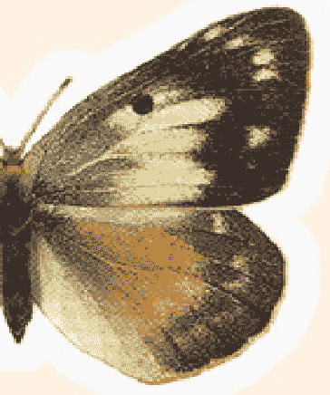

普利策奖得者

> 但现在我们已经走了很长很的路，现在
>
> 是时候松开我们那挥汗如雨的马了。
>
> ——维吉尔，《农牧经》第二卷
>
> （大卫·费里 译）

## 序言

人是什么？

故事者、神话制造者和生命世界的破坏者。用理性、情感和宗教的交织进行思考。更新世晚期，灵长类进化中的一次幸运意外。在想象力和探索驱动力方面极其宏伟，却渴望成为这个衰落行星的主人，而非管家。生来具有永远生存和进化的能力，并能让生物圈永恒。然而却傲慢、鲁莽，在致命程度上倾向于偏袒自我、部落和短期利益。对想象中的高层生物卑躬屈膝，对低级形式的生命充满蔑视。

历史上第一次，那些能够真正思考十年之后情况的人中产生了一种信念：我们正在进行一场全球性的终局游戏。人类对地球的掌控并不稳固。它正变得越来越弱。我们的人口过多，无法保证安全和舒适。淡水日益短缺，由于陆地发生的变化，大气和海洋日益受到污染。气候正在以不利于生命的方式变化，除了微生物、水母和真菌之外。对于许多物种来说，这已经是致命的。

由于人类造成的问题是全球性且渐进性的，由于无法回头之点的预景正迅速临近，这些问题无法通过局部解决。世界上还有足够的水用于水力压岩，还有足够的雨林覆盖用于大豆和油棕树，大气中还有足够的空间储存过量的碳。

与此同时，我们似乎在某种引导下盲目挣扎，除了经济增长、无节制的消费、健康和个人快乐外，没有特定的目标。对生物圈其他部分的影响无处不在负面，环境变得不稳定且不再那么宜人，我们的长期未来变得不确定。

我写了《半球地球》，这是三部曲的最后一部，描述了我们物种如何成为人类世纪元的建筑师和统治者，并带来了影响所有生命（包括我们自己）的后果。在《地球的征服》中，我描述了人类如何扩张并控制地球；在《生命的意义》中，我探讨了我们作为物种在地球上生存的意义。而在《半球地球》中，我提出，通过将地球一半的表面设为保护区，我们可以拯救大部分生态系统和绝大多数物种。

为什么是一半？而不是四分之一或三分之一？因为大型斑块（无论是现有的还是通过廊道建立）能让生态系统和物种维持在可持续水平。随着保护区的扩大，其内部的多样性也随之增加。随着保护区的缩小，其内部的多样性将按照可预测的程度下降——往往是立即的，且对很大一部分物种是永久性的。

保护地球的一半还有第二个心理学理由。目前的保护运动之所以无法走远，是因为它是一个过程。它针对最受威胁的栖息地和物种，并从那里开始工作。由于保护窗口正在迅速关闭，它努力以越来越快的速度增加保护面积，尽可能地挽救时间和机会。

《半球地球》与不同。它是一个目标。人们理解并偏好目标。他们需要胜利，而不仅仅是取得进展的消息。人类本性渴望最终获得某种能平息他们焦虑和恐惧的成就。如果敌人仍在门外，如果破产仍然可能，如果更多的测试可能有积极结果，我们就会保持恐惧。我们的本性进一步倾向于选择那些虽然困难但可能改变游戏规则并具有普遍效益的大目标。为所有生命而奋斗将是人类最高尚的表现。

> * 我在2002年的《生命的未来》中首次提出了建立全球性扩张保护区的基本论点，并在2014年的《永恒之窗：生物学家在戈龙戈萨国家公园的漫步》中进行了详述。“半球地球”这一术语是由托尼·希斯在2014年的斯密森尼文章《世界真的能为野生动物划出一半地区吗》中为这一概念提出的。

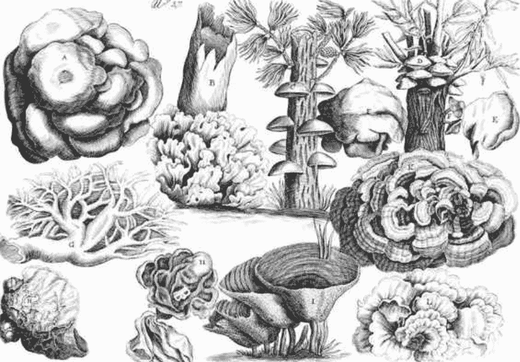

真菌合集。弗朗西斯斯·范·斯特比贝克，1675年。

# 1 世界两次终结

六千五百万年前，一颗直径12公里的小行星以每秒20公里的速度撞击了现今尤卡坦半岛的恰苏鲁布海岸。它撞出了一个深十公里、宽180公里的深洞，像钟声一样响彻整个星球。随之而来的是火山爆发、地震、酸雨，以及席卷全球的山脉海啸。烟尘遮蔽了天空，阻挡了阳光和光合作用。黑暗持续了足够久，结束了大多数幸存的植物。在死亡的黄昏中，温度骤降，火山冬天席卷了星球。70%的物种消失了，其中包括最后的恐龙。在较小的尺度上，微生物、真菌和食尸蝇这些生物世界的顶级清理者，在死去的植物和动物尸体上繁荣了一段时间。但很快，它们也衰落了。

中生代（爬行动物时代）就此结束，新生代（哺乳动物时代）开启。我们是新生代的巅峰产物，也可能是最后的产物。

地质学家将新生代分为七个时代，每个时代都由其独特的环境以及生活其中的动植物种类定义。时间上最早的是古新世，这是一个跨越千万年的时期，期间生命多样性通过进化从中生代末的大灾难中恢复。随后相继是始新世、渐新世、中新世和上新世。进程中的第六个时代是更新世，那是一个冰川前进和退缩的时期。

地质学家正式承认的最后一个时代，也是我们所处的时代，是全新世。它始于11,700年前，当时最后的大陆冰川开始退缩，它带来了温和的气候，并可能是生命历史上物种数量的短暂巅峰。

全新世的黎明也正值人类新定居于地球几乎所有的宜居土地。生命的三个层面都面临着新的威胁，即恰苏鲁布撞击的潜在破坏力。这些层面首先是生态系统，包括珊瑚礁、河流和森林；其次是物种，如珊瑚、鱼类和橡树，它们是生态系统的生命组成部分；最后是决定每个物种特征的基因。

在地质时间尺度上，灭绝事件并不特别稀有。它们在生命史上以随机波动的规模发生。然而，真正具有末日意义的事件大约每亿年发生一次。我们有记录的出现过五次这样的破坏高峰，最近的一次是恰苏鲁布。地球从每次灾难中恢复大约需要一千万年。这就是为什么人类引发的这次破坏高峰通常被称为“第六次大灭绝”的原因。

许多作者认为，地球的变化已经足够大，足以承认全新世的结束，并用一个新的地质时代来取代它。受推崇的名字是由水生生物学家尤金·F·斯托默（Eugene F. Stoermer）在20世纪80年代初，并由大气化学家保罗·克鲁岑（Paul Crutzen）在2000年普及的——“人类世”（Anthropocene），即人类时代。

区分人类世的逻辑是合理的。这可以通过以下思想实验来解释。假设在遥远的未来，地质学家挖掘地球的地壳沉积物，一直到跨越我们过去千年的地层。他们将遇到边界清晰的、经过化学改变的土壤层。他们将识别出气候快速变化的物理和化学特征。他们将发现大量的驯化动植物的化石遗骸，它们突然且在全球范围内取代了地球史前的大多数动植物群。他们将挖掘出机器的碎片，以及一个真正的致命武器博物馆。

遥远的地质学家可能会说：“不幸的是‘人类世’将快速的技术进步与人性中最卑劣的一面结合在了一起。对于人类和其他生命来说，那是一段多么糟糕的时代啊。”

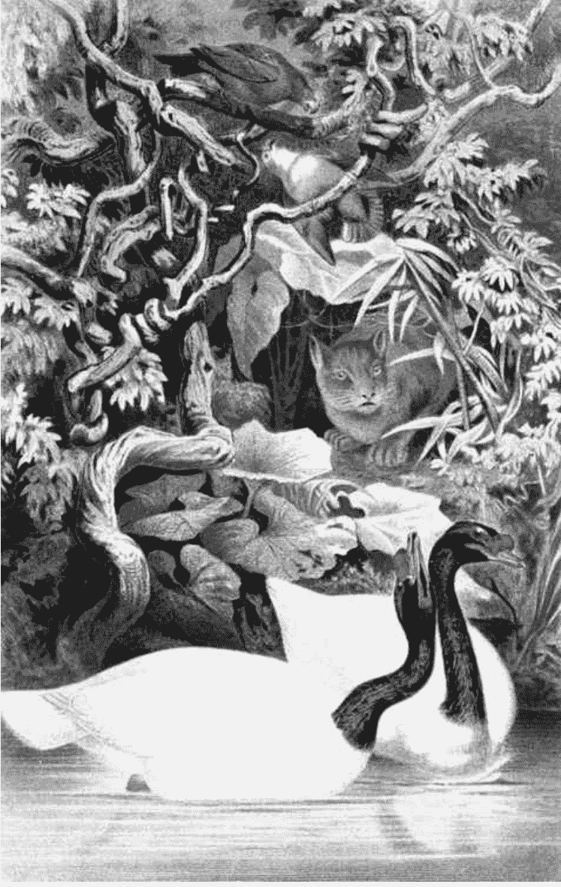

欧洲森林的边缘。阿尔弗雷德·埃德蒙德·布雷姆（Alfred Edmund Brehm），1883–1884年。

# 2 人类需要生物圈

生物圈是地球上任何给定时刻所有生物的集合体。它包含了当你读到这句话时，所有存活的植物、动物、藻类、真菌和微生物。

生物圈的上边界由细菌组成，它们被风暴带升至一万米甚至更高。在这一高度发现的微粒中，细菌占20%（其余部分是惰性尘埃颗粒），某些细菌种类被认为通过光合作用和取食死有机物来循环物质并繁殖。这个高漂浮层能被称为生态系统吗？这个问题仍在讨论中。

生命的下边界存在于科学家所谓的“深层生物圈”的下边缘。在那里，在陆地和海洋下方三千多米处，细菌和线虫（圆虫）着来自地球岩浆的剧烈热量。科学家在这一地狱地层中发现的极少数居民物种依靠周围岩石获取的能量和物质生存。

与整个星球巨大的躯体相比，生物圈薄如蝉翼，重量可以忽略不计。它像一层膜一样贴在表面。

在生物多样性普查记录的地方，外来物种的数量正呈指数级增长。其中，有一些在某种程度上对人类、环境或两者都造成了伤害。根据美国总统行政命令政策，为了帮助明确政府政策，它们被指定为“入侵性”物种。极少数入侵物种造成了巨大破坏，并可能达到灾难性的水平。它们包括一些破坏力已成为家喻户晓的物种。它们迅速增长的名单包括：入侵火蚁、亚洲白蚁（“吃掉新奥尔良的蚂蚁”）、红云蛾、翡绿榆甲虫、斑马贻、亚洲鲤、蛇头鱼、两种蟒以及西西尼罗病毒。

这些入侵物种来自世界各地，它们在那里作为本土物种生活了数千年。因为它们与其家园的其他本土物种自然适应，扮演着捕食者、猎物和竞争者等多种角色，它们的种群总体上受到了控制。在它们的家园，事实也证明，入侵物种倾向于适应草原、河岸以及人类喜好的其他类型栖息地的生活。入侵火蚁具有如热针刺般的刺痛，在牧场、住宅庭院和路边表现最好。在它们南美洲的本土范围内，它们主要是一种习性良好的草原和泛滥区特化种。（关于这种物种的警告：入侵火蚁是我野外和实验室研究的最爱对象之一。我曾作为视频演示的一部分，将手短暂放入蚁穴，几秒钟内就遭到了愤怒工蚁的五十四次刺伤。二十四小时内，刺伤变成了瘙痒的脓疱。我的建议：千万不要把手伸进去，更不要坐在火蚁上。）

其他入侵物种不居住人类栖息地，但对自然环境可能特别危险。小火蚁是一种比普通火蚁更小的物种（也是我的研究另一个课题），是南美雨林的本土物种。它能够以密集的集群穿过其他地方的热带雨林，在那里消灭栖息落叶层和土壤中的几乎所有单足（昆虫术语，指单手）其他无脊椎动物。

另一个可怕的杀手是棕蛇，它是在20世纪40年代后期从新几内亚或所罗门群岛意外引入关姆岛的。由于它主要以筑巢鸟类为食，它消灭了关姆岛好几种类的所有鸣鸟，直到最后一只。

正如少数作家所假设的，认为时间的推移，入侵物种将与本土物种稳定下来形成稳定的“新生态系统”，这与所有证据都相违背。恰恰相反，停止生物世界不稳定的唯一证明的方法，是保护尽可能大的保护区以及其中生存的本土生物多样性。

人类无法免于物种间相互依赖的铁律。我们并不是作为现成的入侵物种被置入一个伊甸园般的世界的。上天也无意让我们统治那个世界。生物圈不属于我们，而是我们属于它。环绕在我们周围的这些如此繁盛的生物是38亿年自然选择进化的产物。我们是其当今的产物之一，作为幸运的旧世界灵长类物种来到。而这只发生在地质尺度上的弹眼之间。我们的生理结构和头脑适应了生物圈中的生活，而我们才刚刚开始理解它。我们现在能够保护其他生命，但我们仍然鲁莽地倾向于破坏和取代它的很大一部分。

> * 《圣经》，钦姆斯译本，约伯记 38:16–19, 25。

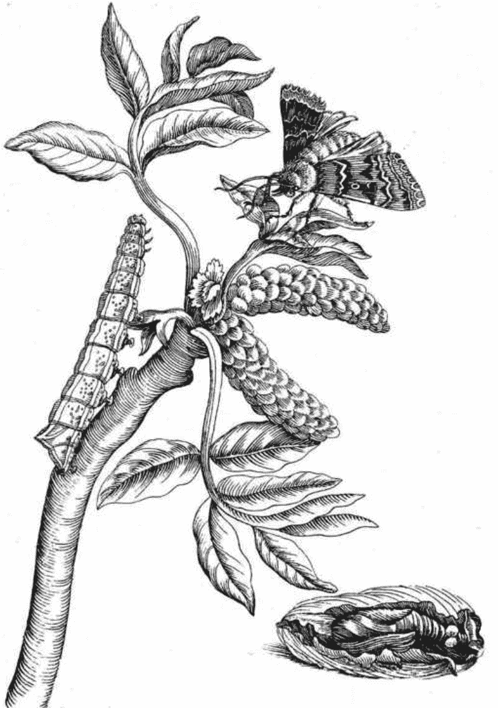

幼虫食物植物（毛虫）上蛾的生命周期（幼虫、蛹、有翅成虫）。玛丽亚·西贝拉·梅里亚，1679–1683。

## 3 如今有多少生物多样性幸存？

地球上活着的物种总数理论上是可以计数的。

所有这些门类的分类数量，接着是目、科、属——最后是物种。从门到属的数量相对稳定，随着投入这些领域的时间越来越多，每一个层级的数据都顺着一条平滑弯曲的曲线上升。如果将这些曲线的形状延伸到物种，预计地球上存在的动物界物种数量将稳定在一个相当合理的770万种。真核生物界（包括植物、动物、藻类、真菌和许多真核微生物，即具有线粒体和其他细胞器的生物）的总数约为870万，正负一百万左右。

然而，达尔霍斯统计法（`Dalhous method`）可能会低估目标。由于生物学家完全理解的原因，许多物种仍未被发现。这些生物学家已经了解到，难以发现的物种往往稀少且孤立在局小、偏远栖息地的狭窄生态位中，因此其数量可能比公开数据集所示的多得多。

无论科学家对生物多样性普查的结论定在哪里，考虑到已发现的、具有拉丁化双名且统计到目前的两十万种物种，总数将惊人地高得多。完全有可能，专家们在物种水平上仅发现了地球多样性的20%或更少。致力于生物多样性的科学家正在进行一场竞赛，试图在每个种群中找到尽可能多的生存物种——从哺乳动物和鸟类，到缓幼、海鞘动物、地衣、织叶叶蛛、蚂蚁和线虫——在它们消失之前，以免它们不仅被忽视，而且永远不再不为人知。

大多数人并不知道这项发现和保护地球上所有生命的、尚未完成的科学任务甚至存在。他们习惯了媒体的报道，这些报道用“在墨西哥发现三种新种蛙”和“在喜马拉雅发现的鸟类由两个物种组成”之类的标题淡化了这一主题。读者被引向相信，对生命世界的探索已几乎完成，新物种的发现是一个重大事件。在我职业生涯的大部分在哈佛大学比较动物学博物馆担任昆虫馆员期间，我可以证明那种形象是多么具有误导性且令人愚钝。事实是，新物种不断涌入世界各地的博物馆和实验室。在大多数生物群中，新奇标本堆积如山。这些标本通常要等待几年甚至几十年，世界各地人手极其匮乏的博物馆馆员才能处理它们。它们研究可能带给我们的生物学知识可能会被无限推迟。

如果目前的性描述和分析速度持续，正如我和其他人经常指出的那样，我们直到23世纪中叶才能完成全球生物多样性普查——即其剩余部分。此外，如果对地球动植物的保护缺乏更专业的测绘和保护，到本世纪末，某种程度的生物多样性将大幅减少。人类在全球生物多样性科学研究与无数未知物种灭绝之间的竞赛中正失去比赛。

我可以用我经验中的一个例子很好地说明分类过载的问题。我关于蚂蚁的一部分研究是分类工作，在生物多样性的任何领域，分类都是进行生态学和演化工作绝对的序曲。多年来，我描述了大约450种新蚂蚁。其中，354种属于大头蚁（`Pheidole`）单属。（提醒一下，属是一类相似的物种群，它们都演化自同一个祖先物种。例如，人属`Homo`是我们的属，祖先物种包括智人`sapiens`和我们的直接祖先物种——能人`Homo habilis`，然后是直人`Homo erectus`。）

大头蚁属的名字在希腊语中意为“节俭者”，是所有已知1.4万种蚂蚁中体最大、最多样化的属。我发现并命名的物种之一是梯大头蚁（`Pheidole scalaris`），其中`scalaris`意为“梯子”，指士兵级头部独特的梯状纹路。另一个是矛大头蚁（`Pheidole hasticeps`）——因为士兵头的形状像矛头；第三种是翅大头蚁（`Pheidole tachygalia`）——“属于`tachigalia`”，指的是蚂蚁筑巢的树（`Tachigalia`）。阿洛大头蚁（`Pheidole aloyai`）是为了纪念 D. P. Aloya 博士，这位古巴的昆虫学家在野外采集了第一批标本。在我和早期的分类学家这样命名了数百种大头蚁后，我已经没有足够的希腊语和拉丁语单词来描述额外的新物种了。使用像 Aloya 这样的采集者名字以及标本发现地的名称很有帮助。然后我想到了另一种减轻困难的方法。我请求国际保护组织（Conservation International）主席 Peter Seligmann 推荐 CI 董事会的八位成员，他们因在全球保护方面的私人努力而做出了卓越贡献。被选中的其中一位是我的董事成员兼朋友，现在有了自己的私人蚂蚁：哈里森德大头蚁（`Pheidole harrisonford`）。还有西里格曼大头蚁（`Pheidole seligmanni`）。

无论是业余还是专业的科学自然主义，对他们研究的物种熟悉程度几乎就像对待其他人一样。我在阿拉拉巴马大学读本科期间的导师之一，鳞翅学家莱夫·L·切莫克（Ralph L. Chermock）曾对学生们说，真正的自然学家知道数千种生物的名字。我从未接近过那个水平，我怀疑 Chermock 也从未达到过。也许一个记忆大师可以通过插图和博物馆标本完成这一壮举，但仅凭这些知识他将几乎没有感觉或实质。然而，Chermock 和我可以做些更好的。在我们各自充分研究过的数百种物种中，我们不仅知道名字，还知道它们所属的高级分类单元，从门到目再到科。我们还知道许多对我们特别感兴趣的属。我们可以在较高的分类水平上识别在我们面前的数千种物种。除了最专注的记忆大师外，我们比任何人都做得好。

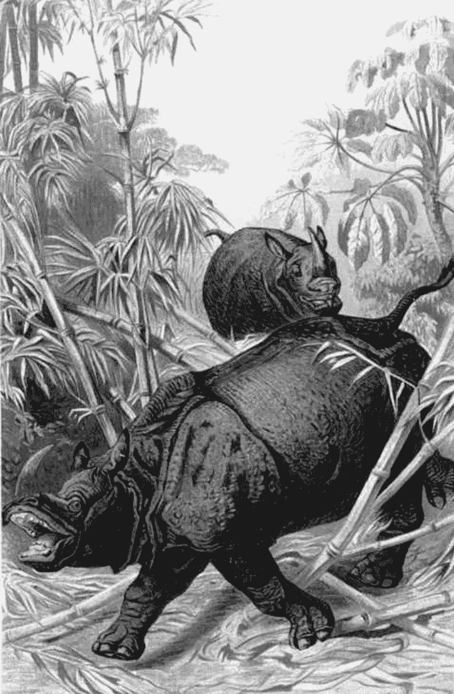

大印度犀牛。阿尔弗雷德·埃德蒙德·布雷姆（Alfred Edmund Brehm），1883–1884。

# 4. 犀牛的哀歌

世界上还剩下二万七千只犀牛。一个世纪年前，数以百万计的犀牛在非洲平原雷鸣般奔跑，或静静地穿过亚洲的雨林。它们代表了五个物种，且都处于灭危边缘。绝大多数幸存者属于白犀的南部亚群，主要分布在南非，在那里受到武装守卫的严密保护。

2014年10月17日，最后幸存的北白犀之一“苏尼”在肯尼亚的奥佩赫塔自然保护保护区（Ol Pejeta Conservancy）去世。它的死亡使得活着的北白犀数量减少到六只：三只在奥佩赫塔，两只在捷克克的德沃·克拉莱动物园（Dvůr Králové Zoo），两只在圣地亚哥动物园游乐公园。这些动物正在老去，且没有后代出生。随着最后的一批个体散落在世界各地，且犀牛通常难以在圈养环境下繁殖，北白犀在功能上已经灭绝。考虑到自然寿命，最后的一只似乎肯定会在2040年之前死亡。

与此同时，它们的黑犀西部亚群已完全灭绝——在任何地方都不再有体存，甚至在圈养中也是如此。这些拥有长弯角的巨型动物曾是非洲野生动物的象征。它们曾遍布于从喀麦隆到乍得、南到中非共和国、东北东北到苏丹的稀树草原和干旱热带林中。它们数量的缩减始于殖民时期的运动猎人。接着是盗猎者，他们采集犀牛角制成仪式性短剑的刀柄，主要在也门，也分布在中东和北非的其他地区。最后是致命的一击，中国和越南对粉末犀牛角作为中药药材的巨大需求。消费量的增加得益于毛泽东推崇中药而非西医学。到2015年，中国人口已增加到14亿。尽管只有极少数比例的人寻求犀角，但对犀牛的影响是灾难性的。每克价格飙升至黄金水平。

犀牛角市场招来了一批盗猎者和犯罪团伙，他们愿意猎杀最后一只动物，为了一个双手就能握住的死物冒生命危险，以换取一个犀角带来的终身收入。对所有五种犀牛的影响似乎无法停止。黑犀西部亚群的人口在1960年至1995年间下降了98%。作为最后堡垒的喀麦隆在1991年仅剩下50只个体，1992年减少到35只。盗猎者的肆虐无休止，喀麦隆政府无法提供任何解决方案。到1997年，只剩下10只犀牛。与白犀倾向于形成多达十四只个体的群体不同（顺便提一下，犀牛群被称为“crashes”），黑犀除繁殖外，都是独居的。在西部黑犀生活的时代，幸存者散布在喀麦隆北部的大片地区。只有四只彼此足够近，可以相遇并交配。然而，它们没有成功繁殖，很快全部消失了。数百万年的进化辉煌就此终结。

此时世界上最稀有的陆地哺乳动物是爪哇犀。这种深山雨林的居民，其分布范围曾从泰国到中国南部，继而到印度尼西亚和孟加拉国。直到最近，还有十只爪哇犀隐藏在越南北部一片未受保护的森林中，即现在的卡提县国家公园（Cát Tiên National Park）。在它们的踪迹为人知后不久，全部被盗猎者杀害。最后一只于2010年4月被射杀。

今天，最后幸存的种群保护在爪哇岛最西端的翁库隆国家公园（Ujung Kulon National Park）。它们包含不到50只个体。（一位专家给我的数字是35只。）一场海啸或一群坚定的盗猎者都可以在一次打击中令该物种灭绝。

在稀性和危险性方面相当的是苏里腊犀，另一种来自亚洲热带深山雨林的物种。爪哇犀广泛分布于东南亚。随着大部分栖息地被农业取代，种群被无情的盗猎者压低，该物种几乎完全限于动物园的几少数圈养个体和苏答腊日益缩小的森林。可能还有几只个体躲在婆罗洲的一个偏远角落。

从从990年至2015年，全球苏里腊犀的数量下降到301只。在一次英雄般的努力下，兽医特里·罗斯（Terri Roth）和她在辛辛提动物植物园的团队学会了将现代人类生殖技术应用于犀牛身上。他们成功了：现在已经培育了三代，使得几只先锋动物非常谨慎地回到苏答腊的自然保护区。这个过程缓慢、困难、昂贵，且远未保证成功。总有那些不眠的盗猎者，每个人都愿意为了一个角和它带来的终身收入献上生命。

如果饲养者和印尼公园护林员的努力失败，苏里腊犀将会消失，这将结束一种持续了数千万、缓慢进化的伟大动物非凡生命。它们最接近的亲属——北半球北极地区的毛犀，在上一个冰期消失了。它们很可能是被猎人驱之灭绝的，这些猎人（至少在欧洲）在洞壁上画了它们的草图，供我们现在的雅兴。

1991年9月底，在访问辛辛提动物园期间，我受院长埃德·马鲁斯卡（Ed Maruska）邀请，去看了一对刚从苏答腊被捕获并经由洛洛矶矶动物园转运的苏里腊犀。其中一只名叫“艾米”（Emi），是雌性。另一只叫“伊普胡”（Ipuh），是雄性。它们都很年轻且健康。那一晚，艾米和伊普胡像塑像一样站在笼子里。由于成年犀通过皮肤呼吸，由于皮肤感染死。我走近它们，向马鲁斯卡询问是否可以触摸它们。他点了点头。那一刻我的感觉是神圣的，无法用语言描述。

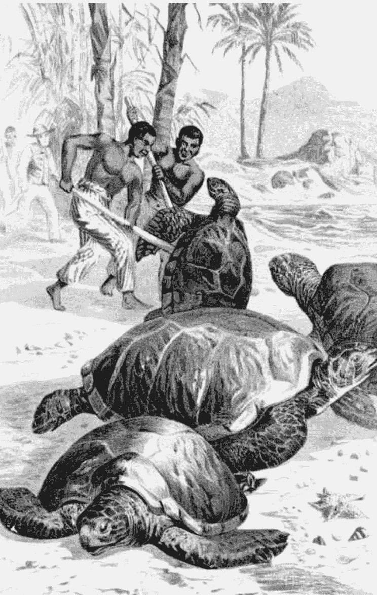

绿海龟和人类。阿尔弗雷德·埃德蒙德·布雷姆（Alfred Edmund Brehm），1883–1884。

# 5. 现在的末日时刻

我们遇到了大规模死亡。我们曾尝试通过圈养来拯救濒危物种，但无一成功。我们观察到了致命真菌对两类的破坏，其学名为`Batrachochytrium dendrobatidis`。这种真菌通过运输青蛙的水族箱传遍全球，其中少数被感染。而且糟糕的是，真菌在整个整个皮肤。由于它们通过皮肤呼吸，它们死于

如果这还不够，第二种真菌最近出现在现场。当`Batrachochytrium dendrobatidis`杀死青蛙时，它的近亲种`Batrachochytrium salamivans`攻击栖蟾（第二种拉丁名意为“栖蟾食者”）。随着宠物贸易入侵欧洲，这种寄生虫导致了98%的死亡率。这对温带和热带美国丰富的栖蟾动物群构成了特别威胁。

青蛙和栖蟾的真菌入侵等同于14世纪席卷欧洲的黑死病。在这场灾难中，下降的黑暗变成了达尔文式的悲剧。捕食者在入侵新大陆后，发现了丰富的食物供应。它们的种群爆炸，消耗了太多的猎物，并导致了自身不可避免的衰落。人类至今未能保护两栖类，未能阻止这种残酷的动物流行病。

青蛙和栖蟾是重要的捕食者，有助于稳定湿润森林、溪边和淡水湿地。它们是我们脊椎动物中最温顺的邻居，等同于我们在森林地表和灌木叶片中发现的鸟类，美丽且往往色彩鲜艳，性情胆小。青蛙在繁殖季节会合唱——在美洲热带有时会有二十种聚在一起——每个物种都有自己的歌曲。整个合奏听起来混乱，但你可以闭上眼睛，根据它们精确且不同的乐谱，像听交响乐一样区分它们。在一年的其他时间，个体会分散开。那时，如果它们发声，那是一种不同的声音，难以定位，是进化过程中为了在同种中标记领地而设计的。

动物将形成“新生态系统”，以取代被我们和我们的搭车物种所消灭的自然生态系统。有证据表明，某些外来植物物种在岛屿环境中“自然化”，换句话说，通过自然选择在遗传上适应了这些环境。但这种情况仅发生在植物物种多样性较低、且提供了大量空生态位供填充的地方。

允许任何种的外来物种进入，在生态学上等同于俄罗斯轮盘。在灭绝之枪的弹仓里转动有多少个弹壳？弹壳中百分之几装了子弹？答案取决于旅行者的身份以及它们能够填补的宿主国生态位。欧洲和北美的植物大致符合入侵生物学中的“十规则”：在大型范围内，每十分分之一的进口物种会逃逸到世界上，而十分分之一的殖民者会繁殖并扩散，到足以成为害生物。对于脊椎动物（哺乳动物、鸟类、爬行动物、两栖动物和鱼类），宠物物种的比例更高——大约十分之一。

不可避免的是，一种或另一种移民物种会变成与青蛙壶菌相当的超级入侵竞争者。这种破坏者是`大叶美果`（`Miconia calescens`），一种原产墨西哥和中洲的观赏灌木。塔地利三分之二的原始森林已被这种入侵者淹没。它可以达到树木的大小，生长极其密集，足以挤掉其他树木和木本灌木——此外还有极少数动物。在夏威夷，类似的命运通过志愿者队伍得到了避免，他们寻找并铲除了未开垦地区的每一株大叶美果植物。

让入侵物种融入新生态系统的代价并不低廉。到2005年，美国的经济成本已上升到每年估计1370亿美元，这还没有计算它们对淡水物种和生态系统构成的威胁。

太平洋岛屿的土地是另一种末日力量的受害者。从物种损失的绝对数量来看，它们是所有脊椎动物中受害最严重的。灭绝浪潮始于三千五百年前人类到达西部群岛（萨摩亚、汤加、瓦努阿图、斐斐和马里亚纳群岛），一直持续到九到七世纪前通过对夏威夷、新西兰和复活节岛最偏远岛屿的殖民。今天，少数幸存物种正处于灭绝的边缘。然而，三分之二的非雀类太平洋鸟类（接近一千种）被灭绝了。因此，在少数较小人类的单一殖民活动中，地球上约10%的鸟类被消灭。

夏威夷被公认为“世界灭绝之都”，当波利尼西亚航海者上岸时，它面临的损失最大；在随后欧洲人和亚洲殖民者的帮助下，他们进一步消灭了那里大部分的本土鸟类。消失的还有本土鹰、一种不会飞的鸇、一种如火鸡大小的陆栖鸟，以及二十多种蜂尾蜜鸸蜜鸟——它们是较小的食粉者，其中许多物种拥有色彩鲜艳的羽毛和长弯的喙，能深入探测管状花。还有更多物种——超过45种——在西方纪元公元前1000年波利尼西亚人到达之前消失了，在两个世纪前第一批欧洲人和亚洲人进入后又有25种消失。奇奇的是，一些最灭绝物种的羽毛残骸仍保存在古代夏威夷皇室的长袍中。

太平洋群岛之所以成为杀戮场有两个原因。首先，因为它们的面积相对较小且殖民者繁殖迅速，很快陷入了人口过剩。在一些偏远的岛屿，捕食行为仍在以缩小的规模持续。2011年，在瓦努阿图的大岛斯皮里图斯岛（Espiritu Santo），我看到猎人手持强力弹弓，捕捉着一只本土的太平洋皇鸽（`Ducula pacifica`），它拥有红斑喙、白色身体和黑色翅膀，显得华丽夺目，正前往卢加维尔的一家餐厅。

大规模灭绝的第二个原因是岛屿鸟类害怕那些双足的殖民者，因为它们在进化过程中从未接触过类似的捕食者。（蛇、猫鼬和老虎是糟糕的海洋旅行者）。（由于它们在进化过程中从未接触过相似的捕食者，岛屿鸟类害怕那些双足的殖民者。）许多岛屿鸟类也因此走向灭绝。由于它们是地栖的，许多鸟类物种因此消失。

马里求斯的渡鸟（dodo）是太平洋中鸽子的后代，这展示了岛屿生物学的的基本原理。马里求斯的渡鸟是一种不会飞的鸽子，展示了岛屿生物学的基本原理。1598年，第一批荷兰海员登上马里求斯时发现了这种肥胖、笨拙且美味的鸟——它们最终被上了餐桌。最后一次记录到活的渡鸟出现在人类视线内是1662年。邻近的罗德格斯岛的僧鸟（solitaire）也遭遇了类似的命运。另一种完全不同的鸟类——马里求斯��隼（隼），在1074年处于灭绝边缘——最后四只个体被捕获并在鸟舍中繁殖。当后代数量足以安全释放时，它们被归还到了极小的自然区域。由于人类贪婪而几乎灭绝马里求斯��隼，如今仅依靠人类的顽强努力得以生存。

2011年，当我与一小组生物学家在新喀西兰岛的山脉对蚂蚁进行研究时，我们目睹了正在形成的“类渡鸟”。这种奇异的生物——火冠鸟（kagu），仅存在于法属西南部太平洋的主岛。曾因数量充足而被定为新喀西兰的官方鸟，现在火冠鸟的数量已减少到不足千只。这种鸟是典型的岛屿居民，在人类、狗和野猫面前毫无还手之力。它体型如鸡，颜色呈蓝白色，有突出的直红喙、长粉红腿，以及一簇白色的羽冠，当两只鸟相遇时，羽冠会竖起并展开进行戏剧性的展示。火冠鸟生活在茂密的高地森林。它们在地上觅食，吃昆虫。尽管它们的翅膀大小正常，但只能飞行短距离。

作为岛屿演化的典型产物，火冠鸟也异常温顺。当人类靠近时，它们会走开，有时会在树干后躲避入侵者离开。我们小组的一名成员克里斯蒂安·拉贝尔（Christian Rabeling）知道如何吸引火冠鸟。他向一只进入我们路径的鸟类演示了这一点。我不知道没去过新喀西兰的拉贝尔是怎么做的，但他自信地蹲下，用手抖动一堆叶子。很快，火冠鸟走向他，检查那堆叶子。我猜测他鲁莽的行为是因为火冠鸟利用同类来寻找昆虫。然后，我们的访客就悠闲地走开了。

很少有人意识到大坝对野生动物造成的破坏。现代历史上最大的打击是莫比尔河和田纳西河流域拦截后导致的淡水软体动物损失。莫比尔河盆地过去几十年的损失是19种蚌类（一种类似蛤类的双壳类）和37种水生螺。田纳西河流域的损失也相当。

为了让你们关注这些软体动物损失，我在这里列出了所有已知灭绝的19种河流蚌物种的名称。

灭绝：库萨鹿角壳、糖匙蚌、棱纹柳叶壳、俄亥州纹柳壳、田纳西纹柳壳、叶壳、黄花壳、窄猫爪壳、扇壳、南方橡果壳、粗梳壳、坎伯兰叶壳、阿拉巴马科拉黑石壳、条纹口袋壳、哈德尔顿灯壳、黑圆足壳、库沙猪螺、库萨猪螺、马蹄壳。安息吧。

这些名字的奇异性反映出，消失的无脊椎动物的名字与同一地区灭绝的鸟类相比是多么陌生——象犀嘴啄鸟、卡罗来纳鹦鹉、旅南鸽、巴赫曼山莺。

在这种情况下，这份消失物种的部分名单对你来说似乎无关紧要（“多一种河流蚌有什么用呢？”），让我们谈谈它们对人类福祉的实际价值。海湾和三角洲的牡蛎能过滤并清洁水质。它们是水生生态系统中至关重要的一环。如果你坚持要说某种无形价值，它们——至少曾经是食物和其他物资的商业来源。

如果淡水蚌和其他无脊椎动物看起来关联性较低，让我们引入另一个例子。根据美国鱼类学会的诺尔·M·伯克德（Noel M. Burkhead）的说法，1898年至2006年，北美有57种淡水鱼灭绝。原因包括河流溪流的筑坝、池塘湖泊的排水、泉头的填充以及污染，这一切都是由于人类活动。物种和种族的灭绝速度保守估计是人类起源时期的877倍（后者为每三百万年灭绝一次）。在这里，为了让它们最后接近生前的存在，以下是它们常见名称的部分列表：马拉维利亚红丽光鱼、高原鳺、厚尾鳺、幻影光鱼、清湖裂鳃鱼、深水鲑鱼、蛇河鴴、小银侧、灰草地池鱼、顶线鱼、波托西幼鱼、拉帕尔马幼鱼、优雅拟刺鱼、犹他湖滚鱼、马里兰鐹。

最后，灭绝还有更深层的意义和长期影响。当这些及其他物种在我们手中消失时，我们丢弃了地球历史的一部分。我们抹去了生命之树的枝丫，最终是整条分支。因为每个物种都是独特的，我们关闭了一本对未知程度很重要但现在已永远丢失的科学知识之书。

灭绝生物学并不是一个令人愉快的话。对于研究濒危和新灭绝物种的科学家来说，一个物种的死亡尤其令人沮丧。这些地球生物多样性的残骸共同考验着人类道德的边界和质量。被我们手毁的物种现在值得我们持续的关注和照顾。无论宗教徒还是不信教者，都应当神化犹太-基督教《创世记》中上帝优雅的指令：让水里充满数不胜数的活生物，让鸟在地的穹苍飞翔。

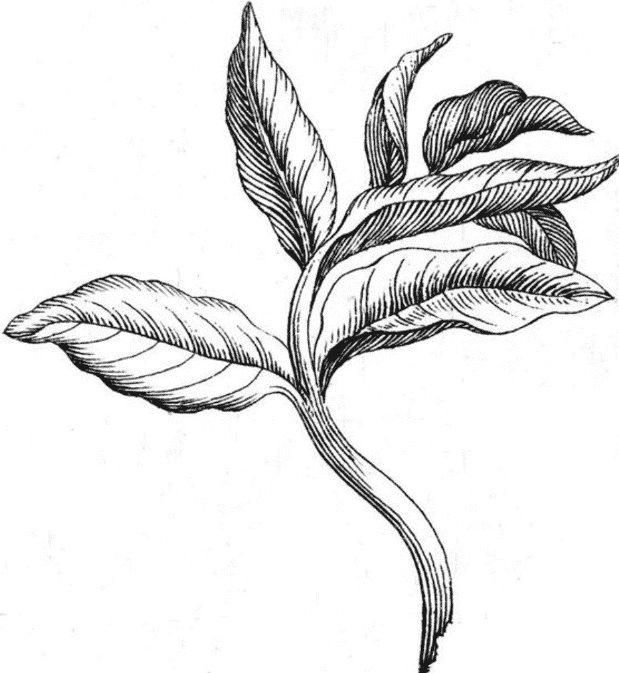

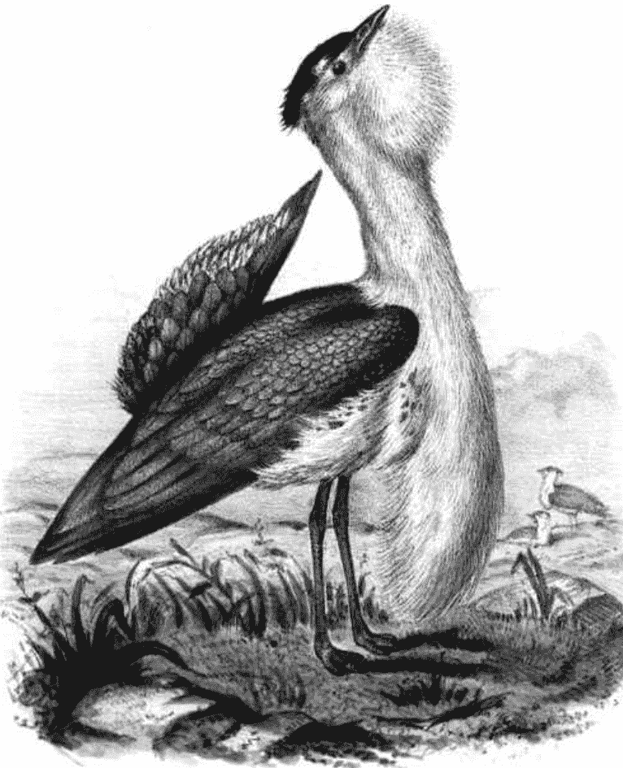

正在求偶展示的澳洲大鸵。

《伦敦动物学会学报》，1868年。

# 6. 我们是神吗？

有些人认为，人类应该接受我们所创造的生态混乱，将其视为通往辉煌命运的受损代价。未来主义者斯图特·布兰德（Stewart Brand）写道：“我们如神，而且必须在这方面做得更好。”地球是我们的星球，这一愿景在之字形逻辑中延续，而我们的最终角色是控制一切。尽管有经济崩溃、气候变化和宗教战争等小插曲，但随着时间的推移，我们在各方面变得更好。我们在全球范围内旅行得更快，探测得更高更深，向宇宙深处望得更远。我们正以指数级的速度集体学习“大神”允许我们这些“小神”学习的一切知识，并通过几次击键让所有知识对每个人都触手可及。智人，这种神奇的双足、拥有自由双手和充满大脑大脑的球形头骨的灵长类物种，正走在路上！

在倾向于科学的知识分子和好莱坞编剧作家的梦想中，人类最终的掌握没有限制。天体物理学家构想在银河系两千亿颗恒星之间以光速十分分之一的速度旅行，在几万年内穿越它。未来甚至有时间让我们这样的物种占据整个河系。这个公式在数学上非常简单，如下：花费几个世纪殖民化拥有宜居行星的最近星系。再花几个世纪或数千年在那里建立文明，然后发射多艘航天器前往其他星系。继续这个过程，直到银河系所有的宜居行星都被占据。这个时间可能长得不可思议，但仍比人类进化起源到现在的时间短（后者在地球生命的完整跨度中也仅是一眨眼）。

同时，在想象中，我们可能达到天文学家尼古拉·卡尔达舍夫夫（Nikolai Kardashev）所说的“I型文明”地位，即控制地球可用能量的社会。随后我们可能可以进入“II型文明”，控制太阳系的能量，甚至“III型文明”，控制整个银河系的能量。

我现在谦卑地问，我们究竟要去向哪里？我相信大多数地球人会同意以下目标：无限长且健康的生活、丰富的资源、个人自由、虚拟与真实的冒险、地位、尊严、加入体面的群体、对明智统治者和法律的服从，以及无论有无繁殖。

然而，存在一个问题。在我们亲手毁灭这些物种时，我们正在不必要地毁灭生命的大部分部分。想象一下，经过数百年的成就，我们正在灭绝地球的生物多样性，就好像自然界的物种和杂草厨房害虫没有区别。我们不羞耻吗？

愿更好的教导胜过保罗在给哥林多人的第一封信中所说的，他建议他们向内从荣耀之主寻求智慧，并因此寻找：

那我们肉眼未见、双耳未听见的、心所不能想象的，都是上帝为那些爱他的人预备的。*

在自我认知中存在一条不可打破的链条，思考型的人很大程度上忽略了它。其中一个教训是，我们并非神。我们还没有足够的的感知力或智能来承担起什么角色。如果我们继续扮演那种假神的角色，随心所欲地破坏地球的生存环境，并对我们所造成的后果感到自满，那么我们将无法拥有一个安全的未来。

*《新英语圣经》。

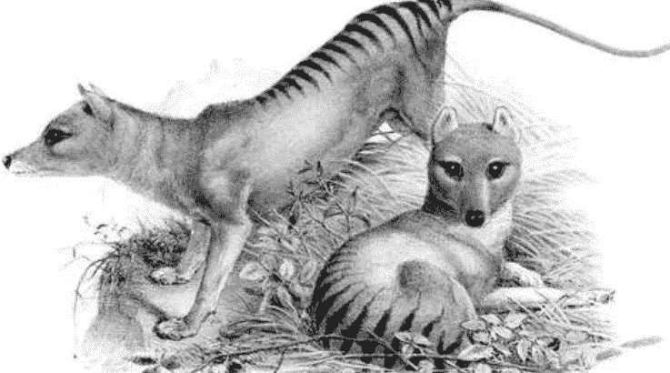

袋狼（“塔斯马尼亚虎”），于1936年灭绝。《伦敦动物学会会报》，1848–1860年。

# 7. 为什么灭绝正在加速

极少有人希望看到物种消失，除非是那些攻击我们身体和食物来源的害虫。生物圈不会为非洲`Anopheles gambiae`组蚊虫的消失而哀悼，它们是嗜血的专家、本土栖息地中的顶级徒步者，以及疟疾的主要传播者。我怀疑，即使是忠实的自然保护者也不会为非洲龙丝虫的完全灭绝而哀悼，我曾认为最可怕的人类病原体。它成年后长达一米，穿过身体并在脚部或腿部打开溃口以排出幼虫。此外，我们还可以忍受导致毁形和致命性利什曼病的原虫寄生虫灭绝。除了仍然未知的细菌、微真菌和病毒病原体外，值得灭绝（或至少值得在液氮中无害保存）的物种数量可能（我推测）少于一千种。我曾多次在热带雨林中感染布鲁病毒（节肢动物传播的病毒）而遭受痛苦，发烧卧在床上，并很乐意与它们告别。

其他数百万种物种无论是直接还是间接地，对人类福祉都有益处。遗憾的是，人类有无数种方式正在加速它们的灭绝，无论它们现在或未来具有何种益的角色。人类的影响很大程度上源于我们为了维持日常生活而进行的许多日常活动。这些活动使我们成为地球生命史上最具破坏性的物种。

我们正以多快的速度将物种推灭绝？古生物学家和生物多样性专家认为，在大约二十万年前人类出现之前，新物种产生的速率与现有物种灭绝的比例大约为每年百万物种中一种。由于人类活动的影响，据认为目前的总体灭绝率是原来的十倍到一千倍，且完全归因于人类活动。

2015年，一个国际研究小组对史前时期的速率进行了仔细分析，得出属（亲缘物种群）水平上的多样化速率低了十倍。将这些数据转换成物种灭绝率时，表明目前的灭绝率比人类扩散前高出近千倍。这一估计与一项独立研究一致，该研究检测到史前人类以及他们在远古时代最接近的亲属中，物种形成率都有类似的下降趋势。

人类活动的每一次扩张都减少了更多物种的种群数量，从而增加了它们的脆弱性和灭绝率。2008年，一个植物学家小组建立的数学模型预测，巴西亚马逊雨林中37%至50%的稀有树种（“稀有”定义为种群少于一万只）将面临早期灭绝，这是由现代道路建设、伐木、采矿和土地转为农业造成的。较低的数字（37%），适用于那些已部分开发但受细心管理保护的地区。

要比较世界不同地区不同植物动物的起源率和灭绝率是困难的。但所有可用证据都指向相同的两个结论：

1. 第六次大灭绝正在进行。
2. 人类活动是其驱动力。

这一严峻的评估引出了第二个非常重要的问题：自然保护工作进展得如何？全球保护运动在减缓和停止地球生物多样性破坏方面取得了多少成就？我曾担任国际自然保护协会（Conservation International）、自然保护协会（The Nature Conservancy）和世界自然基金会（美国）的董事会成员，并担任许多当地保护组织的顾问，我可以见证过去半个世纪里，全球保护工作中投入的由私人和公共资金支持的热忱与灵感，以及在野外付出的汗水与血。这种英雄般的努力完成了什么？

2010年，由两百名脊椎动物专家（哺乳动物、鸟类、爬行动物、两栖类）进行的调查分析了所有25,780种已知物种的状态。其中五分之一被确认面临灭绝威胁，而这些五分之一由于保护工作已经恢复稳定。2006年的一项研究研究得出结论，由于过去世纪的保护工作，特别是鸟类物种的灭绝已减少了约50%。全球仍有31种鸟类因为他们的努力而存活。简而言之，到目前为止，全球保护平均陆栖脊椎动物的物种灭绝率降低了约20%。

接下来，政府监管的影响如何，特别是1973年的美国《濒危物种法》？2005年的一项审查发现，在列入的1,370种受威胁物种中，有四分之一实现了种群增长，而有40%在下降。在列出的物种中，有22种从濒危列表中移除。22种鸟类恢复了健康，13种是黄肩黑鹂、绿海龟和大角羊。（注：原文末尾部分存在大量重复和OCR错误，已根据实际含义进行清理）。

## 影响生物多样性的因素

### 污染

人类活动产生的排放物是生命的杀手，特别是在河流和其他淡水生态系统中，而这些是地球上最脆弱的栖息地。

### 人口增长

尽管这种说法仍然广不受欢迎，但我们确实必须放缓增长。繁衍显然是必要的，但正如教皇方济一指出的，像兔子一样不断繁殖是一个糟糕的主意。人口预测显示，人类人口将在本世纪末或稍前增加到约110亿，随后达到顶峰并开始下降。

对于生物圈的可持续性而言遗憾的是，人均消费注定也会增长，而且可能比人口数量的增长更快。除非引入能够极大提高单位面积效率和生产力的正确技术，否则人类的生态足迹将持续增加，生态足迹定义为每人平均所需的地球表面积。这一足迹不仅是局部区域，还是分布在陆地和海洋上的空间，用于居住、食物、交通、治理以及包括休闲在内的所有其他服务的碎片。

### 过度捕猎

捕鱼和狩猎可以一直持续，直到目标物种被逼灭绝或处于灭绝边缘，使最后的幸存种群易受到疾病、竞争、天气变化以及其他较大且范围更广的同种种群所承受的压力的影响，最终被彻底抹除。

## 物种衰落与灭绝案例

物种衰落和灭绝的某些案例可以很容易识别。一个例子是棕树蛇的食性偏好，它们特别擅长捕食鸟巢。另一个案例是美国中西部黑斑蝶的衰落，这种蝴蝶以在墨西哥米却华坎州的松树上成数百万只地聚集越冬而闻名。

到2014年，美国中部的蝴蝶数量减少了81%，这归因于乳草减少了58%，而乳草是黑斑蝶幼虫的唯一食物植物。乳草的继继减少是因为玉米（maize）和大豆田中甘草膦除草剂使用量的增加。由于这些作物在经过基因改造以抵抗除草剂后生长得茂盛，而那些生长茂盛的乳草植物没有得到保护。由于食物供应无意中减少，美国和墨西哥的迁徙黑斑蝴蝶数量急剧。。

然而在大多数灭绝中，原因是多方面的，并以某种方式相互联系，但最终都是人类活动的结果。在一个分析良好的多因素原因案例中，阿勒格尼山鼠在其三分之一的范围内消失或处于濒危状态。它被认为遭受了美国栗树的灭绝，因此丧失了该物种部分依赖的种子。

同样重要的是山鼠栖息森林的砍伐和碎片化，加上入侵物种欧洲吉赛云蛾的贪食对这一栖息地的进一步破坏。来自浣熊的条纹根甲虫虫感染，而浣熊是比山鼠更适合生活在周围的动物。

那些对齿类动物的衰落不以为意的人，可能会对每年迁徙的鸟类报以更关注的目光，这些鸟类在新世界热带地区是越冬地，在美国东部是繁殖地。根据联邦资助的“北美繁殖鸟类调查”以及“奥杜邦堡圣诞鸟计数”收集的数据，显然有十多个物种的种群正在急剧下降。

受影响的物种包括林地鸫、肯塔基战莺、东部王鸟和斑翅鸟。其中，巴曼战莺（其越冬地在古巴）显然已经灭绝。我对这只小鸟心中留有一个位置。在对美国墨西哥湾沿岸的泛滥林进行实地考察期间，这些森林带我进入了战莺曾筑巢的芦丛，我经常尽力寻找并聆听巴曼战莺的声音（承认技巧并不高超），但徒无于事。

似乎美国本土植物动物的剩余部分正遭受着人类所能投出的一切手段的蓄意攻击。在我们致命武器库中居首位的是对越冬地和繁殖栖息地的破坏、对农药的过度使用、自然昆虫和食物植物的短缺，以及导致迁徙导航错误的人工光污染。气候变化和酸化构成了新认识的规则改变者风险——环境节奏各个方面的转变都偏离了野生动物生存和繁殖所必需的。

## 生物多样性的保护原则

在尝试拯救全球生物多样性时，有几个关于生物多样性的事实需要记住。第一是，人类引起的灭绝因素是协同的。随着任何一个因素的加强，它会导致其他因素也随加强，变化的总和是灭绝的加速。

为了农业砍伐森林减少了栖息地，减少了碳捕获，并引入了向下游并在途中纯净水生栖息地的污染物。随着任何原生捕食者或食草动物物种的消失，生态系统的其余部分被改变了，有时是灾难性的。增加入侵物种也是如此。

生物多样性的另一个首要原则是热带环境在物种数量和脆弱性方面都比温带环境更具丰富。虽然蚜、地衣和针叶树的多样性向极地增加，但数量得多的其他类型的生物在相反方向增加。

例如，你可以预计在纽英格兰的温带森林的平方公里内发现约50种蚂蚁（如果你感兴趣的话），而在厄瓜多尔或波罗洲尼类似的森林区域，这个数量是其十倍。

生物多样性值得注意的第三个原则是其丰富性与其组成物种的地理范围之间的关系。温带北美的大部分植物动物物种分布在整个大陆的大部分地区，但极少数物种在热带南方具有同样广泛的分布范围。

当这最后两个原则联系起来时（它们涉及定留物种的数量），我们发现平均而言，热带物种比温带物种更脆弱。它们占据的范围较小，从而能够维持较小的种群。此外，由于它们存在于更丰富的竞争物种中，它们在居住地、食物以及捕食猎杀和捕食它们的方面往往更具专门化。

因此，保护实践中遵循的一条通用规则是：虽然在加拿大、芬兰或西伯利亚砍伐平方公里的古老针叶林会造成巨大的环境破坏，但在巴西或印度尼西亚砍伐相同面积的原始雨林造成的破坏要大得多。

最后，已知的62,839种脊椎动物（哺乳动物、鸟类、爬行动物、两栖类、鱼类，2010年的总数）与130万已知无脊椎动物（同样为2010年）之间存在巨大差异。

关于生物多样性定量趋势的信息几乎都基于脊椎动物，即我们非常熟悉的大动物。在无脊椎动物中，有研究充分的群体，特别是软体动物和蝴蝶，但即使这些生物也比哺乳动物、鸟类和爬行动物为人知。大多数无脊椎动物物种，特别是高度多样化的昆虫和海洋生物，仍待被发现和被科学认知。

尽管如此，在那些研究充分到可以估计其物种级保护状况的群体中（如淡水蟹、蜻蜓和珊瑚），脆弱和濒危的百分比与脊椎动物相当。

在思考生物圈的生命与死亡时，避免两个误解是关重要的。第一个是认为稀有衰落的物种可能已经老了。你可能认为它的时间到了，随它去吧。

相反，它们的幼体与侵略性物种的幼体一样重要。如果它们的种群规模从脆弱萎缩到濒危（国际自然保护联盟红色清单使用的下降尺度），原因既不是物种的年龄也不是命运。相反，原因是达尔文自然选择过程将其置于的困境。

环境正在变化，而早期自然选择所积累的基因由于偶然无法快速适应。该物种是运气差的受害者，不像一个在十年干旱开始时投资土地的农民。将一些幼体放在基因更适应的环境中，该物种将会繁衍。

这种现象可以追溯到人类的诞生，甚至更远得多，追溯到亿年前生命开始的时期。我们周围仍然生存的生物也是如此。它们都是冠军，每一个都是。到目前为止如此。

- 截至2001年的个体物种红色名录标准按降序排列如下：低风险（LC）、近危（NT）、濒危（EN）、极危濒危（CR）、野外灭绝（EW）、灭绝（E）。

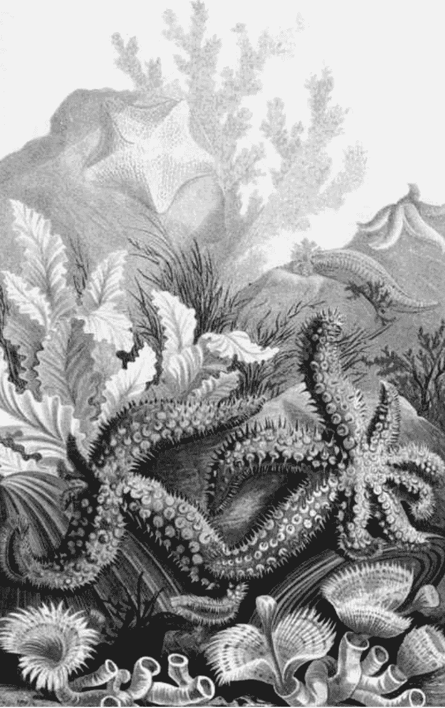

海星和管虫。阿尔弗雷德·埃德蒙·布雷姆（Alfred Edmund Brehm），1883–1884。

# 8 气候变化的影响：陆、海、气

气候变化的愤怒凌于生物圈之上，准备改变任何范围内的一切，它是我们放任太久的孩子。通过将大气作为工业革命的碳排放场，并在毫无警告的情况下继续推进，人类将温室气体（主要是二氧化碳和甲烷）的浓度提高到了危险水平。

大多数专家认同这一严酷的预测：污染引起的年均表面温度升高不应超过工业革命出生前（大约18世纪中期）的2°C（或3.6°F）。这种增长已经接近了“2°C”阈值的一半。

当全球大气变暖突破2°C的增长水平时，地球的天气将失去稳定。现在被视为历史性的热记录将成为常态。严重的风暴和天气异常将成为新常态。正在进行的格陵兰和南极冰盖融化将加速，为陆地带来新的气候和新的地理。

根据卫星和潮汐计数据测量，海平面已每年上升三毫米。在融水增加和由于整个海水加热导致海洋体积膨胀的共同推动下，海平面最终将超过九米。

这种灾难性的变化真的会发生吗？它已经开始。自1980年以来，地球的平均表面温度一直在增长，没有缓和迹象。

各国政府已被激发采取行动，但反应疲软且远不充分。只有微小的太平洋岛屿国家基里巴斯和图瓦卢，在太平洋威胁要吞没它们的情况下找到了解决方案。他们正准备将人口迁移到新西兰。

当然，你不会看到一夜之间发生的迁移。华盛顿的政治领人还没有开始乘坐贡船前往他们的办公室。但在2014年11月12日，奥巴马总统与中国习近平主席签署了一项历史性协议，美国将在2025年前将其碳排放减少到2005年水平的28%，而中国将在2030年前达到峰并开始下降至同一水平。

2014年12月，来自全球几乎196个主权国家的代表在秘鲁利马会面。他们同意回到国内并在六个月内制定计划，减少各自煤煤、天然气和石油的温室气体排放。这一集体计划是2015年12月草拟全球协议的基础。然而，达成的协议直到2020年才需要实施。

国际能源署坚持认为，人类必须设法将世界上大部分已探明的油气储量留在地下，以缓解具有毁灭性的气候变化，并补充说“在2050之前消耗的化石燃料探储量不能超过三分之一”。

每位代表所面临的困境在于忠诚的划分。这被已故生态学家加雷特·哈丁（Garrett Hardin）称为“公地悲剧”，它源于个人、组织或国家共享有限资源的情况。他们倾向于耗尽资源——在这种情况下是全球清洁的空气和水——因为每个人都将根据规则获得最大的份额，或者通过公然作弊获得更大的份额。

公地悲剧的教科书案例是公海生物资源的枯竭。在领海内，世界上许多地区对鱼类和其他海产物的采集监管薄弱；如果所有不属于任何人的公海水不受国际谈判确立规定之外的监管，几代以来，海洋海水受到不同程度的保护或完全没有保护，一直遭受食用物种过度采集的痛苦。

栖息地破坏、入侵物种扩散、气候变暖、酸化、毒素污染以及过度营养盐径流导致的富营养化加速了这种螺旋式下降。

这种攻击是残酷且持续的。自1950年以来，大型食用和运动类物种（如金枪鱼、剑鱼、鲨鱼和大型底鱼，后者包括鳕鱼、比目鱼、鲽鱼、红鲷和鞯鱼）的数量下降了90%。在朝民者时代，鳕鱼多到可以用不带饵的钩就能钓到一餐，而现在它们已经减少了99%。

幸运的是，海洋物种的完全灭绝比陆地大型动物的灭绝稀得多。原因是几乎所有大型海洋物种（包括远游鱼类）都有巨大的个体活动范围或迁移路线。它们一生中旅行的距离比陆地动物得多，因此播种了贫化的种群——从而拯救了它们的物种免于灭绝。

例如，亚洲虎已在其约93%的原始范围内被灭绝，这种攻击是残酷且持续的。大型食用和运动类物种（如金枪鱼、剑鱼、鲨鱼和大型底鱼，后者包括鳕鱼、比目鱼、鲽鱼、红鲷和鞯鱼）的数量自1950年以来下降了90%。在朝民者时代，鳕鱼多到可以用不带饵的钩就能钓到一餐，而现在它们已经减少了99%。

幸运的是，海洋物种的完全灭绝比陆地大型动物的灭绝稀得多。原因是几乎所有大型海洋物种（包括远游鱼类）都有巨大的个体活动范围或迁移路线。它们一生中旅行的距离比陆地动物得多，因此播种了贫化的种群——从而拯救了它们的物种免于灭绝。例如，亚洲虎已在其约93%的原始范围内被灭绝，这种攻击是残酷且持续的。大型食用和运动类物种（如金枪鱼、剑鱼、鲨鱼和大型底鱼）……世界上38%的物种处于脆弱状态。

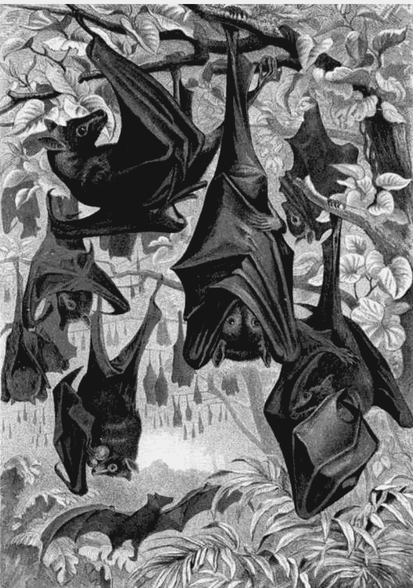

海星和管虫。阿尔弗雷德·埃德蒙·布雷姆（Alfred Edmund Brehm），1883–1884。

# 9 最危险的世界观

并非所有自称是保护主义者的人都同意生物多样性应该被保护。在这种地球生命的愿景中，人类对星球造成了打击，即使是偏远地区。

## 世界

保护运动诞生于19世纪和20世纪初的美国，虽然来得晚了，但幸好还不至于晚到无法拯救我们剩余的动植物。该运动始于1872年世界上第一个国家公园——黄石公园的建立，并深受亨利·大卫·梭罗、约翰·穆尔等其他自然主义者和活动家著作的启发，最终形成了令人印象深刻的联邦、州和地方公园网络。

这些公园还得到了非政府组织（最著名的如自然保护会）所设立的私人保护区的补充。自然是荒野的，自然是古老的，自然是纯洁的，这种典型的美国信条宣称，除了减轻人类干扰的腐蚀作用外，自然不应受到管理。作家华莱·斯格纳在1983年写道，美国的国家公园是“我们曾过的最好的主意”。

为了保护本身而保护的理念已传全球，到21世纪初，世界上196个主权国家中绝大多数拥有自然国家公园或某种政府保护保护区。因此，这一理念是成功的——但仅在数量和质量上如此。

极度濒危的湿地——其物种数量是美国和欧洲保护区的十倍——仅在热带美洲、印度尼西亚、菲律宾、马达加斯加和赤道非洲的大部分地区维持。根据脊椎动物（哺乳动物、鸟类、爬行动物、蛙类和其他两栖动物，鱼类）的数据估计，全球所有栖息地的物种灭绝率已达到人类前基线的千倍，且正在加速。

## 新人类世意识形态

支持者本质上认为，拯救地球生物多样性的传统努力已经失败。原始自然已不存在，真正的荒野仅作为想象的产物存在。那些通过人类世爱好者的视角观察世界的人，其世界观与传统的保护主义者完全不同。

他们中的极端分子认为，剩余的自然应该被视为一种商品，以证明拯救它的合理性。幸存的生物多样性应更多取决于其对人类的价值。让历史按照其似乎早已注定的轨迹发展。

最重要的是，要承认地球的命运是人类化的。对于认同这一大部分或全部愿景的人来说，人类世本质上是一件好事。自然残存的部分并不糟糕，但底线仍然是，即使是野生动物也必须像其他人一样赚取生计。

这种被某些支持者称为“新保护”的意识形态导致了各种实践建议。首要是，自然公园和其他保护区的管理方式应该有助于满足人类的需求。而且并不是我们现在现在及不久的未来中的所有人，我们的当代审美和个人价值观将是决定性的——因此是永远的。

遵循人类世准则的领导者将自然带过不可恢复的边缘，无论未来的无数后代是否喜欢。幸存的野生动植物将与人类建立一种新的友谊。在过去，人们以访问客身份进入自然生态系统；而在人类世时代，构成混杂生态系统片段的物种预计将生活在我们周围。

领先的人类世爱好者似乎担心如果他们的信念得到实现，将产生什么后果。他们对事实的缺乏和对恐惧的缺乏一样。正如社会观察者和保护主义者厄尔（Erle）写道：

> 经济增长和消费文化将仍然是领先的社会模型（许多人类世推动者认为这是理想的，而少数人对此持矛盾态度）；我们现在生活在一个被驯化的星球上，荒野已永久消失；我们可以放下生态忧虑和末日论，对人类化星球上的前景抱有更积极的态度；技术，包括风险性的、集中的和工业规模系统，应该被视为我们的命运甚至是救赎。

马里兰大学的环境科学家厄尔·埃利斯（Erle Ellis）发表了一份激进的信条，帮助环保主义者为新秩序做准备：“停止尝试拯救地球。自然已经消失了。你生活在一个用过的星球上。如果这困扰了你，那就接受它。我们现在生活在人类世——这是一个地质时代，地球的大气、岩石层和生物圈主要由人类力量塑造。”

是什么激情驱动着人类的巨兽？它体现在我们日常生活的普通体验以及语言中不容质疑的习语中。克里斯（Crist）继续他的分析：

> 接管（或同化）通过生物清洗和贫化进行：耗尽并毒化土壤；使万物变得可杀；让在 във面前覆盖或逃避的动物心中产生对上帝的恐惧；将“渔场”重新命名，动物为“牲畜”，树木重新命名为“木材”，河流重新命名为“淡水”，山脉重新命名为“覆盖物”，海滨重新命名为“海景房”，以便将转化、灭绝和商品化的“冒险”合法化。

当然，人类世爱好者并不完全缺乏如何在新秩序中保护生物多样性的想法。英国约克大学的保护生物学家克里斯·D·托马斯（Chris D. Thomas）成功地避开了大量发表的相反证据，指出当地本土物种的持续灭绝将由世界各地人类正在传播的外来物种所平衡。

这位专家向我们保证，这些物种将帮助填补生物多样性自然较低或被人类活动贫瘠化的生态系统的空白。外来物种与幸存的本土物种之间的杂交将进一步增加品种和物种的数量。

我们必须记住，他提醒说，过去地质时代的大规模灭绝之后紧随着着新物种的激增。当然，这个过程持续了数百万年。后代将发现生物多样性的演化恢复需要五百万年或更长的时间，这比演化出现代人类种所需的时间长几倍，这似乎并不重要。大量的外来物种变成入侵种，每年给世界造成数十亿美元的损失，也不是主要障碍。

## “新保护”理念

如果地球生命遗产的保护首先取决于任其自然发展，那么谁能有不同的想法？一位持有不同意见的观点是彼得·M·卡里瓦（Peter M. Kareiva），他是“新保护”理念的领军人物。

他在2014成为自然保护会的首席科学家。在公共演讲和为大众媒体写作时，他是攻击荒野本质的领导者。在他看来，地球上没有原始地区了。因此，早已被占据的地区应该开放给人类进行更理智的管理。卡里瓦倾向于“工作景观”，以便被经济学家和商业领袖接受。

但对荒野的攻击基于一个词源学错误。在《荒野法》中从未出现过“原始”这样的词。无疑，卡里瓦和其他人也意识到，“荒野”一词指的是尚未被人类束缚的地方。

在保护科学术语中，“荒野”是指在没有人类干预的情况下自然过程发生的大区域，在那里生命保持“自主”。荒野通常包含了稀疏的人口，而没有失去其本质。正如我很快将记录的，荒野是真实的实体。

其他人类世乐观者认为可以复活，只要我们能获得足够的组织来绘制基因代码并克隆整个生物。这种过程被称为“灭绝延续”，受青睐的例子包括旅鸽、猛象和澳大利亚的袋狼。

印度巴德拉纳的生物技术教授苏布拉特·库马尔（Subrat Kumar）在《自然》杂志上写道，他不仅相信灭绝延续，还敦促一项新的大规模计划为此做好准备。对于那些担心曾经灭绝的物种可能会扩散得像僵尸一样穿过森林的人，库马尔提供了一个令人放心的补充：“我们带回的任何物种如果产生问题，都可以通过工程手段消除。”

与此同时，在流行文学领域，记者兼作家艾玛·马里斯（Emma Maris）描绘了一个快乐的画面：在新的智能星球各处，为了人类利益而保留的半野生物种。在她看来，我们应该立即放弃不受限制的荒野的想法，这是一种在美国产生并推行的“崇拜”，一直潜伏在保护组织的使命宣言中，并不幸地渗透了自然写作和自然纪录片。马里斯警告说，这种谬误的想法必须得到遏制。我们作为星球统治者的真正角色是将生物多样性变成一个由我们照料的全球性的、半野生的狂野花园。

我的印象是，那些对草地和这些土地仍庇护的巨大生物多样性最漠不在乎且容易忽视的人，往往是经验最少的人。我认为在这里引用伟大的自然主义者亚历山大·冯·洪堡（Alexander von Humboldt）的话是相关的，无论在他的时代还是我们的时代：“最危险的世界观是那些没有观察过世界的世界观。”

## 真实的生存世界

生物多样性的大部分仍然存在于物种和生态系统中，但拯救它的时间正在飞速流逝。到本世纪末，它们可能已经大部分消失。以下展示了其依然存在的巨大广度的图景。

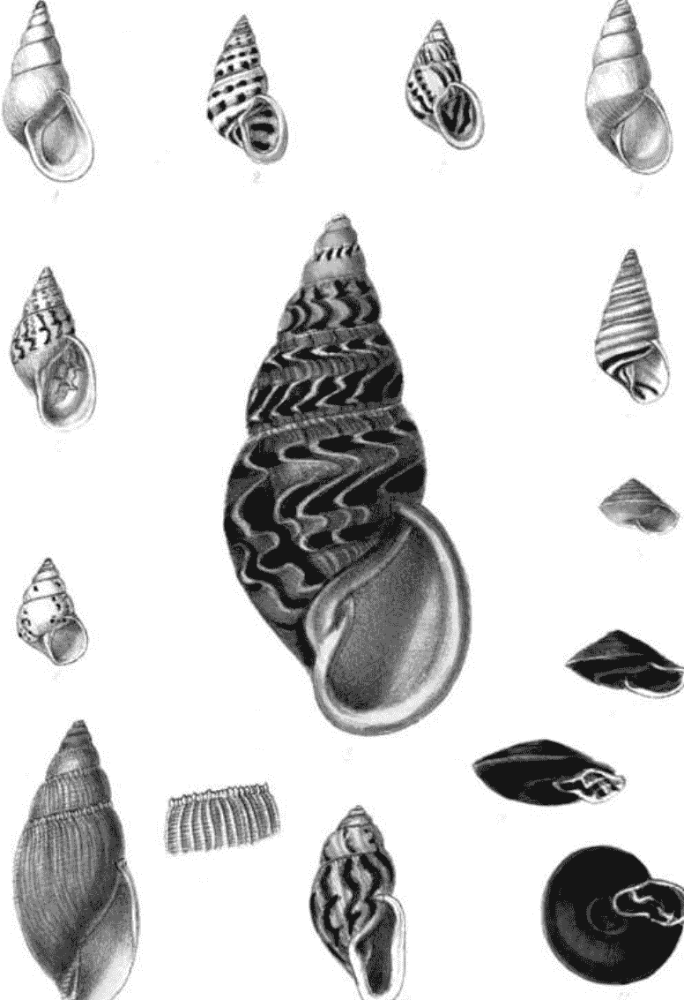

海洋软体动物。《伦敦动物学学会论文集》，1848–1860年。

## 保护科学

与大多数错误的哲学一样，人类世的世界观在很大程度上是善意无知的产物。它呼吁一种新的、以人为为中心的保护方法——更准确地说是“反保护”——这有多个来源。首先是对保护组织历史的错误认知；其次是对生物多样性数据库的理解不足；第三，一个不那么明显的来源是错误地强调生态系统是生物组织的关键层面，而几乎排除了物种和基因。

正如那些人类中心主义的坚定信者在推行“新保护”时所做的那样，认为传统保护组织的议程对人类福利关注极，这完全是错误的。根据我在几家全球领先组织的董事和顾问委员会服务三十年的个人经验，我非常清楚事实恰恰相反。在20世纪80年代，我曾见证了世界野生基金会（美国）大幅扩大了其指导方。我们从辩论组织的意图和目的开始：应该保护哪些动物植物群体、世界的哪些部分、如何保护，以及最后，为什么要保护？仅仅留在少数具有魅力的动植物身上就足够吗？认为它们能作为“伞护物种”保护周围的其他生命？而且拯救自然界中宏大而美丽的生物又将如何服务人类？如果将自然保护区从已经居住在那里或附近的人们隔离开来，无疑是错误的——最终也将是徒劳的。

我们的解决方案分两步被采用。首先，我们将注意力从熊猫、老虎等明星物种扩展到整个生态系统，即使是那些公众并不熟悉的生态系统。接着，我们制定了一项政策，援助自然保护区及周边居民的经济和医疗。

其他保护组织也同样改变了活动，将人类置于舞台中心。例如，国际保护组织（Conservation International）重点关注帮助发展中国家的政府领导者，建议作为改善农村地区经济和生活质量的一部分来保护生物多样性。自然保护会（The Nature Conservancy）始终以人为本，通过承担对生物资源丰富土地的管理，并向公众（包括生态和生物多样性研究人员）开放。Rare 作为一个成功的慈善保护组织，专注于明星物种和自然生态系统，将其视为当地文化的重要组成部分。

生物多样性研究和保护领域的领导者早已明白，世界上幸存的野外并非博物馆。它们不是为了我们的取悦而安排和照料的花园。它们不是娱乐中心、自然资源港口、疗养院或任何种类的未开发商业机会地。野外土地以及在其中受保护的地球大部分生物多样性，与人类杂乱无章地拼凑的世界完全是另一个世界。我们从那里得到了什么？它们提供的全球环境稳定性以及它们本身的存在，就是我们送给自己的礼物。我们是管家，而不是所有者。

我们无法预测人类世意识形态者所建议的程序将造成的破坏，特别是他们半野化的花园、外来种和新型杂交物种，以及亲于商业的景观。他们所参考的文献极其匮乏，表明提出此类措施的作者很大程度上并没有意识到他们建议遭受围困的生态系统的内容和结构。因此，前往大烟雾山脉国家公园（美国研究最充分的保护区之一），并简要思考每类生物已知物种数量的崩溃情况是非常有意义的。数据总结在本章末尾的表格中。研究专家和经过培训的志愿者进行了五万人小时的搜索，记录了18,200种物种。实际数量，特别是当加上所有怀疑但尚未记录的瞬态物种和微生物后，估计在六万到八万种之间。

如果你觉得这18,200种物种中有任何一种是多余的，请重新考虑。它们只是对你来说很陌生，对许多最忠诚的科学家来说也是如此。

大烟雾山脉国家公园存在某些吻虫和跳足纲，移除它们可能对剩余生物群不会产生重大影响（在这里我很容易出错），但我确定，剩余物种中极少数可以在不导致其他某组物种数量严重减少的情况下被消除。为了说明这一原则，请考虑从表中随机选择的五个物种灭绝的后果——例如：环节动物、软体动物、多毛类、缓足类和节肢动物。任何此类五种组合的灭绝都会扰动生态系统，甚至引发整个系统的崩溃。

由此可见，任何对自维持自然生态系统的研究，如果不进行像大烟雾山脉国家公园正在进行的那种全面生物多样性普查，就不可能是完全可靠的。而且这只是一个开始。还需要更多信息，包括每个物种居住在哪里、何时活跃、其生命周期、其种群动态，以及它们与生态系统内外物种的相互作用。即使在分类群内部，如所有的凤蝶类、所有的猛禽类或陆蜗或圆网蛛等，直到整个分类名目，物种之间在基础生物学和对其他生物的影响上通常存在巨大差异。

当我第一次访问大烟雾山脉国家公园时，我被跳足纲（Collembola）的跳虫迷迷了。这些微小且难以捉摸的生物在身体下方有一个杠杆，一端自由移动，另一端固定，使其能够像折叠刀一样打开和关闭。当捕食者靠近时，它释放自由的一端，杠杆撞击地面。然而，从更宏大的自然历史来看，这种动作只是故事的一部分。捕食者与猎物的演化通常被认为是一场军备竞赛。事实证明，某些蚂进化出了优于跳虫的方法。其中一种是当跳虫跳开一只时，它会落在另一只附近。

另一种适应性是整个动物界中最精确、最精美的捕猎技术之一。我研究过几种属于钻蚁亚（Dacetini）的蚂。蚂腰部释放一种吸引猎物的气味。感知到跳虫的靠近，蚂会冻住。然后，在摆动的触角尖端嗅感受器的引导下，缓慢向猎物移动。它们长齿的大颚张得很开，在某些物种中角度超过180度，锁定位置，准备出发。两根长毛向前延伸，避开开启的大颚。当一根或两根毛触碰到跳虫时，大颚瞬间合上——比眼观察快，比跳虫跳开还要快。大颚内侧的齿刺穿猎物。跳虫随后立即释放杠杆，但无济于事——捕食者和猎物在空中移动时仍紧锁在一起。

当我进入公园时的一个现实是，我从一根倒木上剥下一层皮（得到了公园管理员的许可），看到了三个微小的跳足，这是另一类跳蚁有时会捕食的隐秘昆虫类。这些生物属于爪足科（Jalalids）的特殊跳足纲，尾部有一对螯。尽管世界上有很多这种物种，但对其生物学的任何部分都知之甚少。它们偏好的食物是什么，生命周期是什么，为什么这些螯处于如此不寻的位置？我不知道。我或任何其他生物学家无法预测如果它们全部消失会发生什么。我当时的想法是，如果我有另一辈子可以过，我可以完全致力于研究跳足。

同样从这个角度来看，在夏日的田野上，你只需用蝴蝶网在植物丛中来回挥动，就能捕捉到不同种类的蝇。（试试看；你会大惊的。）接着进一步思考，如果你愿意的话，这些物种各具专门化，取食特定的水果、花粉或真菌；或是粪便、尸体，或者如果你允许的话，还有你的新鲜血液。有些蝇是其他昆虫的寄生虫——不仅是昆虫，而且在数以千计的物种中专门针对几种物种。当我还是青少年时产生这一感悟，我几乎要成为一名双翅专家，即研究蝇虫的昆虫学家。我被长足石序细的小蝇迷住了，它们在夏日的阳光下在叶片上展示自己，闪烁着金属般的蓝绿色。那里有多少物种呢？它们为什么要为了最大的视觉效果而跳舞，至少对我而言是如此？它们作为幼虫在哪里、如何度过？然后我被蚂蚁吸引了注意力。尽管我当时在普通的阿拉拉巴马州，远离热带，但我发现了一群蚂蚁正穿过我的后院。它们是本土物种，是横扫中南美森林的行军蚁的微型版本。我跟随着它们快速移动的队伍，看着它们穿过邻居的院子，然后流过铺好的街道，进入一片林地。在队伍的末尾，我看到了寄生衣鱼和其他昆虫追随者。我美丽的小长足序蝇无法与这一奇观竞争，于是我决定专门研究蚂蚁。那时的并不知道我即将进入的世界是何等广阔且美无尽的。

每一个生态系统，无论是池塘、草地、珊瑚礁还是世界各地发现的成千上万其他地方，都是由专门化的生物编织和交织而成的网。物种（即每个相互交的个体群体）与生态系统的某些其他物种以强、弱或无关的方式相互作用。在大多数生态系统中，甚至物种的身份都是未知的，生物学家如何定义它们相互作用的许多过程呢？如果某些本土物种消失，而其他此前不存在的物种入侵，我们又如何预测生态系统的变化呢？我们只有不完全的数据，根据线索工作，并用猜测来调整一切。

我们这些实际上在野外将生态系统分析到物种水平的人，仅在最受限和最基础的生态系统中取得了重大进展，而且仅针对其部分动物群和植物群。通过粗略的分类，我们研究了红林小岛、小池塘、潮汐池和南极干岩石绿洲。我们从这些微型栖息地学习了关于定殖过程的原则，并发现了关于捕食、定殖与生物多样性平衡量之间关系的惊人事实。我们可以告诉你季节和气候变化的影响，以及某些人为干扰的结果。然而，我们不得不承认，生态系统分析这一学科的程度并不比二十世纪初分子遗传学和细胞生物学革命之前的生理学和生物化学先进。

自然知识告诉了我们关于保护和人类世的什么？这一点很明确。为了拯救生物多样性，在处理地球自然生态系统时必须遵守预防原则，并严格执行，直到我们科学家和公众对它们有更多了解。谨慎行——研究、讨论、计划。给地球上的其他生命一个机会。避免药方和对快速解决方案的轻率言论，尤其是那些威胁会对自然世界造成不可逆转伤害的方案。

## 大烟山国家公园物种统计*

| 分类群 | 旧记录（全物种生物多样性调查之前） | 公园新增（自全物种生物多样性调查开始以来） | 科学新增 | 总记录 |
|---|---|---|---|---|
| 微生物 | 0 | 206 | 270 | 476 |
| 细菌 | 0 | 0 | 44 | 44 |
| 古菌 | 0 | 3 | 5 | 8 |
| 微孢子 | 1 | 41 | 2 | 44 |
| 原生物 | 0 | 17 | 7 | 24 |
| 病毒 | | | | |
| 黏菌 | 128 | 143 | 18 | 289 |
| 植物 | 1,598 | 116 | 0 | 1,714 |
| 维管/非维管植物（苔藓等） | 463 | 11 | 0 | 474 |
| 藻类 | 358 | 566 | 78 | 1,002 |
| 真菌 | 2,157 | 583 | 58 | 2,798 |
| 地衣类 | 344 | 435 | 32 | 811 |
| 刺幼动物（水母、藻） | 0 | 3 | 0 | 3 |
| 扁虫门（扁虫） | 6 | 30 | 1 | 37 |
| 苔藓动物（苔虫） | 0 | 1 | 0 | 1 |
| 颚头目（头虫） | 0 | 1 | 0 | 1 |
| 毛线目（马陆） | 1 | 3 | 0 | 4 |
| 线虫（圆虫） | 11 | 69 | 2 | 82 |
| 环节形动物（须虫） | 0 | 1 | 0 | 1 |
| 软体动物（蜗牛、蚌等） | 111 | 56 | 173 |
| 环节动物（水虫、蚯蚓） | 22 | 65 | 92 |
| 缓存动物（水熊） | 3 | 59 | 80 |
| 节肢动物（螨） | 22 | 227 | 32 | 281 |
| 蜱 | 7 | 4 | 11 |
| �螨 | 1 | 21 | 24 |
| 蝎子 | 229 | 256 | 527 |
| 壳壳纲（桡足、介壳目等） | 5 | 3 | 11 |
| | 10 | 64 | 100 |
| 多足目（蜈） | 20 | 17 | 37 |
| 唇翅目（唇翅目） | 0 | 0 | 2 |
| 原始足目（等足） | 7 | 25 | 49 |
| 双足目（马陆） | 38 | 29 | 70 |
| 原始翅目（原翅） | 11 | 5 | 26 |
| 弹尾目（跳虫） | 64 | 129 | 59 | 252 |
| 双翅目（双翅） | 4 | 5 | 14 |
| 鼠尾目（鼠尾） | 1 | 2 | 4 |
| 狭尾目（衣鱼） | 1 | 0 | 1 |
| 蜉序（蜉蝣） | 75 | 51 | 8 | 134 |
| 翅目（蜻蜓） | 58 | 35 | 93 |
| 直翅目（蝗虫、蟋蟀、���龟） | 65 | 37 | 104 |
| 其他“直翅类”（蟑螂、螳螂、竹节） | 6 | 7 | 13 |
| 笔目（鼠襏） | 2 | 0 | 2 |
| 石目（石蝇） | 70 | 48 | 3 | 121 |
| 蚁目（白蚁） | 0 | 2 | 2 |
| 半翅目（真�、蚜） | 276 | 361 | 3 | 640 |
| 苔翅目（蓟�） | 0 | 47 | 0 | 47 |
| 皮目目（石虱） | 16 | 52 | 7 | 75 |
| 吸目（虱） | 8 | 47 | 0 | 55 |
| 鞘目（甲虫） | 887 | 1,580 | 59 | 2,526 |
| neurop目（草蛉、蚁蛉等） | 12 | 38 | 0 | 50 |
| 膜目（蜂、蚁等） | 245 | 574 | 21 | 840 |
| 毛翅目（石蛾） | 153 | 82 | 4 | 239 |
| 鳞目（蝴蝶、蛾、弄蝶） | 891 | 944 | 36 | 1,871 |
| 蚤目（跳蚤） | 17 | 9 | 1 | 27 |
| 敛目（蝎蝇） | 15 | 2 | 1 | 18 |
| 双翅目（蝇） | 599 | 651 | 38 | 1,288 |
| 脊椎动物 | | | | |
| 鱼 | 70 | 6 | 0 | 76 |
| 两栖类 | 41 | 2 | 0 | 43 |
| 爬行类 | 38 | 2 | 0 | 40 |
| 鸟 | 237 | 10 | 0 | 247 |
| 哺乳动物 | 64 | 1 | 0 | 65 |
| **总计:** | **9,470** | **7,799** | **931** | **18,200** |

* 来源：Becky Nichols，昆虫学家，大烟山国家公园（截至2014年3月）

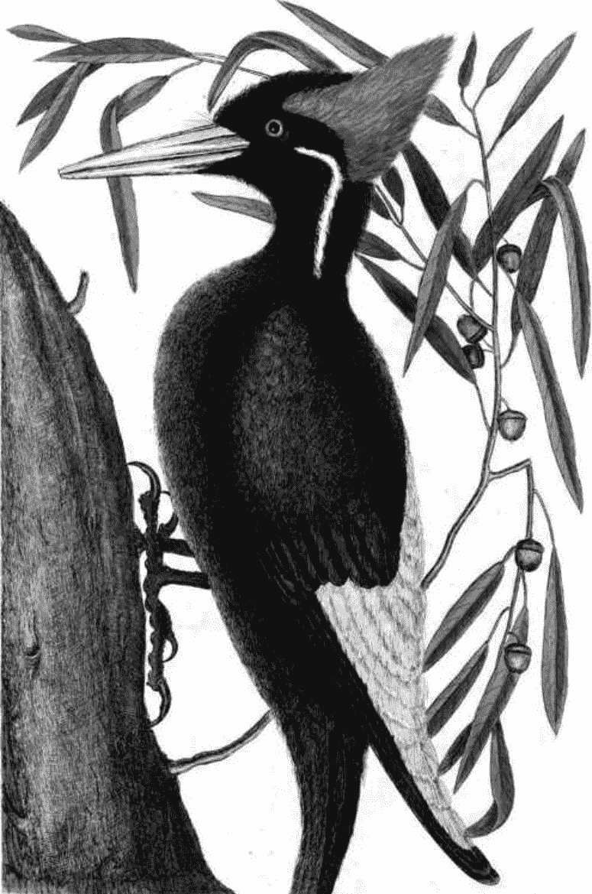

柳树橡上的白面啄木鸟。Mark Catesby, 1729.

## 上主之物种

你可能认为生物多样性的研究与传统生物学是在不同的文化下进行的。但它们之间存在相似之处。细胞和大脑就像生态系统——等同于雨林、草原、珊瑚礁或高山草甸。它们各个部分的位置和功能必须首先被发现和描述，然后联系起来以描出一幅整体图像。但对器官系统的研究主要在实验室的范围内进行。即使是平方米的桌面空间也可能产生重大的发现。相比之下，对生物多样性的研究——称其为生物多样性研究、科学自然史或进化生物学——其范围遍布整个地球表面。

科学家分为两种。第一类是为了生活而进入科学领域。第二类则相反：他们寻找一种进入科学领域的生活方式。我所认识几乎所有的自然学家都属于第二类。他们是所有科学家中最勤奋但竞争性最小的一群。他们也是薪水最低、获得的荣誉最少的群体，因此缺乏动力去

除了科学之外，他们还有其他工作。当自然学家聚在一起时，他们很少谈论不在场的同事。相反，他们会谈论发现和突破性新闻。（“我听彼特在萨尔瓦多掉进了一个峡谷。你知道他还好吗？”）

除极少数例外外，没有人会保守秘密。恰恰相反，这里的氛围是偷听，你可能会捕捉到一些听起来像这样的片段：“你听说了芭芭拉在角织鸟巢里发现那种疯狂的共生谴了吗？在苏里南，我想是那儿。或者，鲍勃去阿尔泰山研究他的地衣了，俄罗斯人允许他在中海拔地区营地六个月。老兄，只要我能去那里采集一周的树甲虫我就知足了！那里仍然是处女地，至少对树甲虫来说是。”

这是一个真实的例子。

埃德·威尔逊（Ed Wilson）于2014年4月27日给《移动注册报》的本·雷恩斯（Ben Rains）写的关于阿拉巴马州南部移动-滕萨瓦三角洲泛滥森林的信函：“我听说这里有小洲猫。那将是哺乳动物区的一个大补充。（小洲猫是一种稀有、行踪诡定的野生猫类，自然分布范围从美国热带向北延伸德克萨斯州。佛罗里达州和墨西哥湾中部岸可能存在引入种。）”

雷恩斯：“噢，是吗？你见过它的照片吗？”

威尔逊：“没有。我猜你要告诉我说没有人照片或皮草。但这个传闻至少引人注目。”

雷恩斯：“嗯，我确定这里有山狮，但你几乎永远看不到它们。所以也许有一天小洲猫也会出现。我们可以期待一下。”

我相信，这种容易建立友谊的原因在于，对于受过训练的自然学家，只要有一点野心、敏锐的眼光和无穷无尽的驱蚊喷剂，他们发现的数量几乎是无限的。通过努力工作，每周获得的发现回报是极高的。这就像在路易斯安纳州的鲶鱼池里每投掷一次带饵的钩，每次都能上钩。深吸三口气，几乎能全部钓上来。每一次进入野外的实地考察或穿越博物馆馆藏的旅行，都能在科学自然史领域产生一次价值的发现。当然，前提是我们知道你正在处理的是什么物种。

自然历史和其他科学家一样，对大发现充满梦想，渴望在珍贵时刻无法想象的现象，或至多是难以捉摸的幻影。我们也有自己的圣杯，其中最熟悉的就是进化的缺失环节——例如，变成鸟的恐龙，或者肺鱼变成两栖动物，或是类人猿变成人类。

同样令人兴奋的是重新发现被认为灭绝的物种。这引出了我最喜欢的幻想之一。我划着独舟穿过另一个沿海泛滥森林的后通道，这条河环绕着乔克哈奇河（Choctawhatchee River），它横跨佛罗里达半岛并流向墨西哥湾。我听到了一种异奇熟悉的鸟鸣，peet-peet，那是喙撞击硬木的双重声。那听起来像是……但是，不不可能。但是，可以。为什么不呢？

在梦中，两只巨大的啄木鸟俯冲而下，落在前方二十英尺的一棵柏树上。接着又是一声尖锐的双重击声，其中一只鸟正凿出一只甲虫。

举起望远镜。那是黑色的身体和尾巴，闪烁着白色的初级羽，雄性鲜红的冠羽。象嘴鸟！但是我想，不可能！也许我记错了野外指南。不，我必须相信自己的眼睛。我所知的最后一次证实的象嘴鸟目击是在1944年路易斯安纳州的辛格地带（Singer Tract）。在幻想中我知道这一点。我还记得2004年在阿肯萨斯州大森林沼泽的目击是一个误报，那只鸟是红背啄木鸟，象嘴鸟的常见相似物。我记得后来一个鸟类小组报告在佛罗里达州乔克哈奇河泛滥区发现了象嘴鸟种群的迹象，但那也没有结果。至少目前还没有。

从白日梦回到现实，在那个报告象嘴鸟迹象的鸟类小组几年后，我去了乔克哈奇河的堰坝处。那是一次刺激——即使没有象嘴鸟。乔克哈奇河是该地区典型的河流：茂密的亚热带泛滥森林，通往无处的入海口，到处充满生机，几种被称为“短鼻龟”和“滑龟”的龟类在你靠近时会滑过倒塌的树干消失在视线中。鳄鱼，偶尔还有大大的，在更上游的地方撞入水中。

我怀着能亲眼看到象嘴鸟的第一希望。我的同伴兼道主M.C·戴维斯是墨西哥湾领先的土地主和自然保护者，他对该地区非常熟悉，但他完全怀疑。他说：“听着，如果我想知道象嘴鸟的情况，我会往上走一段，和住在河边的一些‘沼泽鼠’聊聊，并为象嘴鸟种群的证据提供相当的报酬——我指的不是一只死鸟。”

总之，有一天，我在M.C·戴维斯翻新的谷仓里和一群自然学家吃早餐，为一天的野外工作做准备，谈到了附近乔克哈奇泛滥区可能存在象嘴鸟的话题。大家普遍持反对态度——没有人想显得很轻信——当小组中的一人说他想播放一段鸟鸣录带时。我们听到`peet-peet`，`peet-peet`。一位经验观鸟者轻声说：“那是象嘴鸟。”那可能是，但我是一个现实主义者，我怀疑那录带是六十年前录的。

在纯科学领域，它们的处境甚至比经济学更糟。与这种边缘科学并行的是，其短板在于构成生态系统的物种的身份和自然史数据库——这与经济学中个体天生与后天行为的缺陷如出一辙。此外，当你把真实参与者的行为结合在一起时，无处不在的非线性因素像逃跑的鳗鱼一样扭曲翻动。总的来说，理论学家们未能掌握现实世界近乎无尽的复杂性，在那个世界中，参与的不只有极少数大量的物种或人类，其数量通常是不确定的。

在少数情况下，生态学家可以挖掘数据库中的部分相关性来揭示环境变化的原因。之一是全球变暖导致针叶林中树虫数量增加，随之的是更频繁的火灾，这是一个普遍原理。另一个是随着生态系统的下降，物种平均生态位宽度增加，这在北温带和极地生态系统中十分可见。单个物种平均出现在更多的栖息地中。它们消耗更多样化的食物。另一个全球趋势是地衣、针叶树向世界北的多样性增加，与此同时，在同一地理梯度上，兰花、蝴蝶和爬虫动物的多样性在下降。然而，通常，只有当研究的生态系统非常小且生物多样性相对简单时，生物多样性变化的环境因素才会被引出。

生态学像所有科学学科一样，由最好从底向上逐步掌握的课题组成。首先，你发现某些现象，并推断此类现象的存在，然后你解释它们的因果关系，将手头的材料与任何看似相关的解释相结合。根据现有的解释，利用常识或灵感，你设计出可能的研究（假设），最好是多个相互竞争的解释。借此，你被引导去寻找更多数据并改进理论，这些理论可能也可能为每种现象以及它们所属的模式提供一些微弱的光亮。如果你仍然无法解释整体，至少你可以开辟新的研究途径。

因此，科学研究很少是直截了当的。它很少向顶发生巨大的飞跃。它是斜着移动的，以角度向前推进、重构、扭曲、填充主体、等待、环顾、更准确地描述局部、更坚定地描述谱系。然后，就像洞穴墙上的裂缝一样，一束引导的光穿了进来。

这几乎是所有成功科学运作的方式。显然，这在生态学中做得还不够。推进生态系统结构和功能研究所需的数据在大多数情况下并不存在。让我们反复询问生态学家：如果我们甚至不知道大多数运行着精细调节的能量和物质循环引擎的昆虫、线虫和其他小动物的身份，我们又如何能理解森林或河流可持续性的深层原理？转向海洋，那些在2013年首次为人知的噬菌体病毒捕食者的极度丰富，我们该如何解释？而当超微型生物——皮藻门动物（Picozoa），它们可能是海洋胶体消耗性“暗物质”的关键组成部分——直到2013年才首次被解剖学描述并归为一个新门时，海洋生态系统又将如何被可靠地理解？

让我们用另一种方式来看待生态学短板的这一问题。每一个科学学科在合成成类似于成熟理论的东西之前，都必须经历一个自然史时期。大多数生态学领域缺乏的科学自然史是构成生物多样性的物种的身份和生物学。地球上至少三分之二的物种仍然未知且未命名，在已知的三分之一中，不足千分之一的接受过密集的生物学研究。正如生理学和医学如果没有对人体器官和组织的坚实知识就无法进步（也无法妥善教学），不能期待生态系统分析在缺乏对构成一个生态系统的物种之坚实知识的情况下取得重大进展。

支持“人类世”哲学的作家和发言人关注生态系统，并根据训练，似乎并不理解物种水平上生物多样性的本质和意义。物种水平生物学的研究人员等同于对大脑进行精细研究的神经生物学家，而那些将物种视为填充生态系统的可交换零件的人类世爱好者，无非是十九世纪的颅相学家，他们通过头骨形状来研究思想。

因此，生态生态系统的大部分必要工作在于物种水平的生物多样性研究。生物多样性的探索一如既往是从分类开始的。

分类学家发现物种，学习通过解剖、DNA、行为、栖息地和其他生物特征的差异来识别它们。所有这些信息都有实用价值。假设从一个仍然未知地点引入的新种果蝇威胁到了西部的苜蓿农田。这个入侵者的名字和身份是什么？它从哪里来？它在故乡的寄生虫和其他天敌是什么？还能从它已知的生物学中获取什么来帮助控制它？等到每种紧急情况发生才从底层开始必要的研究不是明智的吗？记住，这种入侵物种的数量在世界各地都在指数级增长。在上升的潮流中，少数是潜在的害虫。另一小部分是携带病原微生物从人类或家畜的昆虫和其他生物。

考虑保护领域日益紧迫的第二类问题。2014年，油棕行业的官员建议砍伐并转化婆罗洲一半的雨林，留下另一半作为自然保护区。这种大规模的破坏对婆罗洲的生物多样性产生什么影响？该岛上所有的物种会在缩减的保护区内存活吗？还是会接近80%，或者一半？在此过程中，有多少在世界上其他地方未被发现的物种将落入电锯？以往对自然环境广泛转换的经验表明，损失将不到一半，但在10%或20%的范围内。由于生物多样性变化的环境因素只有在研究的生态系统非常小且生物多样性相对简单时才会被引出（此处应为：与此同时，在同一地理梯度上，兰花、蝴蝶和爬虫动物的多样性在下降。然而，通常，只有当研究的生态系统非常小且生物多样性相对简单时，生物多样性变化的环境因素才会被引出。*注：原文此处有重复逻辑，译文已根据语境微调*）。

另一个问题是人类世支持者的主张，荒野已不存在，地球已经是一个使用的星球，时间已经到了，他们说，将人们完全带入画面，以共生的方式共存。如此，有多少物种，以及大大自然，会存活？人类世支持者并不知道，科学家们正在努力发现。

房屋，并以它们微小的方式为疟疾控制做出贡献。（`Culicivora` 意为“食蚊者”。）

## 僵尸主宰

作为演化特异性的第二个例子，考虑寄生虫的巧妙。欧洲服尺蛾的幼虫（毛毛虫）白天通过躲在树皮下躲避鸟类和其他捕食者。当夜幕降临，它们会爬上树冠进食叶子作为晚餐。当这些毛毛虫感染一种病毒（特别是核多倍体病毒）时，其白天的行为会发生反转，这种病毒会以致命的有效性席卷整个服尺蛾种群。病毒会诱导大脑发生变化，导致毛毛虫在白天爬到树顶。在顶部，它们的身体会液化，并释放出一云病毒来感染其他的毛毛虫——尤其在雨水的帮助下。类似的僵尸化控制还由冬虫菌实施，真菌在蚂蚁觅食植物时感染蚂蚁。蚂蚁在临死前的最后一个动作是用上颚夹住叶脉，这一动作将它们的尸体固定在原地。真菌从身体中生长出来，并将孢子散到空气中，落在其他身上。

## 骗子大师

物种演化的精确性通常包含欺骗。自然界中充满了为了完成或辅助完成其生命周期而发出虚假线索的植物动物。其中最复杂的例子之一是发现于美国西南地区的一种拟甲虫（*Molo franciscanus*）。它利用一系列骗术来偷取与其同一栖息地常见的独栖蜂（*Habropoda pallida*）的资源。拟甲虫雌在蜜蜂经常采食花粉和花蜜的植物基部产卵。孵化后，甲虫幼虫爬上植物并聚集在一起形成一个小的球形物体。这些小骗子随后释放出一种气味，雌蜂利用这种物质来吸引同类的雄性。甲虫幼虫堆积在受骗的雄蜂背上。当甲虫接触到同种的真实雌蜂并交配时，甲虫幼虫离开并聚集在雌蜂背上。它们一直骑到直到雌蜂回到巢穴，无论那里在哪里，它们都会掉下来，吃掉那里储存的花粉、花蜜，以及她产下的卵。

兰花是植物界的大型骗子。关于它们的欺骗手段可以写一整部百科全书。兰花由一万七千种组成，是花植物家族中最大的，它们利用各种技巧诱导昆虫将花粉传播到其他同种植物上。例如，有些兰花的形状像某些类蜂的雌性。当雄蜂降落交配时，它们得到的只有粘性的兰花花粉团，附着在身体上。其他的兰花品种通过释放雌性气味来吸引雄性。至少有一种物种会发出愤怒蜜蜂的味道，这吸引了捕食这些昆虫的蜂类。蜂类身上带着虚假的蜜兰花花粉团，最终反而授粉了兰花，而不是寻找同类的配偶或采集食物。

## 奴隶主

社会性昆虫提供了许多极端适应的奇特例子。在北方温带地区，数百万年的蚂蚁奴隶制上演了充满欺诈的大大戏。有许多物种会袭击其他蚂蚁物种的群，并在赶走防御性的成年体后，绑架处于蛹期的未成年后代。掠夺者随后将俘虏（让它们从蛹中孵化）作为奴隶抚养，以增加自己的劳动力。在极端情况下，奴隶主就像古老的斯巴达战士一样，完全依赖奴隶的日常劳动。这种欺骗基于蚂蚁的一个普遍特征：工蚁在从蛹中孵化为成年体后，它们在最初的几天里会痴迷于周围蚁群的气味。从那一刻直到死亡，俘虏们都将奴隶主视为姐妹，尽管奴隶主正如其实质那样压迫它们。

奴隶主是凶残的战士。有些个体配备了强大的镰形大颚，用于杀死或致残它们目标群落的防御者。我研究的一种物种通过“宣传性”物质达到了同样的效果。在攻击期间，掠夺者会释放大量的化学物质，这种物质作为防御者的警报信号。被围的工蚁会陷入恐慌，就像人类突然被周围高音量播放的火灾警报声包围一样。掠夺者本身不受干扰；它们会被自己自身的费信息气味所吸引。

如果被要求在没有俘隶劳动的情况下生活，奴隶主会怎样？一天，我决定通过从实验室饲养的奴隶主蚁群中移除所有奴隶来寻找答案。战士们被孤立且没有以前的经验，开始尝试以前留给奴隶的任务。但它们的表现很糟糕。它们照顾幼体的方式非常草率，捡起幼虫和蛹带着它们走一会儿，然后把它们掉在错误的地方。它们完全无法将食物带回巢穴，即使我把碎片放在入口处。

如果奴隶主从它们各种物种所栖息的许多生态系统中消失，会发生什么？我不知道——寄生虫的影响是一个完全独立的领域。

## 巨型杀手

自然历史学家在首次研究之前未知的物种时往往感到惊讶。例如，在反思动物间捕食的普遍现象时，自然历史学家倾向于假设捕食者和猎物的大小大致相同，或者捕食者大得多。然而，例外是存在的。鸟类啄昆虫。一群狼可以在深雪中带走一头驼驯，一群狮子有时可以让大象丧失行动。尽管如此，捕食者和猎物之间的重量差异通常不超过十倍。然而，在南美洲物种 *Azteca andrea* 的戏剧中发现了许多例外，它们生活在南美洲热带雨林的一种阔叶树 *Cecropia obtuse* 上。多达八千只工蚁并排排列在单片粗尾树叶的下缘。它们张开大颚等待，准备好立即行动。当昆虫落在叶子上时，伏击者从四面八方冲上来，并共同将其固定。这意味着几乎任何大小的昆虫猎物都能被捕获。被带到安全处的重量是单个工蚁的13360倍。这种令人惊叹的类人创新在自然界中似乎很少见。

我选择上述物种相互作用的例子在自然界中非常独特是有目的的。首先是为了引起你的注意力，当然；昆虫不是每个人喜欢的动物。但它们也说明了生态系统研究的一个重要原理。想象在物理范围内地球上演化出的任何生态位。（例如，没有动物能以每小时百英里的速度跑步或消化矿石。）地球数百万物种中，可能会有一个或多个占据你选择的生态位。要将这一原理从物种扩展到生态系统，最好的方法莫过于《物种起源》结尾的感叹：

“观察一个错综复杂的树枝，上面有许多种植物，鸟类在灌丛中歌唱，各种昆虫在周围飞舞，蠕虫在潮湿的土壤中爬行，并反思这些构造精致的形式，彼此如此迥异并以如此复杂的方式相互依赖，都是由我们周围作用的法则所产生的。”

对于那些认为自然主要由植物和大型脊椎动物组成的人，我说看看你们周围运行地球的小型生物。对于那些认为自己可以用少数物种的数学模型来洞察生态系统运作的人，我说你们住在梦世界里。正如成功的医学依赖于解剖学和生理学的知识，保护科学依赖于分类学和自然历史的知识。对于那些认为受损的生态系统会自我修复，或者可以通过用功能性的外来物种替代原始原生物种来安全恢复的人，我说在你们造成伤害之前再想一想。

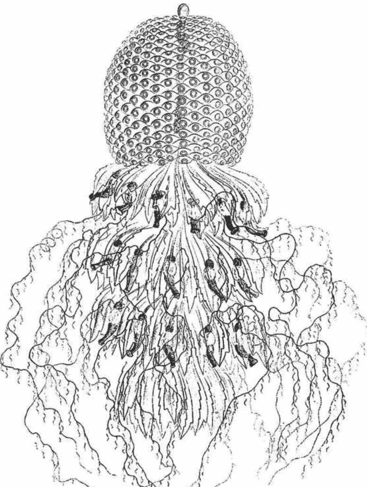

管水母 `Forskalia tholoides`（殖民性“水母”），根据恩斯特·海克尔（1873–1876）的作品描绘。

# 13

完全不同的水生世界

地球上拥有两个不同的生命世界，两个截然不同的生态系统布局。生物多样性的基本层级结构是相同的，从生态系统到物种再到基因，它们面临着同样的灭绝威胁。但其他一切都大不相同。

为了解释这一点，我提议带你开启一段短暂的旅程。随我来到海边。望向一个远离陆地和天空、以至于看起来像在另一个星球上的环境。如果你在没有生命维持系统的情况下物理潜入其中，你将在不到十分钟内死亡。海底有大片区域实际上从未被人类造足，更不用说近距离观察了。

到目前为止，大多数海洋世界一直生活在人类世的事件之外，但这种情况在21世纪初正发生着迅速变化。人类入侵了最遥远和最深的海域，特别是在那些可以营利性提取食物和其他资源的地方。我们的生态足迹正在增长：水域正在变暖和酸化；珊瑚礁正在消失在记忆中，在某些地方正在……

让我们从海滩开始。请你站在低潮时波浪带的湿润沙滩上，让较长的波浪环绕，并开始在上面堆积。现在谈谈生物学。浪花起初可能看起来是没有生命的，由被冲刷干净的水和土壤组成。事实恰恰相反。这里是一群该栖息地特有的无脊椎动物的家园。它们的体型从像子弹一样的穴居虾（“沙蚤”）到拇指大小，再到绝大多数——它们在肉眼下几乎看不见，甚至完全看不见。

这种微栖动物（`meiofauna`，词源源自希腊语意为“较小”）的奇特之处，尤其是考虑到其栖息地的简单性，不仅在于它们所包含的物种，更在于这些物种所代表的许多高级分类单元。如果你在陆地上走到森林边缘并仔细清点其生物多样性，你可能会发现以下七门的代表：脊索动物门（鸟类、哺乳类、两栖类）、节肢动物门（昆虫、蜘蛛、螨、马足、蜈蚣、甲壳类）、软动物门（蜗、蛞）、环节动物门（蚯蚓）、线动物门（线虫）、缓动物（水熊）和轮动物门。在波浪带的沙粒中，你会发现两倍数量的门类（这可能会让你反复念叨“天主在上”），包括内腔虫目、毛颚纲目、颚口目、头甲目、线虫目、多栖目、头壶目、足总目和缓动物。它们存在于我们较熟悉的软动物、多毛虫、轮动物和甲壳类之中。微栖动物的常见体型是虫状的，允许它们在密集的沙粒中快速移动。它们爬行着觅食，爬行着躲避捕，爬行着交配繁殖。

对微栖动物及其在世界海岸生态系统中的地位的研究仍处于早期阶段。其物种相互作用的多种方式在很大程度上仍处于研究阶段。然而，这些地球上物理最活跃的生态系统之一的奇异居民是生物圈的重要部分。而且它们的数量比你想象的要多。尽管微栖动物可能生活在仅一公里宽的栖息带内，但地球海岸的总长度为57.3万公里，几乎相当于地球到月球距离。如果将微栖领域视为这一长度，并将平均宽度推测为一公里，它的总面积将相当于德国面积。

让我们跳过已经熟悉的离岸珊瑚礁（因其巨大的结构复杂性和生物多样性而被称为“海洋雨林”），旅行到开阔海域上方，然后向下俯掠过水面。在这里你将发现浮游生物（`pleuston`），这是一个完全不同的、许多海洋生物学家并不熟悉的栖息地。在空气接触海洋的地方，是专门生活在表面张力形成的层上或其下方的生物。尽管分布稀疏，但在所有海洋无处不在。它们生活在主要由动物产生的浮岛上，这些浮岛的大小从鱼类和海鸟的尸体到肉眼无法看到的藻类碎片和黏液。每一个碎片都是一个生物群的家园。居民总是包括多种细菌，可能还有古菌——它们看起来像细菌，但对于到达传统的海洋岛屿来说是非常新来的，它们繁衍生长，直到耗尽了所有可用的养分。

在整个海洋和内陆海，细菌和古菌乘着表面的碎片，也漂浮在下方的水中游动。那些通过光合作用自由获得物质和能量。总结果是：无论水看起来多么清澈，它都生机勃勃。

因为我的专业是昆虫学，我对海洋昆虫特别感兴趣。由于它们的数百万物种和它们构成的巨大生物量主宰了陆地生命，了解有多少栖栖于海洋环境具有巨大的意义。答案是几乎没有，而这其中包含着迷人的科学之谜。在我对岛屿的研究中，我发现了毛虫生活在红树林的淹没支根中，这是红树林物种中最靠近海洋且全球分布最广的。但这种近陆地的栖息地与远处珊瑚花园和蓝水非常远。那个世界里没有昆虫，除非在表面，而这些奇特的旅行者极其罕见。很少有海洋生物学家甚至见过活着的个体。我没有见过。林奈和达尔文完全不知道它们的存在。所有已知的水黾（一种在淡水溪流、池塘和湖泊中常见的“真亚”，属于半翅目）依靠长腿在水面上跳跃。淡水水黾捕食其他昆虫，如蚊子幼虫，它们本身生活在表面或附近。所有的海洋水黾都属于水属（`Halobates`）。在这个精选小组中，只有少数物种在开放海中生存。它们捕猎的对象尚未知。

开放海水黾的存在是一个例外，加深了谜团。昆虫在陆地以及池塘和其他淡水栖息地中进化了超过四亿年。在期间，当植物存在时它们主宰了动物生命。未定义的数百万物种在反复的进化浪潮中进化并繁衍。然而，只有水黾成功在海洋上足了一脚。据我所知，它们甚至没有在无脊椎动物（如甲壳类、蜘蛛和多毛虫）占据的数千个物种狭窄生态位中被发现。

利用反光照明（`counter-illumination`），即在其腹产生的生物光——这种由自身组织或体内携带的共生细菌提供的光线。这种光与其周围来自上方太阳或月亮的环境亮度相匹配，从而使动物的可见性降低。

遵循生物学法则，在深散射层中，捕食者与猎物之间进行的每一场游戏都是一场进化的军备竞赛。因此，至少有几种深海鲨，同掠食性叉鱼和短尾贼，将这场游戏推向了高度：它们拥有底部的光亮，可以隐蔽它们接近猎物的行迹。

近期海洋生物学中来自深散射层的惊喜之一，除了对该层本身的发现外，就是遇到了一种真正的巨型生物。第一条巨口鲨在1976年才在夏威夷附近的海域被发现。2014年，已有五十多条这种鲨被捕获或至少被可靠地目击。尽管巨口鲨的长度至少18英尺，重量高达一千二百磅以上，但矛盾的是，它们巨大的嘴巴长着小小的牙齿，而且都不会咬人；它们张开大嘴，将较小的壳类动物和其他浮游生物吸入，这与同样无害的曼塔鱼、鲸鲨、姥食鲨和须鲸的方法完全相同。

如果巨型生物在无月之夜依然在广阔大海的下方无形地游动，那么在穿梭其间的小型生物中，还有什么惊喜在等着我们？这个问题一直占据着科学家的脑海。为了寻找最极端、最为人知的生命形式，他们开始更彻底地寻找海洋微生物，其中某些特别被证明是地球上已知最小的生物。

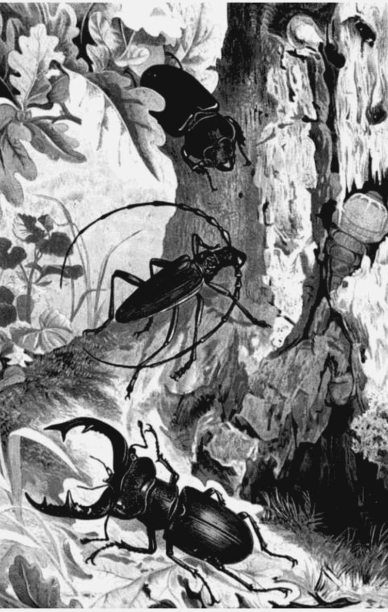

生活在腐烂木材内部及上面的甲虫。阿尔弗雷德·埃德蒙德·布姆（Alfred Edmund Brehm），1883–1884。

本世纪初，纽约探险家俱乐部的成员面临着未攀登的山峰、未行走的极地冰盖和未造访的亚马逊部落的供应日益减少。2009年，他们通过将生物多样性纳入研究范围来适应现状，事实证明这是一个明智的选择。对生物多样性的探索为科学家和冒险家提供了地球星球上剩余的最伟大的身体冒险。

值得注意的是，对生物多样性的新重点还包括对我们身体内植物植物群进行的一次良好的检查。快速测序微生物DNA的能力揭示了每个健康的人体内都包含一系列主要由细菌组成的平衡生态系统。与其他生物体内的微生物一样，它们对它们的人类宿主最友好。生物学家将它们称为“互利共生体”，它们既从与其共生的植物或动物中获益，又作为回报提供益处。

普通人类口腔和食道中生活着五百多种此类细菌。通过形成一个适应性良好的微生物雨林，它们保护了身体的这部分免受有害寄生细菌的侵害。共生失败的代价就是外星人的入侵、牙菌斑的堆积、龋齿和牙周病。

在胃肠道的每个后续部位，其他专门细菌的菌落在消化和处理中起着至关重要的作用。人体细胞的平均数量至少达到万级——根据多次估算得出的数字是四千万。我们微生物组（现在已如此命名）中的细菌平均数量至少高出十倍。为了说明这一点，微生物学家开玩笑说，如果生物分类完全基于每个生物体内DNA的优势，那么人类将被归类为细菌。

得知微生物组出现在医学科学和实践中并不令人意外。研究人员越来越多地调查共生体在广泛健康问题中的作用，这些问题通常发生于胃肠道，但也包括肥胖、糖尿病、易感染性，甚至某些形式的精神疾病。微生物组是一个相互锁定的生态系统阵列，其物种需要保持多样性并在正确的平衡状态。简而言之，大部分医学实践将变成一种细菌园艺。

在人类和其他动物体内生长的花园是世界各处复杂生态系统的典型。全球范围内栖息在动物和植物中的微生物组种类总数仍然完全未知，但可能是巨大的。微生物学家发现，栖息在食木蚂蚁体内的微生物与肉食动物携带的微生物截然不同，对于青蛙和蚯蚓等其他生物更是如此。显而易见，涵盖这些系统的共生微生物学已成为科学领域令人兴奋的前沿，并在未来几十年内保持如此。

微生物学科学于1600年代末由安东尼·范·列文虎克（Antonie van Leeuwenhoek）创立，当时他发明了观察细菌的显微镜。近四百年后，由美国人卡尔·沃斯（Carl Woese）领导的生物学家首次意识到，古菌这类微生物在DNA上与细菌截然不同。这一发现挑战了生命树的基本结构以及我们对早期演化的认知。生命树是一幅分支图，显示了物种与物种群之间的祖先关系，从而追踪了早期生物产生晚期物种的演化过程，这种过程跨越了百万年，而在某些情况下则在几千年内保持未分裂。

在沃斯和他的同事之前，标准分类法承认五个界：原核生物界（由细菌和古菌组成）、原生生物界（包括履虫、变形虫和其他单细胞生物）、真菌界、植物界和动物界。沃斯之后，生命被分为三个巨大的“域”：缺乏细胞核的微生物细菌；新定义的古菌，结构与细菌相似但同样缺乏细胞核；以及具有细胞核的真核域，包含了所有已知生命形式——原生生物、真菌、藻类和植物。DNA比较揭示了真核生物在尺寸上（我们观察和关注的属性）具有优势，而细菌和古菌在数量和全球分布上占据着统治地位，自生命起源以来一直如此。

微生物世界的遗传多样性与生命的其他部分截然不同。人类和土豆在DNA序列上的相似性，比最不相似的细菌之间的相似性还要高。生物学家不知道地球上细菌物种的数量。可能是数千万、几亿个。目前，甚至还没有细菌和古菌物种的精确定义。个体生物的杂交性进一步使情况变得复杂。细菌细胞有多种方式从其他细胞获取基因，无论亲疏远近。它们通过从环境中收集DNA片段来实现这一高科技成就；通过这些准生物在将DNA输送到病毒宿主细胞的过程中从逆转录病毒拍摄片段；最后通过接合，这是一种异常复杂的操作，在此过程中两个细胞结合并交换自身的相似DNA片段。

甚至细菌多样性的地理特征也与植物和动物有着本质的不同。在某种意义上，许多细菌遵循由先驱生态学家劳伦斯·贝肯金（Laurens Becking）在1934年提出的一个原则：“万物无处不在，但环境在进行选择。”这意味着，大部分遗传形式或与其非常相似的形式遍布全球，但在大多数时间里处于休眠状态。它们形成了一个微生物种子库，只有当环境变得符合其DNA编码偏好时，每个物种才开始繁殖。当出现合适的酸度、合适的营养和合适的温度时，沉睡的细胞就会苏醒。种子库遍布陆地和水床。只有跨越巨大的距离（可能是大陆尺度），遗传差异才会出现，并产生类似于植物动物物种规模的物种形成。

随着DNA技术的进步，细菌和其他微生物形式的发现速度也随之提高。有些生命体隐藏在眼皮底下——丰富且暴露，但由于微小到无法用普通光显微镜看到。因此，它们在微生物群的标准筛选中很容易被忽视。

目前发现的最重要生物可能是远远球藻（Prochlorococcus）。虽然直到1988年才被发现，但远远球藻并不稀有。事实上，它们是全球热带和亚热带海洋中最丰富的生物。它们生活在深达两百米的水中，局部密度超过每毫米十万个。由于这些微小细胞也能进行光合作用，依靠阳光能量生存，它们占据了北纬40°到南纬40°之间开放海洋所有光合作用生物量的20%到40%，并负责了当地净初级生产的一半。至少在温暖的海域中，这些隐形的支撑维持了可见的存在。

然而，如果远远球藻与另一种极丰富的细菌——海绵杆菌（Pelagibacter）是最丰富的常规生物，那么它们会是更微小的病毒的猎物吗？专家们曾认为这种微捕食者充其量稀少。然而，在2013年，快速发展的超微研究领域的新方法揭示了每升海水中平均有数十亿个病毒的存在。它们都是噬菌病毒（字面意思是“细菌的吃者”），其中一种HTVC01P是非常丰富的。

生物学家对于病毒泛是否为真正的生物存在分歧，因为它们依赖宿主的分子机器进行复制。如果HTVC010P被归为此类，那么它必须被认为是地球上已知最丰富的物种。

不仅于此。虽然捕获光的远远球藻及其噬菌病毒捕食者占据了海洋的大部分，但它们可能由一个仍未被发现的由食腐者和捕食者组成的“暗物质”支撑。这些生物同样无法通过传统的显微镜检测到。显然，至少部分履行这一角色的是一种高度多样化的微双丝（pico-biphylates），其直径仅为二三百万米。其中一个物种在2013年经过了足够的研究，被识别为一个新门，研究人员将其命名为微动物（Picozoa）。这些近乎消失的微生物以胶体碎片为食，通过来回抽动鞭毛在水中剧烈地移动。一种被充分研究的物种的解剖结构在微生物中是独特的。它呈长方形，捕食器占据了身体的一整半，将所有其他细胞器都挤在另一半。

当科学家向海洋深处探测，穿过光边缘的散射层进入寒冷黑暗、高压的深渊时，他们发现了另一个由鱼类、无脊椎动物和微生物组成的世界。每个物种都专门化于在其演化的特定深度生存和繁殖。

然后底部突然出现，被黑暗且富有诗意地命名为深渊底栖生物（abyssal benthos）。无疑，你可能会认为，在上方几公里的光合区之下，这片毫无特征的淤泥平原上几乎没有生命。那是一个错误。深渊底栖生物充满了生命。这是一个主要的狩猎场，那里的初级生产者不是植物和光合细菌，而是食腐者。这些生物取食每一具尸体、每一块肉骨，以及每一粒穿过上方巡游的鮞鱼、吞噬鳗等和其他生物的盐粒颗粒。底栖鱼类包括独特的鱼类、无脊椎动物和细菌。它们共同等待着从上方掉落的腐朽曼纳。它们是最后的食腐者、食腐者的捕食者，以及开放水域中食腐者的捕食者。食物非常稀缺，但生态系统之所以能运作，是因为所有居民都具有极佳的嗅觉。它们能够追踪从每一块食物散出的极微弱的气味痕迹，即使在相对静止的水中也是如此。

考虑一只沉没木船的命运。在它沉入底部不久，船虫（Teredo）的幼虫就定位了它并固定在其表面。随着后期的生长，“海中白蚁”取食木头，一边前进一边钻出隧道。船虫不是虫（它们在表面上看起来像虫），而是遗传上与藤壶接近的软体动物。

接下来，想象一块到达底部的肉。在几分钟内，它很可能被深海鼠狮鱼和无颌的泥绵鱼发现并猛烈攻击。接着是食腐无脊椎动物，随之是细菌，很快什么也没有了，只有在冰冷静止水中向外扩散的细有机产物。

任何剩余的木头和肉块都是无脊椎动物和细菌的目标，其中一个获得“最怪异”奖项的（至少从人类的角度来看）——我会投票给骨栖虫（Osedax），它们取食掉落在海底的鲸鱼骨中的脂质。这种饮食已经足够奇特了，但进食方式甚至令人难以置信。雌性骨栖虫长到人类手指大小，既没有嘴也没有肠道。它们通过含有共生细菌的身体延伸物渗透骨骼来进食。这些微生物伙伴代谢脂质，并将产生的物质和能量与它们的虫类宿主分享。那么雄性骨栖虫呢？更奇怪。这些类幼虫的成体只有三分之一毫米长，就像手里笔尖的一个点。一百多只生活在每个雌性个体鞘下的寄生群落中，取食雌性卵的蛋黄——换句话说，它们是自己未来的兄弟姐妹。骨栖虫占据的生态位并不像看起来那么稀缺；估计地球海洋上有六十万具鲸骨。

然而，即使骨栖虫让你感到不可思议，我们也不要停于此。在更深的地方还有另一种生命。在底部表面，即底栖壳层之下，生命继续繁荣。海洋生物与陆地上占据深层地下土壤和岩石的对应生物会合，形成了一个包裹行星的被称为“深层生物圈”（deep biosphere）的包层。居民大部分是微生物，由大量的细菌和古菌组成。

在某些海洋海域，至少每立方厘米有一百万个细胞。如果这种密度证明是全球性的，这意味着深层生物圈的微生物占据了地球上所有微生物的一半。它拥有与表面所有光合植物生物（有机物重量）相同的数量级。

如果这些估计大致准确，深层生物圈的存在要求我们对微生物物种及其组成的生态系统的看法发生根本转变。在海洋底部和下方几米处，微生物和稀有的无脊椎动物仍然是上方碳循环的参与者。能量源于光能产生的生物碎片。但在深层生物圈，这种联系减弱了，并显然被来自无机来源的化学能量所取代。此类微生物的最深发现是在地表2.8公里处，南非约翰内斯堡附近的姆彭恩金矿。在那里，在没有光和氧气、恒定60度摄氏的环境下，生活着骨栖虫。它通过还原硫酸和固定周围环境中的碳氮生存。考虑到温度随深度的稳定增加，目前已知骨栖虫是标记生命内在边界的唯一物种。

还有更复杂的细胞生物吗？当我写这些时，已经在深层生物圈的低区域发现了一种线虫，以微生物为食。可能会发现更多代表相当数量生物多样性的无脊椎动物。

独立生命层的存在引发了对想象的末日以及随之而来的世界结局的反思。如果我们物种——自诩的地球之主——意外将行星表面烧焦，或被小行星撞灭了表面所有生物，生命可以在行星的深层生物圈中继续。在那里，它的微生物和无脊椎动物将在黑暗的避难所中生存，从岩石中获取能量和物质，可能演化数百万年，最终到达表面产生多样化的多细胞生物。

在重重困境中，人类级别的后足类动物。这种伟大的宇宙循环可能会赋予地球上的智力第二次机会。

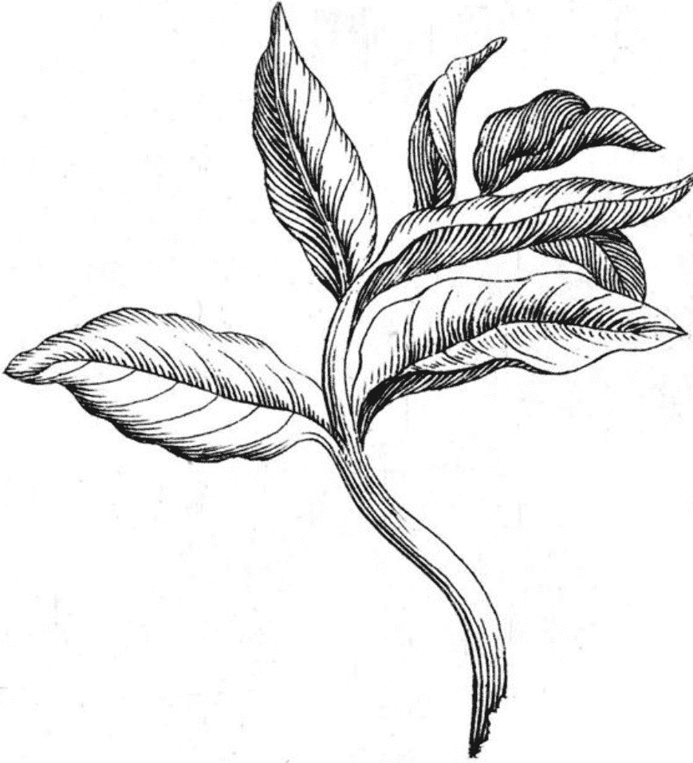

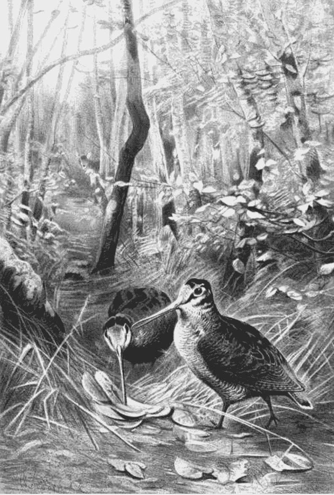

一片欧洲森林，下方中央有两只普通大沙锥（Gallinago gallinago）。阿尔弗雷德·埃德蒙·布雷姆（Alfred Edmund Brehm），1883–1884。

# 15

## 生物圈内的最佳地点

许多终身生活在城市或人口稠密的农村地区的人，很容易想象一个完全属于人类的世界。在极端的“人类世”观点中，重新改造残存的自然来服务人类，似乎比保护原始状态的自然更符合逻辑。为什么，其追随者们问，要将空间和资源投入到一个注定失败的事业？自然界已经遭受了严重破坏。它的生物多样性已过了无法挽回的临界点。主要栖息地已不复存在。这种失败主义观点应当清晰地记住。正如约翰·斯图亚特·米尔曾概括的本质：当战场没有敌人时，老师和学生都会入睡。

当然，自然学家和种群生物学家以完全不同的方式看待世界。确实存在无法回头的点，但只有当我们把地球太多的环境献给了我们单一物种的需求和快乐时，这个临界点才对人类而言存在。一个密密麻麻挤满地球将是一艘星球飞船，生命的长期生存将取决于人类未来的智慧和知识。这不仅对其他生命来说是灾难性的，对我们自身的长期生存也是一个高风险的。

保护组织本身也无法免于“人类世”观点的影响。大自然保护协会（The Nature Conservancy, TNC）最近的年度报告表达了这种思维转变的令人担忧。TNC是世界上最受推崇的非政府自然保护区支持者之一，收购并保留了数百万英里的土地进行永久保护。这项工作无疑将继续，但该机构似乎采取了不同的情绪。自然能为人类和经济做些什么已移到了舞台中心，而生物多样性已被褪色。例如，2013年年度报告的环绕封面就是这种令人担忧趋势的象征。照片上是一个在蒙古骑着马、照着羊群的微笑男孩。背景是延伸到地平线的几何平坦的草原。总生物多样性包含四种生物：人类、两种家畜和一种植物。文中几乎每张照片或每组照片都描写了人物、他们的栖息地和他们的家畜。它描绘了大象、另一种企鹅、第三种幼稚的鹤，以及第四种挂在阿拉斯加烟熏房里的鲑鱼，它们对人类的用途不言而喻。

相比之下，经验丰富的自然学家保护生物学家的观点关注的是地球上其他两万已知物种，以及尚未被发现的六百万多个物种。显然，健康的生物圈对经济是有益的，我们相信公众、企业和政治领袖会加入我们，将生物世界视为一个独立的道德命令，而这恰恰对人类的福祉至关重要。

生物多样性研究的教训是，分布在陆地和海洋无数自然生态系统中的物种多样性正受到威胁。那些研究过数据库的人大多数认同：人类活动将物种灭绝率提高了其前人类水平的一千倍，威胁要灭绝或将本世纪存活的一半物种推向灭绝边缘。然而，世界各地散布着许多地球生物多样性的宝库，面积从几英亩到超过数千平方公里的纯正荒野不等。这些自然生存环境的最后领域几乎都面临着某种程度的威胁，但如果现今的存者有意代表他们采取行动，就可以为后代留住它们。

为了记录关于扩大全球保护这一承诺的重要论点，我写信给了世界上18位资深自然学家，他们都具有国际经验，并在生物多样性和生态学方面拥有专业知识，并征求他们对最佳保护区的意见，即那些庇护着具有显著独特且珍贵物种植物、动物和微生物群落的保护区。我提出了以下请求（在此处略作转述）：

以自然学家所经历和所知的方式来描述真实世界和生物多样性至关重要，这反驳了灭绝物种狂热者、“自然已死”失败主义者以及各种意识形态的人类中心主义者所设想的观点——保护应该由了解它的人来判断和领导。不仅如此，我们还需要大幅加强努力。

所以请求是：根据丰富性、独特性以及研究和保护的最充分程度，列出你认为世界上最好的五个地点之一，换句话说，就是你最关心的地点。正如你要求的，给出你选择的理由。

“生物圈内的最佳地点”是极具个人色彩和主观的选择。它们与20世纪80年代由英国生态学家诺曼·迈斯（Norman Myers）等人首次定义的全球生物多样性“热点”不同——尽管之间有非常大的重叠。热点的选择标准是基于高风险物种的数量，这些物种将通过保护它们栖息的区域得以拯救。我的顾问和我很清楚，我们的“最佳地点”列表可以增加很多倍，但我相信我们捕捉到了大部分最优秀的地方。我们共同说明了一个观点：尽管灭绝率正在飙升，地球的大部分生物多样性仍然可以被保护。

## 出的最佳地点

### 北美

#### 加利福尼亚州的红杉森林

加州植物区是一个热点。作者兼生物多样性专家马凯特（Markett）报告道：“加利福尼亚州的红杉森林是最引注目的生态系统之一。”我度过成长年华穿梭于其中，被巨大的红杉倾倒了，它们拥有与世界上其他地方一样多的物种。

#### 美国南部的长叶松草原

越来越多的科学家将注意力转向这一看似平凡但丰富的景观。从卡罗来纳州到德克萨斯州东，长叶松草原是北美最丰富的地区之一。它的植被适应了频繁的火灾。其岸边的泛滥森林是更丰富多样性的宝库。

### 加勒比海

#### 古巴和海斯帕尼奥拉

大安列斯群岛最大的两个岛包含了整个加勒比海的大部分生物多样性。它们的陆地在数千万年前通过大陆漂移分离。长期的隔离导致了大量物种的产生。一些像奇怪的食虫哺乳类动物鼠鼠（Solenodon）是岛屿最早历史的遗迹。另一些是适应性辐射的产物，一个或少数殖民物种在大陆发现了开放的生态位。这种情况允许某些物种繁殖成群，占据了这些生态位。显著的例子包括多样化的、丰富的鬣蜥品种，以及闪着蓝绿色金属色泽的奇异蚂蚁。一天，在探索古巴中部的埃斯坎布雷山区时，我发现了一种筑在岩石缝隙中的金属绿蚂蚁，另一种在矮木丛中觅食时闪着金光的物种。

#### 南美中美洲

#### 亚马逊河流盆地

这个无尽的生态系统世界是世界上最大的排水系统，拥有面积最大的雨林和生物多样性丰富的周围草原。它供给亚马逊河的一万五千条主要和次级支流，覆盖750万平方公里，占该大陆面积的40%。如果加上安第斯山脉，其生物多样性是世界上最大的。主流起始于秘鲁安第斯山脉。它以每小时2.4公里的平均速度运行，深度超过45.7米，每天通过宽402公里的河口排放三十万亿升水。它的流量是密西西比河的十一倍，尼罗河的六十倍。

圭亚地盾。圭亚纳和苏里南这两个小国，邻法属圭亚那仍有70至90%的地区被原始的与亚马逊相关但独特的雨林覆盖。它们的动植物极其丰富，仍然是世界上探索最少的地区之一。

特普伊（TEPUIS）。这些平顶山是H.G.威尔斯和好莱坞想象中的“迷失的世界”。它们局限于委内瑞拉和圭亚纳西部，由环绕着雨林的古老石英质砂岩组成。它们或平坦的山顶海拔从一千到三千米不等。它们确实是自成的世界，气候与低海拔地区截然不同，拥有壮丽的岩石形成和瀑布（安赫尔瀑布是世界最高），其动植物与下方的地不同，不同桌山之间也各不相同。

秘鲁大马努区地区。领先的热带生物学家艾德里安·福赛斯（Adrian Forsyth）捕捉到了这一地区的魅力，“这里全球最大的赤道冰体在雄伟奥桑加特峰的环绕下，耸立在岩石坡和普纳草原之上，并转化为没有道路的雨林，景观透过山地森林向下延伸。任何站在马德雷德迪奥斯亚马逊林地中的人，一眼就能看到一个压缩的全景。”河流北部存在着地球上最密集的生物多样性，包括一系列新世界哺乳动物。一个简单的平方公里就能栖息与整个美国大陆地区数量相同的蛙类物，以及鸟类和蝴蝶数量的两倍。同样的独特性甚至更高也适用于更北部的厄瓜多尔传奇的亚苏尼国家公园的雨林。

# 中美及北部安第斯山脉的云林和山顶森林

这些凉爽、湿润的环境在气候和生物多样性上与下方的低地森林都有不同。其中许多地方尚未被开发，包含大量仍未知的物种。小面灵（olinguito）的发现——世纪以来发现的首种大型食肉哺乳动物——是那些仍然隐藏着事物的象征。

## 帕拉莫草原（PÁRAMOS）

这些位于南美的高海拔（2,800至4,700米）草原包含了许多独特的草类、草本植物和木本灌木。它们还因新物种演化速率高而脱颖而出——可能是由于破碎的山顶环境中的气候波动。尽管每一处都仅比周围的低地雨林高几公里，但在物理和生物上都是一个不同的世界。它们的植物群是独特的，而其狭小的面积使其生物多样性变得非常脆弱。

## 南美大西洋森林

在葡萄牙语中被称为`Mata Atlântica`，这一广阔而壮丽但现在已大幅减少的生态系统沿着巴西大西洋海岸延伸，从北部的里奥格兰德北方尔特到南部的里奥格兰德·杜苏尔州，并小范围延伸至巴拉圭和阿根廷（换句话说，从巴西“鼻子”尖到巴拉圭东南部）。它的纬度和降水量的巨大变化使其具有异常的生态系统多样性，涵盖从热带到亚热带森林（湿润和干旱），以及灌木丛和草原。在它们的领地内存在着各种稀有和不常的动物，包括马克·莫菲特（Mark Moffett）描述的，“最原始的豪猪；跳舞蛙和食果蛙；巨雉，剩余的几只个体在两名鸟类农主的私人土地上游荡；新世界最大的灵长类动物巨脸猴；所有灵长类中最色彩斑斓的金丝织网猴；基马马达岛的金线矛头蛇，那里的密度达到了已知任何蛇类的最高水平（难怪，“蛇岛”上没有人居住）。”

## 塞拉多（THE CERADO）

塞拉多覆盖了巴西中东部大部分，是南美最大的草原，也是全球热带栖息地中生物多样性最丰富的。其丰富的生命种类源于其构成的清晰生态系统马赛克，从带有散布木林丛的典型开放草原到成片的类雨林高树林，以及沿河分布的茂密廊林。遗憾的是，对于生物多样性来说，这里的土壤有利于农业，塞拉多的栖息地正被迅速清除，而保护区内的保护极少。

## 潘塔纳尔（THE PANTANAL）

地球上最大的湿地之一，大部分位于巴西南部并延伸至玻利维亚，这片壮丽的洪原在雨季节有80%的区域没在水中，是各种水鸟和昆虫的常年家园，也是美洲豹、水豚和其他富有魅力的大型哺乳动物的家园，包括丰富的类鳄凯门鳄。尽管被列为世界遗产地并吸引了越来越多的游客，潘塔纳尔仍承受着沉重的农业和畜牧业负担。

## 加拉帕戈斯群岛（THE GALÁAGOS）

这座位于厄瓜多大陆西部926公里的赤道群岛因查尔斯·达尔文在1835年在那里的五周访问而获得了标志性地位。在回家的途中，他注意到画眉在不同岛屿之间有所不同，这使他构思了进化论。但加拉帕戈斯群岛特殊还有另一个原因：从少数能够跨越海洋并殖民岛屿的物种中演化出了许多特别适应荒凉火山景观的物种。巨龟、海鬣、演化成树木的葵菊科草本、从单一祖先演化并填补六个生态位的鸟类等，使岛屿既是演化生物学的实验室，也是教室。

# 欧洲

## 波兰和俄罗斯的比亚沃维亚森林（BIAŁOWIEZA FOREST）

这是曾覆盖欧洲西北部平原直到新石器时代黎明的原始森林残存的最大碎片。它横跨波兰和白俄罗斯边界，保护区涵盖了近两千平方公里。欧洲大部分哺乳动物生活在这一范围内，其中最著名的是欧洲野牛（曾多次险些逃离灭绝）、欧洲鹿、驼鹿、野猪（一种波兰森林马）、猞猁、狼、水獭、白鼬。

## 贝加尔湖（LAKE BAIKAL）

位于俄罗斯西伯利亚，面积为31,722平方公里，最大深度1,642米，是世界上最老、最深的淡水湖。正如其水量所预期的，它还拥有极其巨大的动物群，包括二千五百种植物、鲈科鱼类、海绵、蜗类和足甲类。像加拉帕戈斯群岛一样，贝加尔湖既是生物多样性的避难港，也是进化的实验室。

# 非洲和马达加斯加

## 埃塞俄比亚的正教森林（THE CHRISTIAN ORTHODOX FORESTS）

埃塞俄比亚北部原生森林仅存不足5%，它们几乎完全局限于散布在褐色景观中的绿色斑块。正如玛格丽特·洛曼（Margaret Lowman）所写的，它们包含了“原生植物的种子库、许多园艺作物的授粉者、淡水泉、植物药、水资源保护和碳汇。”

## 索科特拉岛（SOCOTRA）

这是一个位于也门以南352公里的印度洋孤岛（带有若干卫星岛），岛上生长着形状和叶片奇特的树木和灌木，使其赢得了“另一个加拉帕戈斯”和“地球上最像外星的地方”的美誉。在这里你会发现龙血树、岩生的索科特拉龙血、齿芦以及与其他地区形态相似的其他植物物种。索科特拉还拥有约两百种类，其中八种是该群岛特有的。

## 塞伦盖蒂草原生态系统（THE SERENGETI GRASSLAND ECOSYSTEM）

世界上最著名的陆地野生生态系统无疑是巨大的塞伦盖蒂（在马语语中意为“无尽平原”），横跨从坦桑尼亚北部到肯尼亚西南部的广大区域。其大部分地区以及肯尼亚大部分受到国家公园、保护区和狩猎保护区的保护。这里的动植物群，尤其是大型哺乳动物，最接近自第四纪时代以来一直生活在非洲热带草原和草原的原始物种。

## 莫桑比克的戈龙戈萨国家公园（GORONGOSA NATIONAL PARK）

该国顶级保护区通过其内部发现的多样栖息地完整呈现了东南非非洲的生物多样性，包括一条海拔近两千米的山脊，山顶覆盖着雨林、米木干旱森林、多条河流溪流，以及被雨林覆盖且两侧为石灰岩峭崖的峡谷，后者上面布满了许多尚未被探索的洞穴。戈龙戈萨的大型动物在1978年至1992年内战期间被逼近灭绝，并在遭到大规模盗猎后，正在迅速恢复。

## 南非（SOUTH AFRICA）

整个国家在其边界内包含了世界上几种丰富且独特的组合，涵盖了两种动植物。位于东北部的广阔克鲁格国家公园和其他自然保护区是非洲拥有最完整的10公斤以上野生动物种类的栖息地（包括黑犀牛和白犀牛，两者均处于极度濒危状态）。开角植物区涵盖了9000个物种，其中69%在世界其他地方均未被发现，占非洲所有植物物种的五分之一。在该地区，植物形成了几个独特的原始生息地，包括芬博斯灌木丛地（fenbos heath）、多肉卡鲁鲁沙漠（与纳米比亚共有）以及林波波洛省古老的苏铁树森林。

## 刚果盆地森林

刚果河流流域面积340万平方公里，横跨刚果共和国、刚果民主共和国、中非非洲共和国以及喀麦隆、加蓬、安哥拉、赞比比亚和坦桑尼亚的部分地区，是世界第二大水系，仅次于亚马逊河。这里被热带雨林所覆盖，构成了世界三大雨林荒野之一（另外两个是亚马逊和新几内亚）。尽管面临森林砍伐和农业开垦的严峻挑战，它仍然是3000多种独特植物和巨大动物群的家园，包括大猩猩、�罗洛、森林象以及其他著名的壮观大型动物。刚果的五个雨林公园中有五个是联合国教科文组织世界遗产。

## 加纳阿特瓦森林

非洲西部驼背地区的许多湿润森林已因人类侵入而急剧减少，但残碎片仍像岛屿一样幸存，保留了曾经极其丰富的植物群和森林的一部分。一个绝佳的例子是原始的阿特瓦森林，它至少有50万历史，是雨林的遗迹，而在其他地区雨林已消失了80%。阿特瓦是“高地常绿林”这一生物群变体的最佳实例。

## 马达加斯加

这座巨大的岛屿相当于加利福尼亚州和亚利桑那州的总和，位于非洲东部海岸外400公里的印度洋，自1.5亿年前从南方超级大陆冈瓦纳分离以来一直处于隔离状态。由于面积巨大、古老且属于热带，马达加斯加拥有非常丰富且独特的动植物群，其70%以上的物种在世界其他地方从未发现（这是1.4万个物种的最新数据）。与古巴、希索拉和加尔帕戈斯岛一样，马达加斯加是观察适应性辐射的活实验室，适应性辐射定义为一个幸运殖民岛屿的单一物种起源出大量物种（在这种情况下，通常是飞过或漂过非洲的）。马达加斯加动物演化辐射的例子包括多种但亲缘关系相的猴类（原始灵长类）、变色龙、森林鹴鸸、蛙类，以及在1.2万种植物中，包括棕榈科、兰科、猴面包科和类仙掌的迪迪尔树科的复杂复合群。

# 亚洲

## 亚山脉

亚山脉最高海拔达4509米，这片美丽且少有人迹的山脉耸立于俄罗斯、中国、蒙古和哈萨克斯坦交界的中亚地区。在不同海拔上，分布着草原、北方针叶林和高山植物，它像是一本关于冷温带和极地动物的生物百科全书，是整个欧亚地区拥有真正冰河时代动物群的地方之一。山坡上活跃的食草动物包括马鹿、驼鹿、驯鹿、西藏羚、鹿和野猪。它们的捕食者包括棕熊、狼、猞猁、豹子和貂熊。它还是发现尼人索人物种首批化石的地方。

## 婆罗洲

印度尼西亚的18307个岛屿（估计数量根据标准和技术而异）横跨5120公里的纬度，从苏门答腊的西端到伊里安贾亚（新几内亚的西半部）。这些群岛共同包含了惊人的生物多样性。婆罗洲是世界第三大岛屿，其南部四分之三属于印度尼西亚，而北部四分之一则分别属于马来西亚和独立的文莱君主制国。整个岛屿已经失去了大部分雨林。由于森林砍伐和棕榈油种植，婆罗洲失去了大量比例的雨林。正如207年报道的，“婆罗洲的内部由于棕榈油种植的扩张，许多雨林已消失，许多热带植物被焚毁，但该岛屿仍然是生物多样性最丰富的地区之一。”婆罗洲的整体已经失去了大量比例的雨林。

## 冈瓦纳遗迹

西高特山脉是印度大陆的脊梁，与马达加斯加、新喀里多尼亚和新西兰一样，都是冈瓦纳的碎片。西高特山脉平行于印度西岸延伸的山脉，与马达加斯加、新喀里多尼亚和新西兰一样，都是冈瓦纳的碎片。由于从海平面到6695米的最高海拔，西高特山脉拥有极其丰富的热带生物多样性。这个山山国家拥有不丹的古老栖息地和植物群，这5000种植物中有1700种是特有种。

## 不丹

这片诗意的山地保护了喜马拉雅山脉大部分原始生息地和生物多样性。在不丹，70%的土地被森林覆盖，代表了热带、温带和高山三大主要区域。这5000种植物包括46种杜鹃和600种兰花。

## 缅甸

缅甸的北部地区（面积约31万平方公里）大部分被热带雨林覆盖，是联合国自然自然保护地。其陆地生物多样性由于复杂的山脉分布而得到增强，在海拔700米以上的地方出现了永久冰雪覆盖的山峰。

## 澳大利亚南部灌木丛

从西南海岸的埃斯斯到努尔拉伯平原，分布着地球最丰富的植物群之一。拥有温和的地中海气候，这些灌木丛演化出了许多独特物种。新喀里多尼亚甚至保留了离开澳大利亚-冈瓦纳大陆块之前的元素。

## 澳大利亚北部金伯利地区

澳大利亚该地区的国家公园和其他偏远地区是该大陆生物多样性最高且受干扰最小的地区之一。

## 砾平原

位于大陆中心的荒石沙漠平坦平原只有通过洪水的形式蓄水。在洪水期间，丰富的生命从休眠中苏醒，从远方引来大量鸟类。在雨季之间，土地极其干旱，长着膝高的硬叶植被。

## 新几内亚

作为除格陵兰之外世界第二大岛屿（面积8万平方公里），新几内亚仍然大部分被热带雨林覆盖。其陆地生物多样性被公认为世界上最丰富且探索最充分的。新几内亚在5万年前是由小岛组成的群岛，为物种形成增加了次要因素。

2011年。对我来说，现实生活中的魔力与1954年时完全相同。

## 麦克尔多干谷（MCMURDO DRY VALLEYS）

在地球上最不宜居住的无冰之地，这里生物多样性的贫瘠程度仅有智利完全无雨的阿塔卡马沙漠可比，这里生活着足以构成平衡生态系统的物种。稀疏的藻类痕迹是这里的植物，几种线虫（也常被称为圆虫）则是草食动物和捕食者——科罗拉多州立大学的迪亚娜·沃尔（Diana Wall）称南极土壤中的“大象与老虎”。物质和能量循环的简单性提醒我们，存在着几乎可以在任何地方形成的生物。但随着人类扩大地球生态系统的规模，生命将变得越来越没趣味，且越来越难转化为支持系统。

## 夏威夷群岛

它与同样遥远的复活节岛、皮凯恩岛和马尔基库斯群岛一样，值得提到的部分是因为它们曾经拥有的东西。它的热带气候、较大的面积以及拥有众多栖息地的山地地形，促进了大量陆地植物动物的产生。其中很大比例源于适应性辐射的产物。这种物种群聚的戏剧性例子包括较小鸟类中的蜜蜜雀、昆虫中的树类以及花植物中的龙胆梗草。这种美丽的组合由于农业开发和入侵物种的半野生花园，在很大程度上被消灭或被推到了中部山脉偏远的高地。讽刺的是，后者已成为人类世支持者们所赞誉的“新奇生态系统”的典范。

尽管如此，夏威夷群岛上仍然有一个“最佳地点”。杜克大学的、灭绝与残存本土鸟类领先专家斯图特·皮姆（Stuart Pimm）将其描述为一种“移动状态”：

从茂夷岛树林线正上方俯瞰，正下方的森林是矮小、扭曲且非常潮湿的，在极少数的晴朗日子里，可以看到挤满游客的低地——那里全是外来树木。但在这里，你可以想象一个与众不同的世界——所有的物种都是特有的。这是一次独立的演化——拥有奇怪名字的鸟类，如‘akehoe、o’o、‘akialoa、nuku pu’u——以及更奇怪的野兽和它们特有的龙胆梗草——不，是的。这是一片幽灵的森林——只有‘akehoe 存了下来——但留下的是一个珍贵的提醒，提醒我们它曾多么特别，我们为了留住现存部分必须做什么，以及我们绝不能让什么在其他地方发生。

在脑海中，可以将主要的陆地荒野连接成一个单一的全球环线，并想象在其中近乎连续的旅行中穿行。在这个破碎的生命环中，自然世界呈现出一万年前的样子，那时人类仍然稀疏地占据地球，仅占一小部分，农业是新鲜且稀疏的。

这种旅行与现代普通的旅行是相反的。它不是穿过荒野在城市之间快速跳跃，而是穿过城市通往荒野。

如果选择的路径与我们六万多年前祖先走的路径相同，这场奥德赛将更具意义。这条路线始于人类的出生地——非洲南部和中部的稀树草原和米博森林，那里大部分地区仍处于荒野状态。接着顺着尼罗河向北，也许还经过曼德海布海峡，离开非洲进入欧亚大陆。由于需要，这条路线被地中海地区稠密的人类居住中断，包括波兰和俄罗斯的整个比亚利亚沃维泽森林，那里是欧洲中纬度地区剩余最大的原始森林。随后它进入了针叶林带，即始于斯堪的纳维亚和芬兰开始的北方针叶林，大部分互不连续地向东延伸七千公里，横跨欧亚大陆到达太平洋。途中它经过贝加尔湖，这是世界上最大的淡水体，也是北方温带水生特有物种的家园。

从西伯利亚和中国北黑龙江地区，荒野路径跳跃到中亚的阿尔泰山脉、西藏高原和喜马拉雅山南偏远地区。它在缅甸的山地和热带森林以及印度西盖山脉再次采集。

路线继续通过印度尼西亚及其迅速减少的未受干扰的岛屿。向东，它进入了新内亚两个政治地区的密集森林岛屿：西部的印度尼西亚廖里安和东部的独立国家巴布亚新内亚。从印度尼西亚最南部的巽达群岛加上东帝汶，路线随后跨越提汶汶海，作为首批到达澳大利亚北领地和南大陆西北部金伯利地区的土著人。这两个地方大部分仍保持着原始的生态状态。

路线在西伯利亚东北部中断并重新开始，跨越仍然大部分空空的阿留申群岛到达阿拉斯加，进入内陆广阔的北极和亚北极灌木丛栖息地，然后向南进入加拿大的针叶林。在大陆西部，它沿海岸向下，一直到达中南美洲保存完好的山地栖息地和低地热带地区，然后进入内陆的大片原始栖息地。最后，从秘鲁高地到贝廉姆，穿过雨林到达热带草原，沿着由世界最大流域域汇入的最强河流流动。

我们破碎的生命环结束于安第斯山脉东坡和山脚，在那里，我们发现了人类所能到达的最后一个大陆区域，以及点缀在同一个地方数量最多的野生动物物种。

因此，一个物种的历史是一部史诗。

一个物种的平均寿命随分类群而异。蚂蚁和树木的寿命长达数千万年，而哺乳动物则只有短短几十万年。所有群体的平均跨度似乎（非常粗略地）为百万年。到那时，物种的变化可能已经大到被认为是另一个物种，或者完全消失，加入自生命起源以来已消失的 99% 的物种之列。请记住，每一个存存的物种（包括在我们内）因此都是冠军俱乐部中的冠军。我们都是优中之优，从未犯错误的物种的后代。

当然，人类物种也有演化史，这在传统的记载史上可以追溯到很久以前。我们也是发育树的末端。人类文化的众多故事是通常意义上的史诗，但你将理解塑造这些故事的人性特质也是演化的产物。我们拥有南方人猿亲戚和南方人猿祖先，还有祖母级能人和母亲级直立人。

生物与文化这两个层面交织在一起。这就是为什么历史离开史前史就毫无意义，而史前史离开生物学也毫无意义。

回溯到最久远的地质历史，追溯到原始的单细胞核生物，所有生物物种都被视为同一进化系统系巨型动物的成员。从38亿年前向前追溯到5500万年前的一个点，我们发现了旧世界灵长类的（可以这么说）肢体。继续向前向外延伸，我们来到了人科的分支，最终到达了人类。

我们关键的适应性，也是进化道路上巨大的好运，是我们相对强大的大脑。通过它，我们重现了过去的片段。我们为未来发明了替代片段，选择其中一个，并可能决定将其成为我们故事的一部分。我们是地球上唯一为了知识本身而积累知识的实体，并通过结合我们内部的知识与合作，为未来做出决策——这些决策往往是灾难性的，但同样具有决定性。

因此，我们选择了尽可能地学习生命的其他部分——整个生命，整个生物圈。发现地球上的每种生物都是一项艰巨的任务。但我们会做到，因为人类出于许多基础科学和实践原因需要这些信息，而且深层的、更具吸引力的对未知探索已刻在我们的基因里。地球生物多样性的绘制将成为一个“大科学”项目，与目前的癌症研究和脑活动图相媲美。除非我们目前对生物多样性的估计有巨大偏差，否则地球上每种物种大约对应一千个人。在理论上，很容易为每一种物种找到赞助者。高度连接和数字化的人类集体智慧将比以前任何时候都渗透到我们继承生命的全部。我们将理解灭绝的全意义，并对人类丢弃的每一个物种感到后悔。

所有的生物学知识始于命名和分类。当标本被鉴定到物种时，关于该物种积累的每一条信息都会立即可用。林奈双名法中蕴含着魔力，例如普通果蝇的 *Drosophila melanogaster* 和白头海雕的 *Haliaetus leucocephalus*。它是发现科学界关于该物种所学到的一切的钥匙。它能唤起我们个人已知或认为自己知道的。双名形成了一个适用于人类实际工作方式的层次体系的基础。在反复重复它、倾听它的声音并感知未知时，它是科学的诗篇。

生物学家将物种定义为在自然条件下相互繁殖的个体集合。我之前引用狮子作为例子，它们是老虎（*Panthera tigris*）的近亲属。*Panthera* 这个名字代表了这些大猫的属，它们在基因上相互接近，并与狮子和老虎接近。经典的分类分类系统按照层次顺序继续向上和向外延伸，就像从叶子到树枝一样。*Panthera* 的猫类物种与其他猫科的属（genera 是 genus 的复数）放在一起，例如包括家猫、野猫、猞猁和短尾猫的属，就构成了分类学上的猫科（*Felidae*）。猫科的物种与犬科（*Canidae*）结合，与其他相关的哺乳动物科放在一起形成食肉目（*Carnivora*）。以此类推，沿着分类等级，直到所有的动物、植物和微生物（无论是现在的还是灭绝的）都被包含进来。

这是传统的分类学，可以追溯到250多年前的卡尔·林奈（Carl Linnaeus），它是有效的。它提供了分类的基础和框架，以及科学自然史的语言。双部分的科学名称本身在语义上基于拉丁语和希腊语，并跨越所有文化。它为每个标本提供了一个名称，就像我们为人命名一样，并容易引导至标本所属的层次结构中的所有级别。到目前积累的关于该物种的所有知识都可以通过引用标本名称来获得。

分类学名称遵循大脑运作的方式以及我们所有人最容易交流的方式。我们可以轻松地使用林奈双名法进行交流。一位野外生物学家可能会对飞过香蕉上方的一只小蝇这样说：“这是一只果蝇，一种果蝇属（`drosophila`），几乎确定是果蝇属的成员。我猜它是黑果蝇（`Drosophila melanogaster`），为了完全确定，我需要从显微镜下检查它的关键特征。”对于一只腿张开、两根细长的丝网像尾巴一样延伸在背后的小蜘蛛，它停在红树林（`Rhizophora mangle`）的树皮上：“这是一只蛛蛛（hersiliid）。我不知道它属于蛛蛛科（`Hersiliidae`）的哪个属或哪个种，但那无疑是一只蛛蛛。”接着，是一个多条腿的细长生物。“那是一只蜈蚣。而且不是普通的蜈蚣，而是石蜈蚣科（`Lithobiidae`）的成员。它是一种石蜈蚣，绝对不是马陆蜈、僧蜈、巨足或世界上发现的十个蜈蚣科中的任何一种。”

最后，在莫桑比克的戈龙戈萨国家公园（我曾进行过野外研究），我们看到一列大蚁开始走过一条土路。我可能会向游客解释：

- 那些是马塔贝莱蚁（matabele ants），在非洲的这个地区是这样的，以津巴布韦马塔贝莱战士命名，我们正开始更仔细地研究它们。`Pachodyndyla` 是正确的拉丁名称，它是唯一符合在一天内高度协调地列队行进的名称。数字革命将生命的分类向前推进了几十年，甚至是几个世纪。

随着所有这些数据库的增长，新的方法正在开发中，以将其内容转换为搜索引擎，以帮助快速鉴定标本。到目前为止最有效的是条形码。关键是线粒体基因的DNA序列，它们位于每个细胞的核外，因此仅通过母系遗传。`CO1`基因中的一个片段（仅包含六百五十个碱基对）特别有用，因为它在不同物种之间差异巨大。读取`CO1`，在大多数情况下，也许是所有情况下，生物学家都可以命名物种——将其提供给已知科学。他们还可以匹配截然不同的生命阶段，例如幼虫与它们变态后的成年蝴蝶。像法医学一样，他们甚至可以将生物微小碎片鉴定到正确的物种。而且第一次，可以区分在解剖上如此相似到无法通过标准分类方法区分的物种。

然而，好事往往会招来过度的热情，条形码（barcoding）也是如此。它的某些用户将其视为解决科学界专家分类学家短缺的方案，也是通往全球生物多样性绘制的直接途径，甚至是目前盛行的基于名称的层级分类系统的替代品。然而，这些希望显然是徒劳的。条形码法是一种技术，但并不是科学或科学知识的进步。

此外，无法保证对地球生物多样性的探索能在23世纪之前完成。其问题在于专家研究人员的严重匮乏。没有科学的技术就像没有轮子和地图的汽车。问题的解决在于增加自然学家，或者更准确地说，是科学自然史学家。我们需要更多针对特定生物群的专家，即那些致力于对物种分类、自然史进行原创研究的专职人才，并与其他科学家合作，最终了解他们所青睐群体内所有物种的生物学。这些科学家还是历史学家，是每个物种在其生物学特征展开时将讲述的故事的守护者。科学自然学家曾是生物学的领军人物之一。他们曾经是、且尽管人数较少但仍是哺乳动物学家、爬行动物和两栖类学家、被子植物学家、真菌学家等漫长林奈分类名单上的大师。他们的人数之所以减少，是源于一种错误的信念，即认为生物环境对人类的重要性低于非生物环境。

科学自然学家过去和一直是一类特殊的物种。他们不会选择某个特定的过程或突出的问题作为关注的焦点。他们并不准备将职业生涯投入到追踪某个生物化学循环、渗透核膜层、绘制脑环路图，或实现其他任何可比拟的目标。相反，他们的目标是学习关于他们所选群体的生物学的**一切**，我指的是字面意义上的全方位。这个群体可能不是所有的鸟类，但可能是南美的洲鸣类类；可能不是所有的开花植物，而是北美东部的橡树物种。每一碎片信息都被认为是有价值且可以在某处发表的，即使仅仅是在网上。

因此，自然学家是那些取得最令人惊讶发现、且往往是最重要发现的人。他们经常会遇到某些现象，而那些沉浸于几十种模型物种的分子和细胞组织细节的其他生物学家从未想象过。我承认，当有一次我被一位著名的分子生物学家介绍为行为生物学大型会议的主旨演讲人时，我对自己的工作和同事的工作感到一丝自豪，他说：“埃德是那种能做出我们工作基础性发现的生物学家。”

一个真正的科学自然学家致力于他所属的物种群体。他为它们感到责任。他爱它们，不是爱他可能研究的字面上的蚯、肝蛭或洞穴苔藓，而是爱揭示它们秘密的研究，以及这些被选生物在世界上的位置。长期以来一直清楚，生物学家被分为两类，其区别在于世界观和研究方法论。第一类部落遵循这样一个规则：生物学中的每一个问题都存在一个理想的生物来解决它。因此，被选中了模型物种：果蝇用于颗粒遗传学、大肠杆菌（`Escherichia`）用于分子遗传学、秀线虫（`Caenorhabditis elegans`）用于神经系统结构，横跨分子生物学、细胞生物学、发育生物学、神经生物学，当然还有生物医学的整个领域。相比之下，对于第二类部落——自然学家来说，规则是第一类部落的反面：对于每种生物，都存在一个它是理想解决者的问题。有刺鱼用于本能行为，锥螺类和毒箭蛙用于神经毒素，蚂蚁和蛾类用于信息素，并以此穿过生物组织的每一个层次，从细胞组装到整个生物和进化生物学的所有原理。

不幸的是，这两个部落成员之间的竞争多于合作，而自然学家决定性地失败了。自20世纪50年代（即分子生物学诞生、现代生物学黄金时代开启以来），资金和声誉已大规模转向结构生物学和模型物种学。这种支持很大程度上来自于与医学的明显相关性。从1962年到该世纪剩余的时间里，第二类部落——有机生物学和进化生物学的博士比例急剧下降，而微生物学、分子生物学和发育生物学的比例飙升。研究型大学的教职数量遵循同样的趋势，尽管自然史和生物多样性研究与生态学及其他环境科学具有明显的相关性。科学自然学家往往被错误地标记为过时且大部分已被淘汰，他们在博物馆和环境研究机构中找到避难所，但随着时间的推移，这些职位也变得不再安全且资金不足。

学科间声誉和支持的这种差异，对于科学以及人类保护生物环境的能力来说都是失败的。如果生态学和保护生物学能够成熟到足以保护地球生物多样性的程度，那将不是通过理论和对生态系统的高空飞行实现的，不是通过分子和细胞生物学的研究，而是通过脚踏实地的分类学。让资源继续流向那些探索栖息地广阔特征以及几种细菌、线虫和老鼠复杂细节的人，但也要留给那些研究其他一切事物的日益稀少的少数人。

## 第三部分

## 解决方案

全球保护运动暂时缓解但几乎没有阻止正在进行的物种灭绝。其流失速度反而正在加速。如果想让生物多样性恢复到人类扩散之前的灭绝基准水平，从而为后代拯救它，保护工作必须提升到一个新的水平。“第六次大灭绝”的唯一解决方案是将不可侵犯的自然保护区面积扩大到地球表面的一半或更多。这种扩张受到持续人口增长和由数字革命驱动的经济演变的计划后果的影响。但它也要求对与生物环境关系的道德推理发生根本性的转变。

# 17

## 觉醒

地球是一颗金发行星，距离它的恒星远不至于被烧焦，远也不至于被锁在永久的冰封之中。生命在三十亿年前就在地球上开始，但在南极有一部分生物圈无法进展。在其他地方，甚至在靠近南极冰冷的海域，生命也繁荣并多样化。但在内陆，在莫德地山脉的温特湖，由于环境比地球更接近于火星，进化停滞了。SETI研究所的研究科学家戴尔·安德森曾将温特湖描述为“一个极少有人见过或想象过的地方”。

该地区的气候可能严酷，风速可达110英里。在四个月的时间里，黑暗中只有冰块碎裂的声音和无休止的风声相伴。周围的山脉雄伟地升起，直插云霄的尖峰阻挡了环绕它们的大陆冰川的通过。奥欣冰川的缓坡向北流动，在边缘处停止。位于莫德地山脉内部的温特湖是一个类似于地球早期生物圈的世界。一个由微生物生命主导的世界，形成了我们在化石中看到的相同的织物和结构。

沉积物可以追溯到 34 亿年前。在厚厚的多年年冰层下，蓝藻席藻正像几十亿年前那样不受干扰地生长着。

现在，假设南极的地形碰巧是某种适合生命的地方，但拥有不同的代码以及不同的星能和矿物能量捕获模式。那么生物多样性的常态和繁荣可能像在莫德皇后地（Queen Maud Land）一样在这里，而亚马逊和刚果的赤道带由于过热，无法维持边缘原始生命以外的任何东西。

从整体上看地球有助于获得视角。如果将地球上单细胞细菌和古菌演化为更复杂的生命形式所需的约十亿年进化时间加进去，就能感受到我们的出生地是多么脆弱，庇护每个物种的生态系统部分多么复杂，以及物种之间的非线性相互作用是多么错综且交织。地球的生物圈就像一个鸟类不小心坠入的蜘蛛网。美丽的秩序瞬间变成了混乱。蜘蛛本能地察觉到了这种风险，在丝网的部分区域织了极其显眼的丝线，仿佛在对闯入者大喊让他们避开。

像蜘蛛那样的警告信号就在我们四周，但我们大脑机制中倾向于短期决策而非长期规划的达尔文主义倾向让我们忽略了它们。让我想起 2005 年与德克萨斯科技大学的一位水文学家进行的一次对话。我对德克萨斯州原部丰富的农业状况印象深刻，但也意识到它依赖于来自奥加拉拉（Ogallala）含水层的灌溉。由于水的补给速度远慢于抽取速度，我问我的同伴还能维持多久。“哦，如果我们仔细的话，大约二十年。”“那时你们怎么办？”他耸耸肩回答道，“噢，我们会想办法的。”

我希望我的想法是正确的，但迹象并不乐观。在这里和其它地区的边缘栖息地，气候变化和短视思维已经付出了沉重的代价。随着沙漠在非洲的萨赫尔地区不断扩张，随着澳大利亚的干旱中心向沿海农田挤压，随着科罗拉多河没有多余的水流向美国西南部的缺水农田，农业工作最终将不得不转向旱地作物。他们将需要具有深多年生根系的物种，以及带有食用种子的更耐旱草类。

整个世界已经深陷水危机。约 18 个国家（拥有世界一半的人口）正在耗尽它们的含水层。在中国北方粮仓带的核心地区河北省，深层含水层的平均水位每年下降近三米。印度农村平原地下水位下降得如此快，某些地区必须通过水车运水。国际水研究所的一位官员曾说：“气球破裂时，印度农村将面临无法想象的混乱。”在中东，明显的是，仇恨和不稳定与其说是由于宗教差异和对历史不公的记忆，不如说是由于人口过多以及耕地和水的严重短缺。

地球七十亿人口共同是这个星球匮乏财富的贪婪消费者。预计本世纪末人口将达到百亿（正负十亿），除非农业生物学和高科技扭转局面，否则他们将更加贪婪。农业面临其他现实。目前，我们消耗了地球近四分之一的自然光合生产力：地球新产生的生物量有这么多比例落入我们的手中和胃里，而且份额正在增加。地球剩余的生产力留给了所有其他物种。

目前地球的总生产力可以精确总结如下。蒙大拿大学的史蒂文·W·勒宁（Steven W. Running）在过去的三十年里报告说，地球陆地及植物为主的初级生产力（NPP）保持基本不变，每年波动小于 2%。全球总降水量仅变化了 2%，驱动光合作用的全球太阳辐射输入波动小于 0.01%。人类现在占用了约 38% 的 NPP 作为能量和燃料。人类能继续在一种允许我们接管剩余 62% 的燃料中不断增加和消耗吗？不，我恐怕不能，至少无法通过传统农业实现。减去不可收的部分后，全球总 NPP 仅剩 10% 可供人类额外使用，而这部分主要位于非洲和南美。除非能工程出一种新的绿色革命，否则人类的使用将面临消除大部分剩余陆地生物多样性的风险。

## 修复 (RESTORATION)

许多荒野地区只要保持孤立，就能持续存在。对于大多数保护项目来说，某种程度的修复（即人类干预）是必要的。每个项目都是独一无二的。每个项目都需要科学家、活动家和经济领袖伙伴共同对环境的知识和热爱。要成功，需要每一分创业精神、勇气和坚持。

大型保护计划像新的科学学科一样，始于英雄。少数个人向前，冒着失败和伤害的风险。他们拥有不符合常规的梦想。他们接受长时间的加班、个人开支、不断的不确定性和被拒绝。当他们成功时，他们的个人故事便理所应当地被视为史诗。他们成为了环境史的一部分。

在自然公园和保护区工作期间，我有幸与两位这样的生物多样性保护领域的先驱合作。他们的英雄般的举措在不同的大陆展开。他们修复的景观所面临的问题最初看似完全对立，但这些保护者受到同样的原动力驱动：对他们所结谊的栖息地的热爱，以及对带回关键物种的感知需求。

来自佛罗里达州米拉马海滩（Miramar Beach）的 MC Davis（直到 2015 年因癌症去世前）是一位非常成功的企业家，他的财富很大程度上建立在物业管理和小小型企业的经营上。他最初的生活方式专注于资本投资和开发，看起来像一个典型的美国商人。但他也是一名户外爱好者，以对科学和教育的特殊热情探索他家乡佛罗里达州原部的荒野环境。通过自学生态学，MC 发现该地区大部分部林地的生物多样性处于一种严重受扰的状态。他了解到，主要原因是长叶松（*Pinus palustris*）的消失。

长叶松是一种高大、庄严的树木，产的高质量木材与白松和红杉木并列为美国顶级木材。在欧洲人到来之前，它是南方 60% 荒野土地的主导物种。长叶松并非紧密排列成森林，也不是散布在景观中小森林中最丰富的树木。相反，它统治着一片开阔的草原。其中的其他树种因频繁的闪电引发火灾而变得稀疏。长叶松之所以能生存，是因为它们在幼苗阶段进化出了特殊的抗性，包括快速的地上部生长和深根。在古老的长叶松林中行走相对容易，因为林下由各种同样适应频繁火灾的开花物种组成。

在美国内战结束后，北部的企业家和新陷入贫困的南方人开始采伐长叶松作为主要的收入来源。到20世纪末，仅剩下不到1%的原始森林覆盖得以幸存。

这种面积砍伐导致的结果不仅是优势物种数量急剧减少。之前的“杂草”类树种，包括生长迅速的火松和落落叶松，取代了商业价值更高的长叶松。较高的下层灌木取代了大部分原始物种丰富的下层植被。这些灌木和新占据主导地位的松树导致了厚实、干燥的落叶层堆积，以及大量易燃的枯树枝被拦截并保持在离地面上方。结果是，火灾不再沿地面蔓延，也不在适应了抗火性的植物间缓慢燃烧。在微风的帮助下，火势反而向上蔓延，并像全面野火一样穿透林冠向外肆虐。我非常熟悉这种退化的环境。我童年的大部分时间都在阿拉巴州南部和佛罗里达州西部狭海地区徘荡于此。直到成年后，我才理解了它的全貌。

MC·戴维斯意识到，恢复长叶松是佛罗里达州狭海地区以及美国南部大部分地区健康和可持续性的关键。其他环保人士，包括长叶松联盟的森林专业人员和类似的环保组织，也很好地掌握了这个问题并开始着手。但是戴维斯作为一个私人公民，选择亲自对这个问题采取一些的行动。他确实做到了。他注意到，墨西哥湾海岸海区之外的开发土地由于失去了长叶松且土壤相对贫瘠于耕种，被廉价购买。他与同位企业家萨姆·夏恩合作，买下了大片土地并将其置于永久性保护信托中。

接着是更困难的部分：恢复长叶松草原。戴维斯购买了大型伐木设备，开始砍伐那些侵入性的火松和落落叶松。他安排出售这些木材以资助作业费用。他的团队使用其他专用机器挖掘出下层植被中密集且易发火的部分。当清理出的土地准备就绪时，他们种植了一百多万长叶松幼苗。当南方顶级的木材物种开始回归时，丰富的地面植物恢复了最初不受阻碍的生长。

在恢复佛罗里达北部部分原始栖息地的情况下，MC·戴维斯想出了另一个主意。既然都做做了（他用一种典型的深南方口音说道），我们也许建立一个野生动物走廊，由沿墨西哥湾海岸从塔拉哈西向西到密西西比州的狭窄自然环境地带组成。这条走廊将允许包括熊和山猫在内的大型动物重新占据它们在几十年前消失的地区。它还可能缓解气候变化带来的损害，预计这种变化将包括沿墨西哥湾海岸向东扩散的干旱潮。这种连结现在被视为一种可能。更好的是，它的创建正在进行中。已实现和计划中的部分包括州立和联邦森林、沿海河流泛滥区森林、军事缓冲区土地以及私人拥有的荒地。

格雷高里·C·卡，是遥远爱达荷州一个先驱家族的后裔，也是我有幸认识并协助过的第二位恢复草地的美国企业家。凭借在电话语音技术创新及其商业开发中积累的财富，卡将他的生命奉献给了恢复莫桑比克戈龙戈萨国家公园的艰巨任务。在1978年至1992年的莫桑比克内战期间，战争导致了高达百万人的死亡，随之而来的严重盗猎使得几乎所有的大型动物（包括大象和十四种羚羊）都灭绝或濒于灭绝边缘。

在完成第一次访问后，即2004年3月30日，格雷格·卡开始让戈龙戈萨恢复到原始面貌。他重建了齐特戈戈的中心营地，并增加了一处全新的设施——一个实验室和一个博物馆，用于对公园及周边地区的动植物进行彻底研究。到第一个十年结束时，他已很大程度上实现了他的原始目标。而且，正如计划的那样，游客正不断地回来。

卡的创新绝非仅聚焦于科学和保护。从一开始开始，他也高度重视居住在戈龙戈萨及其周围的人的福利。数百名当地人在公园内被雇佣，职位从劳工、建筑工人到餐厅员工和护林员一应俱全。一位莫桑比克人被任命为公园护林员，并兼任与位于马托的莫桑比克中央政府的官方联系人。另一位莫桑比克人被任命为保护总监。附近的村庄建立了一所诊所和一所学校。当地第一次第一次沿着教育阶梯升入高中，甚至更高。我2010年第一次访问公园期间的导游东加·托尔西达获得了前往坦桑尼亚一所大学的奖学金，他是戈龙戈萨地区第一个达到这一教育水平的人。他于2014年毕业回到这里，并在公园担任管理职务。

戈龙戈萨的大型动物种群曾是莫桑比克顶级的自然保护区，很快开始恢复战前的实力。大多数动物，如非洲象、狮子、水牛、河马、斑马和无数种羚羊，都被从战时幸存者的小种群中繁殖。少数动物，包括鬣狗和非洲野犬，被列入从周边国家种群中引入。尼罗鳄极难杀杀，即使是全副武装的捕猎人也无法将它们拉上岸，它们的数量显然从未减少过。

为了作为世界公园的范例，专家们受邀对戈龙戈萨所有的植物和动物进行普查。后者包括数千种无脊椎动物，体型从几乎看不见的跳虫到���等。我个人发现最令人惊讶的是：蚂蚁，其中两百种是科学新物种。莫桑比克政府已经认可了公园对旅游业的价值并鼓励了其增长。它采取的关键步骤之一是将乌雷玛山山纳入官方边界，从而保护了水源。在规划阶段，援助资金将用于改善公园周边环境并帮助当地居民建立基准。

从科学的角度来看，建立基准的问题并不是反对修复的理由，而是一系列引人入胜的挑战，值得生物多样性、古生物学和生态学共同研究。随着全球公园和自然保护区成为研究与教育的中心，这将成为我们面临的挑战之一。

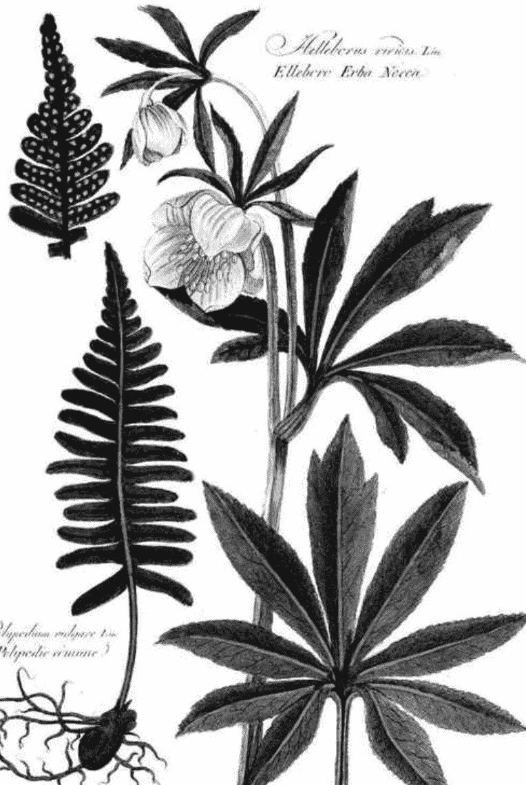

左侧是普通鳞囊蕨（Polypodium vulgare），右侧是绿石莲兰（Helleborus viridis）。Gaetano Savi，1805年。

# 19

## 半个地球：如何拯救生物圈

归根结底，生物多样性保护的核心问题在于，在灭绝率回到人类出现之前的水平之前，将有多少幸存的野外土地及其内部物种将会丢失。目前，人类之前的之前的水平被设定为每年每百万种物种中有十种灭绝。从人类寿命的角度来看，那种原始速率是微乎其微的，在保护思维中基本上为零。（请同时记住，科学家尚未发现多达六百万个当代物种。）然而，这也意味着已知物种的当前灭绝率已经增加了近一千倍且仍在加速——尽管全球保护运动付出了英雄般的巨大努力。

未愈合的流出血在所有生物系统中都只有一个终点：一个个体的死亡，一个物种的灭绝。研究生物多样性流失轨迹的研究人员感到警觉，因为在这一世纪内，呈指数级增长的灭绝率可能会轻易扫除目前现存的大多数物种。

物种生死的关键因素是留给它们的合适栖息地的数量。栖息地面积与物种数量之间的关系经过多次计算和完善，并经常在科学和大众文献中被引用。栖息地面积的变化（无论增加还是减少）会导致可持续物种数量发生三次方到五次方根的变化，最常见的是接近四次方根。例如，如果移除了90%的面积，能够持续生存的物种数量将下降到一半。这正是世界上许多物种资源丰富地区的实际状况，包括马达加斯加、地中海周边、亚洲大陆西南部的部分地区、波利尼西亚，以及菲律宾和西印度群岛的许多岛屿。如果此时再移除10%剩余的自然栖息地——这意味着伐木队可能会一个月内死亡——那么大多数或所有现存的本土物种将会消失。

另一方面，如果可持续物种数量与其栖息地面积呈四次方根关系（近似中值），那么在全球表面的一半范围内受保护的比例大约是85%。这一比例可以通过将地球一半内的“热点”纳入其中来提高，那里存在着数量最多的濒危物种。

今天，世界上每一个主权国家都有某种形式的保护区系统。陆地保护区总约有16.1万处，海洋6500处。根据联合国环境规划署和国际自然保护联盟联合项目的“保护区世界数据库”，到2015年，它们占地球陆地面积不足15%和海洋面积的2.8%。覆盖率正在逐渐增加。这一趋势正在加强。达到现有水平是对那些领导和参与全球保护工作的人的致敬。但这个水平是否足以解决或至少遏制物种灭绝的加速？遗憾的是，事实上它现在已经接近足够了。保护工作在本世纪的剩余时间里设定的上升趋势，是否足以拯救地球大部分的生物多样性？这具有问题性，但我怀疑这是可能的，而且即便如此，待救的生物多样性也将少得多。

即使在传统保护实践的最佳情景下，这些损失也被文明人认为是不可接受的。日益萎缩的生物多样性世界无法仅通过目前的零星式经营得到拯救。如果保护继续被视为国家预算中的奢侈品，它将会大部分丧失。我们的行为正强加给其他生命的灭绝率，而且注定将持续，更准确的观点是，这等同于一次希克斯鲁伯大小的小行星撞在几个人世代中上演。

对于现存物种，唯一的希望是与问题规模相当的人类努力。正在发生的物种大灭绝，以及随而来的基因和生态系统的灭绝，与流行病、世界大战和气候变化并列为人类自加的最致命威胁。对于那些满足于让人类世盲目漂流演化到任何命运的人，我说请花时间重新考虑。对于那些引导全球保护区增长的人们，请允许我诚恳地请求：不要停止，只需目标定得更高。

数量处于危险水平的物种群将获得增长空间。此前因开发而注定灭绝的稀有和局部物种将逃避命运。那些未知的物种（显然至少有六百万种）将不再沉默，从而面临最高风险。人们将更近地接触一个超出我们目前想象的复杂且美丽的世界。我们将有更多的时间为后代理好自己的家。地球，作为一个整体，可以继续呼吸。

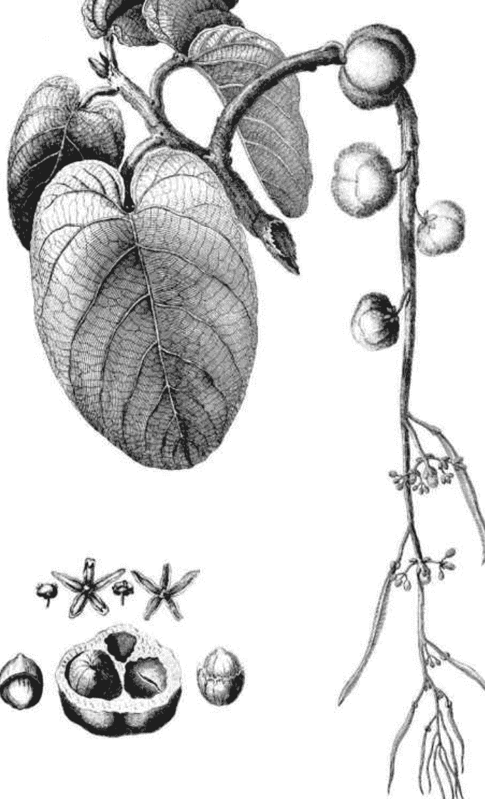

藤植物 Ronnowia domingensis。Pierre-Joseph Buc’hoz，1779年。

# 20

## 穿越瓶颈

“半个地球”方案并不意味着将地球一分为两半或任何其他大规模。它也不要求对任何国家拥有所有权。另一方面，它意味着为可能留出空间。

拯救地球一半的关键在于生态足迹，定义为满足所有需求所需的空间。它包含了用于居住、食物生产和供应、交通、治理、娱乐的土地。正如生态足迹分布在世界各地，碎片化也是如此。

总人口不会立即下降。由于早期多产世代后代的长寿，过剩现象仍然存在。向低生育率的转变可以在一两代之间发生。联合国2014年发布的人口年度报告预测，有80%的概率到2100年，随着增长趋于零增长，世界人口将达到96亿到123亿之间，而2014年为72亿。对于一个已经拥挤的地球来说，这是一个沉重的负担，但除非全球女性转回每人少于2.1个孩子的负增长趋势，否则二十世纪初的人口下降是不可避免的。另一种方式。

那么，人均消费将如何？它难道不会增长到足以打破任何大规模保护的决心吗？如果生态足迹的组成部分保持今天不变，情况确实如此。但它们不会保持不变。足迹将发生演变，不是像你最初想象的那样为了占据更多资源和空间，而是更少。原因在于自由市场体系的进化，以及它日益受到高科技的塑造。今天赢得竞争并可能无限持续下去的产品，需要更少频繁的维修和更换，并以最少的能量提供最高的性能。正如自然选择通过竞争驱动有机演化，使后代每单位成本产生更多拷贝一样，提高生产效益比驱动了经济的演化。除了军事技术外，自由市场中几乎所有的竞争都提高了平均生活水平。视频会议、在线购物与贸易、电子书个人图书馆、互联网上的所有文学和科学数据、在线诊断与医疗实践、通过带有LED照明的室内垂直花园大幅提高每公顷食品产量、转基因作物和微生物、远距离商务会议和等身图像的社交访问，以及最重要的，世界上任何时候、任何时间、任何随地都能免费在线获得的优质教育。所有这些设施现在已完全可用或很快就会实现。每一项都将以更少的人均材料和能量产生更多更好的结果，从而缩小生态足迹的规模。

展望这一未来，我想建议一种方法，以几乎免费地享受我和我的自然主义同行所识别的生物圈内最佳地点。成本效益比将极小。这只需要一千部高分辨率摄像头（得益于持续的信息技术革命，这些相机很小且不显眼），它们从保护区内的站点进行全天候直播。人们仍然可以实地访问世界上任何保护区，但他们也可以以虚拟的方式持续实时进行旅行，在家里、学校和讲堂里只需几次击键。也许是黎明时分的塞伦盖蒂水坑？或是生机勃勃的亚马逊林冠的昼夜循环？是否还有南极附近浅岸海夏季白天的流媒体视频，以及持续穿过印度尼西亚和新几内亚大珊瑚三角洲的摄像头？加上不露痕迹的物种鉴定和简短专家评论，这场冒险将是永远变化且安全的。

简单来说，生态足迹的缩小和随之而来的生物多样性保护改进受到青睐，是因为扩张型经济增长向密集型经济增长的加速替代。贯穿20世纪直到现在的扩张型经济增长，是通过增加资本、人口和更多未开发土地来增加人均收入。密集型经济增长则是通过发明高性能新产品，并将其加入现有产品的改进设计和使用中产生的。这种转变的标志性例子是摩尔定律，对于其发明者戈登·摩尔（英特尔的联合创始人，兼是全球保护事业的领军活动家）：微芯片晶体管的成本将下降，因为刻在计算机微处理器固定区域内的数量每隔两年将增加一倍。该定律在2002年至2012年间有效，产量从每美元260万增加到每美元2000万，然后开始平稳。

21世纪经济演化的紧密后果是世界观从基于数量的财富转向基于质量的财富，而后者是通过生态现实主义实现的。核心思想是将整个地球视为一个生态系统，看到地球的真实目，而不是我们希望的样子。鉴于经济和环境的稳定性紧密相关，两者都需要通过自我理解来追求生活质量，而不是基于财富最终可以交易成生活质量的假设来进行传统的物质财富积累。

生态现实主义世界观在英国皇家学会的报告《人类与地球》中引起了共鸣。其建议得到了全球国家科学院网络的支持。

在最发达和新兴经济体中，必须迫切减少不可持续的消费。这将意味着缩减或从根本上改变具有破坏性的物质消费和排放，并采用可持续技术，这对于确保所有人的可持续未来至关重要。目前，消费与基于增长的经济模型紧密相关。提高个人福祉以使人类繁荣而非仅仅是生存，需要从目前的经济衡量标准转向充分重视自然资本。迫切需要将经济活动与物质和环境吞吐量解耦。

经济演化的路径将由日益密集且扩张日益减少的增长所决定。其最先进的产品将赋予个人工具，能够以更少的人均材料和能量消耗实现更多目标。其成功的环境后果将与人类世意识形态支持者所设想的相反。噢，它将减少全球生态足迹，为其他生命释放空间和资源，而不是将其视为增长经济的必要而加以限制。生物圈和构成它的一千万物种将不再被视为商品，而被视为某种意义大得多的东西——一个仍然超出我们想象边界、但对人类长期生存至关重要的神秘实体。

通过创新和努力，我们将找到一种引导气候变化危机的方法，而不必诉诸目前正在讨论的巨大且危险的地球工程计划。特别是，让我们希望对未来衰落的恐惧抑郁不会迫使人类清除大气中过量的二氧化碳，然后以某种方式将收集的碳放回地下。或者，在地球表面覆盖硫酸盐以反射部分太阳能量。或者更糟但仍被讨论的，向海水中加入石灰以吸收大气中过量的二氧化碳。

我们希望，密集演化的先锋包含在生物学和机器人领域。人工生命的创造已经是现实。2010年5月20日，J·克雷格·文特的研究小组宣布了生命的第二次诞生，这次是通过人类命令实现的。他们从零构建了细胞。通过简单的化学试剂，他们组装了细菌物种的全部代码*Mycoplasma mycoides*，一个含有53万碱基对的双螺旋。在过程中，他们轻微修改了代码序列，插入了故物理学家理查德·费曼的名言：“我无法创造的，我不理解”，以便进行未来的测试。然后他们将修改后的DNA移植到一个移除了原始DNA的接收细胞中。新编码细胞像自然细胞一样进食和繁殖。

该实体被赋予了一个拉丁化的名称以及一个相应的机器人姓，Mycoplasma mycoides JCVI-syn1。哈密尔顿·O·史密斯代表团队写道，有了这个合成实体以及完成该项目的新工具和技术，“我们现在有了解析细菌细胞基因指令集并理解其工作方式的方法。”

事实上，新技术已经准备好了很多。2014年，霍普金斯大学Jeff小组的第二个团队构建了酵母细胞的人工染色。这一成就也代表了一个重要优势。酵母细胞拥有染色体和线粒体，比细菌细胞更复杂。

过去千年里，基础人工选择的教科书级例子是将墨西哥和中美洲的一种具有三排叶的野生草——棱棘草转化为玉米。祖先中发现的食物是一包贫瘠的硬核。经过几个世纪的选择性育种，它演变成了现在的形态。如今，玉米在对表现出“杂交优势”的纯系品种进行进一步选择和广泛杂交后，是数亿人的主食。

本世纪的第一个十年见证了杂交之外的新基因改造阶段的开始：人工选择，甚至在单个生物中直接替换基因。如果我们以过去半世纪分子生物学的进展轨迹作为历史指南，科学家似乎将开始常规地从零构建各种细胞，然后诱导它们增殖成合成组织、器官，并最终诱导产生具有相当复杂性的独立生物。

如果人们要在我们梦想的可持续伊甸中过长寿健康的生活，如果我们的思想能够解放出来，居住在理性战胜迷信的、得多的宇宙中，这将通过生物学的进步实现。这一目标是可行的，因为科学家们，

作为科学家，他们遵循着一个不妥协的使命：将发现推向极限。必要时，将接棒从一个人传给下一个人，但绝不让努力熄灭。已经出现了一个术语来描述生物及其部分的制造：合成生物学。它的潜在效益可以被视觉化为在医学和农业领域的传播，其限制仅限于想象力。合成生物学还将基于微生物的食品和能量经济带入中心。

合成生物学的巨大潜力也直接导致了一个棘手的问题：我们能创造出人类吗？一些狂热者认为随着时间的推移，我们最终能够做到。如果科学家成功了，即使只是部分成功，我们也已经接近费曼方程：构建即理解。但我们被迫去解决哲学上的终极问题：人性的意义是什么？

在这个世纪，回顾历史是恰当的。百年前，人工智能（AI）工程师和脑科学科学家开始追求由不同技术服务的两个独立目标。人工智能的首要目的过去和现在仍然是创建执行超出人类能力任务的设备。相比之下，脑科学更加聚焦。它的核心和终极目标是全脑仿真（WBE），即构建人类级心灵的方法和最终目标。今天，这两项努力正在汇合，在许多方面它们已经重叠。人工智能技术已被证明对全脑仿真至关重要，而在活体脑中观察到的活动预示着人工智能的进步。

全脑仿真面临的最大挑战是对意识的解释。神经生物学家几乎一致认为，意识是一种具有细胞物理基础的物质现象。因此，它是所谓的“神经工作空间”的一部分，从而受到实验和制图的约束。全脑仿真仍在以蹒跚的步伐进行，但每一步都比上一步长。如果目前的科研轨迹和速度能够维持，全脑仿真很可能在本世纪内实现。它的巅峰将成为有史以来最伟大的成就之一。全脑仿真究竟将完成什么？它将实现人工意识心灵的构建——具有反思性的、情感性的、渴望学习和成。

被这一目标或其关键部分吸引的研究人员不知道他们将发现什么，以及它可能会变成什么样。最成功的科学家就像探索未知领土的探矿者。他们大部分关心的是发现——成为第一个发现智力金、银或石油的人。人们想要它，于是宣称主权，让其他人担心后果。在生活的晚年，他们变成了哲学家，并开始担忧。与此同时，他们坚信人类最终将由人造智能相伴，这种智能理解智能的意义并可以安全地传输到移动机器人中。另一方面，受好莱坞剧作家影响的大众却感到忧虑。作为沉迷于宗教教条和迷信的、动荡不安文化的公民，即使是受过良好教育的人也愿意相信任何事情。在人工智能和全脑仿真中，他们看到了可能发生的灾难的蓝图。很容易想象，人类级机器人发疯并在（机器人人类复制品）在反抗它们的人类创造者时肆意破坏，而心灵下载到计算机中，并作为（“超人类”）统治那些选择保留凡胎肉肉之躯的人。这有助于他们所处的神话，例如这些故事出现在技术上卓越的科幻电影中，如《2001太空漫游》（1968）、《星球大战》（1977）、《终结者》（1984）、《机械机器人》（2004）、《阿凡达》（2009）和《上传》（2014），得益于华丽特效支持的史诗级戏剧，这些都是该类型迄今为止最有趣的电影。

科学家们确信自己比别人清楚。无论如何，我们正处于将脑科学移向生物学和人文中心的道路上。人工智能的规模随着机器计算的整体指数级增长而上升。以每千美元硬件每秒执行的计算次数衡量，计算机性能自1960年以来从每秒千次计算（每三小时一次）增加到每秒百亿次。所有国家，无论是发达还是发展中国家，现代文明都加入了数字革命。这种影响是不可逆的。它将继续无情地加剧，很快将深入每个人的生活。一个例子是对职业寿命的影响。牛津大学的经济学家卡尔·贝内迪克·弗雷伊和数学家迈克尔·A·奥斯本估计，到2030年，休闲治疗师、运动训练师、牙科医生、化学工程师和消防员的工作将相对安全，而二级机械师、秘书、房地产经纪人、会计师、审计师和电话推销员将面临高风险。

每年都能看到人工智能的进展及其众多应用——这些进展在几十年前还是遥不可及的未来。机器人在火星表面上滚动。它们在拍摄、测量地形细微之处、分析土壤和岩石的化学成分以及寻找生命迹象时，在岩石周围穿行并在坡面上移动。2014年，日本制造的机器人SHIFT在国际DARPA机器人挑战赛中胜出，穿越门口和碎片，使用连接消防软管的工具在墙上开一个洞，并沿着弯曲的路径驾驶汽车。先进计算机最近开始通过反复尝试进行学习和自我修正。一个被赋予这种能力的程序训练自己识别猫的图像。另一个被程序为能与男孩水平对话的程序通过了图灵测试（以先驱计算机理论家艾兰·图灵命名），因为专家小组中三三分之一的人在与其交谈五分钟后没有认出它是一台机器。

1976年，肯尼·I·阿普尔和沃尔夫冈·哈肯通过在早期计算机上的十次计算彻底改变了数学的一部分，证明了经典的四色地图定理（证明绘制任何地图最多需要四种颜色）。在数字革命的早期，创新者依靠机械原理，而不是模仿鸟类的飞行。随着当今计算机技术和脑科学的快速发展，计算机科学家和脑科学家都还不足以做出实际的联系。计算机技术和脑科学的联盟产生了全脑仿真，作为科学的终极目标之一。

脑科学家对大脑电路和过程的了解足以将其转化为人工智能算法吗？这两个学科的倾向仍然不同。人工智能本质上是一项寻求解决方案的工程事业，而全脑仿真专注于大脑和心灵的核心问题。两者深度交织。根据斯坦福大学的丹尼尔·Eth及其同事，在计算机上模拟整个大脑是现实的，包括它的思想、情感、记忆和技能。他们确定了四种必需技术：首先扫描大脑细胞结构，接着将扫描结果转换为模型，在计算机上运行模型，最后模拟来自身体和周围环境的感觉输入。许多人认为这一切都能在本世纪结束之前完成。

反射的控制。从一开始开始，大脑就安置了本能的调控中心。正是在这些中心，恰当的刺激（行为学家所说的“标志性刺激”）触发了先天的本能（“消费行为”）。

从古老的注定向人类演化的两栖动物开始，再到爬行动物，大脑的每个部分的神经通路都通过自然选择反复改变，以适应生物所生存的环境。从古生代的两栖动物到中生世的灵长类动物，古老的中心被新的中心（主要是不断增长的皮层）所增强，这些新中心增加了学习能力。它们通过演化反射和本能的库，实现了对特定环境的适应，使其包含了对变化环境的适应性。在其他一切都相同的情况下，生物跨越季节和不同栖息地发挥功能的能力，使它们在生存和繁衍的持续斗争中占据了优势。

因此，神经生物学家发现人类大脑中密密地分布着部分独立的无意识操作中心，以及所有理性思考的操作器，这并不奇怪。通过皮层进行的思维，最初看起来像是随机排列，实际上是处理数字、注意力、面部识别、意义、阅读、声音、恐惧、价值观和错误检测等各种总部。决策往往在意识理解之前，在这些中心通过无意识选择的力量做出。即使是简单的动作，决策也可以在没有意识的情况下进行。庞加莱早在1902年就清晰且诗意地预见到这一过程；

潜意识自我并不逊于意识自我；它并非完全自动；作为一种具有辨别能力，它具有含蓄的细腻；它更懂得如何选择、如何划分。我在说什么呢？它比意识自我更擅长划分，因为它在意识自我失败的地方取得了成功。简而言之，潜意识自我难道不优于意识自我吗？

进化的下一步是意识。大脑科学家并不知道它究竟是什么，但他们正在掌握它作为人类大脑中新来者所扮演的角色。法国法学院的领先理论家斯坦尼斯拉斯·德哈纳在2014年延续了庞加莱的思路如下：

事实上，意识支持许多无法无意识展开的特定操作。潜意识信息是转瞬即逝的，但意识信息是稳定的——我们可以随心所欲地抓住它。意识还压缩传入的信息，将巨大的感官数据流减少为一小组经过仔细挑选的易于处理的符号。采样信息可以被路由到另一个处理阶段，允许我们执行完全控制的操作链，就像串行计算机一样。意识的这种广播功能至关重要。在人类身上，这种功能通过语言得到了极大增强，让我们能够将意识思想分布到社交网络中。

脑科学与生物多样性之间有什么关系？随着人类的未来越来越受到关注，包括人类智力源泉的开启，现在是——已经太晚了——仔细审视我们对地球其他生命的道德推理了。人性沿着一条之字路径演化，处于遗传特征不断变化的交换之中。从那数百万年直到人类世的这一最后时刻的开始，我们的物种让生物圈继续自我演化。然后，在镰刀和火的帮助下，受无知本能而非理性的引导，我们改变了一切。

生物多样性保护的终局正在21世纪上演。数字技术的爆炸式增长改变了我们生活的方方面面并改变了自我认知，使“BNR”行业（生物学、纳米技术、机器人学）成为现代经济的先锋。这三者有潜力有利于生物多样性，也有可能破坏它。我相信它们将有利于它：通过将经济从化石燃料转向清洁可持续的能源，通过新的农作物品种和种植方式从根本上改进农业，以及减少对远途旅行的需求或欲望。这些都是数字革命的主要目标。通过这些目标，生态足迹将将缩小。普通人可以期待享受更长、更健康、高质量的生活，而对陆地海洋的能量提取和原始需求更少。如果我们幸运（且聪明），世界人口将在世纪末或之后达到超过100亿的峰。不仅世界人口将下降，生态足迹也将——可能是急剧下降。原因是我们是试图理解世界如何运作的思考生物。我们将醒来。

与此同时，数字技术偶然使得全球生物多样性的普查成为可能，并已经在进行中，尽管速度太慢了——终点在23世纪。我们和与我们在一起的其他生命正处于人口增长、资源萎缩和物种灭绝的瓶颈之中。作为它们的守护者，我们需要将我们的物种视为正在参加一场拯救生存环境的竞赛。逻辑上的首要目标是通过瓶颈，进入一个更好、更少危险的存在，同时尽可能保留其他大多数生命。如果全球生物多样性得到空间和安全保障，目前濒危的大多数物种将自行重新获得可持续性。

此外，合成生物学、人工智能、全脑仿真和其他类似的基于数学的学科的进展可以被引入，以创造一种真实的、预测性的生态学。在其中，物种之间的相互关系将得到像我们寻找身体的健康和长寿那样热烈的探索。人们常说人脑是宇宙中已知的最复杂的系统。那是错误的。最复杂的是个体自然生态系统，以及组成地球物种级生物多样性的生态系统集合。每个植物、动物、真菌和微生物都受到复杂的决策设备的引导。每一种都以自己的方式精密编程，以通过各自的生命周期。即使生活在我们肠道细菌天堂中的单细胞大肠杆菌，也会通过在其微观体内的化学感受分子的响应，旋转其鞭毛，来靠近食物或远离食物。

所有这些心灵以及周围的决策设备是如何演化的，以及它们如何与生态系统相互作用（无论紧密还是松散），这是生物学一个巨大的领域，大部分仍未被开发——并且仍由致力于此的科学家们梦想得仍然不均衡。应用于神经科学、大数据理论、互操作性研究、机器人化身模拟以及其他可比事业的分析技术将在生物多样性研究中找到应用。它们是生态学的姐妹学科。

是时候扩大对人类未来的讨论并与其他生命联系起来了。硅谷那些关于数字化人类的梦想者还没有这样做，至少还没有。他们完全没有对生物圈进行思考。随着人类状况如此迅速变化，我们正在日益失去或退化为无用，那些独立于我们且免费地运行世界的数百万物种。如果人类继续以这种自杀的方式改变全球气候、消除生态系统并耗尽地球自然资源，我们的物种将很快发现自己被迫做出选择，这次将涉及大脑的意识部分。情况如下：我们是成为生存保守者，在保持遗传人性的同时，减少对我们和其他生物圈有害的活动？还是利用新技术来适应仅对我们物种重要的变化，而让其他生命流逝？我们只有短暂的时间来决定。

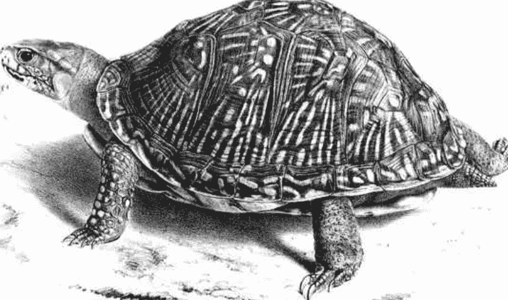

墨西哥龟 *Cistudo mexicana*。伦敦动物学学会论文报，1848–1860年。

# 21

## 我们必须做什么

在一个生物技术和理性能力飞速发展的世界里，构想一个覆盖了地球表面一半的、不可侵犯的全球保护区网络是完全合理的。但人们和他们以自我为中心的政治领导人是否愿意与他人分享他们本可以自己支配的资源呢？有一种流行的说法是：利他主义的第一条法则是永远不要期待任何人做任何违背个人利益的事。由于大脑进化的方式，如果人们想象到即使微小的个人风险或牺牲，保护遥远的环境也会变得异常困难。这种逻辑延续认为，真正的利他主义仅限于家庭、部落、种族或国家，在这些地方，我们的基因被视为通过对他人的个人奉献而获得了间接的回报。人们认为上帝认为信徒宗教的创世故事优于所有其他宗教。爱国者认为自己社会的道德准则是世界上最好的。奥林匹获胜者奏响的是国歌，而不是对人类成就的赞歌。

尽管自我奖励的行为主导了人类行为，但它并非孤立存在。一种真正的利他本能确实存在。当个体具有某种权力并因此承担实现利他目标的责任时，这种本能最容易进入大脑的决策中心。产生这种本能的驱动进化力量是群体选择，它区别于个体选择。这一过程的本质是：如果对群体其他成员的利他有助于群体的成功，那么利他者血脉和基因获得的收益可能超过其个人利他行为造成的基因损失。

查尔斯·达尔文是这一思想大纲的起源，尽管他承认最初理解时具有双重性（一方面，他并没有基因的概念），但他仍然在《人类的起源》中清晰地勾勒了它：

> 不要忘记，高标准的道德对于每个个体及其后代相对于同部落的其他人并没有微小的优势或没有优势，但道德标准的提高和高尚人数的增加无疑会给某一个人优于另一个人的巨大优势。毫无疑问，一个包含许多成员、并高度拥有爱国主义精神、忠诚、服从、勇气和同情心的部落，总是准备为共同利益相互提供并牺牲自己，他们将战胜其他部落；这就是自然选择。世界在任何时候都会取代部落；因为道德是他们成功的要素之一，因此道德标准和高尚人士的数量将在各处上升和增加。

这种多层次选择（个体选择加群体选择）的思想经过了多次提炼，并得到了理论和实验的证明，可以作为社会演化的部分扩展到同一部落内外的无关人员，甚至到其他物种。正如我和研究人员在早期的工作中论证的那样，亲生物学现象——即对生命过程的天生喜爱——适用于自然界，换句话说，人类的祖先环境。

生物世界正处于危急状态。它在多样性的所有水平上都遭受着下降。对其生态服务和潜在产品的经济措施只能提供帮助，而不能拯救它。对上帝神圣意志的感知也是不够的：传统宗教以人类的拯救（无论今世还是后世）为核心，高于任何可以想象到的其他目的。

只有道德推理发生重大转变，对生命的其余部分给予更多的承诺，才能应对这一世纪最大的挑战。荒野是我们的出生地。我们的文明建立在它们之上。我们的食物以及大多数住所和交通工具都源于它们。我们的神居住在它们之中。荒野中的自然是地球上每个人的天赋。

我们允许在在那里生存但继续威胁那里的数百万物种，是我们的系统发育亲属。它们的长期历史就是我们的长期历史。尽管我们所有的伪装和幻想，我们一直是也将一直是与这个特定的生物世界相连的生物物种。数百万年的进化不可磨地编码在我们的基因中。没有荒野的历史根本不是历史。

我们应该永远记住，我们物种所继承的美丽世界是生物圈花费38亿才建立的。其物种的复杂性我们只了解其部分，而它们如何合作创造一个可持续的平衡，我们才刚刚开始掌握。无论喜欢与否，无论准备与否，我们都是生命世界的思想和守护者。我们自己的最终未来取决于这种理解。我们从所处的野蛮时期已经走了很远，现在我相信我们已经了足够的知识，来采纳一种关于生命其余部分的超越性道德准则。它简单易懂：不再对生物圈造成进一步伤害。

# 参考文献与延伸阅读

### 序言

书目说明：我首次在《生命的未来》（2002年）和《永恒之窗：一位生物学家的罗贡戈萨国家公园漫步之旅》（2014年）中提出了建立如此大规模保护区的初步论点。“半地球”这一概念是由托尼·希斯（Tony Hiss）在文章《世界真的能为野生动物留出地球一半吗？》（《史密森尼杂志》45(5): 66–78, 2014）中为这一概念提出的术语。

## 1 世界末日，两次

- Brown, L. 2011, 《边缘上的世界》（纽约: W. W. Norton）。

- Chian, D., 等. 2008. 环境遗传学揭示了地球深处的一个单一物种。*科学杂志* 322(589): 275–278。

- Christner, B. C., 等. 2014. 南极冰盖下的微生物生态系统。*自然* 512(7514): 310–317。

- Crist, E. 2013. 论命名的贫乏。*环境人文* 3: 129–147。

- Emmott, S. 2013. 《十亿》（纽约: Random House）。

- Kolbert, E. 2014. 《第六次灭绝》（纽约: Henry Holt）。

- Priscu, J. P. 2012. 冰冷世界的宜居性。*微生物* 7(4): 167–172。

- Weisman, A. C. 2013. 《倒计时：我们对地球未来的最后希望？》（纽约: Little Brown）。

- Weatherner, G., 和 T. Butler, 编. 2015. 《保护荒野：公园与荒野，保护事业的基础》（华盛顿，DC: Island Press）。

## 2 人类需要生物圈

- Boersma, P. D., H. Richard, 和 A. Van Buren, 编. 2006. 《太平洋西北部的入侵物种》（西雅图: Washington Press）。

- Murcia, C., 等. 2014. 对“新生态系统”的批判。*生态与演化趋势* 29(10): 548–553。

- Pearson, A. 2008. 海底住着谁？*自然* 454(7207): 952–953。

- Sax, D. F., J. J. Stachowicz, 和 D. Gaines, 编. 2005. 《入侵物种：生态学洞察与传记》（桑德兰: Sinclair Associates）。

- Simberloff, D. 2013. 《入侵物种：每个人都需要知道的》（纽约: Oxford University Press）。

- Tudge, C. 2000. 《生命的变幻：对所有生物的调查与庆颂》（纽约: Oxford University Press）。

- White, P. J., R. A. Garrott, 和 G. E. Plum. 2013. 《气候变化中的野生动物》（剑桥: Harvard Press）。

- Wilson, E. O. 1993. 《生命的多样性：学院版》（纽约: W. W. Norton）。

- Wilson, E. O. 2002. 《生命的未来》（纽约: Knop）。

- Wilson, E. O. 2006. 《创世：对生命的呼吁》（纽约: W. W. Norton）。

- Womack, A. M., B. J. Bohannan, 和 J. L. Green. 2010. 大气的生物多样性。*伦敦动物学会论文报* 365: 3645。

- Woodworth, P. 2013. 《我们的与地球》（芝加哥: University of Chicago Press）。

## 3 生物多样性调查现状？

- Baillie, J. E. 2010. 《世界脊椎动物》（伦敦: 伦敦动物学会）。

- Bruns, T. 2006. 重新发现王国。*自然* 443(7113): 758。

- Chapman, R. D. 2009. 《澳大利亚与世界的生物名称》（堪培拉: 环境、遗产与艺术部）。

- Maurer, A., 和 M. Domelas, 编. 2010. 引言：变化世界中的生物多样性。*伦敦动物学会论文报* 365: 3591–3778。

- Pereira, H. M., 等. 2013. 关键生物多样性。*科学杂志* 339(6117): 278–279。

- Scho, P. D., 和 J. Handelsman, 2004. 微生物普查。*微生物与分子生物学* 68(4), 686–691。

- Strain, D. 2011. 870万：地球上复杂物种的估值。*科学杂志* 333(6046): 1083。

- Tudge, C. 2000. 《生命的变幻：对所有生物的调查与庆颂》（纽约: Oxford University Press）。

- Wilson, E. O. 1993. 《生命的多样性：学院版》（纽约: W. W. Norton）。

- Wilson, E. O. 2013. 警惕孤独。*经济学人*“2014年世界”，p. 143。

## 4 犀牛的回响

- Platt, J. R. 2015. 西黑犀牛灭绝了。*科学美国博客网络*,2015年1月17日。

- Roth, T. 2004. 一只名叫“Emi”的犀牛。*野生动物探险》（辛辛那提园与植物园），9/10期：4-9。

- Martin, D. 2014. Ian Player去世，享87岁；曾帮助过犀牛。*纽约时报*，12月5日，B15版。

## 5 末日降临

- Laurance, W. F. 2013. 命名地球物种的竞赛。《Science》 339(6125): 1275。

- Sax, D. F., and S. D. Gaines. 2008. 物种入侵与灭绝：岛屿本土生物多样性的未来。《*Proceedings of the National Academy of Sciences U.S.A.*》 105(suppl. 1): 1490–1497。

## 6 我们如神一般吗？

- Brand, S. 1968. “我们如神一般，不如擅长这件事吧。”收于《*全地球目录（由 Stewart Brand 出版）*》。

- Brand, S. 2009. “我们如神一般，**必须**擅长这件事。”收于《*全地球纪律：生态实用主义宣言*》（纽约：Viking 出版社）。

## 7 为什么灭绝正在加速

- Laurance, W. F. 2013. 命名地球物种的竞赛。《Science》 339(6125): 1275。

- Hoffman, M., et al. 2010. 保护对世界脊椎动物状态的影响。《Science》 330(6010): 1503–1509。

- Sax, D. F., and S. D. Gaines. 2008. 物种入侵与灭绝：岛屿本土生物多样性的未来。《*Proceedings of the National Academy of Sciences U.S.A.*》 105(suppl. 1): 1490–1497。

## 8 气候变化的影响：陆、海、空

- Banks-Leite, C., et al. 2012. 揭示碎片化景观中群落相似性和物种灭绝的驱动因素。《Ecology*》 93(12): 2560–2569。

- Botkin, D. B., et al. 2007. 预测全球变暖对生物多样性的影响。《BioScience*》 57(3): 227–236。

- Burkhead, N. M. 2012. 1990–2010年北美淡水鱼类的灭绝率。《BioScience*》 62(9): 798–808。

- Carpenter, K. J., et al. 2008. 三分之一的造礁珊瑚面临气候变化和局部影响引起的高灭绝风险。《Science》 321(5888): 569–573。

- Cicerone, R. J. 2006. 《*寻找气候变化并发挥作用*》。第六届 John H. Chafee 纪念演讲（华盛顿特区：国家科学与环境委员会）。

- Culver, S. J., and P. F. Dawson, 2008. 《*对全球变化的生物响应：过去的1.45 亿年*》（纽约：剑桥大学出版社）。

- Vos, J. M., et al. 2014. 估算物种灭绝的正常背景速率。《Conservation Biology*》 29(2): 452–462。

- Duncan, R. P., A. G. Boyer, and T. M. Blackburn. 2013. 太平洋史前生物灭绝的规模与变异。《*Proceedings of the National Academy of Sciences U.S.A.*》 110(64): 6436–6441。

- Dybas, C. L. 2005. 世界海洋中的死区。《BioScience*》 55(7): 552–557。

- Erwin, D. H. 2008. 演化历史的灭绝代价。《*Proceedings of the National Academy of Sciences U.S.A.*》 105(suppl. 1): 11520–11527。

- Estes, J., et al. 2011. 地球的营养级下缩小。《Earth Science*》 333(6040): 301–306。

- Gillis, J. 2014. 3.6 度的不确定性。《纽约时报》，2014年12月16日，第D3 页。

- Hawks, J. 2012. 人类演化的更长尺度。《*Proceedings of the National Academy of Sciences U.S.A.*》 109(39): 15531-15532。

- Herrero, M., and P. K. Thornton. 2013. 畜牧与全球变化：可持续系统的新兴问题。《*Proceedings of the National Academy of Sciences U.S.A.*》 110(52): 20878-20881。

- Jackson, J. B. 2008. 新海洋中的生态学灭绝。《*Proceedings of the National Academy of Sciences U.S.A.*》 105(suppl): 11458-11465。

- Jeschke, J., and D. L. Stayer. 2005. 欧洲和北美的脊椎动物入侵。102(20): 71。

- Laurance, W. E., et al. 2006. 亚马逊碎片区树种组成的组成的快速衰减。《*Proceedings of the National Academy of Sciences U.S.A.*》 103(50): 19010–19014。

- Löridge, K. 2006. 通向灭绝的句法视角：来自北方的。《Bioscience*》 56(8): 667–673。

- Lovejoy, T. E., and L. Hahn, 2005. 《气候变化》（纽哈芬）。

- Mayhew, J. P., G. B. Jenkins, 2008. 全球温度与生物多样性的长期相关性。《Proceedings of the Royal Society*》 375(5): 47–53。

- McCauley, J. D., et al. 2015. 海洋森林砍伐：动物损失。《Science》 347(6219): 247–254。

- Millennium Assessment. 2005. 生态系统与决策者摘要，24页。

- Pimm, S., et al. 2014. 物种生物样性及其灭绝率、分布与保护。《Science》 344(6187): 12462–12470 (doi:10.1126/science.12465)。

# 参考文献

Pimm, S., and T. Brooks. 2013. 保护：事实与谬误。《Current Biology*》 23:R1098, 第4页。

Stuart, S. N., et al. 2004. 物种下降的状态与趋势。《Science》 306(5702): 1783–1788。

The Economist. 2014. 深水，2月22日。

Thomas, C. D. 2013. 局部尺度维持、区域尺度增加与全球下降。《*Proceedings of the National Academy of Sciences U.S.A.*》 110(48): 19187–19188。

Urban, M. C. 2015. 气候变化加速的灭绝风险。《Science》 348(6234): 571–573。

Vellend, M., et al. 2013. 全球元分析显示局部尺度植物多样性没有变化。《*Proceedings of the National Academy of Sciences U.S.A.*》 110(48): 19456–19459。

Wagg, C., et al. 2014. 土壤生物多样性与土壤社区决定功能性。《*Proceedings of the National Academy of Sciences U.S.A.*》 111(14): 5266–5270。

## 最濒危的世界

Crist, E. 2013. 论我们命名的贫乏。《Environmental Humanities*》 3:129–147。

Ellis, E. 2009. 为拯救地球。《Wired》，5月6日。

Kolata, J. 2003. 你没灭绝吗？科学家大大了眼睛。《纽约时报》，3月19日。

Kumar, S. 2012. 灭绝不会永远持续。《Nature》 492(7427): 9。

Marris, E. 2011. 《喧闹的花园：在后荒野世界培养生命》（纽约：Bloomsbury 出版）。

Revkin, A. C. 2012. Peter Kareva，一个令人尴尬的环保主义者。《纽约时报》，4月3日。

Rich, N. 2014. 猛犸降临。《纽约时报杂志》，2月27日。

Thomas, C. D. 2013. 人类世可能会提高生物多样性。《Nature》 502(7469): 7。

Murcia, C., et al. 2014. 对“新生态系统”概念的批判。《Trends in Ecology and Evolution*》 29(10): 548–553。

Vosen, P. 2012. 打破迷信的科学家让环保人士不再依赖“恐怖故事”。Greenland，4月3日。

Wuerthner, G., E. Crist, and T. Butler, 2015. 《保护荒野：公园与荒野，保护基金会》（华盛顿特区：Island Press 出版）。

Zimmer, C. 2013. 让它们重获生命。《National Geographic》 223(4): 30。

## 10 保护科学

Balford, A. 2012. 《野性希望》（芝加哥：芝加大学出版社）。

Cadotte, M., S. L. Pimm, and T. H. Oakley. 2008. 演化历史预测灭绝。《*Proceedings of the National Academy of Sciences*》 105(44): 17012–17017。

Discover Life in DLIA. 2012. 大烟国家公园报告。

Hoffmann, M., et al. 2010. 保护对世界脊椎动物状态的影响。《Science》 330(6010): 1503–1509。

Jeschke, J., and D. L. Stayer. 2005. 欧洲和北美的脊椎动物入侵。《*Proceedings of the National Academy of Sciences U.S.A.*》 102(20): 7198–7202。

Rees, S. 2005. 《1973年濒危物种法》。

Rodriguez, A. S. 2006. 全球努力成功了吗？《BioScience*》 55(4): 360。

Shipper, J., et al. 2008. 世界陆地和海洋哺乳动物的状态：威胁。《Science》 322(5899): 225–230。

Stone, R. 2007. 失去的乐园。《Science》 317(5835): 193。

Taylor, M. F., K. F. Suckling, and J. J. Rachlinski. 2005. 濒危物种法的有效分析。《BioScience*》 55(4): 367。

## 11 物种之主

Hoose, P. M. 2004. 《拯救……竞赛》（纽约：Farrar, Straus and Giroux 出版）。

## 12 生命的未知网

Dejean, A., et al. 2010. 树木利用“魔术贴”原理捕获巨大的猎物。《PLOS One*》 5(6): e1331。

Dell, H. 2006. 捕捉一只蜜蜂。《Nature》 443(7108): 158。

Hoover, K., et al. 2011. 扩展表型。《Science》 333(6048): 1401。

Hughes, B. B., et al. 2013. 顶级捕食者的恢复缓解了对海草的负面营养级影响。《*Proceedings of the National Academy of Sciences U.S.A.*》 110(38): 15313–15318。

Mius, S. 2005. 代理吸血鬼：蜘蛛血凝固蚊子。《Science News*》 168(16): 246。

Montoya, J. M., S. L. Pimm, and R. V. Solé. 2006. 生态网络及其脆弱性。《Nature*》 442(7100): 259–264。

Moore, P. D. 2005. 稳定的根源。《Science》 4437(13): 959–961。

Mora, E., et al. 2011. 地球和海洋中有多少物种？《PLOS Biology*》 9: e100127。

Palfrey, J., and U. Gasser. 2012. 互操作性：高度连接系统的承诺与现实（纽约：Basic Books）。

Seenivasan, R., et al. 2013. Picomonas judraskela gen. sp. nov：微动物门（Picozoa）的首个被鉴定的成员，这是一个广泛的微真核生物群体，曾被称为“微植物”。

PLoS One 8(3): e59565.

Ward, M. D. 2006. 微生物物种的微生物视角。观点1: 269–278。

## 13 截然不同的水世界

Ash, C., J. Foley, and E. Pennisi. 2008. 迷失在微生物空间。Science 320(5879): 1027.

Chang, L., M. Bears, and A. Smith. 2011. 海洋上的——我们从未见过的达尔文。Antenna 35(1): 36–42.

Gibbons, S. M., et al. 2013. 全球海洋中持久微生物种子库的进化。美国国家科学院进展（Proceedings of the National Academy of Sciences U.S.A.）110(12): 4651–4655.

McCauley, D. J., et al. 2015. 海洋动物死亡：全球海洋中的动物生命。Science 347(6219): 247–254.

McKenna, P. 2006. 研究发现发现海洋。波士顿报，8月7日。

Pearson, A. 2008. 谁住在海床下？Nature 454(7207): 952–953.

Roussel, E., et al. 2008. 延伸海底的微生物组。Science 320(5879): 1046.

## 14 隐形帝国

Ash, C., J., and E. Pennisi. 2008. 迷失在微生物空间。Science 320(5879): 1027.

Bouman, H. A., et al. 2006. 球藻藻种（Prochlorococcus species）在全球表面分布的海洋学偏差。Science 312(5775): 918–921.

Burnett, R. M. 2006. 病毒生命之树的仅仅桶。美国国家科学院进展（Proceedings of the National Academy of Sciences U.S.A.）103(1): 3–4.

Chiao, D., et al. 2008. 环境基因组学揭示了地球深处的单一物种生态系统。Science 322(5899): 275–278.

Christner, B. C., et al. 2014. 西南极冰盖下的微生物生态系统。Nature 512(7514): 310–317.

DeMaere, M. Z., et al. 2013. 高水平的交换交换塑造了南极孤立湖中全古菌（holarchea）的进化。美国国家科学院进展（Proceedings of the National Academy of Sciences U.S.A.）110(42): 16939–16944.

Fier, N., and R. B. Jackson. 2006. 土壤细菌群的多样性和生物地理学。美国国家科学院进展（Proceedings of the National Academy of Sciences U.S.A.）103(3): 626–631.

Hugi, M., et al. 2013. 沿海水域礁石结构和活性生态型的季节性动态。美国国家科学院进展（Proceedings of the National Academy of Sciences U.S.A.）110(15): 6004–6009.

Johnson, Z. I., et al. 2006. 海洋尺度环境梯度下球藻藻之间的生态位划分。Science 311(5768): 1737–1740.

Milius, S. 2004. 无肠获胜者：没有共生让我们生活在鲸骨上。科学新闻（Science News）166(5): 68–69.

Pearson, A. 2008. 谁住在海床下？Nature 454(7207): 952–953.

Seenivasan, R., et al. 2013. Picomonas judraskela gen. sp. nov：微动物门（Picozoa）的首个被鉴定的成员。PLoS One 8(3): e59565.

Shaw, J. 2007. 未被观测到的行星。哈佛杂志（Harvard Magazine）110(2): 44–53.

Zhao, Y., et al. 2013. 海洋中丰富的 SAR11 病毒。Nature 494(7437): 357–360.

## 15 生物圈中最好的地方

本章描述的选择是我个人的主观评估，以及18位保护生物学家根据丰富的实地经验所要求的。这些生物学家是 Leanne Alfonso, Stefan Cover, Sylvia Earle, Brian Fisher, Adrian Forsyth, Robert George, Harry Greene, Thomas Lovejoy, Margaret (Meg) Lowman, David Madison, Bruce Means, Russ Mittermeier, Mark Moffett, Piotr Naskrecki, Stuart Pimm, Glenn Prance, Peter Raven 和 Diana Wall。

## 16 重新定义历史

Tewksbury, J. J., et al. 2014. 自然史在社会中的地位。BioScience 64(4): 300–310.

Wilson, E. O. 2012. 地球征服（纽约：W. Norton）。

Wilson, E. O. 2014. 存在的意义（纽约：W. Norton）。

## 17 觉醒

Andersen, D. 2014. 8月12日的信，经许可。

千年评估（Millennium Assessment）.2005. 生态系统与人类福祉，决策者的摘要，第24页。

Running, S. W. 2012. 可测量的边界。Science 337(6101): 1458–1459.

## 18 修复

Finch, W., et al. 2012. 远及视觉之处（卡皮尔山，北卡罗来纳州：North Carolina Press）。

Hiss, T. 2014. 世界留出一半给野生动物。史密森（Smithsonian）45(5): 66–78.

美国国家科学院进展（Proceedings of the National Academy of Sciences U.S.A.）110(38): 15313–15318.

Krajick, K. 2005. 与入侵者的战争。Science 310(5753): 1410–1413.

Tallamy, D. 2007. 带回家：如何用本土植物维持野生（波特兰，俄勒冈州：Timber Press）。

Wilkinson, T. 2013. 最后立场：拯救星球的任务（吉尔福德，康涅狄格州：Lyons Press）。

Wilson, E. O. 2014. 永恒的窗口：生物学家的公园之旅（纽约：Simon Schuster）。

Woodworth, P. 2013. 我们曾经与未来的星球：气候变化中的世界（芝加哥：University Press）。

Zimov, S. A. 2005. 更新世：近期猛象的生态系统。Science 308(5723): 796–798.

## 19 半地球：如何拯救生物圈

Gunter, M. M., Jr. 2004. 下一个方舟：如何保护生物多样性（林肯，新英格兰州：University of New England）。

Hiss, T. 2014. 世界留出一半给野生动物。史密森（Smithsonian）45(5): 66–78.

Jenkins, C. N., et al. 2015. 美国生物多样性优先。美国国家科学院进展（Proceedings of the National Academy of Sciences U.S.A.）112(16): 5081–5086.

Ross, R., A. P. Dobson, B. Baldwin, P. Beier, C. R. Davis, D. A. Delasa, J. Francis, H. Locke, K. Nowak, R. Lopez, C. Reining, S. C. Trombulak, and G. Tabor. 2011. 大胆思考。Conservation 26(1): 1–9.

Soulé, M. E., and J. Jericho, 1999. 大陆保护：区域网络的科学基础（华盛顿，特区：Island Press）。

Steffen, W., et al. 2015. 行星边界：在变化的星球上引导人类发展。Science，1月15日，第1–17页。

## 20 瓶颈

Aamoth, D. 2014. 图灵测试。时代杂志（Time Magazine），6月23日。

Blewett, J., and R. Cunningham, et al. 2014. 后增长计划：经济增长的结束如何带来更公平更快乐的社会（伦敦：Green House）。

Bourne, J. K., J. 2015. 丰的终结（纽约：W. Norton）。

Bradshaw, C. J. A., and B. W. Brook. 2014. 人口减少不是解决环境问题的快速方法。美国国家科学院进展（Proceedings of the National Academy of Sciences）111(46): 16610–16615.

Brown, R. 2011. 边缘上的世界：如何防止环境和经济崩溃（纽约：W. Norton）。

Brown, R. 2012. 满的星球，空旷的地方：粮食短缺的地缘政治（纽约：W. Norton）。

Callaway, E. 2013. 合成生物学家和保护者开启对话。Nature 496(7445): 281.

Carrington, D. 2014. 世界人口将在2100年达到110亿——持续上升70%。卫卫报（The Guardian），9月18日。

Cohen, J. E. 1995. 有多少人能支撑地球（纽约：W. Norton）。

Dehaene, S. 2014. 意识与大脑：破译编码我们思想的大（纽约：Viking）。

Eckley, J., and A. Sandberg. 2013. 脑模拟危险吗？人工智能（Artificial Intelligence）40(3): 170–194.

Emott, S. 2013. 下半世纪脑模拟的前景。J. J.-C. Foss. J. Artificial Intelligence 4(3): 130–152.

Fre, G. 2015. 经济增长的结束？科学美国人（Scientific American）312(1): 12.

Garrett, L. 2013. 生物学的新浪潮。外交事务（Foreign Affairs），11-12月。

Perlard, P., et al. 2014. 世界人口在本世纪内难以实现稳定。Science 346(6206): 234–237.

Saunders, D. 2010. 《抵达之城：历史上最大的迁徙潮如何重塑我们的世界》（纽约：Pantheon 出）。

Schneider, G. E. 2014. 《大脑结构及其起源：行为与心理的发展与演化》（马萨诸塞州剑桥：MIT出版社）。

Thackray, A., Brock, and R. Jones. 2015. 《摩尔定律：戈登·摩尔传传，硅谷的革命者》（纽约：Basic Books 出）。

《经济学人》 2014. 工作的未来。1月18日。

《经济学人》 2014. 机器人的兴起。3月29日-4月4日。

联合国，2012.《世界人口展望》（纽约：联合国出版社）。

Venter, J. 2013.《光速生命：从双螺旋到数字生命的黎明》（纽约：Viking 出）。

Weisman, A. 2013.《倒计时：我们对地球未来的最后最后的希望吗？》（纽约：Little, Brown 出）。

Wilson, E. O. 2014.《永恒之窗：一位生物学家的戈龙戈萨国家公园之行》（纽约：Simon & Schuster 出）。

Zlotnik, H. 2013. 群体控制.《自然》杂志 501(7465): 30–31。

## 21 必经之路

Balford, A., 等人. 2004. 全球海洋区域海岸线.《美国国家科学院纪报》101(26): 9694–9697。

Bradshaw, C. J. A., and B. W. 2004. 人口减少并非解决环境问题的快速万能药.《美国国家科学院纪报》111(46): 1660–16615。

Donlan, C. J. 2007. 恢复美国的大型野生动物.《科学美国人》296(6): 72–77。

Hamilton, C. 2015. 气候变化的风险.《纽约时报》，2月12日，第A27页。

Hiss, T. 2014. 世界现实可以为人类留下半个地球吗？《史密森杂志》45(5): 66–78。

Jenkins, C. N., 等人. 2015. 美国保护区缺失生物多样性优先级.《美国国家科学院纪报》112(6): 5081–5086。

Mikaku, G., H. P. Poissinger, and M. Blaschka. 2014. 生物多样性重点区域和地区——空间重叠的全球分析.《牛羚》杂志 48(1): 1–72。

Perira, H. M., 等人. 2013. 关键生物多样性变量.《科学》339: 277–278。

Saunders, D. 2010. 《抵达之城：历史上最大的迁徙潮如何重塑我们的世界》（纽约：Pantheon 出）。

Selleck, J., 等人. 2014. 生物：发现、科学与管理.《公园科学》特刊 31(1): 1–123。

Service, R. F. 2011. 多样性会促进三文鱼吗？《科学》334(6058): 888–892。

Steffen, W., 等人. 2015. 行星边界：在不断变化的星球上引导人类发展.《Sciencexpress》，1月15日，第1–17页。

Stuart, S. N., 等人. 2010. 生命的晴雨表.《科学》328(5975): 177。

Wilson, E. O. 2002. 《生命的未来》（纽约：Knopf 出）。

Wilson, E. O. 2014. 《永恒之窗：一位生物学家的戈龙戈萨国家公园之行》（纽约：Simon & Schuster 出）。

Wilson, E. O. 2014. 《人类存在的意义》（纽约：W. Norton 出）。

## 术语表

**人类世（Anthropocene）** 提议的新地质时代名称，在此时期，整个全球环境已人类活动所改变。

**人类世世界观（Anthropocene worldview）** 应用于自然的观点，认为从现在起，所有生命应主要或仅根据对人类福利的重要性而被赋予价值。在其极端形式下，这种世界观预见了未来的地球将完全被人类包裹和改造。

**生物多样性（biodiversity）** 物生物在过去和现在、不同地点以及生态系统的变异总量，以及物种特征的基因的总和。

**生物圈（biosphere）** 世界在任何时刻生存的所有生物，它们共同构成了地球周围的一个薄薄的球形层。

**生态系统（ecosystem）** 具有特定物理特征以及居住其中的独特物种的区域，例如湖泊、森林斑块、珊瑚礁、树洞，或者你的口腔和食道。

**基因（gene）** 遗传的基本单位，由特定的 DNA 序列编码。

**属（genus）**（复数：genera）一组物种，无论生存或灭绝，因源自同一个祖先物种而彼此关系紧密。

**半地球（Half-Earth）** 一项提议，将地球陆地面积和和海洋面积留给自然。

**物种（species）** 遗传上独特的种群或种群群，其成员能与其他种群相互交配。

## 附录

I

将地球陆地面积和海洋面积留给自然的提议。

II

将地球陆地面积和海洋面积留给自然的提议。

III

将地球陆地面积和海洋面积留给自然的提议。

IV

将地球陆地面积和海洋面积留给自然的提议。

V

将地球陆地面积和海洋面积留给自然的提议。

VI

将地球陆地面积和海洋面积留给自然的提议。

VII

将地球陆地面积和海洋面积留给自然的提议。

VIII

将地球陆地面积和海洋面积留给自然的提议。

IX

将地球陆地面积和海洋面积留给自然的提议。

X

将地球陆地面积和海洋面积留给自然的提议。

- 巴西环境部长签署了所需的法律文件，以永久性资助地区保护区计划（ARPA），该计划涵盖 5120 万公顷，面积是美国国家公园的三倍。

- 总部位于伦敦的石油公司 SOCO International 宣布将放弃在维龙戈萨国家公园勘探石油的计划，该公园是刚果民主共和国的世界遗产地。该公园拥有丰富的生物多样性，其中包括极濒危的大山猩猩。

- 在中国的一场由名人发起的运动后，鱼翅汤的消费量下降了高达 70%。中国人对这种美味的喜爱曾掠夺全球鲨鱼种群。

- 在美国以及其他地区，大坝的建设对淡水域具有破坏性影响，是大多数原生鱼类和软体动物灭绝的主因。许多大坝现在正在被拆除，每年移除的速度在本十年内翻了一番。

- 政府可以通过一个相对小的政策变化来保护大量的自然环境。2012 年，美国 USAID 发布了其首个生物多样性政策，旨在通过“战略性行动保护全球最重要的生物多样性，例如铲拳打击全球野生动物走私；并重点关注将生物多样性与其他发展部门相结合以获得更好的成果”。

- 世界公园大会构想了一个对开放水域生态系统具有巨大影响的计划。该提议建议在全球 20% 至 30% 的海域建立大型海洋保护区（MPAs），并在禁止捕鱼。由于开放海洋区域的鱼类和其他生物会不断扩散，保护区恢复的生产力将与相邻渔场共享。据估计，产量的平均增长将创造百万个额外工作，且监测和保护的成本低于政府为增加整个未受保护开放水域系统的产量而提供的补贴。

## 附录二

以下是卷首及二十一章开头插图的完整引用信息。

- [卷首] 蜜蜂、蝇虫与花朵——Frühllingsbild aus b. Insektenlinien，出自 Alfred Brehm 的《Brems 63 Chromatotafeln aus Brems Tierleben, Niedere Tiere》，第7–10卷（莱比锡：Bibliographisches Institut, 1883–1884）（哈佛大学 MCZ Ernst Mayr 图书馆）。

- 1 [世界终结了两次]——出自 Francisus von Sterbeck 的《Theatrum fungorum oft het Tooneel der Camernoelen》中的第27图（安特卫普：I. lacobs, 1675），19页，扉页，36幅图（25折页）。（Botany Foliare Rare BOOK S838 副本 1 [第27幅图随后见哈佛大学]）。

- 2 [人类需要生物圈]——天鹅——Schwarzschwan，出自 Alfred Brehm 的《Brems 55 Chromatotafeln aus Brems Tierleben, Vögel》，第4-6卷（莱比锡：Bibliographisches Institut, 1883–1884）（哈佛大学 MCZ Ernst Mayr 图书馆）。

- 3 [今日还有多少生物多样性]——蛾类、幼虫、蛹，出自 Maria Sibilla Merian 的《Der Rauen wunderbare Veränderung und sonderbare Blumen-Nahrung: worinnen durch eine neue-te Erfindung der Regeln, Wimmer, Sommer-vögel, Motten, Fliegen, und andererlicher Thierlein Urup, Speisen und Veränderungen in ihrer Zeit》（在纽伦堡；由 Andreas Graffen 处销售；法兰克福与莱比锡；由 David Funk 出，在 Andreas Knorten 处销售，1679–1683），2卷，第1[44]，102；[88];[44], [100]，第20页 [2幅插图页；21厘米（图IX随后于第16页)]）（哈佛大学 Botany Arnold [Cambr.] Ka M54 第2卷）。

- 4 [犀牛挽歌]——Nashorn，出自 Alfred Edmund Brem 的《Brems 63 Chromatotafeln aus Brems Sägetiere》，第1–3卷（莱比锡：Bibliographisches Institut, 1883–1884）（哈佛大学 MCZ Ernst Mayr 图书馆）。

- 5 [阿波罗当下]——乌龟与人——Senschkinder，出自 Alfred Edmund Brem 的《Brems 63 Chromatotafeln aus Brems Tierleben, Niedere Tiere》，第7–10卷（莱比锡：Bibliographisches Institut, 1883–1884）（哈佛大学 MCZ Ernst Mayr 图书馆）。

- 6 [我们是神吗?] Otis–Otis australis 雌性，XXX Proceedings of the Zoological Society of London (Illustrations 1848–1880)，1868年，第II卷，鸟纲，图I–LXXVI（哈佛大学 MCZ Ernst May Library）。

- 7 [为什么灭绝正在加速？] 袋鼠——图 XVIII 出 Proceedings of the Zoological Society of London (Illustrations 1848–1880)，第I卷，哺乳纲，图I–LXXXIII（哈佛大学 MCZ Ernst May Library 图书馆）。

- 8 [气候变化的影响：陆、海与海星] Stachelhäufer，出自 Alfred Edmund Brem 的《63 Chromotafeln aus Tieren, Niedere Tiere》，第7–10卷（莱比锡）：Bibliographisches Institute, 1883–1884（哈佛大学 MCZ May Library 图书馆）。

- 9 [最危险的野兽] 獾/狐狸—Fuchs，出自 Alfred Edmund Brem 的《52 Chromotafeln aus Tierleben》，第1–3卷（莱比锡）：Bibliographisches Institute, 1883–1884（哈佛大学 MCZ May Library 图书馆）。

- 10 [保护科学] 海壳——图 XXXVI 出 Proceedings of the Zoological Society of London (Illustrations 1848–1860)，第V卷，软体纲，图I–LI（哈佛大学 MCZ Ernst May Library 图书馆）。

- 11 [主之神的物种] 黑嘴啄木鸟与柳橡——图 16 M. Cathy, 1729，《The Natural History of Life》第一卷（Lucy Cathy 和 Nigel Frith 原稿的数字化复制，DRPG；收录于《The Curious Master Species》，皇家学会纪念信托编辑）；E. Charles Nelson 和 David J. Elliott（乔治亚州亚特兰大：Georgia Press, 2015）。

- 12 [未知的生命网络] 蛇类——Thamnotheres [Brachius] 和 hyla hylochor [Agalyopsis martelli]，图 XXXII 出 Proceedings of the Zoological Society of London (Illustrations 1848–60)，第IV卷，爬行动纲与鱼纲，图I–XXI 和 I–XI（哈佛大学 MCZ Ernst May Library 图书馆）。

- 13 [奇妙的水生世界] 管水母——Forskella to，在 Heinrich Philipp August Haeckel 的，H.M.S. Challenger 号于 1873–1876 年期间采集的管水母（伦敦：1888），复印于 Sociobiology 1975，图 19-2（哈佛大学 MCZ Ernst May Library 图书馆）。

- 14 [隐形的帝国] Biershischkal，出自 Alfred Edmund Brem 的《63 Chromotafeln aus Tierleben, Niedere Tiere》，第7–10卷（莱比锡：Bibliographisches Institute, 1883–1884）（哈佛大学 MCZ Ernst May Library 图书馆）。

- 15 [生物圈之优] 鴶——Schnopfe，出自 Alfred Edmund Brem 的《55 Chromotafeln aus Tierleben》，第4–6卷（莱比锡：Bibliographisches Institute, 1883–1884）（哈佛大学 MCZ Ernst May Library 图书馆）。

- 16 [隐藏的现实] Hydrops crispis 和 Hydroliches dichota——图 XXVI 出自 Hipolit Ruiz 和 Joseph Paulino 的《Flora Peruana et Clivensis: descriptions, et iconarum plantarum Peruvianum, et Chilendam, systema lineare dignamum》，由 Gallardo Ruiz 和 Joseph Paulino 撰写（马德里：Tipis Gabrielis de Sanchez, 1799–1802），3卷：含图；43厘米。（哈佛大学 Botany Gray Herbarium Fol. 2x85, v）。

- 17 [觉醒] 鱼——Aplootis melvisi（上）和 Aplotis panturu（下），出自 Proceedings of the Zoological Society of London (Illustrations 1848–1880)，第I卷，哺乳纲，图I–LXXXIII（哈佛大学 MCZ Ernst May Library 图书馆）。

- 18 [修复] 松树——图 I 出自 Engelmann 的《The History of the Pine Trees》（波士顿：Ticknor, 1848），43厘米。（哈佛大学 Botany Gray Herbarium Fol. 2x85, v）。

- 19 [半地球：如何拯救生物圈] Hydatodes viridis，出自 Rick Cech 和 Guy Tudor 的《Butterflies of the East Coast: An Observer’s Guide》，普林斯顿出版社，2005，55页，60幅，36厘米。（哈佛大学 Botany Arnold [Cambr.] Ka M54 第2卷）。

- 20 [穿过瓶颈] 藤蔓——Ronowia domingensis 图 IV 出自 Pierre-Joseph Buc 的《Plantes nouvellement découvertes: récemment classées, représentées en gravures, pour servir d'intelligence générale et économique》（巴黎：L’Auteur, 1779–1884）（哈佛大学 Botany Arnold [Cambr.] Ka M54）。

- 21 [必须要做的事] 龟——Cistudo (Onych) mexicana Gray，出自 Proceedings of the Zoological Society of London (Illustrations 1848–60)，第IV卷，爬行动纲与鱼纲，图I–XXII 和 I–XI（哈佛大学 MCZ Ernst May Library 图书馆）。

# 索引

列出的页码对应于本书的印刷版。您可以使用设备的搜索功能在文中查找特定术语。

*斜体*页码指的是图表和插图。

- 深海底栖生物, 127

- 金欢树, 147

- 刺冠虫, 90

- 非洲，生物多样性储量地, 143–46

- 非洲爪蛙, 35–36

- 非洲野犬, 180

- 农业，数字革命与, 205

- 农业生物学, 172

- 阿拉巴马马鱼, 42

- 阿拉戈斯蓝雉, 141

- 藻类, 11, 90, 116, 123, 161, 175

- 在南极, 150

- 物种总数, 22

外来物种：

- 与本土物种的杂交化, 76–77

- 另见入侵物种

阿勒格尼树鼠, 59

Aloya, D. P., 25

阿尔泰山脉, 146

利他主义, 209–212

亚马逊地区保护区 (ARPA), 230

亚马逊河流域, 138–39

无花美丽木兰（植物）, 150

美国栗树, 14, 59

美国鱼类学会, 93

两栖动物, 93

- 壶腹菌与, 35–36

- 已知 vs. 未知物种, 22

- 另见蛙类

安德森, 戴尔, 169

环节动物, 85, 91, 114

非洲按蚊（蚊子）, 53

南极，生物多样性地, 150, 169–70

南极冰盾, 65

羚羊, 179

人类世, 1–4, 227

- 其界定, 9

- 作为纪新世 (Eremocene), 20

- 海洋世界与, 113–14

人类世世界观, 227

基线选择, 182

- 在保护组织中, 134

- 危险性, 71–79

- 对物种级生物多样性的无知, 104–5

- vs. 密集型经济增长, 194

蝼蚁, 93

蚂蚁, 93

- 与弹虫菌与, 107–8
- 对其的着迷, 88
- 微生物组与, 122
- 新物种, 24–25
- 分类学研究, 161
- 另见特定的蚂蚁

蚂蚁的行为：

- 与蟋足, 86–87
- 与体型更大的猎物, 110
- 奴隶制度, 109–10
- 与蚂蚁兵蚁, 160–61

`AntWiki`, 162

`Appel, Kenneth A.`, 200

水生虫, 91

`aifers`, 171

节肢动物, 85, 91

南洋松, 150

病毒传播性, 53

古菌, 90, 128, 170

- 细菌 vs., 123
- 在海洋中, 116
- 区域与灭绝, 57

人工智能：

- 生态科学与, 206
- 全脑仿真与, 197–99, 201–2

人工生命体, 195–97

人工选择, 196–97

亚洲，生物多样性储量地, 146–48

亚洲银鲤, 15

亚洲白蚁, 15

杨树, 14

`Atewua 森林`, 245

奥杜邦圣诞鸟类计数, 60

澳大利亚和美拉拉尼西亚，生物多样性储量地, 148–50

澳大利亚生物资源研究, 21

澳洲大鸨, 45

南方古人, 157

《阿凡达》（电影）, 199

化身, 199, 206

安特雷亚蚁（蚂蚁）, 110

巴赫曼莺莺, 43, 60

细菌, 90

- 人工合成, 195–96
- 行为本能, 206
- 多样性, 124–25
- 在人类微生物组中, 121–22
- 在海洋中, 116, 125–28
- 物种总数和, 22
- 在上层大气和深层生物圈中, 59
- vs. 古菌, 123
- 另见微生物

噬菌体, 125–26

白海豚, 42

须鲸, 119

孟加拉国，孙达班斯保护森林, 14

猴面包树, 146

条码, 162–63

石翅蝉, 92

巴罗科科拉多岛, 57

基线选择, 181–83

歇鱼鲨, 119

海滩生态系统, 114–15

熊, 146, 148, 179

`Becking, Lourens Bass`, 124

蜜蜂, 93, 108

甲虫, 92, 120

- 另见特定的甲虫

底栖生物, 114, 127

生物圈中的优质地点，另见储量

不丹, 147–48

比亚沃维泽森林, 142–43

圣经经文，另见圣

大数据, 206

生物多样性, 227, 230

- 食物网与, 106
- 栖息地面积, 186
- 人口增长, 72
- 重要性, 133–36
- 森林破坏, 105
- 储量，另见储量
- 物种作为优选单位, 105–6
- vs. 生态系统级, 104–5
- 热带 vs. 温带环境, 67
- 脊椎动物 vs. 无脊椎动物, 61–62
- 大烟山国家公园的, 85–86, 90–93

生物多样性保护：

- 人类世世界, 76
- 数字革命与, 205–7
- 保护区, 16
- 生物多样性遗产, 162
- 生物学, 165–66
- 生物发光, 118

亲生物性, 211

生物圈, 227

生物圈中的优质地点, 133–53

商品化，经济演化与, 194

- 组成, 11–12
- 依赖, 13
- 鸟类, 93
- 生物多样性保护区, 140, 142, 146
- 灭绝率, 55–56, 59–60
- 已知 vs. 未知物种, 21

在太平洋岛屿的灭绝, 38–41, 72–73

黑病, 36

黑眼叶蛙, 100

黑犀牛, 29–31, 145

瓢虫, 108

黑色产业, 205

野猪, 14, 142, 146

林林莺, 60

凤尾乌贼, 118

`Boeke, Jef`, 196

茂加植物园, 57

婆罗洲, 146–47

瓶颈，人口 vs. 资源, 205–6

大脑：

- 演化带来的局限, 209–10
- 另见意识

人类大脑：

- 演化, 202–4
- 短期思考, 170–71

脑科学：

- vs. 人工智能, 197–98, 201
- 生物多样性与, 204–5
- 数字革命与, 199–201
- 另见全脑仿真

`Brand, Stewart`, 47

`Brehm, Alfred Edmund`, 10, 18, 34, 64, 70, 120, 123

刺毛, 85

- 跳跃, 92

棕树蛇, 16, 57

`Bruller, Jean`, 49

苔动物, 90

`Bucholz, Pierre-Joseph`, 188

`Burkhead, Noel M.`, 43

蝴蝶, 26, 27, 58–59, 62, 73, 88, 93, 102, 163

- 在大马于地区, 140
- 另见特定的蝴蝶

石蛾, 93

每秒计算量, 199

加利福植物区, 136–37

非洲水牛, 180

好角植物区, 138

二氧化碳移除, 195

碳排放减少, 66

卡罗罗纳纳鹦鹉, 43

`Carr, Gregory C.`, 179–80

`Catesby, Mark`, 94

吉市仙国家公园, 31

大叶木棉（树）, 110

细胞，酵母 vs. 细菌, 196

新生代：

- 开始, 7
- 各时代, 8

全球生物多样性普查：

- 当前物种估值, 21–22
- `Housie 方法`, 22–23
- 数字技术与, 205
- 历史, 21
- 与灭绝的竞赛, 23–24
- 物种作为优选单位, 20
- 理论上的可能性, 19

蜈蚣, 91, 114, 160

塞拉多草原, 141

变色龙, 146

魅力物种, 84

`Chermock, Ralph L.`, 25

美国栗树, 14, 59

希克苏苏鲁伯陨石撞击, 7, 8

足纲, 91

中医学, 30

乔克托哈特奇河, 97–99

东正教教堂森林, 14

壶腹菌, 35–36

辛辛那提动物园与植物园, 32

文明，I, II 和 III, 48

分类学科学, 158–63

气候变化, 75–69

地球工程与, 194

克隆, 78

刺胞动物, 90

`Dacetini`, 87

`Dallhousie 方法`, 22–23

坝, 41–42, 43

蜻蜓, 92

`DARPA 机器人挑战`, 200

`达尔文, 查斯`, 111, 116, 142, 210

`Davis, MC`, 98, 176–79

欺骗, 108–9

深层生物圈, 11, 128–30

密度调节, 13–14

石翅目, 92

《人类起源》（达尔文）, 210

沙漠, 26, 171

- 另见特定的沙漠

嗜氧性硫磺氧化还原菌（细菌）, 129

发育生物学, 165

马达加科, 146

数字革命：

- 生物多样性保护与, 205–7
- 脑科学与, 201
- 每秒计算量的增长, 199
- 机器人与, 200
- 分类学与, 161–62
- 虚拟旅游与, 192

双足目, 91

足尾目 (`Diplura`), 91

足尾目 (`diplurans`), 91

双目 (`Diptera`), 93

剑狼 (`dire wolf`), 73

DNA：

- 古生菌与细菌的对比, 123
- 人类微生物组和, 124
- 线粒体, 162–63
- 物种历史与, 156
- 渡鸟, 40
- 长足翅蝇, 88
- 海豚, 42
- 蜻蜓, 62, 92
- 血龙树, 134
- 杜沃克拉洛韦动物园 (`Dvů Králové Zoo`), 29

地球：

- 作为金发箍行星, 169
- 另参见“半地球”提议 (`Half-Earth proposal`)
- 蚯蚓, 22, 91, 114
- 臭蝱, 92
- 东部王蓝, 60

生态足迹：

- 人工生命形式和, 195
- 数字革命和, 205
- 经济演化和, 194
- 海洋生态系统和, 113–14
- 人均消费和, 191–92
- 人口和, 189–91
- 人口增长和, 58

生态现实, 193–94

经济演化, 192–94

人工智能和, 197–204

人工生命形式和, 195–97

经济增长，广泛的, 192–93

生态系统崩溃, 85

其情景, 14–16

生态系统, 227

- 分析, 89
- 人类纪世的无知, 83–85
- 复杂性, 113–19
- 海洋的, 106
- 模型, 106
- 捕食者-捕物者关系, 86–87
- 生物多样性单位和, 20

生态系统研究：

- 不足之处, 101–2, 103–4
- 方法, 102–3
- 解决的问题, 104–5

鳗, 127

`爱因斯坦，阿尔伯特 (Einstein, Albert)`, 200

大象, 134, 145, 148, 179, 180

驼鹿, 14, 142

`利斯，埃尔 (Ellis, Erle)`, 75–76

绿蜡杨甲虫, 15

`Emi（犀牛的名字）`, 32–33

生命百科全 (`Encyclopedia of Life`), 162

《濒危物种保护法》(1973), 56

`恩格尔曼，乔治 (Engelmann, George)`, 174

始新世, 8

蜉翅目, 92

古冰世 (`Eremocene`), 20

白鼬鼠, 143

大肠杆菌（细菌）, 206

`埃特，丹尼尔 (Eth, Daniel)`, 201

真核生物界 (`Eukarya`), 123

- 其中的物种数量, 22–23

欧洲：

- 生物多样性储库, 142–43
- 人口零增长和, 190

欧洲野牛, 142

食蚊跳蛛 (`Evarcha culicivora`), 107

大脑的进化, 202–4

纽约探险家俱乐部 (`Explorers Club of New York`), 121

灭绝：

- 加速, 14, 53–63
- 保护和, 55–56, 74
- 鱼类, 43–44
- `HIPPO` 缩写和, 57–58
- 人类活动和, 54–55, 60；另参见第六次灭绝
- 人类殖民化和, 38–41
- 侵入物种, 38–41, 53
- 已知物种与未知物种, 19
- 人类之前的, 54
- 保护区和, 185–87
- 灭绝事件, 7, 8

人类生育率, 190–91

`费曼，理查德 (Feynman, Richard)`, 195, 197

雀雀, 142

火蚁, 15–16

鱼类数据库 (`FishBase`),

鱼类, 93

- 深海底栖生物, 127
- 大坝和, 42
- 淡水鱼灭绝, 41–43, 230
- 已知物种与未知物种, 22
- 马里亚纳海沟, 12
- 海洋生态系统和, 117–19
- 过度捕捞, 67–68
- 近期灭绝, 43–44

另参见特定鱼类

扁虫, 90

跳蚤, 93

蝇类, 87–88, 93

另参见特定蝇类

不会飞鸟, 39–40

佛罗里达狭陆 (`Florida Panhandle`), 176–79

比目鱼, 67

开花植物，已知与未知物种, 22

“狐蝠”, 70

食物网：

- 与生态系统和,
- 不寻常物种相互作用, 106–11

`福德，哈里森 (Ford, Harrison)`, 25

森林, 31, 35–38, 41, 59, 88, 137, 140–41, 143, 145, 150, 182–83

- 针叶林, 102, 146
- 泛滥平, 60, 139, 179
- 海带, 117, 182
- 山地, 20
- 红杉, 136–37
- 热带林, 16, 30, 53, 148, 153
- 另参见雨林

`Forskalia thoides`（水）, 112

`福赛斯，亚德里安 (Forsyth, Adrian)`, 140

化石燃料储备, 67

四色地图, 200

`弗朗西斯教皇 (Francis, Pope)`, 58

自由市场体系, 191–92

淡水物种灭绝, 41–43

`弗雷，卡尔·贝迪克 (Frey, Carl Benedikt)`, 199

蛙：

- 生物多样性保护区, 140, 141, 146
- 壶菌菌和, 35–36
- 鸣蛙, 36–37
- 另参见特定蛙类

真菌, 1, 6, 11, 53, 72, 88, 90, 123, 161, 175

- 另参见真菌

植物灌丛地 (`fynbos heathland`), 145

加拉帕戈斯群岛 (`Galápagos`), 142

`Gall gallinago`（大嘴鸱）, 132

基因库 (`GenBank`), 162

生物多样性单位和, 20, 220

创世记, 44

基因改造, 196–97

- 另参见人工生命形式

属, 227

- 定义, 24

自然学者的知识, 26

地球化学过程, 129

地球工程, 194–95

地理范围，生物多样性和, 51

大杀手, 110

长臂, 148

全球生物多样性基金 (`Global Biodiversity Facility`), 162

全球变暖，另参见气候

草, 227

草甘膦杀死, 59

狗鬼鱼, 168

人类作为神, 47–55

金矛头蛇, 141

金狮面狨猴, 141

地球作为金发箍行星, 169

猩猩, 145, 230

戈龙戈萨国家公园 (`Gorongosa National Park`), 144, 160

- 恢复, 179–81

蝗虫, 92

草地, 15, 134, 140, 141, 144, 153

大马努地区 (`Great Manú`), 140

大印度犀牛, 28

大烟山国家公园 (`Great Smoky Mountains National Park`），生物多样性普查, 85–86, 90–93

麻黄, 184

温室气体, 65, 66

格陵兰冰盾, 65

海龟, 34

群体选择, 210–111

关亚, 16

圭亚那盾 (`Guiana Shield`), 139

线虫, 53

大口油鳗, 127

裸子植物，物种总数和, 22

吉赛蛾, 15, 59

病毒寄生虫, 107

栖息地面积, 186

栖息地破坏：

- 大坝, 41–42
- 灭绝率和, 57
- `HIPPO` 缩写和, 57

`Habropoda pallida`（蜂）, 108

`哈克尔，恩斯特 (Haeckel, Ernst)`, 112

刺吻鱼, 127

毛刺, 27

`哈肯，沃尔夫冈 (Haken, Wolfgang)`, 200

半地球提议 (`Half-Earth proposal`), 227, 229

- 在人类纪中, 1–4
- 生物物圈中的最佳地点, 133–53
- 作为紧急方案, 3, 83–166
- 灭绝率和栖息地, 185–527
- 以目标为导向的, 4
- 证明“半”的合理性, 3–4
- 必要性, 5–79, 169–73
- 有组织的支持, 229–33
- 术语的起源, 3
- 世界中的部分, 189–207
- 人口增长和, 190
- 恢复中, 175–83
- 在真利他主义中, 209–12
- 另参见特定生态系统

半野性花园, 79, 85

大比目鱼, 67

水黾 (`Halabobates`), 117

`哈丁，加勒特 (Hardin, Garrett)`, 67

蝏蛛, 91

刀头鱼, 118

夏威夷，发生的灭绝, 39

夏威夷群岛, 151–52

半翅目 (`Hemiptera`), 92, 116–37

保护计划的英雄时代, 176

高生育率国家, 190

`HIPPO` 缩写, 57–58

河马, 180

海斯帕尼拉岛 (`Hispaniola`), 138

好莱坞, 198–99

全新世 (`Holocene Epoch`), 8, 9

《圣经》, 12, 44, 50–51

直人 (`Homo erectus`), 157

能人 (`Homo habilis`), 157

蜜蜂锥雀, 151

`霍普，杰拉德·曼利叶 (Hop, Gerard Manley)`, 72

蟋蟀, 92

“热点”, 136, 186

`HTVC`, 126

人类，人类性, 1–4

- 进化史, 57
- 作为神的, 47–51
- 数量的, 9, 16
- 微生物组, 121–22
- 靠近生物多样性保护区, 180
- 另参见人类纪

`洪堡，亚历山大 (Humboldt, Alexander)`, 78

杂交化, 76, 85, 181–82

玉米, 196

水合（植物）, 154

鬣狗, 180

帝国鸽, 39

印度，孙德尔班斯 (`Sundarbans`), 6

工业革命, 65, 72

昆虫：

- 海洋的, 116–17
- 密集型增长, 192, 194
- 人工智能和, 197–204
- 人工生命形式和, 195–97
- 物种相互依赖性, 16–17
- 人类和, 13–14

国际能源署, 66, 67

自然保护联盟 (`IUCN`), 62, 186

国际水管理, 171

侵入物种：

- 壶菌菌和, 35–36
- 生态系统崩溃和, 15
- `HIPPO` 缩写和, 57–58
- 数量增加, 104–5
- 威胁, 37–38

“数量”, 37–38

- 另参见外来物种

无脊椎动物：

- 普通人的知识, 26–27
- 生物多样性，与脊椎动物对比, 61–52
- 物种总数和, 22

`Ip（犀牛的名字）`, 32–33

灌溉, 171

岛屿进化, 39, 41

鳞翅目 (`isoptera`), 92

象牙嘴啄壳鸟, 43, 94, 97–99

美洲豹, 96

薮猴, 87

爪犀牛, 31

`J. 克莱格·文特研究所 (J. Craig Venter Institute)`, 195

水母, 1, 90, 112

`Job`, 12

约书亚, 50

跳蛛, 106–7

角鼠, 40–41

`卡达肖乔夫，尼古拉 (Kardachev, Nikolai)`, 38

`卡里瓦，彼得·M. (Kariva, Peter M.)`, 77

卡鲁沙漠 (`Karoo desert`), 145

蝈螽 (`katydids`), 92, 181

海带森林, 117, 182

肯塔基林莺, 60

基汉西雨蟾, 42

金伯利地区, 148–49

基里巴斯, 66

# 索引

库鲁格国家公园 (Kruger National Park), 144–45

K-选择, 190, 191

库马，Subrat, 78

班德伊拉，康拉德 (Labandeira, Conrad), 117

草翅虫, 93

翁特湖 (Lake Untersee), 169–70

空闲荒芜的景观, 77

水蛭, 91

曼虫病, 53

猴猴, 146

鳞翅目 (Lepidoptera), 93

虱子, 92

地衣, 23, 61, 90, 96, 102

林奈，卡卡尔 (Linnaeus, Carl), 21, 116, 159

狮子, 21, 159, 179

利普，凯伦·R. (Lips, Karen R.), 35

小火蚁, 16

石贝兰, 151

落叶松松, 177

伐木, 105

阿勒格尼松鼠, 59

在针叶林与雨林之间, 66

长叶松, 176–78

长叶松稀树, 137

洛佩斯，希波利托·鲁易斯 (López, Hipólito Ruiz), 154

洛曼，玛格丽特 (Lowman, Margaret), 143

山猞, 143, 146

猕猴, 14

大嘴鱼, 127

马达加斯加的生物多样性, 74, 145–46, 147, 186

马德雷松橡树林, 137–38

玉米, 196

疟疾, 53

哺乳动物, 93

- 已知物种与未知物种的对比, 21

*另参见*特定哺乳动物

猛犸象, 73, 78

蝠蝠鱼, 119

螳螂, 92

毛泽东, 30

生命之谱 (Map of Life), 162

马里亚纳海沟, 12

海洋生态系统, 113–19, 230–31

> 另参见珊瑚礁

海洋软体动物, 82

海洋保护区 (MPAs), 230–31

马里斯，艾玛 (Marris, Emma), 78–79

马鲁斯卡，埃德 (Maruska, Ed), 32–33

乳齿, 73

大西洋森林 (Mata Atlântica), 141

马塔贝勒蚁, 160–61

毛里求斯�隼, 40

蜉蝣, 92

麦默尔多干谷 (McMurdo dry valleys), 150

米斯，布鲁斯 (Means, Bruce), 149

膜翅目 (Mcmoptera), 93

巨型动物灭绝, 72, 73

巨口鲨, 118–19

Meier, KarlHeinz, 202

中栖动物，见海生态生态系统

美克拉尼西亚和澳大利亚，生物多样性热点，148–50

Mendelson, Joseph R., II, 35

Merian, Maria Sibylla, 18

中生代，末期，7

墨西哥箱龟，208

大叶火竹属，38

微生物，1, 7, 11, 58, 90, 105, 119, 121–30, 197

在马里亚纳海沟，12

微生物学，123, 165

微生物组，121–22

Microcoryhyia属，92

微生物，物种总数，22

微孢子虫，90

千层草，59

千足虫，91, 114

新新世，8

螨虫，91, 114

线粒体DNA，162–63

移动河流域，42

嘲鸟，142

生态系统建模，160

复杂性，111

Moffetff, Mark, 136, 141

黏菌，90

分子生物学，165

未来的创新，196–97；另见人工生命形式

软体动物，82, 90

淡水，42–43, 230

溶钻船虫，127

另见特定软体动物

Moloe francis（斑点龟甲虫），108

黑斑蝶，58–59, 137

摩尔定律，193

驼鹿，146

道德推理，2, 167–68

演化的，204

群体选择与，210–11

转发生变的需求，211

蚊子，26, 53

作为跳蛛的猎物，107

苔藓动物，90

苔藓，90, 164

物种总数，22

蛾类，26, 93, 165

美国栗树和，14

服蛾，15, 59, 107

其生命周期，18

Mponeng 金金矿，129

Muir, John, 73

多级选择，210–11

卷面猴，141

博物馆，新标本，23–24 贻贝，15, 91

灭绝的，42–43

互利共生生物，121–22

缅甸，148

类无几支球菌（细菌），195–53

Myers, Norman, 136

Naskrecki, Piotr, 181

美国国家公园体系，232

自然史：

分类中的，158–63

物种历史，155–57

作为科学的一个时期，103–4

科学自然主义者及，163–66

自然主义者：

热情，95–99

分类学知识，25–27

入侵物种的自然化，37

自然选择：

与环境变化，62–63

另见人工选择

大自然保护协会，55, 73, 77, 134

线虫，23, 90, 103, 115

在南极，150

在深层生物圈中，11, 129

另见蠕虫

半形纲动物，85, 90, 115

净初级生产力 (NPP)，

神经形态工程，201–2，另见脑仿真

翅翅目，93

新加里多尼亚，149–50

新保护，74, 77

另见人类世世界观

新几内亚，149

新物种，21–22, 23–24

生态位：

多重性，111

物种交互，116

北美，生物多样性热点，136–38

北美繁殖鸟类调查，59–60

北方白犀，29

“新生态系统”，182

NPP（净初级生产力），172

橡树，8, 27, 94, 137, 143, 164

奥巴马，巴拉克，66

职业的，寿命，199–206

海洋：

资源枯竭的，67–68

生态系统的，113–19

影像，195

上升，66

蜻翅目，92

奥加拉拉水层，171

棕榈油工业，105

�如��，145

渐新世，8

灵猴，140

Ojeta 保护区，29

兰花，108–9, 146

《物种起源》（达尔文著），111

直翅目，92

Osborne, Michael A., 199

海藻虫，128

等足动物，91

水獭，143

过度捕猎：

种数量，58

海洋资源的，67–68

古新世，8

棕榈油种植园，147

棕榈，2, 105, 146

棕榈蛇，100

潘塔纳尔，141–42

猫属，159

寄生虫，53

物主，107–78

公园，74, 75

旅客鸽，14, 43, 78

病原体，53

Pavon, Joseph,154

Pelagibacter 细菌，125

人类与行星，193

人均消费，191–92

Pheid，24–25

Phaptera，92

原生动物，103, 126

Pimm, Stuart, 151

植物：

维管与非维管，90

另见特定植物

扁形动物门，90

翅翅目，92

更新世，8

上新世，8

偷猎，179

犀牛的，30, 31, 32

崖松属，150

Poincaré, Henri, 203

不归点：

人类世世界观，75

临界点，2

另见生态系统崩溃

波利尼西亚，生物多样性热点，151–53

种群增长：

数字革命与，205

未来的，190–91

以及

松鼠，141

捕食者：

生物多样性与，13–14

食物网，106

较大的猎物，110

口吻虫，85

Prochloroccus 细菌，125, 126

探险者，科学家作为，198

原生生物，90, 123

尾足目，91

有足动物，91

伪蝎目，91

目翅目，92

毛德地，169–70

Rabeling, Christian, 41

浣熊，59

Raines, Ben, 96

雨林，2, 3, 31, 61, 110, 138, 139, 144, 145, 147, 179, 230

栖息地流失，57

树木灭绝，54–55

16

稀有（组织），84

射线，119

红色名单，62

大熊猫，148

红鲷鱼，67

红杉森林，136–37

驯鹿，146

爬物动物，93

已知与未知物种，21–22

保护区：

人类世世界观与，75

生物多样性保护与，16

早期，74

灭绝率与，185–87

烟山国家公园，85–86, 90–93

半地球方案与，189

虚拟访问，192

人类的福利，84

生物多样性热点：

非洲和马达加斯加，143–46

南极，150

亚洲，146–48

澳大利亚和美克拉尼西亚，148–50

欧洲，142–43

北美，136–38

波利尼西亚，151–53

南美和中美，138–42

西印度群岛，138

修复项目：

犀牛，28, 29–33, 145

杜鹃，148

丝带虫，90

蟑螂，92

机器人，198–99, 206

近期创新，200

狍鹿，142, 146

Ronia domensis（藤本植物），188

Roth, Terri, 32

线虫，11, 59, 90

皇家学会，193

选择，190, 191

三三法则，12

Running, Steven W., 172

剑齿虎，73

蝾螈，36

鲑鱼，42, 134

圣地亚哥动物野生公园，29

Savi, Gaetano, 184

深海底层，127–28

科幻，在电影中，199

科学家：

作为自然主义者，163–66

作为探险者，198

发现的渴望，197

蝎翅蝇，93

蝎子，91

澳大利亚西南部的灌木丛，148

海平面，66

海水獭，85

第二次起源，195

Seligmann, Peter, 25

塞伦盖蒂草原，144

鲨鱼，67, 68

海岸线生态系统，114–15, 138

短期思考，169–73

灰鸟，146

西伯利亚驼鹿，146

银鱼，88, 92

Singer, Tract, 97, 99

双翅目，93

第六次灭绝，8, 55–56

鲱鱼，67

跳躸，93

斜松树，174, 77

可持续能量，205

太阳弄蝴蝶，86

骗子，108–109

剑鱼，67

骗子（斑点龟甲虫），108–109

黏菌，90

共生微生物学，122–23

唇足目，85, 87, 91

灭绝原因的协同作用，96

合成生物学，197, 206

另见人工生命形式

凤翅目，92

蜱虫，26, 91

老虎，14, 21, 68, 147, 148, 159

虎鲨，68

临界点，见“不可逆点”（point of no return）

TNC，见“大自然保护协会会”（Nature Conservancy, The）

齿芦，144

鲞鱼（Torcida），汤加，180

乌龟，142

旅游，180, 181

  虚拟旅游，192

公地悲剧，67

《超越》（Transcendence，电影），199

超人类，199

树蟋，151

树，14, 90, 107, 110, 117, 123, 136–41, 143, 144, 146, 147, 151, 156,

  176, 177

  另见特定树种

部落主义，209–210

毛翅目，93

真亚，92

管虫，64

金枪鱼，67

图灵测试，200

图瓦卢，66

2C 阈值，65

《2001漫游》（2001: A Space Odyssey，电影），199

伞护物种，84

联合国公约，229

联合国教科文组织（UNESCO），229

联合国环境规划署，186

美国，人口零零增长与，190

未知物种，19

  数量，22

高地常绿林，145

美国国际援助署（USAID），230

美国国家物候网络，162

+ 吸血鬼猎人，106–107

安东·范·列文霍克，123

弗朗西斯科·范·斯特贝克，6

丝绒鱼，168

脊椎动物，21, 22, 36, 38, 74, 93

  生物多样性，对比无脊椎动物，61–62

藤蔓，188

棕蝰，100

鳄鱼，127

维吉尔，vii

维鲁翁加国家公园，230

病毒，90, 103, 107

  媒介病毒，53

  在海洋生态系统中，125–126

+ 加入《生命体征》（Vital Signs），162

竹节，92

戴安娜·沃尔，150

大马鹿，146

黄蜂，108–109

水熊，91

水资源危机，171–172

水叶植物，154

水黾龟，116–117

WBE（全脑仿真），197–199, 201–202

财富，193

除草剂，59

H. G. 威尔士，140

西非黑犀，29–31

西高地山脉，147

西印度群岛，生物多样性库，138

西尼罗病毒，15

湿地，74, 141–142, 149

  两栖动物及，36, 37

鲸鱼，119, 128

鲸鲨，119

白犀牛，29, 30, 145

全脑仿真（WBE），197–199, 201–202

  生态科学与，206

  以及大脑演化，202–203

皱叶海棠，154

荒野：

  定义，77–78

  作为花园，79, 84

《荒野保护法》（1964年），77

柳橡树，94

卡尔·沃泽，123

狼狗，146

狼，13–14, 73, 143, 146

女性，生育能力，190, 191

木蠹虫，127

森林，8, 137, 148, 152, 176, 179

  欧洲森林，10, 132

  长叶林，137

啄木鸟，94

木质推力，60

毛犀牛，32

工作景观，77

世界保护区数据库，186

世界遗产基金会，229, 230

世界公园大会，230

世界野生自然基金会，55, 83–84

波里斯·沃姆，22

虫类，90, 91

  另见特定虫类

习近平，66

亚苏尼尼国家公园，140

人工合成的酵母，196

黄石国家公园，13–14, 73

斑斑壳，15

斑马，180

人口零增长，190–191

僵尸大师，107–108

伦敦动物学会，46, 52, 82, 100, 168, 208

虫藻，68

# 关于作者

爱德华·奥·威尔逊（Edward O. Wilson）被认为是世界上顶尖的生物学家和自然学家之一。他是二十多本书的作者，其中包括《创世纪》和获得普利策奖的《蚂蚁与自然人》。威尔逊是哈佛大学荣誉教授，居住在马萨诸塞州的列克星顿。

# 爱德华·奥·威尔逊的其他著作

《人类存在的意义》（2014）

《永恒之窗：生物学家漫步莫桑比戈龙戈萨国家公园》（2014）；

葡萄牙语版，2015

《给年轻科学家的一信》（2013）

《我们为何在此：移动与南方城市的精神》，与亚历克斯·哈里斯合著（2012）

《地球社会征》（2012）

《蚂蚁王国：何塞·塞莱斯蒂诺·穆蒂斯与新世界的自然史黎明》，与何塞·M·戈麦斯·古杜兰合著（2011）

《切叶蚁：本能的文明》，与伯特·霍尔多布勒合著（2011）

《蚁丘：小说》（2010）

《超级有机：昆虫社会的美丽与奇异》，与伯特·霍尔多布勒合著（2009）

《创世纪：拯救地球生命的呼唤》（2006）

《揭示的自然：论文选集，1949–2006》（2006）

《从简单到开始：达尔文的四部巨著》，辑录并附导言（2005）

《新世界的法蚁：一种占主地位、高度多样化的蚁属》（2003）

《生命的未来》（2002）

《生物多样性：人类最古老的遗产》（1999）

《整合性：知识的统一》（1998）

《寻找自然》（1996）

《蚂蚁之旅：科学探索的故事》，与伯特·霍尔多布勒合著（1994）

《自然人》（1994）；新版，2006

《生命的多样性》（1992）

《蚂蚁》，与伯特·霍尔多布勒合著（1990）；获得普利策奖，小说类，1991

《生态系统中的成功与主导：以社会昆虫为例》（1990）

《生物亲》（1984）

《普罗米修斯之火：对心灵起源的反思》，与查尔斯·J·卢姆斯合著（1983）

《基因、心灵与文化》，与查尔斯·J·卢姆斯合著（1981）

《人性》（1978）；获得普利策奖，小说类，1979

《社会昆虫的种级与生态学》，与乔治·F·奥斯特合著（1978）

《社会生物学：新综合》（1975）；新版，2000

《种群生物学原理》，与威廉·H·波塞特合著（1971）

《昆虫社会》（1971）

《岛屿生物学理论》，与罗伯特·H·麦克阿瑟合著（1967）
